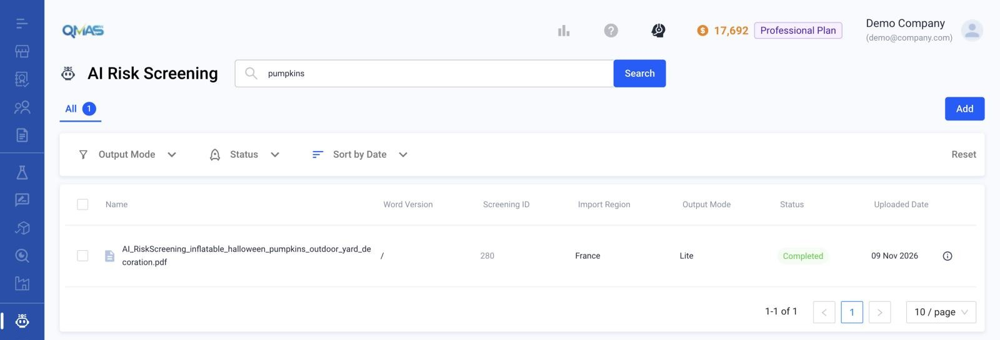
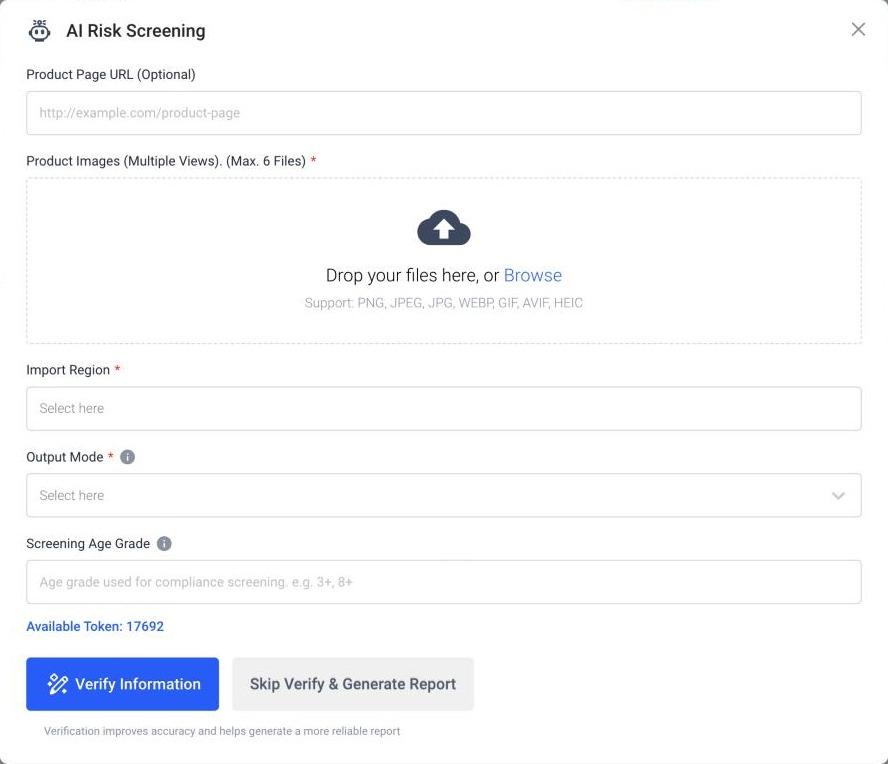

# AI Insight — Run an AI Risk Screening

Upload product photos and let AI identify compliance risks and requirements for your import region. You get a compliance guideline report (PDF).

- **Module:** AI Insight (shown as “AI Risk Screening” in the QMAS menu)
- **Start here:** https://qmas.icw.io/ai-risk-screening → **Add**, or a product profile → **AI Risk Screening** → **Add**
- **Uses:** Tokens. Your balance shows as **Available Token** in the pop-up.

## Overview

1. Open **AI Risk Screening** from the left menu (or from a product profile) and click **Add**.
2. Upload up to 6 product photos and choose the **Import Region** and **Output Mode**.
3. Click **Verify Information** (recommended) or **Skip Verify & Generate Report**.
4. When the status is **Completed**, open the report from the list.

## Step-by-step

### 1. Open AI Risk Screening

In the left menu, open **AI Risk Screening**. The list shows every screening with its import region, output mode (Full or Lite), status and upload date. Click **Add**.

The guide still files this module under AI Insight. The current screen title and address are AI Risk Screening (`/ai-risk-screening`).

*AI Risk Screening list.*

You can also start from a product: open the product profile, choose **AI Risk Screening** in its left menu, then click **Add**.

### 2. Fill in the screening

- **Product Page URL** (optional): a link to the product page.
- **Product Images** (required): up to 6 photos from different views. PNG, JPEG, JPG, WEBP, GIF, AVIF or HEIC.
- **Import Region** (required): where the product will be sold.
- **Output Mode** (required): **Full** or **Lite** report.
- **Screening Age Grade** (optional): the age grade to screen against, for example 3+ or 8+.

**Available Token** shows your balance.

*New AI Risk Screening pop-up.*

### 3. Verify and generate

Click **Verify Information** (recommended: verification improves accuracy and gives a more reliable report), or **Skip Verify & Generate Report** to go straight to the report.

The new screening appears in the list. When its status is **Completed**, the report is ready. Click the **ⓘ** icon to see the screening details.

## Tips

- Use clear photos from several angles (front, back, label, packaging) for a better result.
- Check your Available Token balance before you generate.

## FAQ

**Q: How do I run an AI risk screening / AI Insight?**

A: Go to AI Risk Screening (https://qmas.icw.io/ai-risk-screening), click Add, upload product photos, choose Import Region and Output Mode, then click Verify Information or Skip Verify & Generate Report.

**Q: Where do I see my token balance?**

A: In the AI Risk Screening pop-up, under Available Token.

**Q: What is the difference between Full and Lite?**

A: They are the two report output modes. Choose one in Output Mode when you add a screening.
