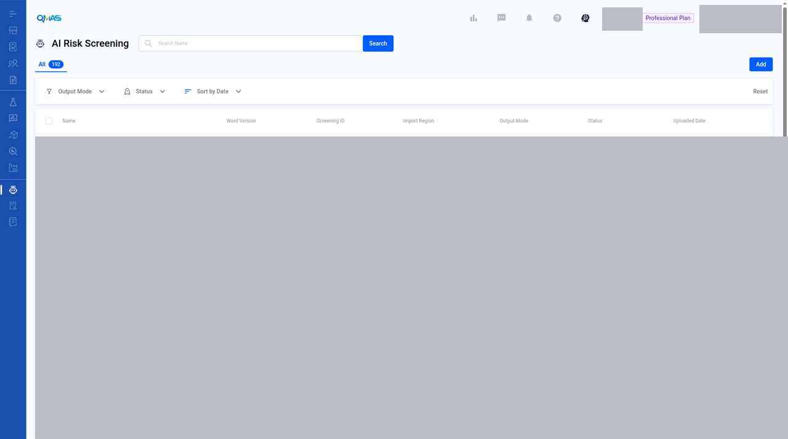
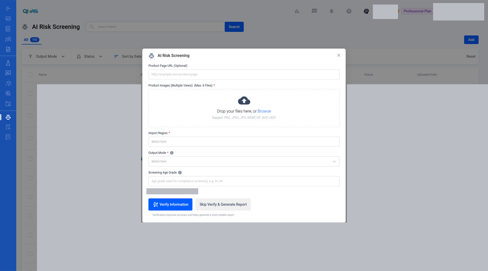

# AI Insight — Run an AI Risk Screening

> Updated working draft 2026-11-13-draft. This file is not deployed. Existing published version: https://marconip2026.github.io/qmas-user-guide/

## Source and verification

**Current UI verified.** Current UI verified for the reviewed AI Risk Screening list and the blank New AI Risk Screening dialog. There is no Help Center article for AI Insight, AI Risk Screening, or AI Assessment. No screening was run.

Do not mark this whole module unverified. A completed report and Verify Information remain gaps.

No Help Center article is the source of the steps on this page.

Help Center home: [QMAS Help Center](https://icw-io.notion.site/QMAS-Help-Center-5cd9414da2474d16a7c405a3542fe4af) (last edited 2026-01-20 13:54:13 HKT). User Guide index: [User Guide](https://app.notion.com/p/a92963a30e584145bb457a62b7706541) (last edited 2026-01-16 15:44:49 HKT). Public icw-io addresses for individual articles were not verified, so those links use app.notion.com.

Upload product photos and let AI identify compliance risks and requirements for your import region. You get a compliance guideline report (PDF).

- **Module:** AI Insight (shown as “AI Risk Screening” in the QMAS menu)
- **Start here:** https://qmas.icw.io/ai-risk-screening → **Add**, or a product profile → **AI Risk Screening** → **Add**
- **Uses:** Tokens. Your balance shows as **Available Token** in the pop-up.
- **Checked against:** QMAS dev, 4 Nov 2026

## Overview

1. Open **AI Risk Screening** from the left menu (or from a product profile) and click **Add**.
2. Upload up to 6 product photos and choose the **Import Region** and **Output Mode**.
3. Click **Verify Information** (recommended) or **Skip Verify & Generate Report**.
4. When the status is **Completed**, open the report from the list.

## Step-by-step

### 1. Open AI Risk Screening

In the left menu, open **AI Risk Screening**. The list shows every screening with its import region, output mode (Full or Lite), status and upload date. Click **Add**.

The guide still files this module under AI Insight. The current screen title and address are AI Risk Screening (`/ai-risk-screening`).

*AI Risk Screening list.*

Current UI name is AI Risk Screening. Search, the All tab, filters and Add are visible. List rows are masked. No screening was run. This is a 1280×800 desktop crop (1280×714), not a high-resolution screenshot.

You can also start from a product: open the product profile, choose **AI Risk Screening** in its left menu, then click **Add**.

> **Image pending privacy review:** `04-product-profile-entry.jpg`
>
> Reviewed replacement image not available yet. Follow the written steps above.

*AI Risk Screening inside a product profile.*

### 2. Fill in the screening

- **Product Page URL** (optional): a link to the product page.
- **Product Images** (required): up to 6 photos from different views. PNG, JPEG, JPG, WEBP, GIF, AVIF or HEIC.
- **Import Region** (required): where the product will be sold.
- **Output Mode** (required): **Full** or **Lite** report.
- **Screening Age Grade** (optional): the age grade to screen against, for example 3+ or 8+.

**Available Token** shows your balance. The number in this screenshot is redacted.

The reviewed pop-up is blank. Product Page URL is only the placeholder, no images are uploaded, and Import Region, Output Mode and Screening Age Grade are empty. Verify Information and Skip Verify & Generate Report are visible and were not used. No report was generated.

*New AI Risk Screening pop-up.*

Dialog title is AI Risk Screening. Blank form only. No photos uploaded and neither action button was used.

### 3. Verify and generate

Click **Verify Information** (recommended: verification improves accuracy and gives a more reliable report), or **Skip Verify & Generate Report** to go straight to the report.

The new screening appears in the list. When its status is **Completed**, the report is ready. Click the **ⓘ** icon to see the screening details.

> **Image pending privacy review:** `03-screening-details.jpg`
>
> Reviewed replacement image not available yet. Follow the written steps above.

*Screening details: product name, import region, age grade, categories, materials, battery/AC/food-contact flags and output mode.*

## Tips

- Use clear photos from several angles (front, back, label, packaging) for a better result.
- Check your Available Token balance before you generate.

## FAQ

**Q: How do I run an AI risk screening / AI Insight?**

A: Go to AI Risk Screening (https://qmas.icw.io/ai-risk-screening), click Add, upload product photos, choose Import Region and Output Mode, then click Verify Information or Skip Verify & Generate Report.

**Q: Where do I see my token balance?**

A: In the AI Risk Screening pop-up, under Available Token.

**Q: What is the difference between Full and Lite?**

A: They are the two report output modes. Choose one in Output Mode when you add a screening.

## Help Center additions and remaining gaps

This section adds Help Center material and named gaps. It does not replace the steps above.

- **Source-documented** — written in the original Help Center. The last-edited date is given. That does not by itself prove the current QMAS UI.
- **Dev-verified** — confirmed on qmas-dev.icw.io during guide work.
- **Gap** — named as missing or too thin. Not current behaviour until checked on dev.

Reviewed screenshots remain 56 of 98. Forty-two inventory slots are still pending. Six supplementary images are not part of the 98. Unreviewed screenshots were not copied.

### Help Center finding

There is no Help Center article for AI Insight, AI Risk Screening, or AI Assessment.

### Remaining gaps

- Completed report: open it, download the PDF, and what Full versus Lite actually contain.
- **Verify Information** intermediate UI. It is the recommended path and is not shown.
- Empty state. A wrong empty-state description is a filed bug. Wait for the fixed UI.
- Naming is still undecided: this guide title **AI Insight**, menu **AI Risk Screening**, Home **AI Assessment** and **AI Insight**.
- Token spend: the guide already warns. Do not run a screening unless asked.

Help Center reconciliation 2026-11-13 (HKT). Original Help Center not edited. This draft is not the public guide. No Dify upload.
