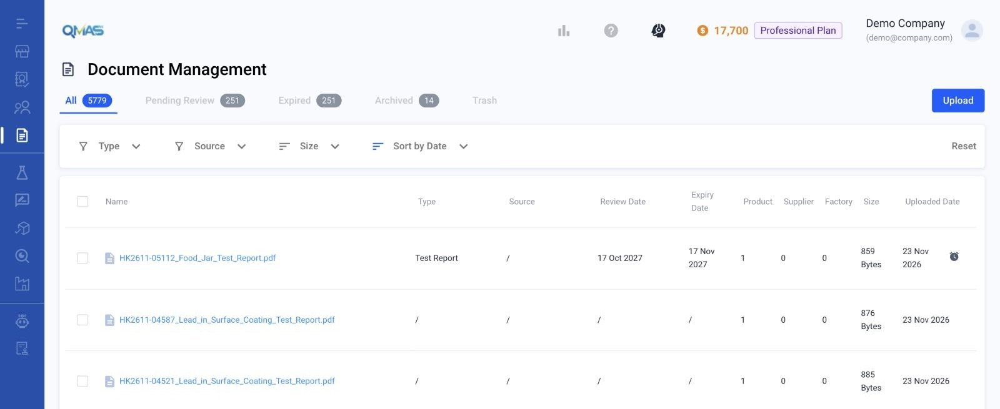

# Document Management — Upload a Document

Upload a compliance document, link it to products, suppliers or factories, set its dates and reminders, and add compliance data.

- **Module:** Document Management
- **Start here:** https://qmas.icw.io/document-management → **Upload**
- **Pop-up tabs:** Save To → Dates & Reminder → Compliance Data → Confirm

## Overview

1. Open **Document Management** and click **Upload**, then choose one or more files from your computer.
2. In **Upload Document**, choose the document **Type**.
3. **Save To**: link the document to suppliers, factories or products.
4. **Dates & Reminder**: set issue, expiry and review dates and an email reminder.
5. **Compliance Data**: add test data, certificate data or other data. Click **Confirm**.

## Step-by-step

### 1. Open Document Management

In the left menu, open **Document Management**. The tabs show **All**, **Pending Review**, **Expired**, **Archived** and **Trash** documents. Click **Upload** at the top right and choose your file.

*Document Management list with the Upload button.*

### 2. Choose the document type

The **Upload Document** pop-up shows the file name. Click the pencil icon to rename it. Under **Type**, type or select a document type, for example **Test Report**.

### 3. Save To — link the document

On the **Save To** tab, click **Add Supplier**, **Add Factory** or **Add Product**. Select the items in the pop-up and click **Confirm**. A document can be linked to several items. Click **Remove** to unlink one.

### 4. Dates & Reminder

Set the **Issue Date**, **Expiry Date** and **Review Date**. Under **Email Reminder**, choose **On Expiry Date**, **On Review Date** or **Custom** to get an email reminder. Use **Clear All Settings** to start again.

### 5. Compliance Data

Click **Edit** next to **Test Data**, **Certificate Data** or **Other** to record the details from the document, such as test items and results or certificate numbers.

### 6. Confirm

Click **Confirm**. QMAS shows a success message and the document appears at the top of the list, with its type and the number of linked products, suppliers and factories.

## Tips

- Set an expiry date and reminder for certificates and test reports so you know before they expire.
- You can also upload documents from a product, supplier or factory profile.

## FAQ

**Q: How do I upload a document?**

A: Go to Document Management (https://qmas.icw.io/document-management), click Upload, choose the file, set the Type, link it under Save To, then click Confirm.

**Q: How do I get a reminder before a document expires?**

A: In the Upload Document pop-up, open Dates & Reminder, set the Expiry Date, then choose an Email Reminder option.

**Q: Where can I see expired documents?**

A: Open the Expired tab in Document Management.
