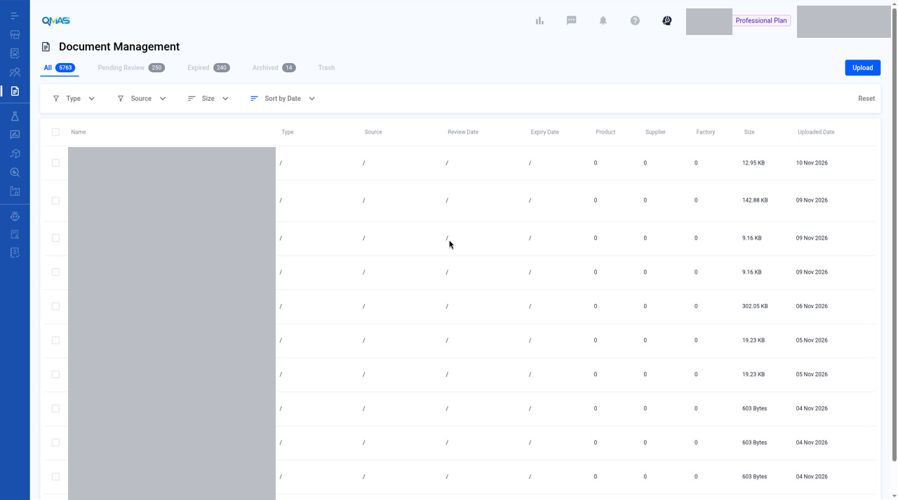

# Document Management — Upload a Document

> Updated working draft 2026-11-13-draft. This file is not deployed. Existing published version: https://marconip2026.github.io/qmas-user-guide/

## Source and verification

**Current UI verified.** Current UI verified for the reviewed list screenshot. There is no Help Center article for this module. Product Profile document steps are a different page.

Do not mark this whole module unverified. Pending upload slots and the lifecycle tabs remain gaps.

No Help Center article is the source of the steps on this page.

Help Center home: [QMAS Help Center](https://icw-io.notion.site/QMAS-Help-Center-5cd9414da2474d16a7c405a3542fe4af) (last edited 2026-01-20 13:54:13 HKT). User Guide index: [User Guide](https://app.notion.com/p/a92963a30e584145bb457a62b7706541) (last edited 2026-01-16 15:44:49 HKT). Public icw-io addresses for individual articles were not verified, so those links use app.notion.com.

Upload a compliance document, link it to products, suppliers or factories, set its dates and reminders, and add compliance data.

- **Module:** Document Management
- **Start here:** https://qmas.icw.io/document-management → **Upload**
- **Pop-up tabs:** Save To → Dates & Reminder → Compliance Data → Confirm
- **Checked against:** QMAS dev, 4 Nov 2026

## Overview

1. Open **Document Management** and click **Upload**, then choose one or more files from your computer.
2. In **Upload Document**, choose the document **Type**.
3. **Save To**: link the document to suppliers, factories or products.
4. **Dates & Reminder**: set issue, expiry and review dates and an email reminder.
5. **Compliance Data**: add test data, certificate data or other data. Click **Confirm**.

## Step-by-step

### 1. Open Document Management

In the left menu, open **Document Management**. The tabs show **All**, **Pending Review**, **Expired**, **Archived** and **Trash** documents. Click **Upload** at the top right and choose your file.

*Document Management list with the Upload button.*

File names in this screenshot are masked. Tabs, column headers, and Upload stay visible.

### 2. Choose the document type

The **Upload Document** pop-up shows the file name. Click the pencil icon to rename it. Under **Type**, type or select a document type, for example **Test Report**.

> **Image pending privacy review:** `02-upload-modal.jpg`
>
> Reviewed replacement image not available yet. Follow the written steps above.

*Upload Document pop-up.*

### 3. Save To — link the document

On the **Save To** tab, click **Add Supplier**, **Add Factory** or **Add Product**. Select the items in the pop-up and click **Confirm**. A document can be linked to several items. Click **Remove** to unlink one.

> **Image pending privacy review:** `03-save-to.jpg`
>
> Reviewed replacement image not available yet. Follow the written steps above.

*The document linked to a product.*

### 4. Dates & Reminder

Set the **Issue Date**, **Expiry Date** and **Review Date**. Under **Email Reminder**, choose **On Expiry Date**, **On Review Date** or **Custom** to get an email reminder. Use **Clear All Settings** to start again.

> **Image pending privacy review:** `04-dates-reminder.jpg`
>
> Reviewed replacement image not available yet. Follow the written steps above.

*Dates & Reminder tab.*

### 5. Compliance Data

Click **Edit** next to **Test Data**, **Certificate Data** or **Other** to record the details from the document, such as test items and results or certificate numbers.

> **Image pending privacy review:** `05-compliance-data.jpg`
>
> Reviewed replacement image not available yet. Follow the written steps above.

*Compliance Data tab.*

### 6. Confirm

Click **Confirm**. QMAS shows a success message and the document appears at the top of the list, with its type and the number of linked products, suppliers and factories.

> **Image pending privacy review:** `06-uploaded.jpg`
>
> Reviewed replacement image not available yet. Follow the written steps above.

*The uploaded document at the top of the list.*

## Tips

- Set an expiry date and reminder for certificates and test reports so you know before they expire.
- You can also upload documents from a product, supplier or factory profile.

## FAQ

**Q: How do I upload a document?**

A: Go to Document Management (https://qmas.icw.io/document-management), click Upload, choose the file, set the Type, link it under Save To, then click Confirm.

**Q: How do I get a reminder before a document expires?**

A: In the Upload Document pop-up, open Dates & Reminder, set the Expiry Date, then choose an Email Reminder option.

**Q: Where can I see expired documents?**

A: Open the Expired tab in Document Management.

## Help Center additions and remaining gaps

This section adds Help Center material and named gaps. It does not replace the steps above.

- **Source-documented** — written in the original Help Center. The last-edited date is given. That does not by itself prove the current QMAS UI.
- **Dev-verified** — confirmed on qmas-dev.icw.io during guide work.
- **Gap** — named as missing or too thin. Not current behaviour until checked on dev.

Reviewed screenshots remain 56 of 98. Forty-two inventory slots are still pending. Six supplementary images are not part of the 98. Unreviewed screenshots were not copied.

### Help Center finding

There is no Help Center article for the Document Management module.

Upload, folders, share, and **Set Reminder** in the Product Information Pack are written against the product profile Document tab, not this module. See the [Product Profile](product-profile.md) page. Do not copy those steps here as if they were Document Management module steps.

### Remaining gaps

- Workflows for **Pending Review**, **Expired**, **Archived**, and **Trash**.
- Post-upload row toolbar (share, archive, download, rename, move). Needs a dev check on this module.
- Filters, search, and Export.
- Edit dates, reminder, or compliance after upload.
- The upload toast “Upload Document Succeed” is a filed bug. Keep neutral “success message” language until the UI is fixed.

Help Center reconciliation 2026-11-13 (HKT). Original Help Center not edited. This draft is not the public guide. No Dify upload.
