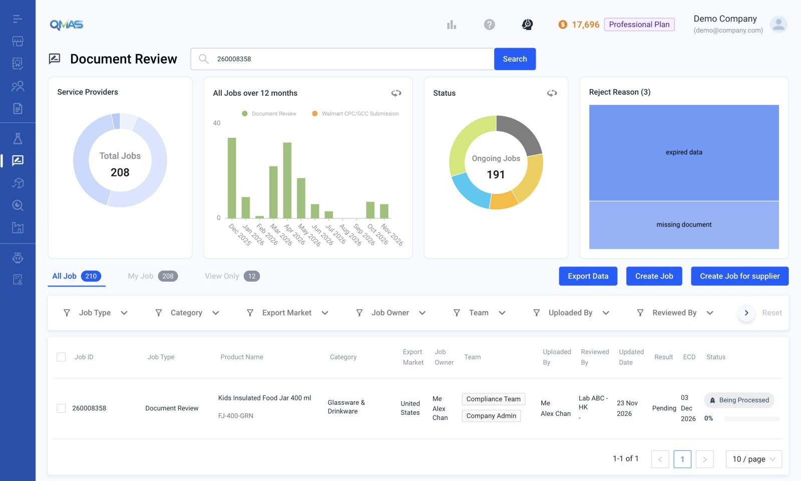
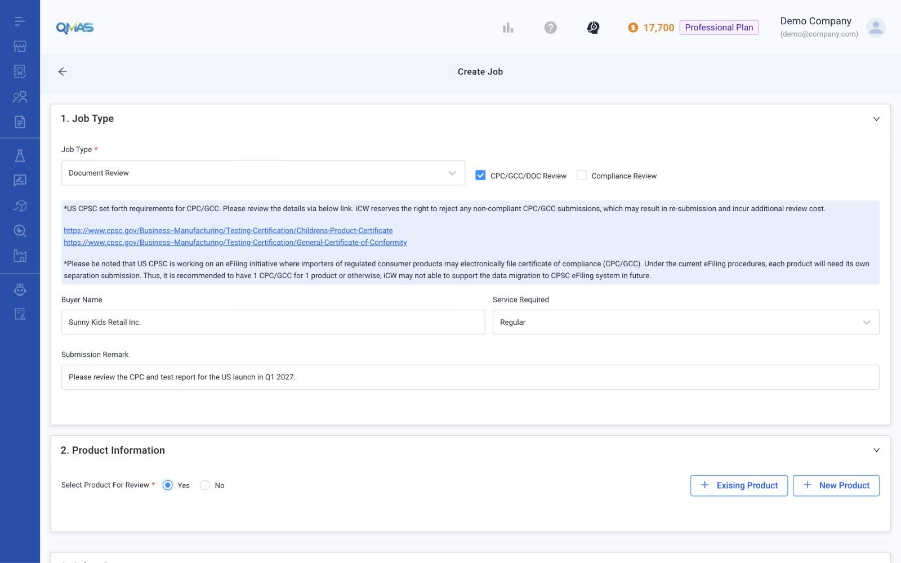
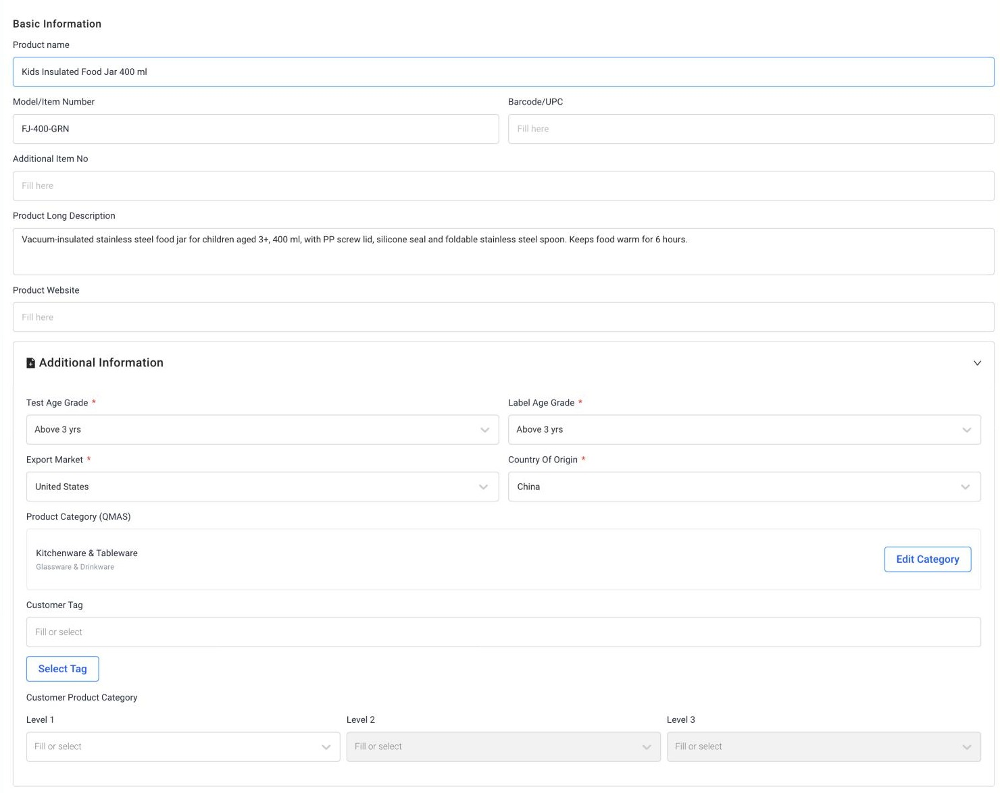
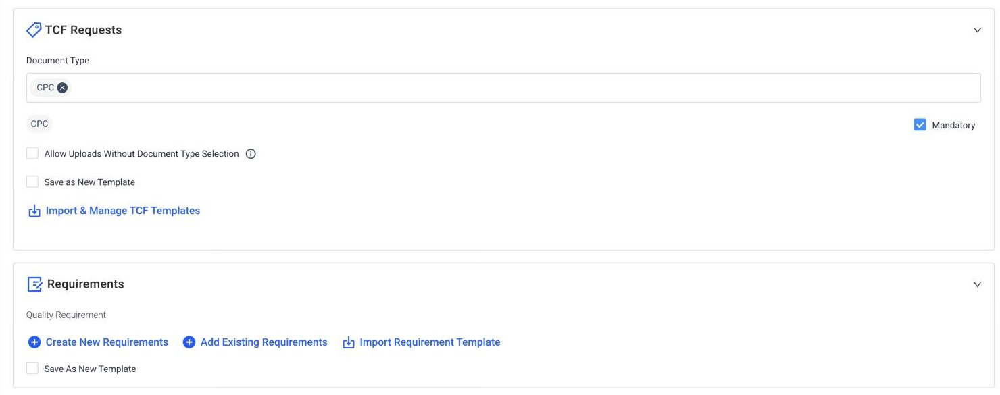
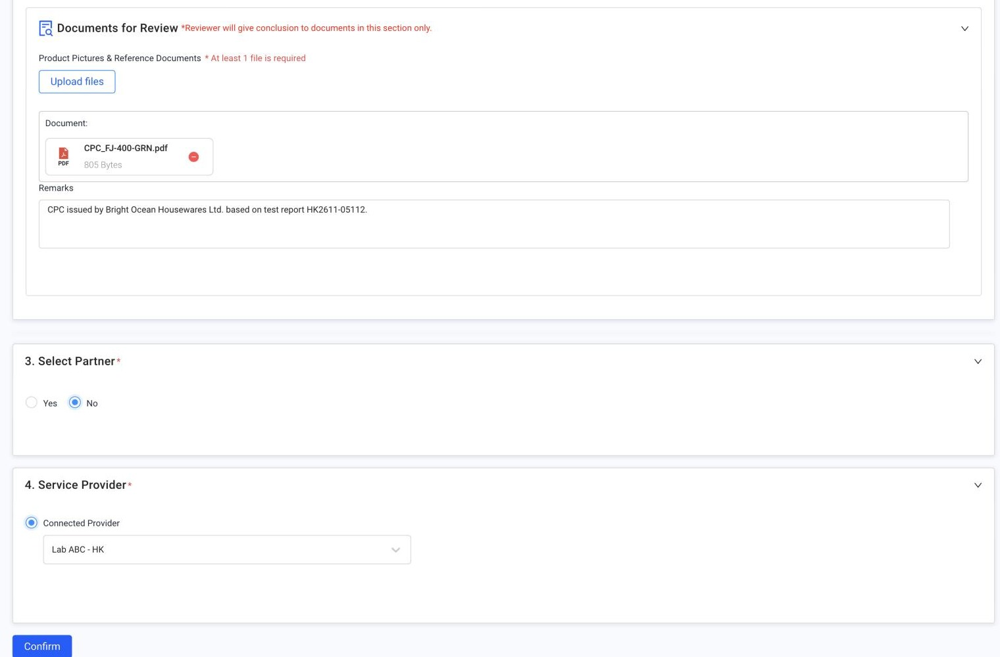
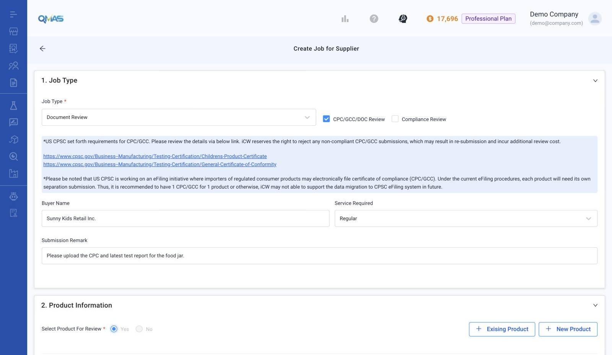
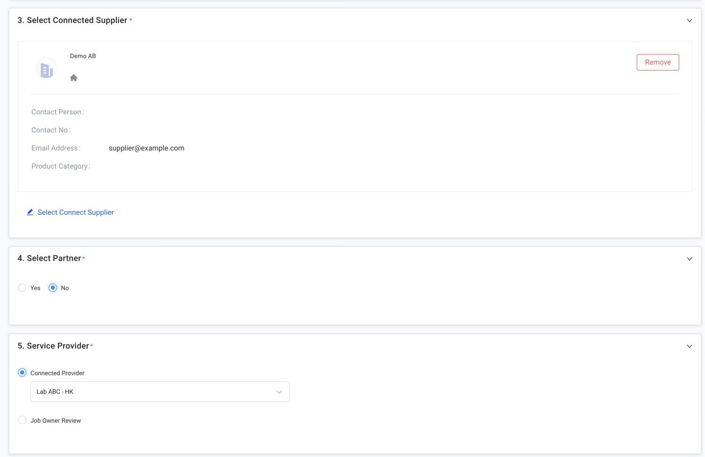

# Document Review — Create a Review Job

Get compliance documents (CPC, GCC, DoC, test reports, TCF) reviewed by a lab or by yourself, whether you upload them or your supplier does.

- **Module:** Document Review
- **Start here:** https://qmas.icw.io/document-review → **Create Job** or **Create Job for supplier**
- **Direct links:** You upload: https://qmas.icw.io/document-review/upload-document/create · Supplier uploads: https://qmas.icw.io/document-review/upload-document/request

## Overview

1. Choose the flow that fits (table below).
2. Fill in **Job Type**, **Product Information** and the documents to review.
3. For a supplier job, choose the **connected supplier** who will upload.
4. Choose a **partner** (optional) and the **Service Provider**: a connected lab, or **Job Owner Review** to review yourself.
5. Click **Confirm**. Follow the status on the Document Review list until the review is concluded.

## Step-by-step

### 1. Choose your flow

| Flow | Button | Who uploads | Who reviews |
|---|---|---|---|
| A. Upload for lab review | Create Job | You | Connected lab |
| B. Supplier uploads for lab review | Create Job for supplier | Your connected supplier | Connected lab (Connected Provider) |
| C. Supplier uploads for your own review | Create Job for supplier | Your connected supplier | You (Job Owner Review) |

In the left menu, open **Document Review**. The dashboard shows service providers, jobs over 12 months, status and reject reasons. The tabs **All Job**, **My Job** and **View Only** list the jobs.

*Document Review with Create Job and Create Job for supplier.*

### 2. Job Type

Choose the **Job Type** (for example Document Review) and tick **CPC/GCC/DOC Review** and/or **Compliance Review**. Optionally fill in **Buyer Name**, **Service Required** (Regular by default) and **Submission Remark**.

*Create Job — 1. Job Type and 2. Product Information.*

### 3. Product Information

Keep **Select Product For Review = Yes**. Click **Existing Product** to pick products, or **New Product** to create one. For each product, check the **Basic Information**, then fill in **Additional Information**: Test Age Grade, Label Age Grade, Export Market and Country Of Origin are required.

*Basic Information and Additional Information for the selected product.*

Below that you can add **PO Information**, upload **Product Pictures & Reference Documents**, set the **TCF Requests** (choose document types or import a TCF template) and add **Quality Requirements**.

*TCF Requests and Requirements.*

### 4. Documents for Review, partner and provider (Flow A)

Under **Documents for Review**, click **Upload files** (at least one file is required). The reviewer gives a conclusion only on documents in this section.

**Select Partner** (optional): choose Yes to let one partner view the job.

**Service Provider**: choose the connected lab under **Connected Provider**. Click **Confirm**.

*Documents for Review, Select Partner and Service Provider.*

### 5. Create Job for supplier (Flows B and C)

Click **Create Job for supplier**. Fill in Job Type and Product Information as above. Then:

- **Select Connected Supplier**: choose the supplier who will upload. Only suppliers connected with you on QMAS are listed. See Supplier Management → Invite Supplier.
- **Select Partner** (optional).
- **Service Provider**: choose **Connected Provider** and a lab for Flow B, or **Job Owner Review** for Flow C.
- Click **Confirm**. The supplier gets a notification to upload the documents.

*Create Job for Supplier.*

*Select Connected Supplier, Select Partner and Service Provider (Connected Provider or Job Owner Review).*

### 6. Follow the review

- Flow A and B: the job shows **Being Processed** while the lab reviews. The lab concludes each document as **Approve**, **Reject** or **Waiting for Additional Information**.
- Flow C: when the supplier has uploaded, open the job, click **View detail**, and conclude each document yourself with **Approve**, **Reject**, **N/A** or **Waiting for additional information**. Click **Confirm**.
- If a document is rejected or more information is needed, read the comment and upload a corrected file.
- When all documents are approved, complete the job.

## Tips

- Flows B and C need a connected supplier. Invite the supplier first from Supplier / Factory Management → Invite Supplier.
- Save a TCF document-type list as a template so you can reuse it in the next job.

## FAQ

**Q: How do I send documents to a lab for review?**

A: Go to Document Review (https://qmas.icw.io/document-review), click Create Job, fill in Job Type and Product Information, upload files under Documents for Review, choose the lab under Service Provider, and click Confirm.

**Q: How do I ask my supplier to upload documents for review?**

A: Click Create Job for supplier on Document Review, choose the connected supplier, then choose Connected Provider (lab review) or Job Owner Review (you review) and click Confirm.

**Q: What does Job Owner Review mean?**

A: You review the supplier's documents yourself instead of a lab.

**Q: Why can't I find my supplier in Select Connected Supplier?**

A: Only suppliers connected with you on QMAS are listed. Invite them from Supplier / Factory Management → Invite Supplier.
