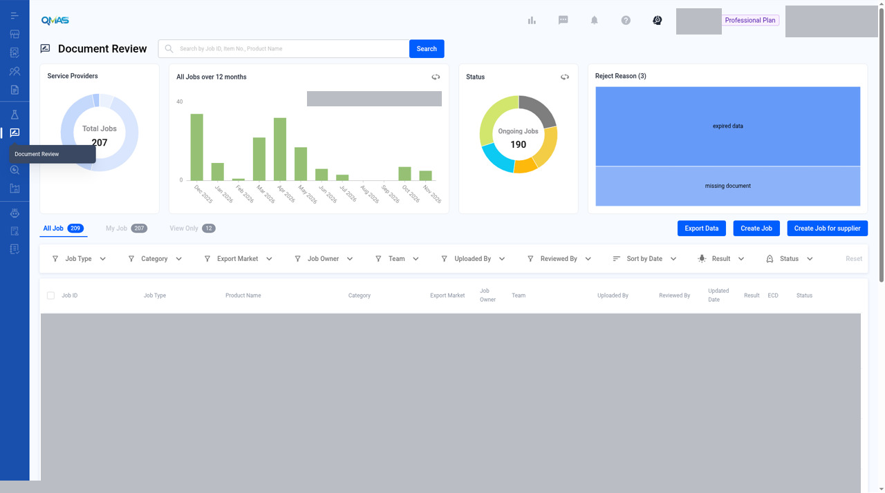
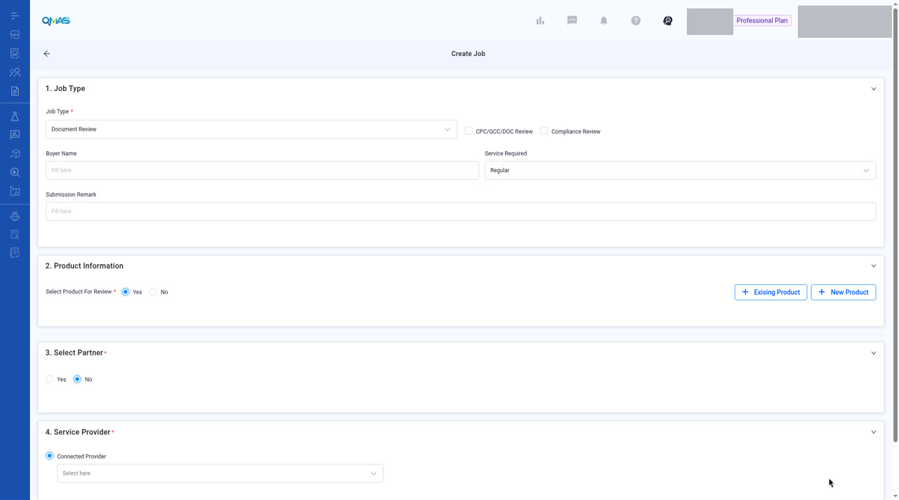
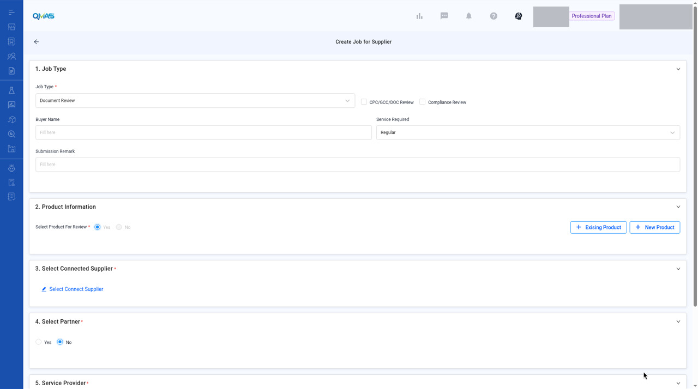

# Document Review — Create a Review Job

> Updated working draft 2026-11-13-draft. This file is not deployed. Existing published version: https://marconip2026.github.io/qmas-user-guide/

## Source and verification

**Mixed.** The reviewed list and blank create-job screens are current UI verified. There is no Document Review Help Center article. The supplier article only says a connected supplier can be assigned Document Review jobs, and that mention is source-only.

Do not mark this whole module unverified. Approve, reject, and resubmit remain gaps. Source: QMAS Help Center — Manage your QMAS Supplier Compliance Profile, last edited 2026-01-16 15:38:01 HKT, for the invite mention only.

- [Manage your QMAS Supplier Compliance Profile](https://app.notion.com/p/aa532b63c9554db99b57676ee83d489c) (last edited 2026-01-16 15:38:01 HKT). Invite and connection mention only. It does not describe how to conclude a review job.

Help Center home: [QMAS Help Center](https://icw-io.notion.site/QMAS-Help-Center-5cd9414da2474d16a7c405a3542fe4af) (last edited 2026-01-20 13:54:13 HKT). User Guide index: [User Guide](https://app.notion.com/p/a92963a30e584145bb457a62b7706541) (last edited 2026-01-16 15:44:49 HKT). Public icw-io addresses for individual articles were not verified, so those links use app.notion.com.

Get compliance documents (CPC, GCC, DoC, test reports, TCF) reviewed by a lab or by yourself, whether you upload them or your supplier does.

- **Module:** Document Review
- **Start here:** https://qmas.icw.io/document-review → **Create Job** or **Create Job for supplier**
- **Direct links:** You upload: https://qmas.icw.io/document-review/upload-document/create · Supplier uploads: https://qmas.icw.io/document-review/upload-document/request
- **Checked against:** QMAS dev, 4 Nov 2026

## Overview

1. Choose the flow that fits (table below).
2. Fill in **Job Type**, **Product Information** and the documents to review.
3. For a supplier job, choose the **connected supplier** who will upload.
4. Choose a **partner** (optional) and the **Service Provider**: a connected lab, or **Job Owner Review** to review yourself.
5. Click **Confirm**. Follow the status on the Document Review list until the review is concluded.

## Step-by-step

### 1. Choose your flow

| Flow | Button | Who uploads | Who reviews |
|---|---|---|---|
| A. Upload for lab review | Create Job | You | Connected lab |
| B. Supplier uploads for lab review | Create Job for supplier | Your connected supplier | Connected lab (Connected Provider) |
| C. Supplier uploads for your own review | Create Job for supplier | Your connected supplier | You (Job Owner Review) |

In the left menu, open **Document Review**. The dashboard shows service providers, jobs over 12 months, status and reject reasons. The tabs **All Job**, **My Job** and **View Only** list the jobs.

*Document Review with Create Job and Create Job for supplier.*

### 2. Job Type

Choose the **Job Type** (for example Document Review) and tick **CPC/GCC/DOC Review** and/or **Compliance Review**. Optionally fill in **Buyer Name**, **Service Required** (Regular by default) and **Submission Remark**. The screenshot shows this form at those defaults, before a review type is ticked or a product is added. It is not a submitted job.

*Create Job — 1. Job Type and 2. Product Information.*

Blank/default form, not a submitted job. Job Type shows the Document Review default and Service Required shows Regular. Sections 3 and 4 are also in view. The account header was redacted.

### 3. Product Information

Keep **Select Product For Review = Yes**. Click **Existing Product** to pick products, or **New Product** to create one. For each product, check the **Basic Information**, then fill in **Additional Information**: Test Age Grade, Label Age Grade, Export Market and Country Of Origin are required.

> **Image pending privacy review:** `03-product-info.jpg`
>
> Reviewed replacement image not available yet. Follow the written steps above.

*Basic Information and Additional Information for the selected product.*

Below that you can add **PO Information**, upload **Product Pictures & Reference Documents**, set the **TCF Requests** (choose document types or import a TCF template) and add **Quality Requirements**.

> **Image pending privacy review:** `04-tcf-requirements.jpg`
>
> Reviewed replacement image not available yet. Follow the written steps above.

*TCF Requests and Requirements.*

### 4. Documents for Review, partner and provider (Flow A)

Under **Documents for Review**, click **Upload files** (at least one file is required). The reviewer gives a conclusion only on documents in this section.

**Select Partner** (optional): choose Yes to let one partner view the job.

**Service Provider**: choose the connected lab under **Connected Provider**. Click **Confirm**.

> **Image pending privacy review:** `05-docs-partner-provider.jpg`
>
> Reviewed replacement image not available yet. Follow the written steps above.

*Documents for Review, Select Partner and Service Provider.*

### 5. Create Job for supplier (Flows B and C)

Click **Create Job for supplier**. Fill in Job Type and Product Information as above. Then:

The screenshot is the default form: no supplier is selected, and section 5 is clipped at the bottom.

- **Select Connected Supplier**: choose the supplier who will upload. Only suppliers connected with you on QMAS are listed. See Supplier Management → Invite Supplier.
- **Select Partner** (optional).
- **Service Provider**: choose **Connected Provider** and a lab for Flow B, or **Job Owner Review** for Flow C.
- Click **Confirm**. The supplier gets a notification to upload the documents.

*Create Job for Supplier.*

Blank/default form, not a submitted job. Sections 1–5 are in view and section 5 is clipped at the bottom. No supplier is selected. The account header was redacted.

> **Image pending privacy review:** `07-supplier-job-provider.jpg`
>
> Reviewed replacement image not available yet. Follow the written steps above.

*Select Connected Supplier, Select Partner and Service Provider (Connected Provider or Job Owner Review).*

### 6. Follow the review

- Flow A and B: the job shows **Being Processed** while the lab reviews. The lab concludes each document as **Approve**, **Reject** or **Waiting for Additional Information**.
- Flow C: when the supplier has uploaded, open the job, click **View detail**, and conclude each document yourself with **Approve**, **Reject**, **N/A** or **Waiting for additional information**. Click **Confirm**.
- If a document is rejected or more information is needed, read the comment and upload a corrected file.
- When all documents are approved, complete the job.

## Tips

- Flows B and C need a connected supplier. Invite the supplier first from Supplier / Factory Management → Invite Supplier.
- Save a TCF document-type list as a template so you can reuse it in the next job.

## FAQ

**Q: How do I send documents to a lab for review?**

A: Go to Document Review (https://qmas.icw.io/document-review), click Create Job, fill in Job Type and Product Information, upload files under Documents for Review, choose the lab under Service Provider, and click Confirm.

**Q: How do I ask my supplier to upload documents for review?**

A: Click Create Job for supplier on Document Review, choose the connected supplier, then choose Connected Provider (lab review) or Job Owner Review (you review) and click Confirm.

**Q: What does Job Owner Review mean?**

A: You review the supplier's documents yourself instead of a lab.

**Q: Why can't I find my supplier in Select Connected Supplier?**

A: Only suppliers connected with you on QMAS are listed. Invite them from Supplier / Factory Management → Invite Supplier.

## Help Center additions and remaining gaps

This section adds Help Center material and named gaps. It does not replace the steps above.

- **Source-documented** — written in the original Help Center. The last-edited date is given. That does not by itself prove the current QMAS UI.
- **Dev-verified** — confirmed on qmas-dev.icw.io during guide work.
- **Gap** — named as missing or too thin. Not current behaviour until checked on dev.

Reviewed screenshots remain 56 of 98. Forty-two inventory slots are still pending. Six supplementary images are not part of the 98. Unreviewed screenshots were not copied.

### Help Center finding

There is no Document Review Help Center article.

The only related Help Center text is on the supplier profile article (last edited 2026-01-16): inviting or connecting a supplier “allows you to assign Document Review jobs to your connected suppliers.” Statuses Invite, No Connection, and Connected are documented there. That text does not describe how to conclude a review job.

### Remaining gaps

- Job detail after create: View detail, conclusion controls (the steps above name Approve, Reject, N/A, and Waiting), and re-upload after reject. Zero screenshots.
- List filters, Export, and My Job versus View Only.
- Save or reuse a TCF template (tip only today).
- The Quality Requirements block on the create form is thin.
- Filed typos (“Exising Product”, “JEPG”, “Select Connect Supplier”). This guide uses corrected English. Confirm the live UI.

Help Center reconciliation 2026-11-13 (HKT). Original Help Center not edited. This draft is not the public guide. No Dify upload.
