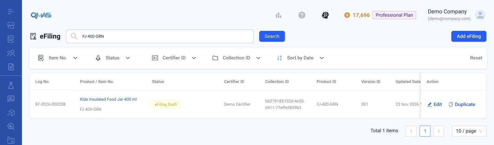
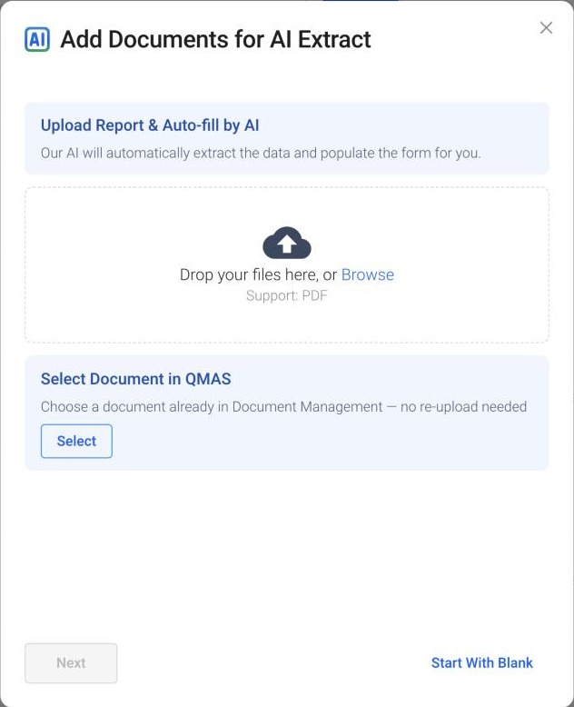

# eFiling — Submit eFiling to CPSC

Create and submit CPSC eFiling certificates for your products, with AI that can fill the form from your test report.

- **Module:** eFiling
- **Start here:** https://qmas.icw.io/efiling → **Add eFiling**
- **Before you start:** Set up your CPSC Certifier ID and API keys in Company Profile → **CPSC eFiling - Certifier ID**.

## Overview

1. Make sure your CPSC Certifier ID is set up in Company Profile.
2. Open **eFiling** and click **Add eFiling**.
3. Upload a report for **AI Extract**, select a document already in QMAS, or **Start With Blank**.
4. In **Quick Select eFiling Information**, check the Certifier ID and products, then click **Next**.
5. Complete the **eFiling Submission** form, then **Save Draft** or **Preview to Submit**.

## Step-by-step

### 1. Open eFiling

In the left menu, open **eFiling**. The list shows each eFiling with its log no., product, status, certifier ID, collection ID, product ID and version ID. Use **View** to open one or **Duplicate** to start a new version from it. Click **Add eFiling**.

*eFiling list.*

### 2. Add documents for AI Extract

- **Upload Report & Auto-fill by AI**: drop a PDF test report. AI extracts the data and fills the form.
- **Select Document in QMAS**: choose a document already in Document Management, with no re-upload.
- **Start With Blank**: fill the form yourself.

The reviewed dialog is blank. No report was uploaded and no extraction was run. Next is disabled. Start With Blank is visible and was not used.

*Add Documents for AI Extract.*

### 3. Quick Select eFiling Information

Choose the **CPSC Certifier ID** and check the products to include. Click **Next**.

### 4. eFiling Submission form

Fill in **eFiling Information** (Certifier ID, collection, point of contact) and **Product Detail**. Use **Link To QMAS Product** to connect the form to a product, or tick **Create As New Product**. Use **+ Add Product** at the top for a multi-product submission.

Then complete the remaining sections (lab, citations and exclusions). Click **Save Draft** to finish later, or **Preview to Submit** to check and send to CPSC.

If you close the form without saving, QMAS asks you to confirm. Unsaved values are lost. Saved drafts stay in the eFiling list.

## Tips

- AI Extract works best with a clear PDF test report.
- Within 48 hours you can resubmit with the same Version ID to overwrite. After that, use a new Version ID.

## FAQ

**Q: How do I submit eFiling to CPSC?**

A: Go to eFiling (https://qmas.icw.io/efiling), click Add eFiling, upload a report for AI Extract or Start With Blank, check the Quick Select information, complete the eFiling Submission form, then Preview to Submit.

**Q: Where do I set up my CPSC API key?**

A: Settings (avatar / account control) → Company Profile → CPSC eFiling - Certifier ID.

**Q: Can AI fill in the eFiling form?**

A: Yes. In Add eFiling, upload a PDF report under Upload Report & Auto-fill by AI.
