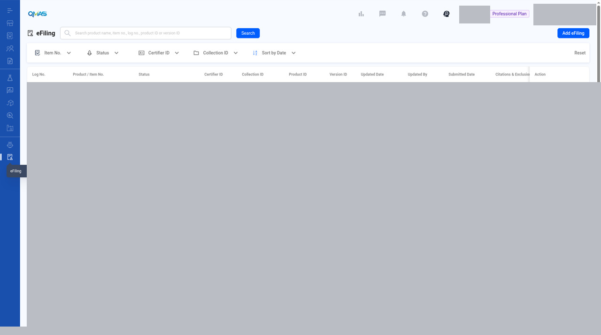
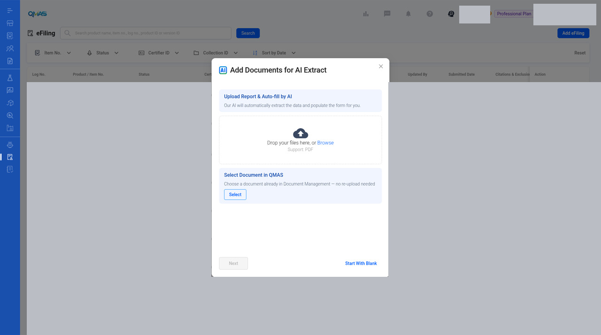

# eFiling — Submit eFiling to CPSC

> Published QMAS User Guide.

## Source and verification

**Current UI verified.** Current UI verified for the reviewed list and the blank Add Documents for AI Extract dialog. There is no Help Center user-guide article for these steps. This page does not submit a certificate to CPSC.

Do not mark this whole module unverified. The pack checklist link to an internal Documents page is not a Help Center source. Preview, submit, draft, and duplicate remain gaps.

No Help Center article is the source of the steps on this page.

Help Center home: [QMAS Help Center](https://icw-io.notion.site/QMAS-Help-Center-5cd9414da2474d16a7c405a3542fe4af) (last edited 2026-01-20 13:54:13 HKT). User Guide index: [User Guide](https://app.notion.com/p/a92963a30e584145bb457a62b7706541) (last edited 2026-01-16 15:44:49 HKT). Public icw-io addresses for individual articles were not verified, so those links use app.notion.com.

Create and submit CPSC eFiling certificates for your products, with AI that can fill the form from your test report.

- **Module:** eFiling
- **Start here:** https://qmas.icw.io/efiling → **Add eFiling**
- **Before you start:** Set up your CPSC Certifier ID and API keys in Company Profile → **CPSC eFiling - Certifier ID**.
- **Checked against:** QMAS dev, 4 Nov 2026

## Overview

1. Make sure your CPSC Certifier ID is set up in Company Profile.
2. Open **eFiling** and click **Add eFiling**.
3. Upload a report for **AI Extract**, select a document already in QMAS, or **Start With Blank**.
4. In **Quick Select eFiling Information**, check the Certifier ID and products, then click **Next**.
5. Complete the **eFiling Submission** form, then **Save Draft** or **Preview to Submit**.

## Step-by-step

### 1. Open eFiling

In the left menu, open **eFiling**. The list shows each eFiling with its log no., product, status, certifier ID, collection ID, product ID and version ID. Use **View** to open one or **Duplicate** to start a new version from it. Click **Add eFiling**.

*eFiling list.*

Add eFiling is visible. List rows are masked. This is a 1280×800 desktop crop (1280×714), not a high-resolution screenshot.

### 2. Add documents for AI Extract

- **Upload Report & Auto-fill by AI**: drop a PDF test report. AI extracts the data and fills the form.
- **Select Document in QMAS**: choose a document already in Document Management, with no re-upload.
- **Start With Blank**: fill the form yourself.

The reviewed dialog is blank. No report was uploaded and no extraction was run. Next is disabled. Start With Blank is visible and was not used.

*Add Documents for AI Extract.*

Blank dialog. Upload Report & Auto-fill by AI and Select Document in QMAS are shown. No file, no extraction, and no submission.

### 3. Quick Select eFiling Information

Choose the **CPSC Certifier ID** and check the products to include. Click **Next**.

> **Image pending privacy review:** `03-quick-select.jpg`
>
> Reviewed replacement image not available yet. Follow the written steps above.

*Quick Select eFiling Information.*

### 4. eFiling Submission form

Fill in **eFiling Information** (Certifier ID, collection, point of contact) and **Product Detail**. Use **Link To QMAS Product** to connect the form to a product, or tick **Create As New Product**. Use **+ Add Product** at the top for a multi-product submission.

Then complete the remaining sections (lab, citations and exclusions). Click **Save Draft** to finish later, or **Preview to Submit** to check and send to CPSC.

> **Image pending privacy review:** `04-submission-form.jpg`
>
> Reviewed replacement image not available yet. Follow the written steps above.

*eFiling Submission form.*

If you close the form without saving, QMAS asks you to confirm. Unsaved values are lost. Saved drafts stay in the eFiling list.

## Tips

- AI Extract works best with a clear PDF test report.
- Within 48 hours you can resubmit with the same Version ID to overwrite. After that, use a new Version ID.

## FAQ

**Q: How do I submit eFiling to CPSC?**

A: Go to eFiling (https://qmas.icw.io/efiling), click Add eFiling, upload a report for AI Extract or Start With Blank, check the Quick Select information, complete the eFiling Submission form, then Preview to Submit.

**Q: Where do I set up my CPSC API key?**

A: Settings (avatar / account control) → Company Profile → CPSC eFiling - Certifier ID.

**Q: Can AI fill in the eFiling form?**

A: Yes. In Add eFiling, upload a PDF report under Upload Report & Auto-fill by AI.

## Help Center additions and remaining gaps

This section adds Help Center material and named gaps. It does not replace the steps above.

- **Source-documented** — written in the original Help Center. The last-edited date is given. That does not by itself prove the current QMAS UI.
- **Dev-verified** — confirmed on qmas-dev.icw.io during guide work.
- **Gap** — named as missing or too thin. Not current behaviour until checked on dev.

Reviewed screenshots remain 56 of 98. Forty-two inventory slots are still pending. Six supplementary images are not part of the 98. Unreviewed screenshots were not copied.

### Help Center finding

There is no Help Center User Guide article for eFiling.

The Product Information Pack checklist links “How to submit eFiling to CPSC” to an internal Documents / User Guide page, not to the public Help Center: https://app.notion.com/p/32e9c62c39fc80faa0e3e510e7f30265. Do not treat that page as a Help Center source. Prefer this page for user-facing steps. This guide does not submit a certificate to CPSC.

### Remaining gaps

- Preview to Submit, draft resume, Duplicate, and View are mentioned above and have no shots.
- Certifier ID and API key setup in Company Profile.
- Select Document in QMAS, and Start With Blank.
- Multi-product submission and Link To QMAS Product detail.

Help Center reconciliation 2026-11-13 (HKT). Original Help Center not edited. No Dify upload.
