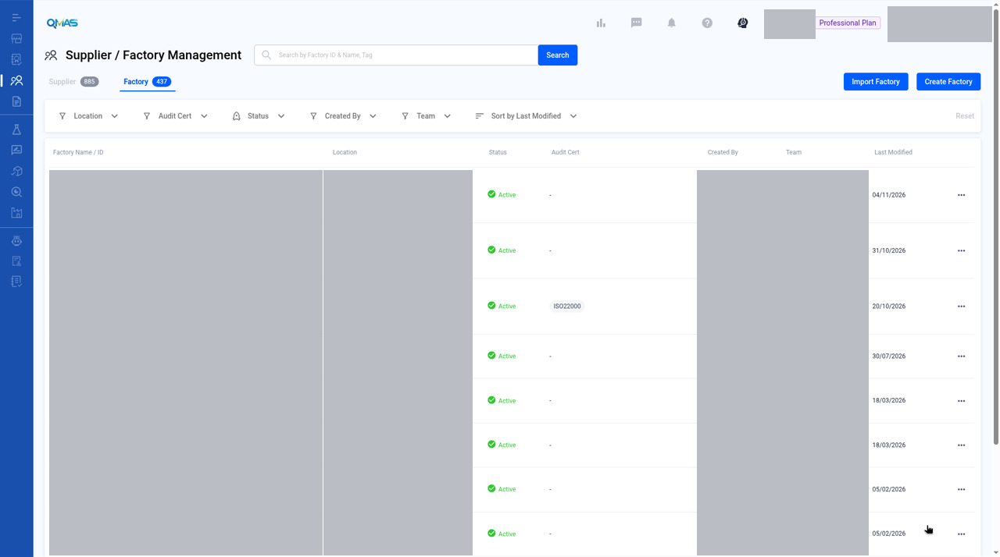
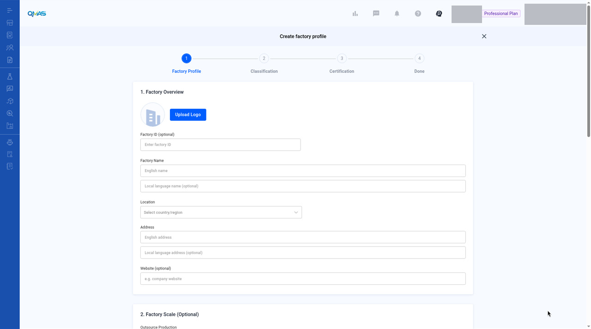
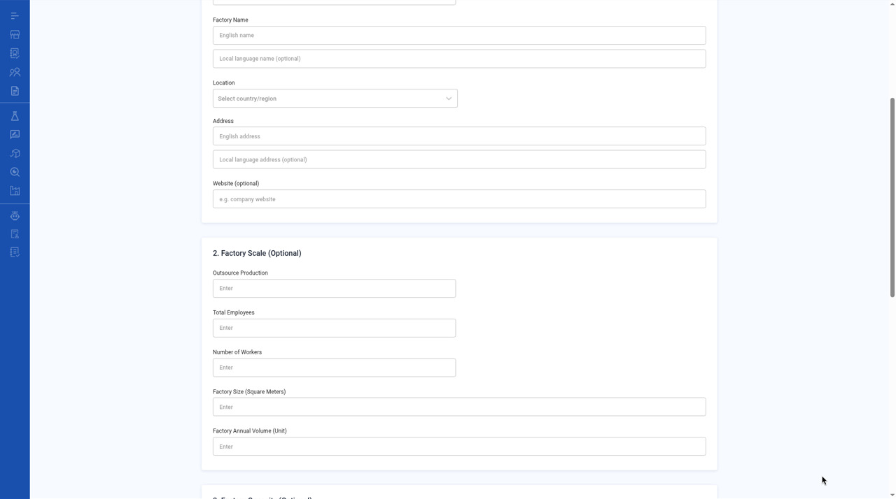
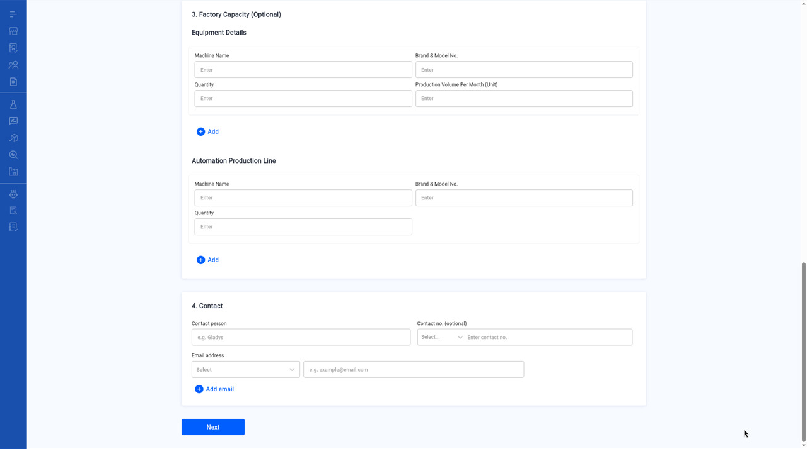
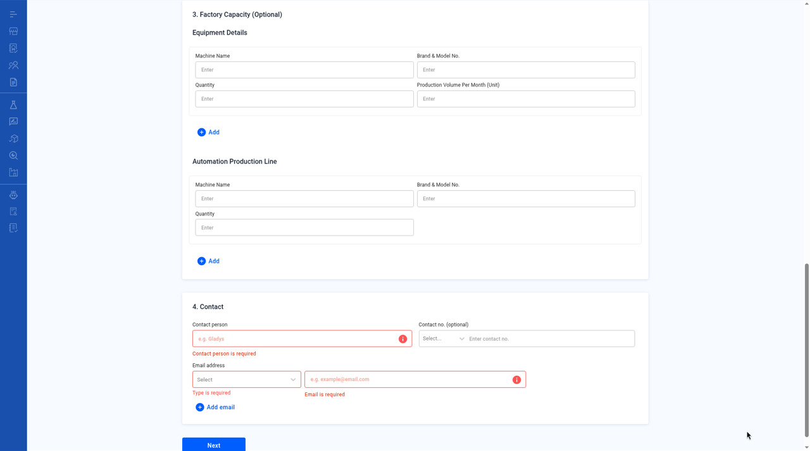
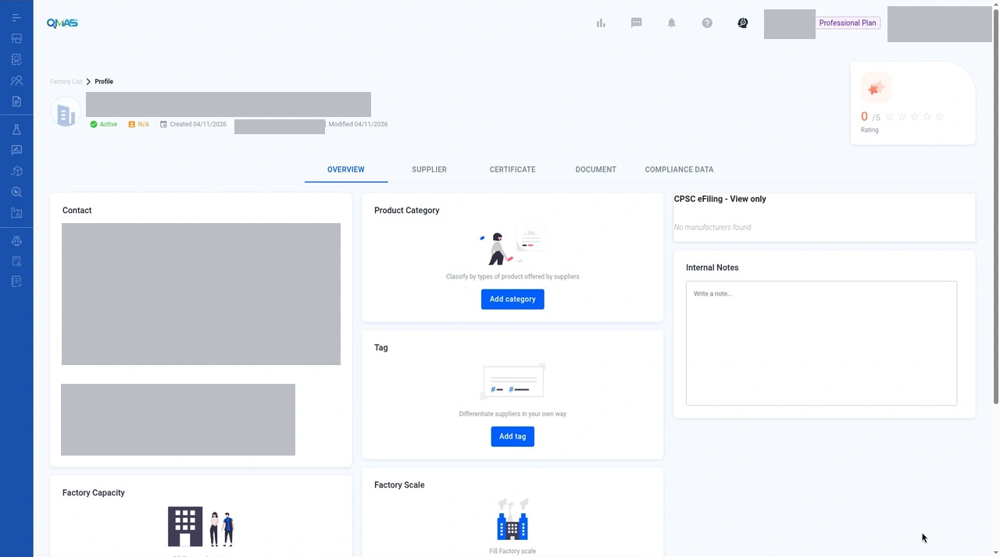
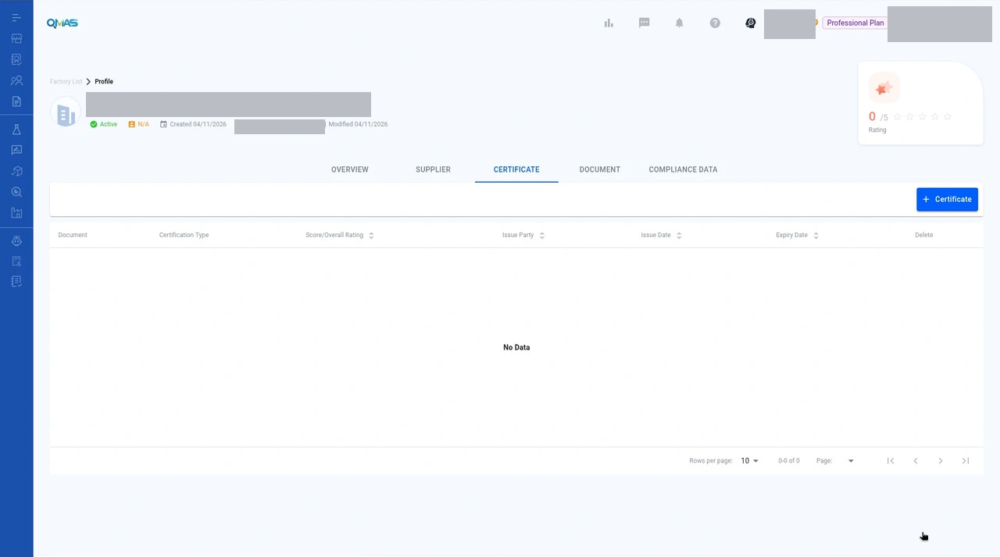

# Factory Management — Create a Factory

> Published QMAS User Guide.

## Source and verification

**Mixed.** The reviewed create path and the readonly Overview and empty Certificate tab are current UI verified. Edit, rating, notes, and import are source-only and not dev-verified.

Do not mark this whole module unverified. Source: QMAS Help Center — Manage your QMAS Factory Compliance Profile, last edited 2026-01-16 16:11:21 HKT. The article was not marked Updated November 2026.

- [Manage your QMAS Factory Compliance Profile](https://app.notion.com/p/2ea9c62c39fc80198eddc3c9e7d20007) (last edited 2026-01-16 16:11:21 HKT). Create path and reviewed profile screens are current UI verified. Edit, import, rating, and notes are source-only, not dev-verified.

Help Center home: [QMAS Help Center](https://icw-io.notion.site/QMAS-Help-Center-5cd9414da2474d16a7c405a3542fe4af) (last edited 2026-01-20 13:54:13 HKT). User Guide index: [User Guide](https://app.notion.com/p/a92963a30e584145bb457a62b7706541) (last edited 2026-01-16 15:44:49 HKT). Public icw-io addresses for individual articles were not verified, so those links use app.notion.com.

Add a factory profile with its location, scale, equipment and certificates, so you can link it to suppliers, products and inspections.

- **Module:** Supplier / Factory Management
- **Start here:** https://qmas.icw.io/supplier-manager/suppliers → **Factory** tab → **Create Factory**
- **Direct link:** https://qmas.icw.io/supplier-manager/factory/create
- **Steps:** 1 Factory Profile → 2 Classification → 3 Certification → Done
- **Checked against:** QMAS dev, 4 Nov 2026

## Overview

1. Open **Supplier / Factory Management**, click the **Factory** tab, then **Create Factory**.
2. **Factory Profile**: overview, scale, equipment and contact.
3. **Classification** (optional): product category and tags.
4. **Certification** (optional): add audit reports or certificates, then click **Done**.
5. The factory profile opens.

## Step-by-step

### 1. Open the Factory tab

In the left menu, open **Supplier / Factory Management** and click the **Factory** tab. It lists your factories with location, status and audit certificates.

Click **Create Factory**, or **Import Factory** to add many factories from a file.

*Factory tab with Import Factory and Create Factory.*

### 2. Factory Profile — overview

- **Upload Logo** and **Factory ID** (optional).
- **Factory Name**: English name (required) and local-language name (optional).
- **Location**: country or region, then province and city.
- **Address**: English address (required) and local-language address (optional).
- **Website** (optional).

*Create factory profile — step 1, Factory Overview.*

### 3. Factory Profile — scale and equipment (optional)

**Factory Scale**: outsource production, total employees, number of workers, factory size (square meters) and annual volume.

The equipment section lists machines and **Automation Production Line** entries: machine name, brand and model no., quantity and monthly production volume. Click **Add** for more rows.

*2. Factory Scale (optional).*

Scrolled view. Factory Scale is fully visible. Lower Factory Overview fields are blank placeholders, and a sliver of 3. Factory Capacity is also in frame.

### 4. Factory Profile — contact

Under **4. Contact**, fill in the **Contact person** and an **Email address** with its type (Company, QA, Sales or Other). **Contact no.** is optional. Click **Next**.

*Contact section and Next.*

Scrolled view. 3. Factory Capacity is blank and visible above 4. Contact and Next.

If Contact person or the email type and address are empty, **Next** (not Submit) marks them required. The fields stay on example placeholders.

*Factory create-profile required-field validation after Next (not Submit): Contact person, email type and email address.*

Supplementary screenshot. It is not one of the 98 published inventory slots. Same scrolled Contact view as the previous image, after Next.

### 5. Classification (optional)

Click **Select category** for the product categories this factory makes, and **Select tag** for your own tags. Click **Next**.

> **Image pending privacy review:** `05-step2-classification.jpg`
>
> Reviewed replacement image not available yet. Follow the written steps above.

*Step 2 Classification.*

### 6. Certification (optional)

Click **Add** to attach an audit report or certificate. In **Add Certification**, choose the certification type, upload the file (JPG, JPEG, PNG, PDF, DOC or XLS), and fill in the score or overall rating, issue party, issue date and expiry date. Click **Add**.

> **Image pending privacy review:** `07-add-certification.jpg`
>
> Reviewed replacement image not available yet. Follow the written steps above.

*Add Certification pop-up.*

Click **Done** to create the factory.

> **Image pending privacy review:** `06-step3-certification.jpg`
>
> Reviewed replacement image not available yet. Follow the written steps above.

*Step 3 Certification.*

### 7. Done — factory profile

QMAS shows “Create factory successfully!” and opens the factory profile. Use the tabs **Overview**, **Supplier**, **Certificate**, **Document** and **Compliance Data** to manage what is linked to this factory.

The reviewed screenshot is a readonly Overview of an existing profile. Product Category, Tag, Factory Capacity and Factory Scale are empty. It is not the Add Certification pop-up, and no record was written for this shot.

*Factory profile — Overview tab.*

Readonly Overview. Category, Tag, Capacity and Scale are empty. Created and Modified dates stay visible. This is a 1280×800 desktop crop (1280×714), not a high-resolution screenshot.

*Factory profile — Certificate tab, empty (No Data).*

Supplementary screenshot, not one of the 98 inventory slots. Genuine empty Certificate tab on the same profile. This is not Step 3 Certification or the Add Certification pop-up. No record was created or changed.

## Tips

- Set the expiry date on audit certificates so you can see when they need renewing.

## FAQ

**Q: How do I create a new factory?**

A: Go to Supplier / Factory Management, click the Factory tab, then Create Factory. Fill in Factory Profile, then Next, Next and Done. Direct link: https://qmas.icw.io/supplier-manager/factory/create

**Q: Can I add many factories at once?**

A: Yes. Click Import Factory on the Factory tab.

**Q: Where do I upload a factory audit certificate?**

A: In step 3 Certification of Create Factory, or later from the Certificate tab of the factory profile.

## Help Center additions and remaining gaps

This section adds Help Center material and named gaps. It does not replace the steps above.

- **Source-documented** — written in the original Help Center. The last-edited date is given. That does not by itself prove the current QMAS UI.
- **Dev-verified** — confirmed on qmas-dev.icw.io during guide work.
- **Gap** — named as missing or too thin. Not current behaviour until checked on dev.

Reviewed screenshots remain 56 of 98. Forty-two inventory slots are still pending. Six supplementary images are not part of the 98. Unreviewed screenshots were not copied.

### Source-documented — edit, documents, and import (last edited 2026-01-16)

Source: Manage your QMAS Factory Compliance Profile, https://app.notion.com/p/2ea9c62c39fc80198eddc3c9e7d20007. Not marked “Updated November 2026”. Labels need a dev check.

Edit company and contact information with the icon next to each section. Edit categories and tags with the pen icon.

**Add rating** uses the same four dimensions as suppliers in the Help Center (Responsiveness, Quality, Pricing, Market Awareness). Confirm whether a factory rating still exists and still uses these labels.

**Internal notes.** Add missed certificates or documents later in the **CERTIFICATE** and **DOCUMENT** sections.

The Help Center text has typographical errors (“thisfactory”, “factyory”). Those are not UI labels.

**Import Factory:** click **Import Factory**, then **Download here** for the factory template, fill it in (the article says create, update, and delete are supported), upload, and click **Next**. A toast confirms completion. One Help Center step title still says “Upload the filled **supplier** template”. Treat that as a source typo unless dev shows that exact wording.

Do not blanket-replace “supplier” wording on Factory screens. A filed bug asks for a context-by-context check.

### Remaining gaps

- Profile tabs Supplier, Certificate, Document, and Compliance Data are named, not walked through.
- Overview Product Category and Tag empty-state wording.
- List filters, Export, and the row toolbar.
- Screenshots for import, rating, notes, and tabs other than Overview.

Help Center reconciliation 2026-11-13 (HKT). Original Help Center not edited. No Dify upload.
