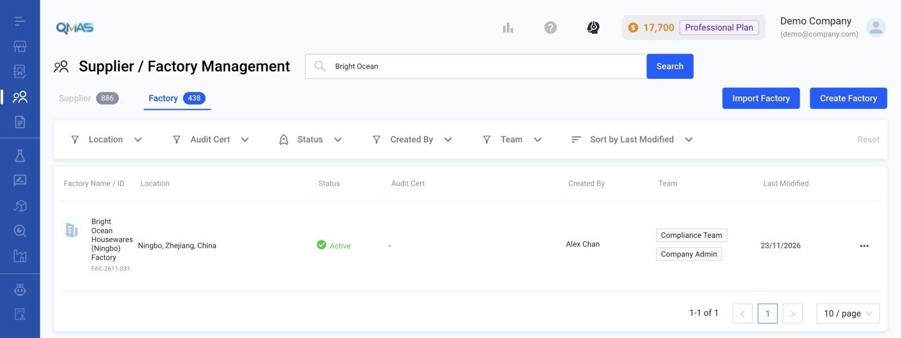
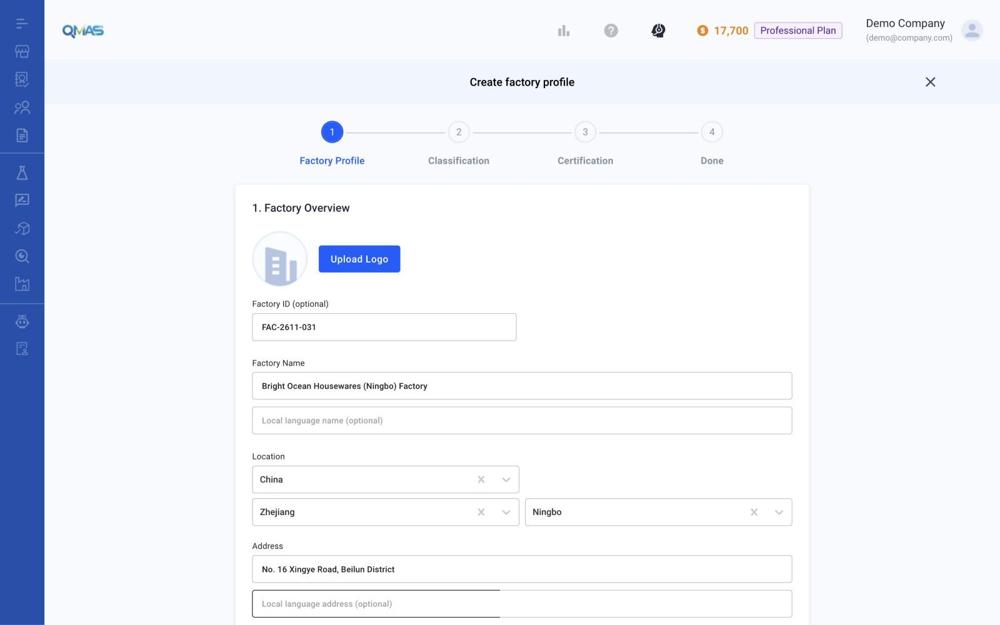
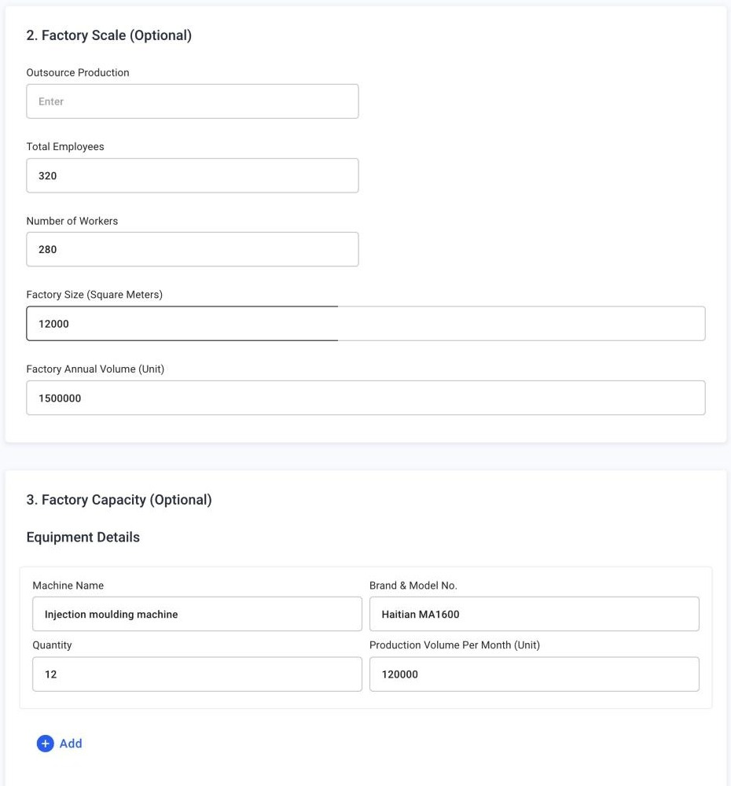
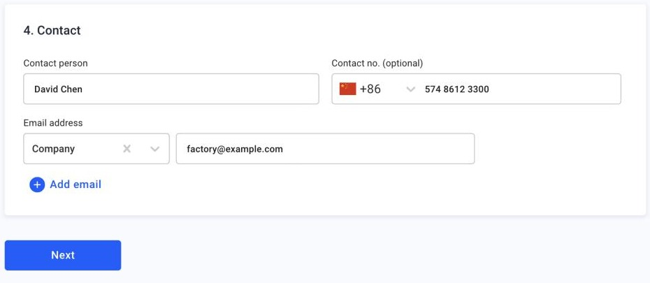
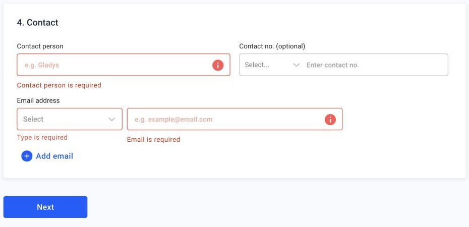
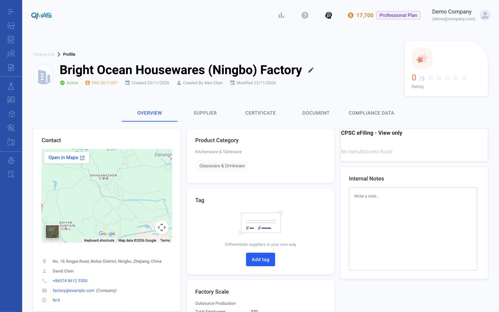
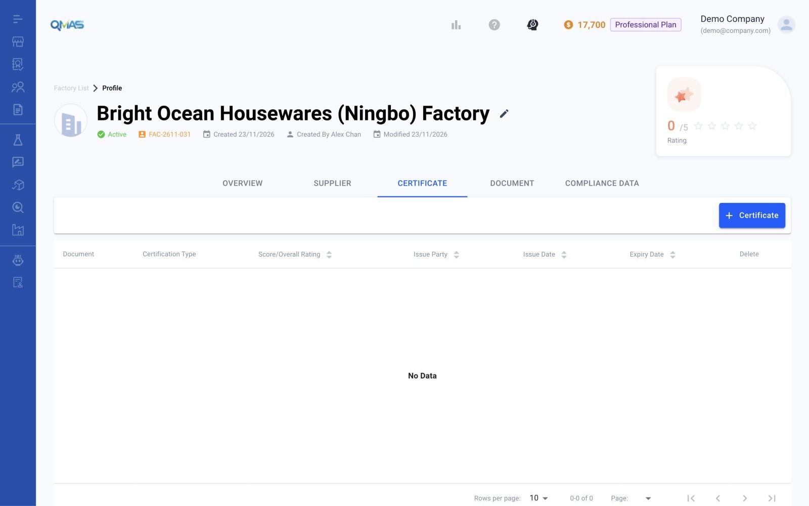

# Factory Management — Create a Factory

Add a factory profile with its location, scale, equipment and certificates, so you can link it to suppliers, products and inspections.

- **Module:** Supplier / Factory Management
- **Start here:** https://qmas.icw.io/supplier-manager/suppliers → **Factory** tab → **Create Factory**
- **Direct link:** https://qmas.icw.io/supplier-manager/factory/create
- **Steps:** 1 Factory Profile → 2 Classification → 3 Certification → Done

## Overview

1. Open **Supplier / Factory Management**, click the **Factory** tab, then **Create Factory**.
2. **Factory Profile**: overview, scale, equipment and contact.
3. **Classification** (optional): product category and tags.
4. **Certification** (optional): add audit reports or certificates, then click **Done**.
5. The factory profile opens.

## Step-by-step

### 1. Open the Factory tab

In the left menu, open **Supplier / Factory Management** and click the **Factory** tab. It lists your factories with location, status and audit certificates.

Click **Create Factory**, or **Import Factory** to add many factories from a file.

*Factory tab with Import Factory and Create Factory.*

### 2. Factory Profile — overview

- **Upload Logo** and **Factory ID** (optional).
- **Factory Name**: English name (required) and local-language name (optional).
- **Location**: country or region, then province and city.
- **Address**: English address (required) and local-language address (optional).
- **Website** (optional).

*Create factory profile — step 1, Factory Overview.*

### 3. Factory Profile — scale and equipment (optional)

**Factory Scale**: outsource production, total employees, number of workers, factory size (square meters) and annual volume.

The equipment section lists machines and **Automation Production Line** entries: machine name, brand and model no., quantity and monthly production volume. Click **Add** for more rows.

*2. Factory Scale (optional).*

### 4. Factory Profile — contact

Under **4. Contact**, fill in the **Contact person** and an **Email address** with its type (Company, QA, Sales or Other). **Contact no.** is optional. Click **Next**.

*Contact section and Next.*

If Contact person or the email type and address are empty, **Next** marks them as required.

*Required fields turn red after you click Next: Contact person, email type and email.*

### 5. Classification (optional)

Click **Select category** for the product categories this factory makes, and **Select tag** for your own tags. Click **Next**.

### 6. Certification (optional)

Click **Add** to attach an audit report or certificate. In **Add Certification**, choose the certification type, upload the file (JPG, JPEG, PNG, PDF, DOC or XLS), and fill in the score or overall rating, issue party, issue date and expiry date. Click **Add**.

Click **Done** to create the factory.

### 7. Done — factory profile

QMAS shows “Create factory successfully!” and opens the factory profile. Use the tabs **Overview**, **Supplier**, **Certificate**, **Document** and **Compliance Data** to manage what is linked to this factory.

*Factory profile — Overview tab.*

*Factory profile — Certificate tab, empty (No Data).*

## Tips

- Set the expiry date on audit certificates so you can see when they need renewing.

## FAQ

**Q: How do I create a new factory?**

A: Go to Supplier / Factory Management, click the Factory tab, then Create Factory. Fill in Factory Profile, then Next, Next and Done. Direct link: https://qmas.icw.io/supplier-manager/factory/create

**Q: Can I add many factories at once?**

A: Yes. Click Import Factory on the Factory tab.

**Q: Where do I upload a factory audit certificate?**

A: In step 3 Certification of Create Factory, or later from the Certificate tab of the factory profile.
