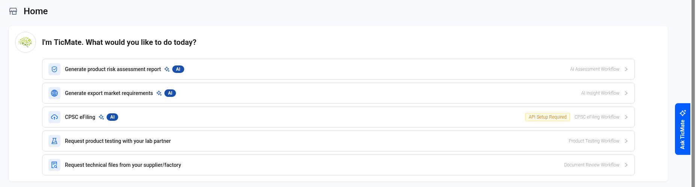
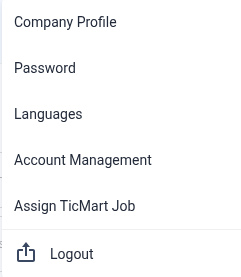
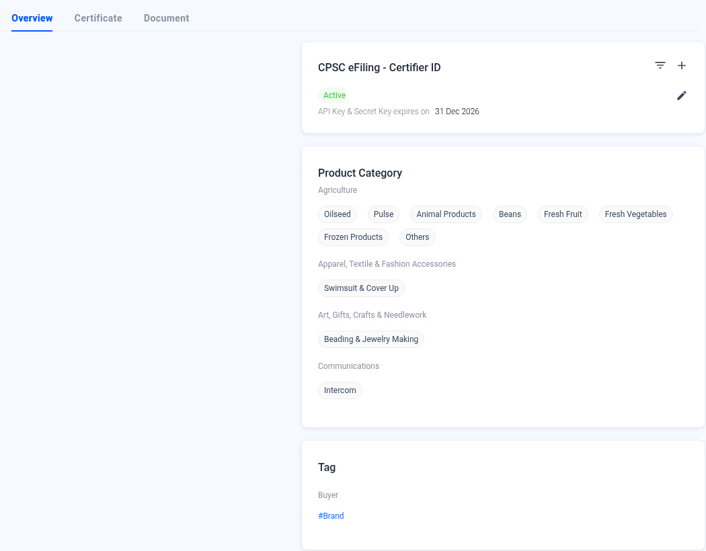

# Getting Started — Home, Settings and Company Profile

> Updated working draft 2026-11-13-draft. This file is not deployed. Existing published version: https://marconip2026.github.io/qmas-user-guide/

## Source and verification

**Mixed.** Home, Settings, and Company Profile are current UI verified, including the avatar account control and the five TicMate shortcuts. The 2024 Help Center onboarding steps are source-only and not dev-verified.

Do not mark this whole module unverified. The reviewed Home screenshots are current UI. Source: QMAS Help Center — Getting Started, last edited 2024-04-02 15:23:02 HKT, for the onboarding pointers only.

- [Getting Started](https://app.notion.com/p/cee08d7673aa467797efb39efe68bbdc) (last edited 2024-04-02 15:23:02 HKT). Onboarding pointers only. Source-only, not dev-verified.
- [Set Up Your Product Compliance Module](https://app.notion.com/p/3200ac0e049d4aa8b2409bad15cea3cd) (last edited 2024-04-02 19:08:58 HKT). Related 2024 setup pointer. Source-only, not dev-verified.
- [Set Up Your Supplier Management Module](https://app.notion.com/p/01167450c4d54a98a3670fe13e056f12) (last edited 2024-04-02 18:20:47 HKT). Related 2024 setup pointer. Source-only, not dev-verified.
- [FAQs](https://app.notion.com/p/84844e89cab14819b021b0aa8e33ef31) (last edited 2022-12-19 15:59:00 HKT). Related FAQ pointer. Source-only, not dev-verified.

Help Center home: [QMAS Help Center](https://icw-io.notion.site/QMAS-Help-Center-5cd9414da2474d16a7c405a3542fe4af) (last edited 2026-01-20 13:54:13 HKT). User Guide index: [User Guide](https://app.notion.com/p/a92963a30e584145bb457a62b7706541) (last edited 2026-01-16 15:44:49 HKT). Public icw-io addresses for individual articles were not verified, so those links use app.notion.com.

Find your way around QMAS: the Home page, the top bar and your company settings.

- **Home:** https://qmas.icw.io/home
- **Company Profile:** https://qmas.icw.io/company-profile
- **Checked against:** QMAS dev, 9 Nov 2026

## Overview

1. **Home** shows quick workflows, items that need your attention, and an overview of your business.
2. The **left menu** opens each module.
3. The **top bar** has analytics, messages, notifications, the account avatar, help and credits.
4. **Settings** opens from the **avatar** (account control) in the top bar. The menu includes Company Profile, Password, Languages, Account Management, Assign TicMart Job and Logout.

## Step-by-step

### 1. Home

**TicMate** says “I’m TicMate. What would you like to do today?” and lists these workflow shortcuts:

- **Generate product risk assessment report** (AI Assessment workflow).
- **Generate export market requirements** (AI Insight workflow).
- **CPSC eFiling**. If it shows “API Setup Required”, set up your Certifier ID in Company Profile first.
- **Request product testing with your lab partner** (Product Testing).
- **Request technical files from your supplier/factory** (Document Review).

**Attention** counts the items that need action in each module, such as Product Testing, Document Review, QC Inspection, IQC Inspection, Factory Audit, Pending Review Doc and Expired Doc. Click a card to see them.

**Business Overview** shows your active products, suppliers, factories and partners. Click **›** to open the list.

**Ask TicMate** on the right edge opens the TicMate assistant.

*Home page.*

This reviewed screenshot shows the TicMate workflow shortcuts. Attention and Business Overview are described in the steps and are not in this crop.

### 2. Settings menu

Click your **avatar** (account control) in the top bar:

| Option | What it does |
|---|---|
| Company Profile | Company details, certificates, documents, product categories and CPSC eFiling Certifier ID. |
| Password | Change your password. |
| Languages | Change the system language. |
| Account Management | Manage your company's user accounts. |
| Assign TicMart Job | Assign jobs from the TicMart marketplace. |
| Logout | Signs you out of QMAS. |

*Settings menu.*

Menu opened from the account avatar: Company Profile, Password, Languages, Account Management, Assign TicMart Job and Logout.

### 3. Company Profile

Click the pencil icon next to the company name to edit it. The **Overview**, **Certificate** and **Document** tabs hold your company information. **CPSC eFiling - Certifier ID** is where you add and manage the API key for eFiling. **Product Category** lists the categories your company works with.

*Company Profile.*

## Tips

- The question-mark icon opens the QMAS Help Center.
- The coin icon shows your credits and tokens for paid features such as AI Insight.

## FAQ

**Q: How do I change the language?**

A: Click your avatar (account control) in the top bar, then Languages.

**Q: How do I change my password?**

A: Click your avatar (account control) in the top bar, then Password.

**Q: Where do I edit my company information?**

A: Click your avatar (account control), then Company Profile (https://qmas.icw.io/company-profile).

## Help Center additions and remaining gaps

This section adds Help Center material and named gaps. It does not replace the steps above.

- **Source-documented** — written in the original Help Center. The last-edited date is given. That does not by itself prove the current QMAS UI.
- **Dev-verified** — confirmed on qmas-dev.icw.io during guide work.
- **Gap** — named as missing or too thin. Not current behaviour until checked on dev.

Reviewed screenshots remain 56 of 98. Forty-two inventory slots are still pending. Six supplementary images are not part of the 98. Unreviewed screenshots were not copied.

### Dev-verified — already in the steps above

Settings opens from the **avatar / account control**. That correction is already in the steps above.

Home shows **5** TicMate workflow shortcuts: AI Assessment, AI Insight, CPSC eFiling, Product Testing, Document Review.

### Source-documented — Help Center onboarding (last edited 2024-04-02)

Source: Help Center Getting Started, https://app.notion.com/p/cee08d7673aa467797efb39efe68bbdc. This does not replace the Home walkthrough above.

The 2024 landing tells new accounts to watch the walkthrough videos, set up Product Compliance and Supplier Management, schedule an onboarding session after the customer-success email (or use Help Center Support if that email is missing), then use the Help Center and product-update emails.

Those 2024 setup guides still say “top menu bar”. Prefer this page and the current create guides for live steps.

- Set Up Your Product Compliance Module (2024-04-02), historical: https://app.notion.com/p/3200ac0e049d4aa8b2409bad15cea3cd
- Set Up Your Supplier Management Module (2024-04-02), historical: https://app.notion.com/p/01167450c4d54a98a3670fe13e056f12

Help Center videos were not re-watched and are not current-UI evidence:

- Introduction of QMAS: https://www.youtube.com/watch?v=Qn02Yu-0Ppk
- Manage your product compliance with QMAS: https://www.youtube.com/watch?v=3zpn_gHhW7s
- How to request quotation for product testing with QMAS: https://www.youtube.com/watch?v=AaZ9zHeQ23s
- How to manage your supplier information with QMAS: https://www.youtube.com/watch?v=xZyHOMg7_yc

### Source-documented — FAQs (last edited 2022-12-19)

Source: https://app.notion.com/p/84844e89cab14819b021b0aa8e33ef31

- Ordering product testing: the FAQ points at the Help Center Product Testing article.
- Cancelling a product testing order: “contact our customer support team via email or online chat.” Not re-verified against current Support or in-app cancel behaviour.
- Integrating an existing supplier or product database: the 2022 FAQ says an import feature is available and mentions an enterprise API plan. Treat the plan and API wording as historical until confirmed.

### Remaining gaps

- **Notifications** and **Messages** centers. No Help Center article. Exact paths need a dev check. No new module was invented.
- Company Profile Certificate, Document, and CPSC eFiling Certifier ID setup. The page above is an overview only.
- Attention card drill-downs, including Factory Audit and Pending/Expired Doc.
- TicMate / Ask TicMate usage beyond the shortcut list.
- Login page. Older notes say it is outdated. It is not on the public guide.
- Naming is still undecided: Home **AI Assessment** and **AI Insight**, menu **AI Risk Screening**, and this guide title **AI Insight**.

Help Center reconciliation 2026-11-13 (HKT). Original Help Center not edited. This draft is not the public guide. No Dify upload.
