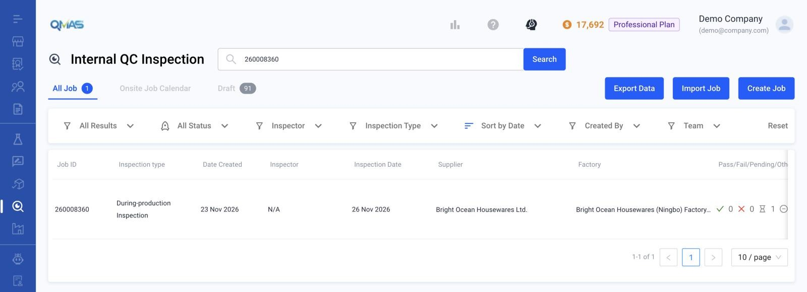
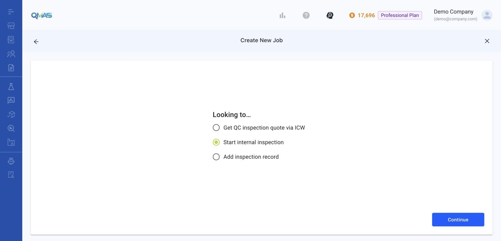
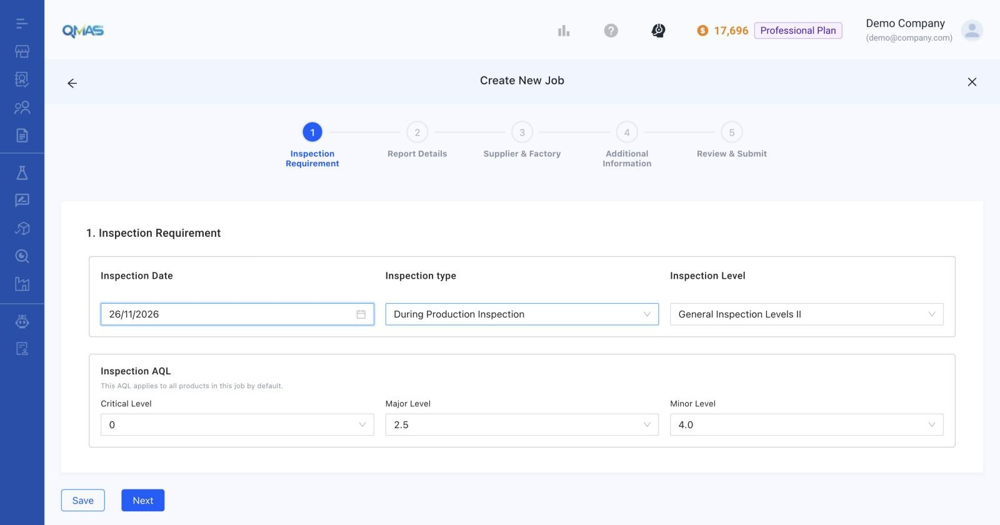

# Internal QC Inspection — Start an Internal Inspection

Schedule an inspection that your own QC team carries out, without a third-party provider.

- **Module:** Internal QC Inspection
- **Start here:** https://qmas.icw.io/inspection/internal/list → **Create Job**
- **Direct link:** https://qmas.icw.io/inspection/jobs/new?type=internalInspection
- **Steps:** 1 Inspection Requirement → 2 Report Details → 3 Supplier & Factory → 4 Additional Information → 5 Review & Submit

## Overview

1. Open **Internal QC Inspection** and click **Create Job**. **Start internal inspection** is already selected. Click **Continue**.
2. **Inspection Requirement**: date, type, level and AQL.
3. **Report Details**, **Supplier & Factory** and **Additional Information** work the same way as in the QC Inspection quote flow.
4. **Review & Submit**: check everything and click **Submit**.

## Step-by-step

### 1. Open Internal QC Inspection

In the left menu, open **Internal QC Inspection**. The tabs show **All Job**, **Onsite Job Calendar** and **Draft**. Click **Create Job**. To add many jobs at once, use **Import Job**.

*Internal QC Inspection list with Import Job and Create Job.*

### 2. Start internal inspection

**Start internal inspection** is selected. Click **Continue**.

*Create New Job — Start internal inspection selected.*

### 3. Inspection Requirement

Choose the **Inspection Date**, **Inspection type**, **Inspection Level** and the **AQL** (Critical, Major, Minor). There is no budget or service provider, because your own team does the inspection. Click **Next**.

The reviewed screenshot is that blank form. It does not show Target Budget or Service Provider Preference. Wizard steps 2–5 are labels only. Those screens were not captured and were not invented.

*Step 1 Inspection Requirement for an internal inspection.*

### 4. Steps 2–5

The next steps are the same as in the QC Inspection quote flow. See the [QC Inspection](qc-inspection.md) guide for those steps.

- **Report Details**: add products and their POs.
- **Supplier & Factory**: select the supplier and the factory to inspect.
- **Additional Information**: upload reference files and add remarks.
- **Review & Submit**: check the summary, then click **Submit**. The job opens with its Job ID.

## Tips

- If you need a third-party inspector instead, use QC Inspection → Create Job → **Get QC inspection quote via ICW**.
- Click **Save** on any step to keep a draft.

## FAQ

**Q: How do I start an internal inspection?**

A: Go to Internal QC Inspection (https://qmas.icw.io/inspection/internal/list), click Create Job, keep Start internal inspection selected, click Continue and complete the 5 steps. Direct link: https://qmas.icw.io/inspection/jobs/new?type=internalInspection

**Q: Can I import internal inspection jobs?**

A: Yes. Click Import Job on the Internal QC Inspection list.
