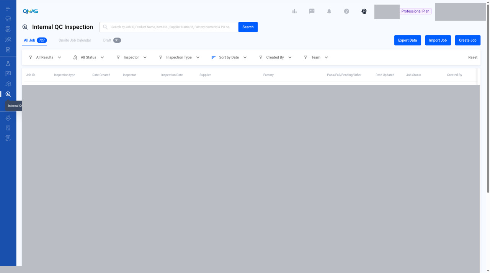
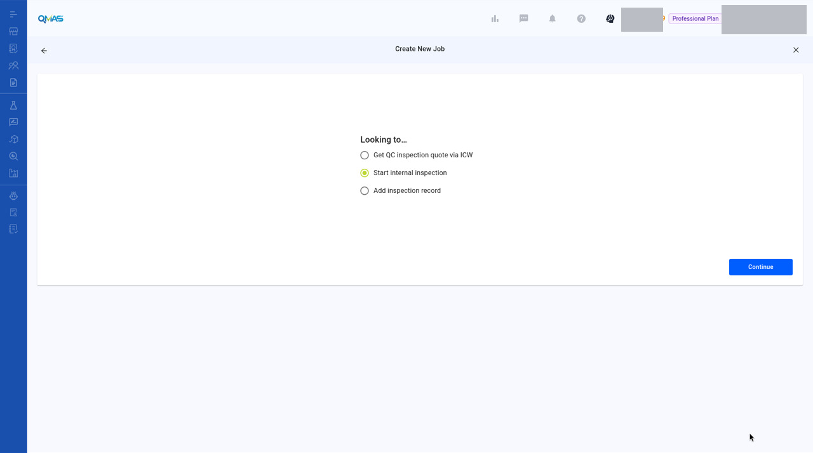
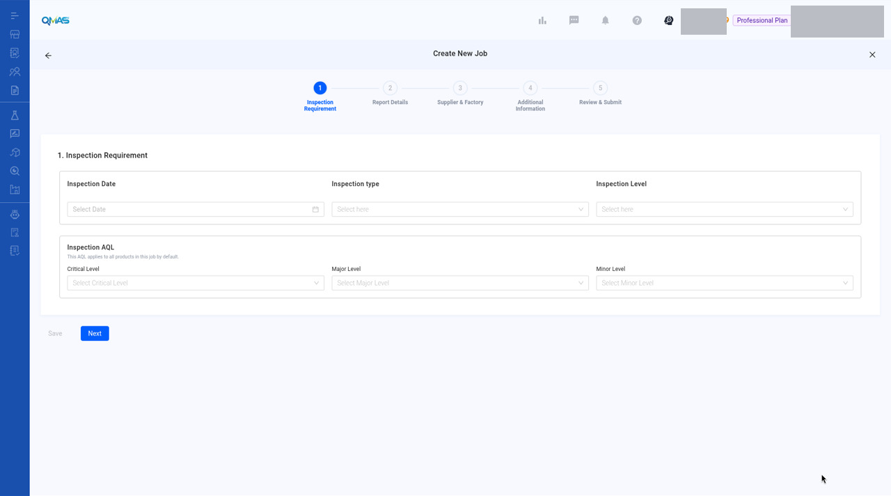

# Internal QC Inspection — Start an Internal Inspection

> Published QMAS User Guide.

## Source and verification

**Mixed.** The reviewed list, Looking-to, and blank step 1 are current UI verified. There is no standalone Help Center article. The QC article only names Start internal inspection, and that mention is source-only. Steps 2–5 stay written text.

Do not mark this whole module unverified. Source: QMAS Help Center — How To Request Quotation For QC Inspection From Global Laboratories, last edited 2026-11-04 12:15:22 HKT, for the Looking-to mention only.

- [How To Request Quotation For QC Inspection From Global Laboratories](https://app.notion.com/p/bf607ad093d24e3c8d483dd85d9a474e) (last edited 2026-11-04 12:15:22 HKT). Looking-to mention only. The reviewed start-internal screens on this page stay current UI verified.

Help Center home: [QMAS Help Center](https://icw-io.notion.site/QMAS-Help-Center-5cd9414da2474d16a7c405a3542fe4af) (last edited 2026-01-20 13:54:13 HKT). User Guide index: [User Guide](https://app.notion.com/p/a92963a30e584145bb457a62b7706541) (last edited 2026-01-16 15:44:49 HKT). Public icw-io addresses for individual articles were not verified, so those links use app.notion.com.

Schedule an inspection that your own QC team carries out, without a third-party provider.

- **Module:** Internal QC Inspection
- **Start here:** https://qmas.icw.io/inspection/internal/list → **Create Job**
- **Direct link:** https://qmas.icw.io/inspection/jobs/new?type=internalInspection
- **Steps:** 1 Inspection Requirement → 2 Report Details → 3 Supplier & Factory → 4 Additional Information → 5 Review & Submit
- **Checked against:** QMAS dev, 4 Nov 2026

## Overview

1. Open **Internal QC Inspection** and click **Create Job**. **Start internal inspection** is already selected. Click **Continue**.
2. **Inspection Requirement**: date, type, level and AQL.
3. **Report Details**, **Supplier & Factory** and **Additional Information** work the same way as in the QC Inspection quote flow.
4. **Review & Submit**: check everything and click **Submit**.

## Step-by-step

### 1. Open Internal QC Inspection

In the left menu, open **Internal QC Inspection**. The tabs show **All Job**, **Onsite Job Calendar** and **Draft**. Click **Create Job**. To add many jobs at once, use **Import Job**.

*Internal QC Inspection list with Import Job and Create Job.*

Import Job and Create Job are visible. Job rows are masked. This is a 1280×800 desktop crop (1280×714), not a high-resolution screenshot.

### 2. Start internal inspection

**Start internal inspection** is selected. Click **Continue**.

*Create New Job — Start internal inspection selected.*

Start internal inspection is selected. Continue is visible. No personal data is filled in.

### 3. Inspection Requirement

Choose the **Inspection Date**, **Inspection type**, **Inspection Level** and the **AQL** (Critical, Major, Minor). There is no budget or service provider, because your own team does the inspection. Click **Next**.

The reviewed screenshot is that blank form. It does not show Target Budget or Service Provider Preference. Wizard steps 2–5 are labels only. Those screens were not captured and were not invented.

*Step 1 Inspection Requirement for an internal inspection.*

Blank form. No Target Budget or Service Provider Preference, unlike the QC quote flow. Steps 2–5 remain pending.

### 4. Steps 2–5

The next steps are the same as in the QC Inspection quote flow. See the [QC Inspection](qc-inspection.md) guide for those steps.

- **Report Details**: add products and their POs.
- **Supplier & Factory**: select the supplier and the factory to inspect.
- **Additional Information**: upload reference files and add remarks.
- **Review & Submit**: check the summary, then click **Submit**. The job opens with its Job ID.

## Tips

- If you need a third-party inspector instead, use QC Inspection → Create Job → **Get QC inspection quote via ICW**.
- Click **Save** on any step to keep a draft.

## FAQ

**Q: How do I start an internal inspection?**

A: Go to Internal QC Inspection (https://qmas.icw.io/inspection/internal/list), click Create Job, keep Start internal inspection selected, click Continue and complete the 5 steps. Direct link: https://qmas.icw.io/inspection/jobs/new?type=internalInspection

**Q: Can I import internal inspection jobs?**

A: Yes. Click Import Job on the Internal QC Inspection list.

## Help Center additions and remaining gaps

This section adds Help Center material and named gaps. It does not replace the steps above.

- **Source-documented** — written in the original Help Center. The last-edited date is given. That does not by itself prove the current QMAS UI.
- **Dev-verified** — confirmed on qmas-dev.icw.io during guide work.
- **Gap** — named as missing or too thin. Not current behaviour until checked on dev.

Reviewed screenshots remain 56 of 98. Forty-two inventory slots are still pending. Six supplementary images are not part of the 98. Unreviewed screenshots were not copied.

### Help Center finding

There is no standalone Internal QC Help Center article.

The November 2026 QC article mentions **Start internal inspection** as a Looking-to option when your own QC team will inspect. That is the only Help Center mention. It does not document steps 2–5, Import Job, or the Onsite Job Calendar.

### Remaining gaps

- Own screenshots, or a clearly labelled “same as QC” set, for steps 2–5 and the completed job detail.
- **Import Job**.
- **Onsite Job Calendar** tab.
- Draft tab and job detail after submit.
- Difference callouts versus third-party QC beyond “no budget/provider”.

Help Center reconciliation 2026-11-13 (HKT). Original Help Center not edited. No Dify upload.
