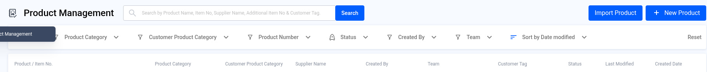
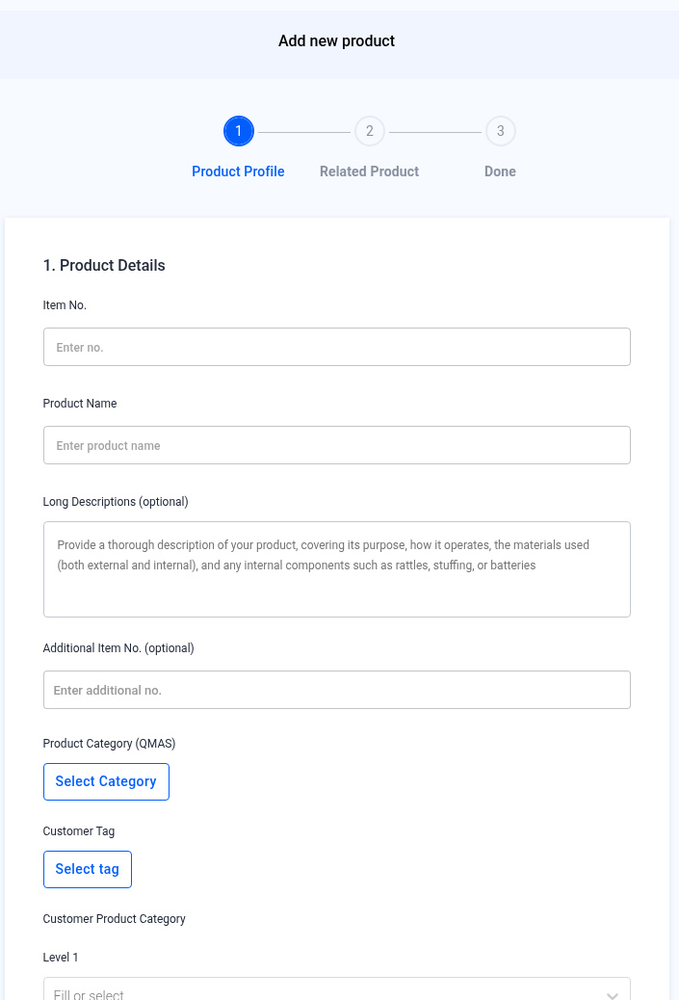
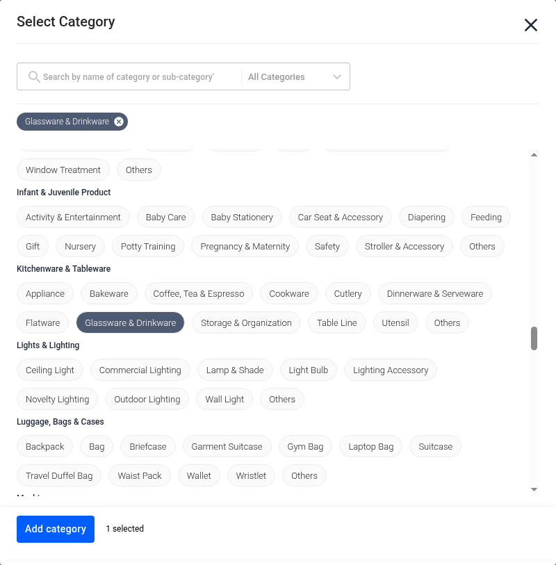
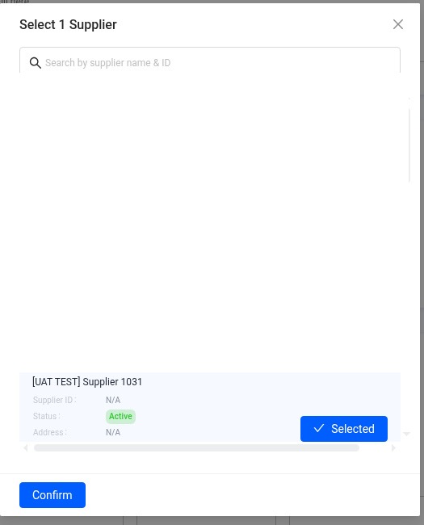
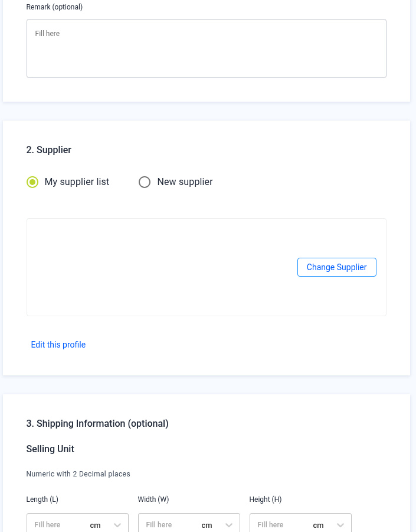
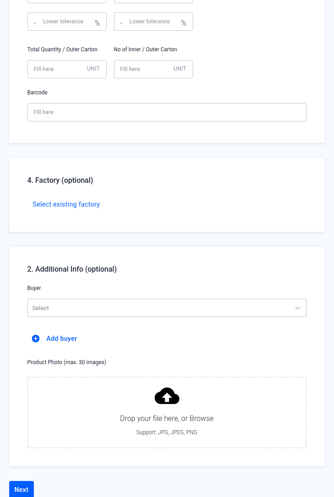
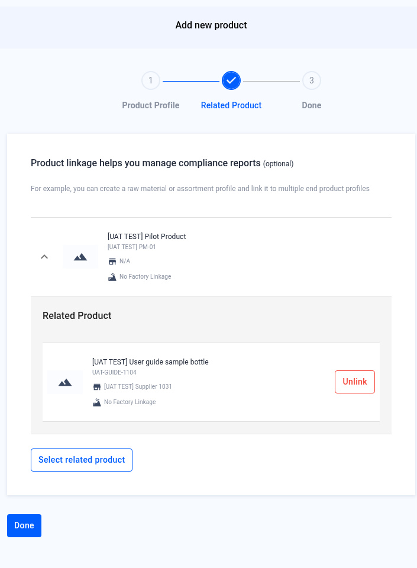
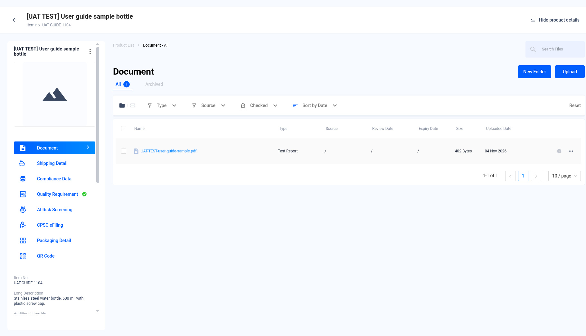
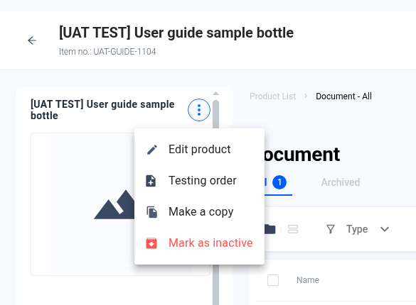
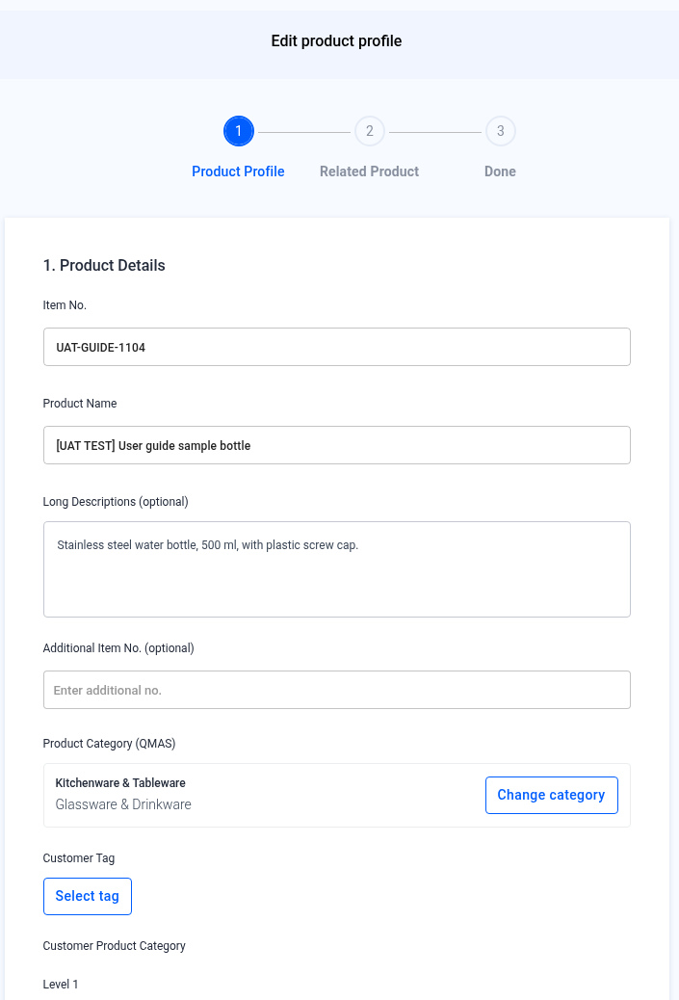

# Product Management — Create and Edit a Product

> Updated working draft 2026-11-13-draft. This file is not deployed. Existing published version: https://marconip2026.github.io/qmas-user-guide/

## Source and verification

**Mixed.** The reviewed create path and list filters are current UI verified. The Import Product pointer is Help Center text and is not dev-verified.

Do not mark this whole module unverified. Source: QMAS Help Center — Manage your QMAS Product Information Pack, last edited 2026-11-04 11:39:48 HKT. Current UI verified for the create and edit path. One inventory slot, 08-product-added, is still not captured.

- [Manage your QMAS Product Information Pack](https://app.notion.com/p/3a2b2d2eeedc42388ab6fc997070df61) (last edited 2026-11-04 11:39:48 HKT). Create path is current UI verified. Import Product is source-only, not dev-verified.

Help Center home: [QMAS Help Center](https://icw-io.notion.site/QMAS-Help-Center-5cd9414da2474d16a7c405a3542fe4af) (last edited 2026-01-20 13:54:13 HKT). User Guide index: [User Guide](https://app.notion.com/p/a92963a30e584145bb457a62b7706541) (last edited 2026-01-16 15:44:49 HKT). Public icw-io addresses for individual articles were not verified, so those links use app.notion.com.

Add a product profile to QMAS so you can attach documents, compliance data, testing and eFiling to it.

- **Module:** Product Management
- **Start here:** https://qmas.icw.io/product/list → **+ New Product**
- **Direct link:** https://qmas.icw.io/add-product
- **Steps:** 1 Product Profile → 2 Related Product → Done
- **Checked against:** QMAS dev, 9 Nov 2026

## Overview

1. Open **Product Management** and click **+ New Product**.
2. **Product Profile**: fill in product details, then choose a supplier. Shipping information, factory and additional info are optional.
3. **Related Product** (optional): link related products, then click **Done**.
4. The product appears at the top of the Product Management list. Open it to see the product profile.
5. To change it later, open the product, click **⋮** next to the name, then **Edit product**.

## Step-by-step

### 1. Open Product Management

In the left menu, open **Product Management**. Click **+ New Product** at the top right. To add many products at once, use **Import Product**.

Filter the list with **Product Category**, **Customer Product Category**, **Product Number**, **Status**, **Created By** and **Team**. **Sort by Date modified** changes the order. **Reset** clears the filters.

*Product Management list with Import Product and + New Product at the top right.*

Reviewed screenshot of the list filters and column headers. No data rows are shown.

### 2. Product Profile — product details

The **Add new product** wizard opens. Under **1. Product Details**, fill in:

- **Item No.** and **Product Name** (required).
- **Long Descriptions** (optional): purpose, materials and internal parts such as batteries or stuffing.
- **Additional Item No.** (optional).
- **Product Category (QMAS)**: click **Select Category**.
- **Customer Tag**, **Customer Product Category** (Level 1–3) and **Remark** (optional).

*Step 1 Product Profile — Product Details.*

In **Select Category**, search by name (for example “drinkware”), click the category, then click **Add category**.

*Selected categories show as dark chips at the top. “1 selected” appears next to Add category.*

### 3. Product Profile — supplier

Under **2. Supplier**, choose **My supplier list** and click **Select supplier**, or choose **New supplier** to add one here.

In the pop-up, click **Select** on one supplier, then **Confirm**.

*Select 1 Supplier — you can link one supplier per product.*

The supplier card appears. Use **Change Supplier** to pick another one, or **Edit this profile** to update the supplier.

*Selected supplier, followed by 3. Shipping Information (optional).*

The supplier card body in this screenshot is intentionally blank. Change Supplier and Edit this profile remain visible. The selected test supplier is shown on the Select supplier screenshot.

### 4. Product Profile — optional sections

- **Shipping Information**: size, weight, tolerance and barcode for the selling unit, inner carton and outer carton.
- **Factory**: click **Select existing factory**.
- **Additional Info**: choose a **Buyer** (or **Add buyer**) and upload up to 30 **product photos** (JPG, JPEG, PNG).

Click **Next**.

*Factory and Additional Info at the bottom of step 1, then Next.*

### 5. Related Product (optional)

Product linkage helps you manage compliance reports. For example, link a raw material or an assortment to several end products. Click **Select related product**, or skip this step. Click **Done**. **Unlink** removes a product from this step.

*Step 2 Related Product.*

### 6. Done — find your product

QMAS shows “Product added” and returns to the Product Management list. The new product is at the top.

The screenshot of that new row was not captured, because it would require creating a real product. The placeholder is not a picture of a finished create.

> **Not captured:** `08-product-added.jpg`
>
> Not captured. A real product was not created for this screenshot, so this placeholder is not confirmation of a completed create.

*The new product at the top of the list.*

Click the product to open its profile. From the left menu of the profile you can manage **Document**, **Shipping Detail**, **Compliance Data**, **Quality Requirement**, **AI Risk Screening**, **CPSC eFiling** and **Packaging Detail**.

The left menu also includes **QR Code**.

*Product profile.*

Left menu includes Document, Shipping Detail, Compliance Data, Quality Requirement, AI Risk Screening, CPSC eFiling, Packaging Detail and QR Code. The Document tab shows New Folder, Upload, All, Archived, Type, Source, Checked, Sort and Reset.

### 7. Edit, copy or deactivate a product

On the product profile, click **⋮** next to the product name:

| Option | What it does |
|---|---|
| Edit product | Opens the same wizard with your saved details. Change them, then click Next and Done. |
| Testing order | Starts a Product Testing order for this product. |
| Make a copy | Creates a new product with the same details. |
| Mark as inactive | Sets the product to inactive. |

*The ⋮ menu on the product profile.*

*Edit product profile — the same steps as creating a product.*

## Tips

- Search the list before you create a product so you don’t add a duplicate.
- Shipping information is optional when you create the product. You can add it later from **Shipping Detail** on the profile.

## FAQ

**Q: How do I create a new product in QMAS?**

A: Go to Product Management (https://qmas.icw.io/product/list), click + New Product, fill in Product Profile, then click Next and Done. Direct link: https://qmas.icw.io/add-product

**Q: How do I edit a product?**

A: Open the product from the Product Management list, click ⋮ next to the product name, then Edit product.

**Q: Can I add many products at once?**

A: Yes. Click Import Product on the Product Management list.

**Q: Where do I submit eFiling or add compliance data for a product?**

A: Open the product profile and use CPSC eFiling or Compliance Data in its left menu.

## Help Center additions and remaining gaps

This section adds Help Center material and named gaps. It does not replace the steps above.

- **Source-documented** — written in the original Help Center. The last-edited date is given. That does not by itself prove the current QMAS UI.
- **Dev-verified** — confirmed on qmas-dev.icw.io during guide work.
- **Gap** — named as missing or too thin. Not current behaviour until checked on dev.

Reviewed screenshots remain 56 of 98. Forty-two inventory slots are still pending. Six supplementary images are not part of the 98. Unreviewed screenshots were not copied.

### Dev-verified — list filters (2026-11-09)

The list filters are already in the steps above: **Product Category**, **Customer Product Category**, **Product Number**, **Status**, **Created By**, **Team**, sort, and **Reset**. The reviewed list screenshot shows those filters with no data rows.

Optional **Factory** and **Additional Info** (buyer, up to 30 product photos) are already in the wizard steps.

### Source-documented — Product Information Pack (last edited 2026-11-04)

Source: Manage your QMAS Product Information Pack, https://app.notion.com/p/3a2b2d2eeedc42388ab6fc997070df61. The November 2026 create steps follow the same path as this page.

**Import Product:** the Help Center intro says “To add many products at once, use **Import Product**.” The Product Profile FAQ already says to download the ICW template, fill it in, and upload it. A full multi-step import walkthrough is still missing. Do not invent extra import steps.

The 2024 setup guide still says “top menu bar, select PRODUCT MANAGEMENT”. Prefer the current left menu and this page.

### Remaining gaps

- Full Import Product wizard screenshots and field notes.
- List Export Data, row-select / bulk toolbar, and search. Only the filters above are dev-verified.
- Further Related Product linkage examples. **Unlink** is already named on the reviewed step 2 screenshot.
- Section numbering, stepper tick, and Title Case bugs are filed separately. Match the fixed UI once it ships. Do not invent the fix.

Help Center reconciliation 2026-11-13 (HKT). Original Help Center not edited. This draft is not the public guide. No Dify upload.
