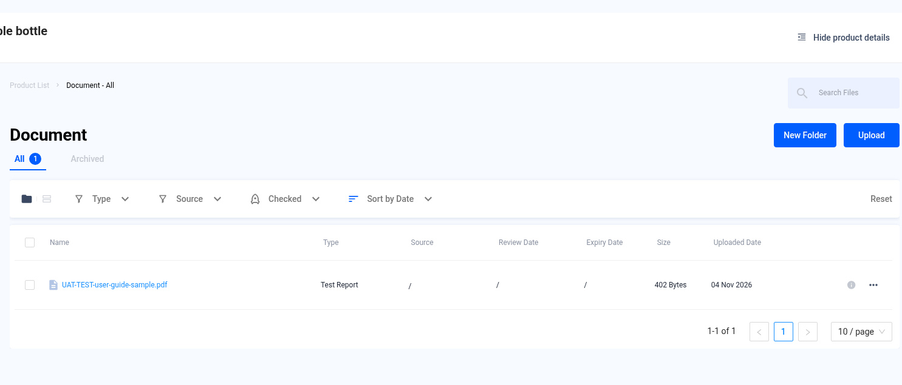
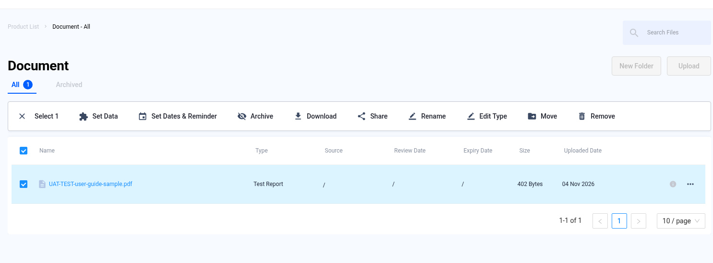
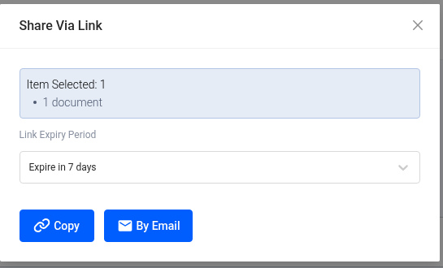
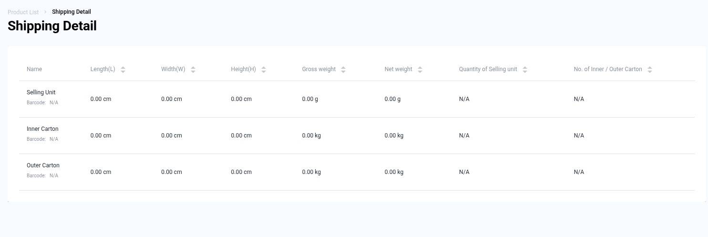
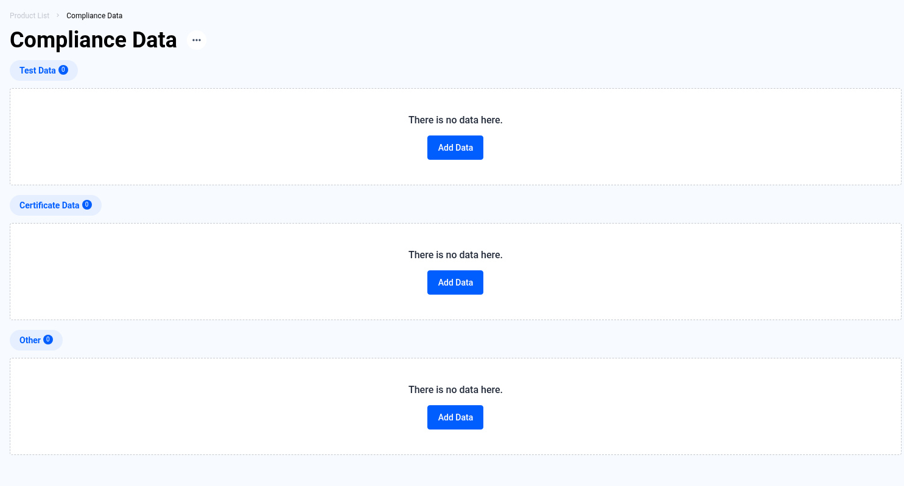
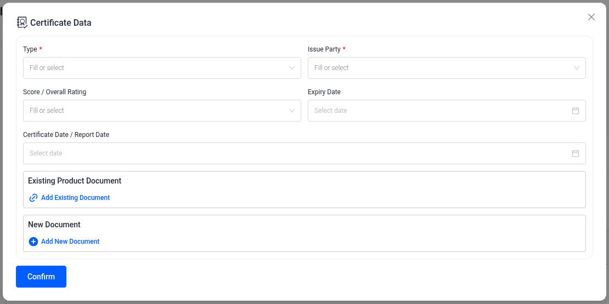
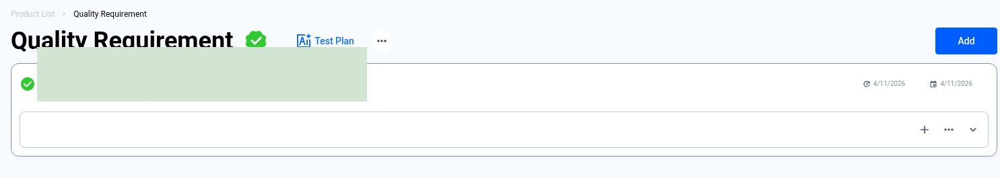
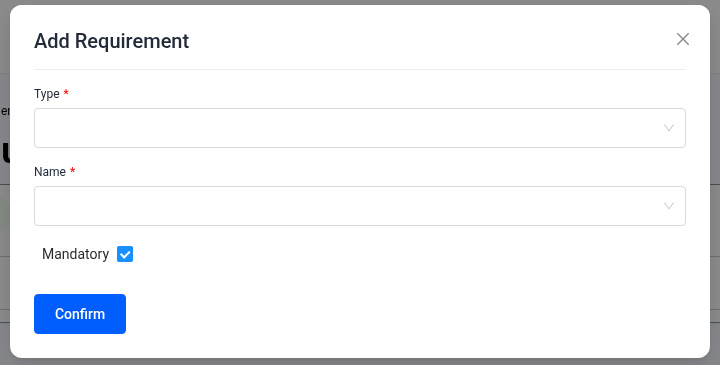
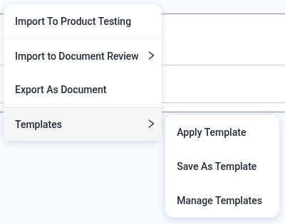
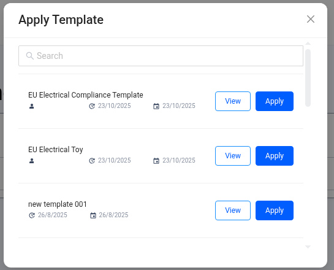

# Product Management — Every Tab of the Product Profile

> Published QMAS User Guide.

## Source and verification

**Mixed.** The reviewed tab screenshots are current UI verified. Expiry reminders, share wording, and Get DoC are source-only and not dev-verified. There is no CPC or GCC Help Center article.

Do not mark this whole module unverified. Pending screenshot slots do not make the reviewed tabs unverified. Source: QMAS Help Center — Manage your QMAS Product Information Pack, last edited 2026-11-04 11:39:48 HKT. Reminder, share, and Get DoC sections were not part of the November 2026 rewrite.

- [Manage your QMAS Product Information Pack](https://app.notion.com/p/3a2b2d2eeedc42388ab6fc997070df61) (last edited 2026-11-04 11:39:48 HKT). Reviewed tabs are current UI verified. Reminder, share, and Get DoC wording is source-only, not dev-verified.

Help Center home: [QMAS Help Center](https://icw-io.notion.site/QMAS-Help-Center-5cd9414da2474d16a7c405a3542fe4af) (last edited 2026-01-20 13:54:13 HKT). User Guide index: [User Guide](https://app.notion.com/p/a92963a30e584145bb457a62b7706541) (last edited 2026-01-16 15:44:49 HKT). Public icw-io addresses for individual articles were not verified, so those links use app.notion.com.

After you create a product, its profile holds everything about it. This guide explains each tab in the profile's left menu and the import option on the product list.

- **Module:** Product Management
- **Open a profile:** https://qmas.icw.io/product/list → click a product
- **Tabs:** Document · Shipping Detail · Compliance Data · Quality Requirement · AI Risk Screening · CPSC eFiling · Packaging Detail · QR Code
- **See also:** Create and edit a product: [Product Management — Create and Edit a Product](product-management.md)
- **Checked against:** QMAS dev, 4 Nov 2026. Document, Shipping Detail, the empty Compliance Data tab, the in-progress Test Data form, the empty Certificate Data form, and the Quality Requirement shots included here were rechecked on QMAS dev, 9 Nov 2026.

## Overview

1. **Document**: upload, organise, share and set reminders for the product's files.
2. **Shipping Detail**: sizes, weights and barcodes for the selling unit and cartons.
3. **Compliance Data**: record test results, certificates and other compliance data.
4. **Quality Requirement**: list the product's quality requirements, use templates and send them to testing or document review.
5. **AI Risk Screening**: run AI compliance screenings for this product.
6. **CPSC eFiling**: submit eFiling for this product and see its eFiling log.
7. **Packaging Detail**: record each packaging component, its materials and suppliers.
8. **QR Code** is also in the left menu. This guide does not yet describe that screen.

## Step-by-step

### 1. Document

Shows every file linked to the product. Use **New Folder** to organise files and **Upload** to add a file (see the Document Management guide for the upload pop-up). Filter by **Type**, **Source** or **Checked**, switch between **All** and **Archived**, and search with **Search Files**. **Sort** and **Reset** sit with those filters.

*Document tab with one UAT sample PDF and the filter controls.*

All (1), New Folder, Upload, Type, Source, Checked, Sort and Reset are visible. The file is a UAT sample PDF marked Test Report. Source and the date columns on that row are empty.

Tick one or more files to open the toolbar:

| Action | What it does |
|---|---|
| Set Data | Add compliance data (test, certificate or other) from this file. |
| Set Dates & Reminder | Set issue, expiry and review dates and an email reminder. |
| Archive | Move the file to the Archived tab. |
| Download | Download the file. |
| Share | Create a share link with an expiry period. Copy it or send it by email. |
| Rename / Edit Type | Change the file name or document type. |
| Move | Move the file to a folder. |
| Remove | Remove the file. |

*Toolbar after selecting a file.*

The selection toolbar shows Set Data, Set Dates & Reminder, Archive, Download, Share, Rename, Edit Type, Move and Remove for the same UAT sample file.

*Share Via Link — choose how long the link stays valid, then Copy or By Email.*

### 2. Shipping Detail

Shows the length, width, height, gross and net weight, quantity and barcode for the **Selling Unit**, **Inner Carton** and **Outer Carton**. To change them, click **⋮** next to the product name → **Edit product** and update **Shipping Information**. The reviewed screenshot shows 0.00 and N/A in those fields, not filled shipping values.

*Shipping Detail tab — empty values (0.00 / N/A).*

### 3. Compliance Data

Three sections: **Test Data**, **Certificate Data** and **Other**. Click **Add Data** (or **Add** once a section has records).

*Compliance Data tab before any data is added.*

Test Data, Certificate Data and Other each show 0 and “There is no data here.”, with Add Data. This is the captured empty state.

**Test Data** records one test result:

- **Result** (required): Passed, Failed or Report As Is.
- **Export Market** (required). For US eFiling, choose **United States (CPSC eFiling submission)**.
- **Legislation, Test Item & Citation** (required): type in this field. The reviewed screenshot sets Export Market to Africa and shows **+ Add '[UAT TEST]'**. It is not a legislation results list and not a saved Test Data record.
- **Report ID**, **Issue Party** (required), **Expiry Date** and **Test Date / Report Date**.
- Link the report under **Existing Product Document** (a file already on the product) or **New Document**.

![In-progress Test Data form. Result is unset, Export Market is Africa, and the legislation field shows + Add '[UAT TEST]'. Not a legislation results list and not a saved record.](images/product-profile/07-test-item-search.jpg)

*Test Data form — Export Market set; legislation field showing + Add ‘[UAT TEST]’ (not a completed saved record).*

> **Not captured:** `08-test-data-filled.jpg`
>
> Not captured. A Test Data record was not saved and a report was not linked for this screenshot. This placeholder is not a completed or saved record.

*Not captured. A completed Test Data record with a linked report is not in this draft.*

Click **Confirm** to close the Test Data form. This draft does not show a saved Test Data row. Screenshots of a completed record and of the table after saving were not captured, because each needs a real saved record.

> **Not captured:** `09-test-data-saved.jpg`
>
> Not captured. A saved Test Data row was not created for this screenshot. This placeholder is not proof of a saved record.

*Not captured. The Test Data table after saving is not in this draft.*

**Certificate Data** works the same way. Fill in the certificate **Type**, **Issue Party**, **Score / Overall Rating**, **Expiry Date** and **Certificate Date**, then link the certificate file. The reviewed screenshot shows that form empty.

*Empty Certificate Data form.*

This screenshot does not show filled certificate values.

### 4. Quality Requirement

Quality Requirement lists what the product must meet, for example test standards or packaging rules. Each requirement has a **Type** (the group) and a **Name**. You can attach compliance data to it as proof, mark it completed, and reuse the list in Product Testing or Document Review.

The reviewed screenshot is not an empty tab. It shows one requirement with the name hidden, plus Test Plan, ⋯ and Add. The attachment area under that row is empty.

*Quality Requirement tab with one existing requirement (name redacted); Test Plan, ⋯, and Add visible — not an empty tab.*

**4a. Add a requirement yourself**

- Click **Add Requirement** (or **Add** at the top right once the list has items).
- **Type**: pick an existing type, or type a new one and choose **+ Create “…”**.
- **Name**: pick a name from the list for that type. Picking a different Type clears the Name.
- Tick **Mandatory** if the requirement must be met, then click **Confirm**.

The reviewed Add Requirement screenshot shows Type and Name empty, with Mandatory checked. It is not an example of a filled Type and Name.

*Add Requirement modal — Type and Name empty, Mandatory checked (not a filled Type and Name example).*

**4b. Add requirements from a template (fastest)**

Click **⋯** next to the title → **Templates**:

| Option | What it does |
|---|---|
| Apply Template | Pick a saved template (use **View** to preview it) and click **Apply**. All its requirements are added. |
| Save As Template | Save this product's requirements as a template for other products. |
| Manage Templates | See and manage your saved templates. |

*⋯ → Templates.*

The open menu shows Import To Product Testing, Import to Document Review, Export As Document, and Templates: Apply Template, Save As Template and Manage Templates.

*Apply Template — View or Apply a saved template.*

The list shows EU Electrical Compliance Template, EU Electrical Toy and new template 001, each with View and Apply. Creator names are blanked in this screenshot.

QMAS shows “<template name> applied”. Requirements are grouped by Type; the number next to the Type is how many requirements it has.

The screenshot of the list after Apply Template was not captured, because that needs a real apply. The placeholder is not that list.

> **Not captured:** `22-requirement-list.jpg`
>
> Not captured. Apply Template was not run for this screenshot. This placeholder is not the requirement list after a template is applied.

*Requirements after applying a template.*

**4c. Attach proof and complete a requirement**

- Click **+** on a requirement to open **Attach Compliance Data**. Choose the **Test Data**, **Certificate Data** or **Other** tab, tick the records and click **Confirm**. If a record you just added is missing, click **Reload Data**. To add new data, go to Compliance Data first.
- Click **⌄** to expand a requirement and see the attached data. Click the bin icon to detach it.
- Click **⋯** on a requirement for **Edit**, **Duplicate**, **Upload Document**, **Mark As Completed** and **Remove**.
- **Mark As Completed** shows “Requirement Completed” and turns the requirement’s tick green.

> **Image pending privacy review:** `23-attach-compliance.jpg`
>
> Reviewed replacement image not available yet. Follow the written steps above.

*Attach Compliance Data — tick the test record.*

> **Image pending privacy review:** `24-requirement-attached.jpg`
>
> Reviewed replacement image not available yet. Follow the written steps above.

*The attached test data under the requirement.*

> **Image pending privacy review:** `25-requirement-row-menu.jpg`
>
> Reviewed replacement image not available yet. Follow the written steps above.

*⋯ menu on one requirement.*

> **Image pending privacy review:** `26-requirement-completed.jpg`
>
> Reviewed replacement image not available yet. Follow the written steps above.

*Requirement marked as completed.*

**4d. Send requirements to a job**

- **⋯ → Import To Product Testing**: tick the requirements (or **Select All**) and click **Confirm to Create Job**. Product Testing → Request Quotations opens with this product added, and the requirements appear under **Quality Requirement** in step 2.
- **⋯ → Import to Document Review** → **Create Job** or **Create Job for supplier**: opens the matching Document Review form for this product.
- **⋯ → Export As Document**: exports the requirement list as a document.

> **Image pending privacy review:** `29-import-to-pt.jpg`
>
> Reviewed replacement image not available yet. Follow the written steps above.

*Import To Product Testing — choose requirements, then Confirm to Create Job.*

> **Image pending privacy review:** `31-pt-requirement-carried.jpg`
>
> Reviewed replacement image not available yet. Follow the written steps above.

*The requirement carried into Product Testing step 2.*

> **Image pending privacy review:** `28-import-doc-review.jpg`
>
> Reviewed replacement image not available yet. Follow the written steps above.

*Import to Document Review → Create Job or Create Job for supplier.*

**4e. Test Plan (AI)**

Click **Test Plan** to let AI suggest a test plan. Fill in the **Product Description** (more detail gives better results), **Import Country** and **Product Intended Used By**, upload up to 6 product images, then click **Generate Test Plan**.

> **Image pending privacy review:** `27-test-plan.jpg`
>
> Reviewed replacement image not available yet. Follow the written steps above.

*Test Plan pop-up.*

### 5. AI Risk Screening

Lists the AI screenings for this product. Click **Add** to start one. The pop-up and results are explained in the [AI Insight](ai-insight.md) guide.

> **Image pending privacy review:** `17-ai-risk-screening.jpg`
>
> Reviewed replacement image not available yet. Follow the written steps above.

*AI Risk Screening tab.*

### 6. CPSC eFiling

Shows the **eFiling Log** for this product. Click **Submit eFiling** to create an eFiling. Before you can sync with CPSC, add your API Key and Secret Key in **Company Profile** (link in the grey note). The full flow is in the [eFiling](efiling.md) guide.

> **Image pending privacy review:** `16-cpsc-efiling.jpg`
>
> Reviewed replacement image not available yet. Follow the written steps above.

*CPSC eFiling tab.*

### 7. Packaging Detail

Lists the packaging components of the product. Click **Create Packaging Component** and fill in:

- **Basic Information**: name and description (required), identification no., function, legal role, weight, material type and name, status (Active, Inactive or Draft), and packaging images.
- **Dimension**, **Additional Information**, **Supplier Linkage** and **Technical Documentation** (expand each section).

Click **Confirm**. Use the **Status** filter to show active, inactive or draft components.

> **Image pending privacy review:** `14-packaging.jpg`
>
> Reviewed replacement image not available yet. Follow the written steps above.

*Packaging Details tab.*

> **Image pending privacy review:** `15-packaging-component.jpg`
>
> Reviewed replacement image not available yet. Follow the written steps above.

*Create Packaging Component.*

### 8. Import products in bulk

On the Product Management list, click **Import Product**. Download the ICW Product template (**download here**), fill it in, upload the Excel file (one file at a time), then click **Next**. Only the ICW template can be used.

> **Image pending privacy review:** `18-import-product.jpg`
>
> Reviewed replacement image not available yet. Follow the written steps above.

*Import Product.*

## Tips

- **Hide product details** at the top right hides the product card on the left.
- Link test reports to Test Data. eFiling can reuse this data when you quick-select test data.
- Use requirement **Templates** so similar products get the same requirements.

## FAQ

**Q: How do I add a test result to a product?**

A: Open the product → Compliance Data → Test Data → Add Data. Fill in Result, Export Market, Legislation/Test Item, Issue Party, link the report, then Confirm.

**Q: How do I share a product document?**

A: Open the product → Document, tick the file, click Share, choose the link expiry, then Copy or By Email.

**Q: How do I add quality requirements to a product?**

A: Open the product → Quality Requirement → Add Requirement, or ⋯ → Templates to apply a saved template.

**Q: Where do I record packaging information?**

A: Open the product → Packaging Detail → Create Packaging Component.

**Q: How do I import many products?**

A: On Product Management, click Import Product, download the ICW template, fill it in and upload it.

**Q: How do I reuse quality requirements for many products?**

A: Open a product → Quality Requirement → ⋯ → Templates → Save As Template. On other products use ⋯ → Templates → Apply Template.

**Q: How do I prove a requirement is met?**

A: On the requirement click +, attach the test or certificate data, then ⋯ → Mark As Completed.

## Help Center additions and remaining gaps

This section adds Help Center material and named gaps. It does not replace the steps above.

- **Source-documented** — written in the original Help Center. The last-edited date is given. That does not by itself prove the current QMAS UI.
- **Dev-verified** — confirmed on qmas-dev.icw.io during guide work.
- **Gap** — named as missing or too thin. Not current behaviour until checked on dev.

Reviewed screenshots remain 56 of 98. Forty-two inventory slots are still pending. Six supplementary images are not part of the 98. Unreviewed screenshots were not copied.

### Dev-verified — already in the steps above (2026-11-09)

The left menu includes **QR Code** as well as Document, Shipping Detail, Compliance Data, Quality Requirement, AI Risk Screening, CPSC eFiling, and Packaging Detail.

Document tab chrome on the reviewed screenshot: **New Folder**, **Upload**, **All / Archived**, filters **Type** / **Source** / **Checked**, and **Sort** (plus Reset).

When older Help Center wording disagrees with that chrome, prefer these dev-verified labels.

### Source-documented — reminders and Get DoC (not rewritten in November 2026)

Source: the same Product Information Pack article, last edited 2026-11-04. The document, reminder, and DoC sections were not rewritten in that November update. Treat the labels below as Help Center text, not as a current-UI claim.

Historical Help Center document wording uses **Upload file**, three dots next to Document → **New tab**, and **New folder**. Prefer **Upload** and **New Folder** from the dev-verified chrome when they differ.

**Expiry reminders:** select the document, choose **Set Reminder** in the toolbar, pick the date, click **Create**. The Help Center says the reminder is sent to the email inbox on that date. Needs a dev check.

**Declaration of Conformity (DoC):** the Help Center says you can request ICW to generate a DoC, “subjected to additional fee.” “Navigate to the document in the tool bar, then select **Get DoC**, then click **Send request**.” “You will receive your product DoC by email within 3 days.”

The Help Center does not document Generate **CPC** or **GCC**, or a separate PO DoC Management module. Those remain gaps. Do not invent those steps.

### Remaining gaps

- Current entry point for Generate CPC / GCC / DOC, if it is different from Get DoC.
- Test Plan (AI) after the pop-up: a generated plan, or applying it to requirements. See also the separate [Test Plan](test-plan.md) page for the 2024 top-menu article. Do not merge the two.
- Compliance Data **Other**; edit or delete of existing rows; packaging edit and status filter.
- Manage Templates, Save As Template, and Export As Document are text only today.
- Saved Test Data and the post-template requirement list were not captured. Those slots stay placeholders and are not pictures of saved data.

Help Center reconciliation 2026-11-13 (HKT). Original Help Center not edited. No Dify upload.
