# Product Management — Every Tab of the Product Profile

After you create a product, its profile holds everything about it. This guide explains each tab in the profile's left menu and the import option on the product list.

- **Module:** Product Management
- **Open a profile:** https://qmas.icw.io/product/list → click a product
- **Tabs:** Document · Shipping Detail · Compliance Data · Quality Requirement · AI Risk Screening · CPSC eFiling · Packaging Detail · QR Code
- **See also:** Create and edit a product: [Product Management — Create and Edit a Product](product-management.md)

## Overview

1. **Document**: upload, organise, share and set reminders for the product's files.
2. **Shipping Detail**: sizes, weights and barcodes for the selling unit and cartons.
3. **Compliance Data**: record test results, certificates and other compliance data.
4. **Quality Requirement**: list the product's quality requirements, use templates and send them to testing or document review.
5. **AI Risk Screening**: run AI compliance screenings for this product.
6. **CPSC eFiling**: submit eFiling for this product and see its eFiling log.
7. **Packaging Detail**: record each packaging component, its materials and suppliers.

## Step-by-step

### 1. Document

Shows every file linked to the product. Use **New Folder** to organise files and **Upload** to add a file (see the Document Management guide for the upload pop-up). Filter by **Type**, **Source** or **Checked**, switch between **All** and **Archived**, and search with **Search Files**. **Sort** and **Reset** sit with those filters.

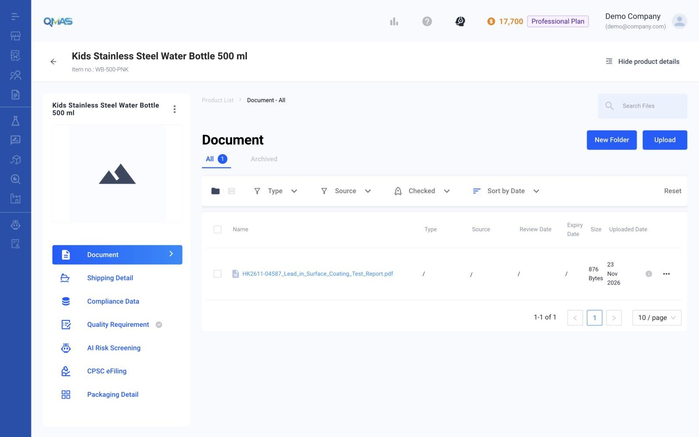

*Document tab with one test report and the filter controls.*

Tick one or more files to open the toolbar:

| Action | What it does |
|---|---|
| Set Data | Add compliance data (test, certificate or other) from this file. |
| Set Dates & Reminder | Set issue, expiry and review dates and an email reminder. |
| Archive | Move the file to the Archived tab. |
| Download | Download the file. |
| Share | Create a share link with an expiry period. Copy it or send it by email. |
| Rename / Edit Type | Change the file name or document type. |
| Move | Move the file to a folder. |
| Remove | Remove the file. |

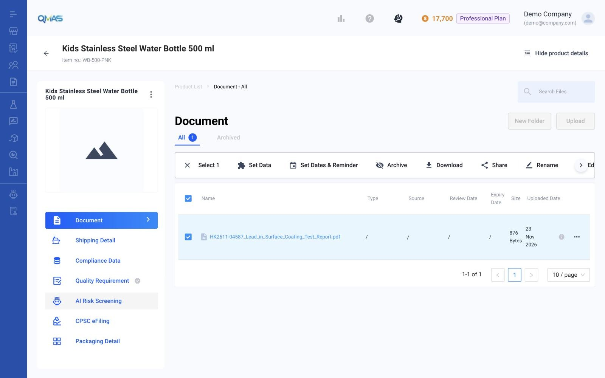

*Toolbar after selecting a file.*

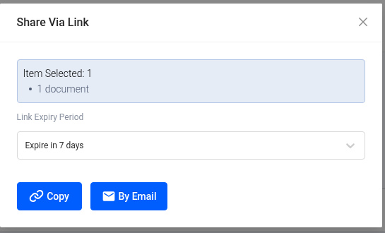

*Share Via Link — choose how long the link stays valid, then Copy or By Email.*

### 2. Shipping Detail

Shows the length, width, height, gross and net weight, quantity and barcode for the **Selling Unit**, **Inner Carton** and **Outer Carton**. To change them, click **⋮** next to the product name → **Edit product** and update **Shipping Information**.

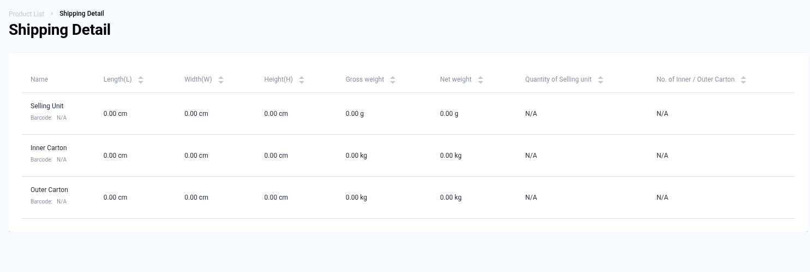

*Shipping Detail tab.*

### 3. Compliance Data

Three sections: **Test Data**, **Certificate Data** and **Other**. Click **Add Data** (or **Add** once a section has records).

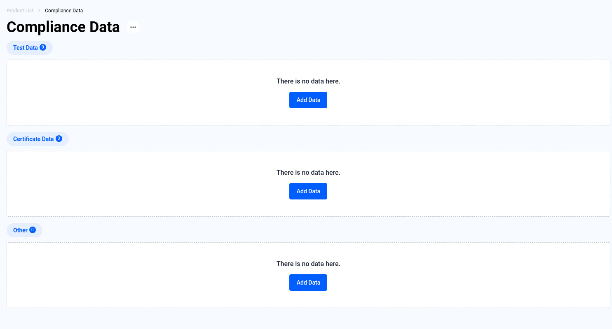

*Compliance Data tab before any data is added.*

**Test Data** records one test result:

- **Result** (required): Passed, Failed or Report As Is.
- **Export Market** (required). For US eFiling, choose **United States (CPSC eFiling submission)**.
- **Legislation, Test Item & Citation** (required): type a keyword such as “lead” and pick the test item from the list.
- **Report ID**, **Issue Party** (required), **Expiry Date** and **Test Date / Report Date**.
- Link the report under **Existing Product Document** (a file already on the product) or **New Document** (upload a new file).

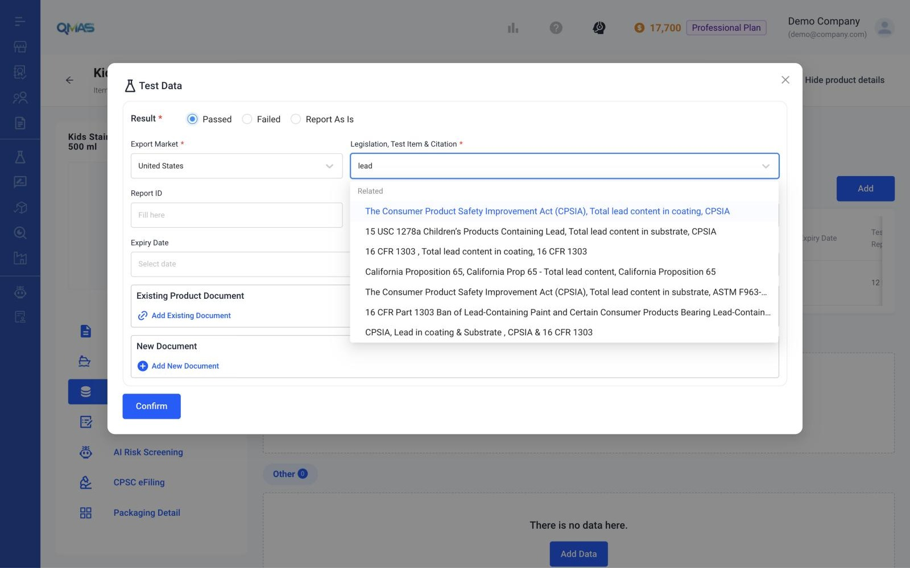

*Search legislation and test items by keyword.*

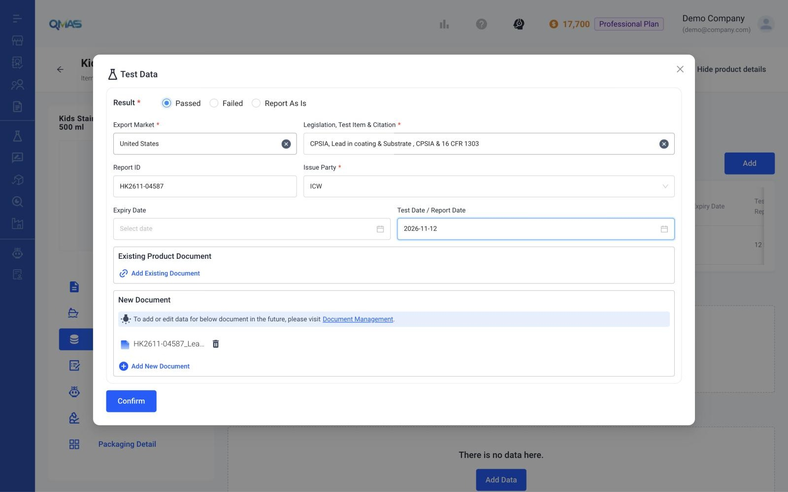

*A completed Test Data record with the report attached.*

Click **Confirm**. QMAS shows “Data Created” and the record appears in the Test Data table with its export market, legislation, test item, citation, report ID and issue party.

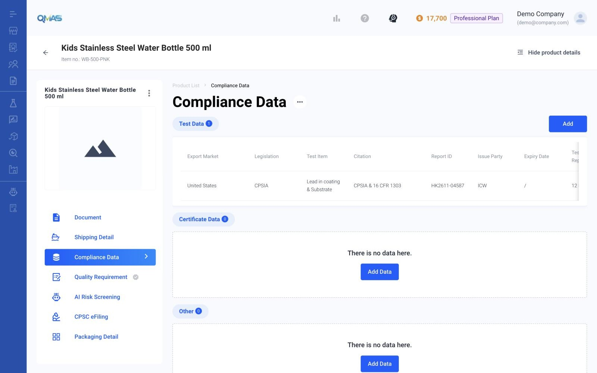

*Saved test data.*

**Certificate Data** works the same way. Fill in the certificate **Type**, **Issue Party**, **Score / Overall Rating**, **Expiry Date** and **Certificate Date**, then link the certificate file.

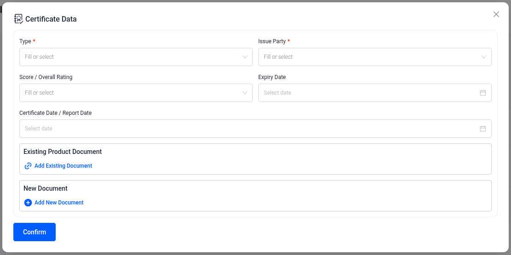

*Certificate Data form.*

### 4. Quality Requirement

Quality Requirement lists what the product must meet, for example a chemical test or a physical test. Each requirement has a **Type** (the group) and a **Name**. You can attach compliance data to a requirement as proof, mark it as completed, and send the requirements to Product Testing or Document Review.

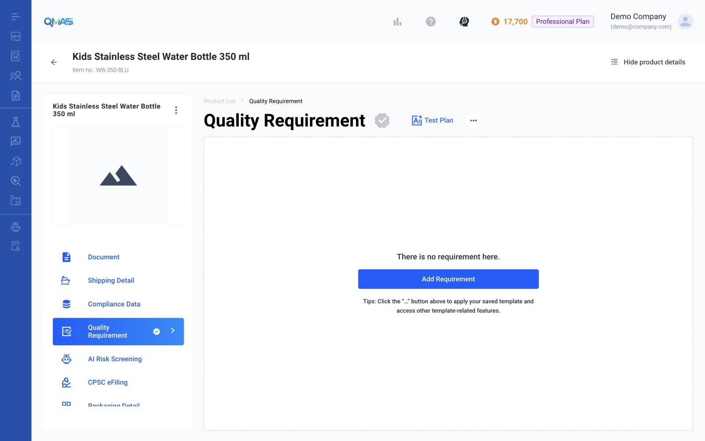

*Quality Requirement tab before any requirement is added: Add Requirement, Test Plan and the ⋯ menu.*

**4a. Add a requirement yourself**

- Click **Add Requirement** (or **Add** at the top right once the list has items).
- **Type**: pick an existing type, or type a new one and choose **+ Create “…”**. Example: *Chemical Testing*.
- **Name**: pick a name from the list for that type, or type a new one and choose **+ Create “…”**. Example: *Lead in Surface Coating (16 CFR 1303)*. Picking a different Type clears the Name.
- Tick **Mandatory** if the requirement must be met, then click **Confirm**. QMAS shows “Requirement Created”.

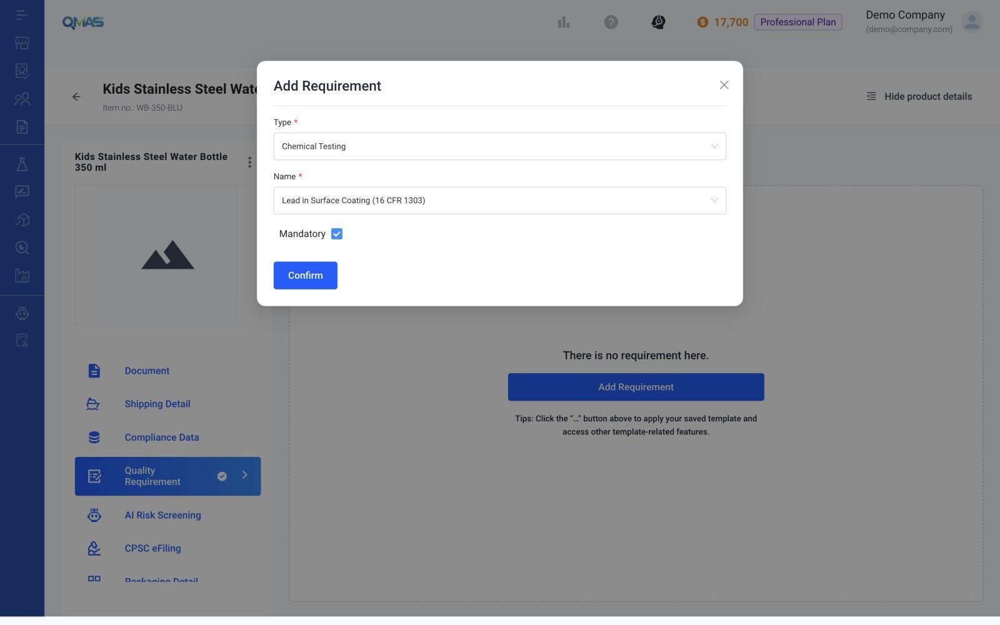

*Add Requirement with Type, Name and Mandatory filled in.*

Requirements are grouped by Type. The number next to the Type is how many requirements it has, and a red * marks a mandatory requirement.

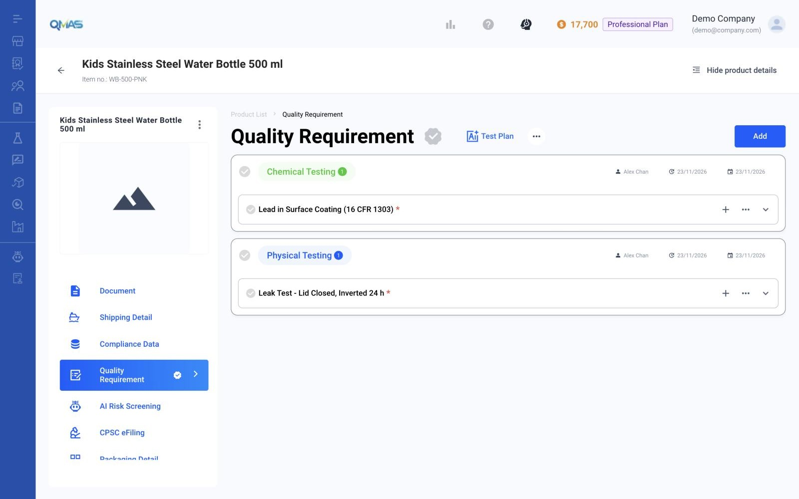

*Requirements grouped by Type: Chemical Testing and Physical Testing.*

**4b. Reuse requirements with templates**

Click **⋯** next to the title → **Templates**:

| Option | What it does |
|---|---|
| Apply Template | Search for a saved template, use **View** to preview it, then click **Apply**. All its requirements are added to this product. |
| Save As Template | Save this product's requirements as a template. Type a new name and choose **+ Create “…”**, then click **Confirm**. QMAS shows “Template saved”. |
| Manage Templates | See and manage your saved templates. |

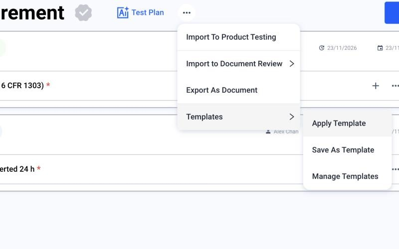

*⋯ → Templates: Apply Template, Save As Template and Manage Templates.*

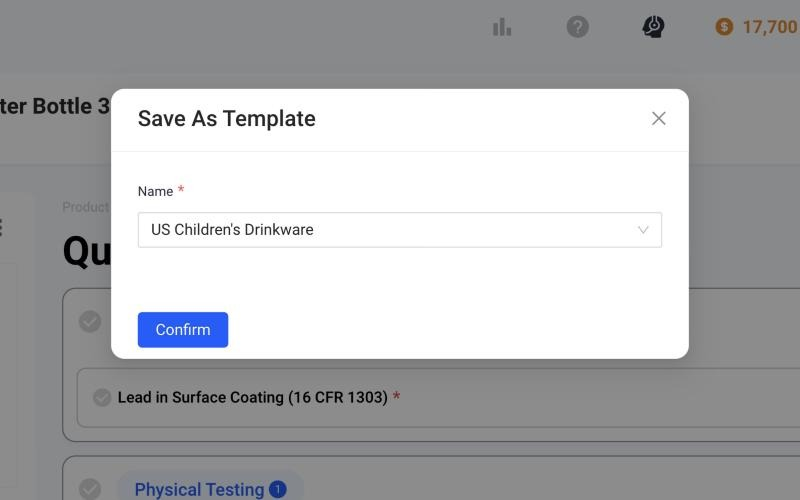

*Save As Template — name the template, then click Confirm.*

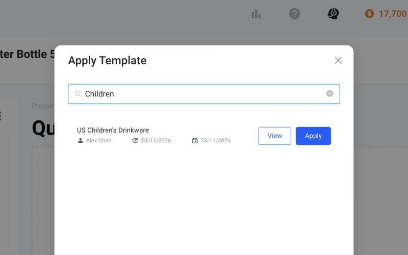

*Apply Template — search, View or Apply a saved template.*

After you click **Apply**, QMAS shows “<template name> applied” and the template's requirements appear in the list.

**4c. Attach proof and complete a requirement**

- Click **+** on a requirement to open **Attach Compliance Data**. Choose the **Test Data**, **Certificate Data** or **Other** tab, tick the records and click **Confirm**. QMAS shows “Data Added”. If a record you just added is missing, click **Reload Data**. To add new data, go to the Compliance Data tab first.
- The attached data appears under the requirement. Click **⌄** to expand or collapse it, and the bin icon to detach it.
- Click **⋯** on a requirement for **Edit**, **Duplicate**, **Upload Document**, **Mark As Completed** and **Remove**.
- **Mark As Completed** shows “Requirement Completed” and turns the requirement’s tick green.

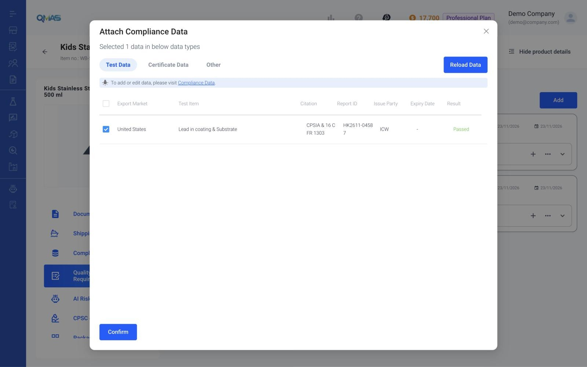

*Attach Compliance Data — tick the test record, then click Confirm.*

*The attached test data under the requirement.*

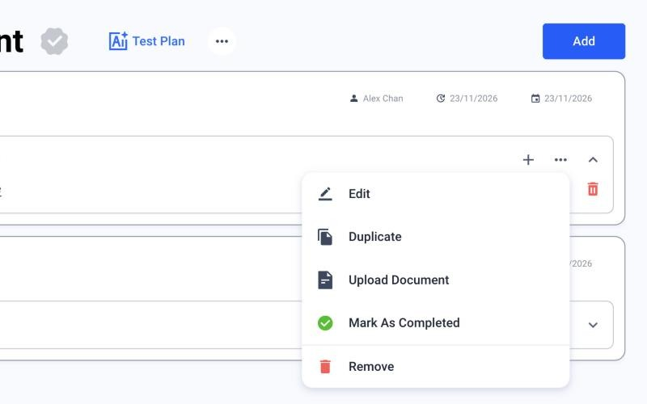

*⋯ menu on one requirement.*

*Requirement marked as completed — the ticks turn green.*

**4d. Send requirements to a job**

- **⋯ → Import To Product Testing**: click **Select** on each requirement (or **Select All**), then click **Confirm to Create Job**. Product Testing → Request Quotations opens with this product added, and the requirements appear under **Quality Requirement** in step 2.
- **⋯ → Import to Document Review** → **Create Job** or **Create Job for supplier**: opens the matching Document Review form for this product.
- **⋯ → Export As Document**: exports the requirement list as a document.

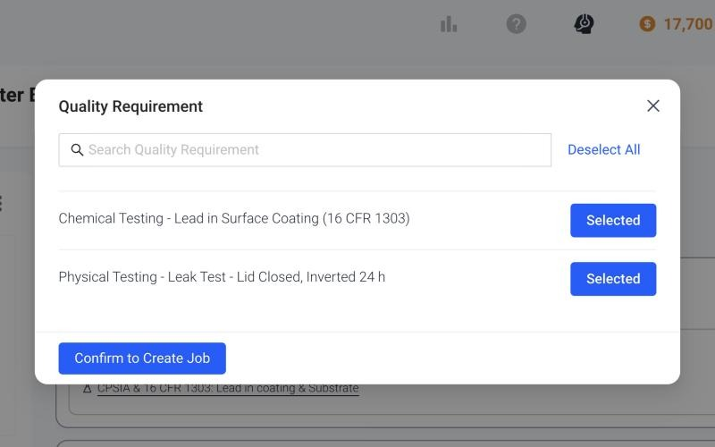

*Import To Product Testing — select requirements, then Confirm to Create Job.*

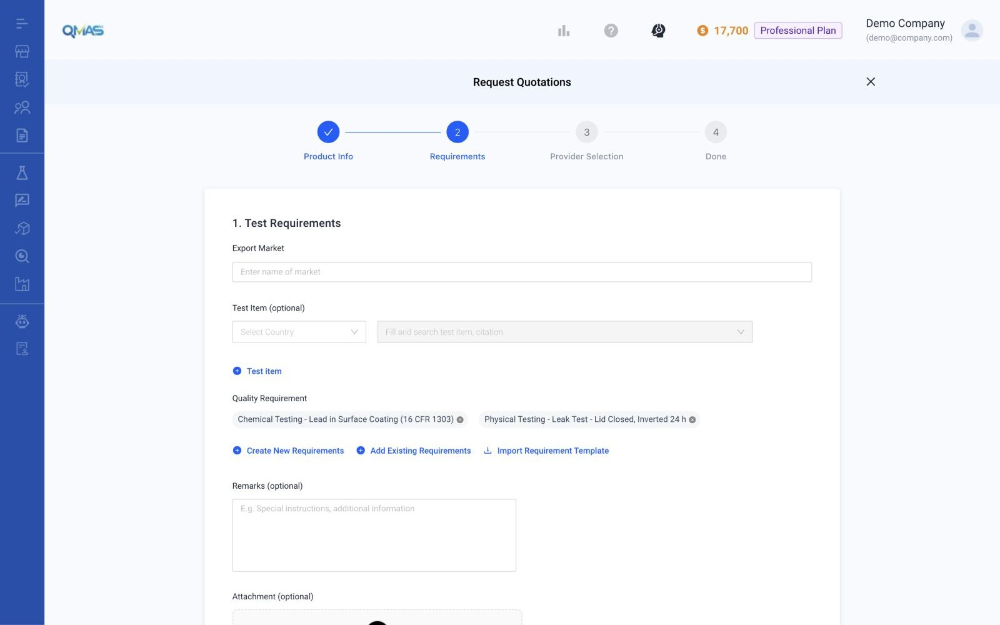

*The requirements carried into Product Testing step 2.*

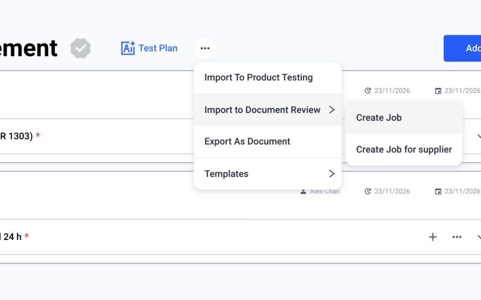

*Import to Document Review → Create Job or Create Job for supplier.*

**4e. Test Plan (AI)**

Click **Test Plan** to let AI suggest a test plan. Fill in the **Product Description** (more detail gives better results), **Import Country** and **Product Intended Used By**, upload up to 6 product images, then click **Generate Test Plan**.

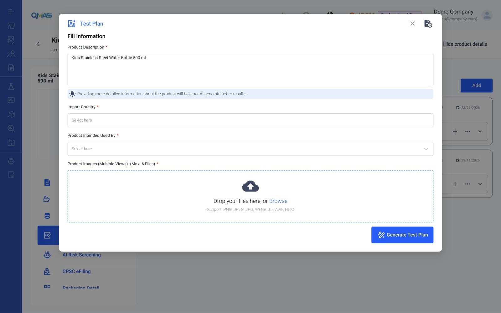

*Test Plan pop-up.*

### 5. AI Risk Screening

Lists the AI screenings for this product. Click **Add** to start one. The pop-up and results are explained in the [AI Insight](ai-insight.md) guide.

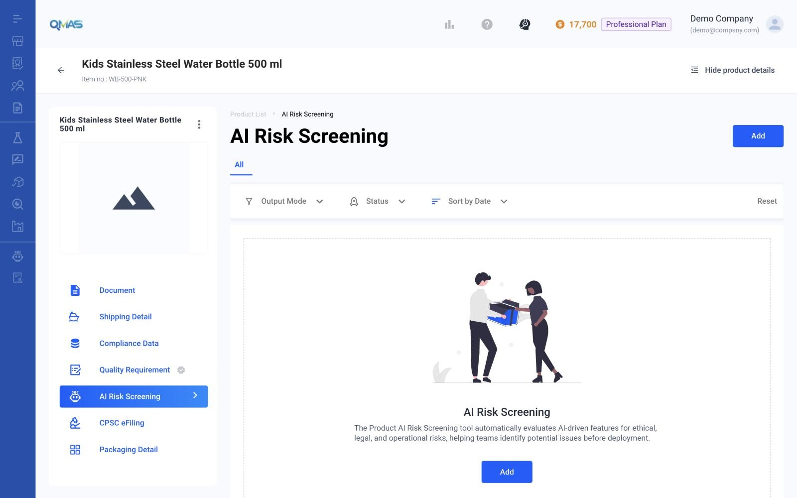

*AI Risk Screening tab.*

### 6. CPSC eFiling

Shows the **eFiling Log** for this product. Click **Submit eFiling** to create an eFiling. Before you can sync with CPSC, add your API Key and Secret Key in **Company Profile** (link in the grey note). The full flow is in the [eFiling](efiling.md) guide.

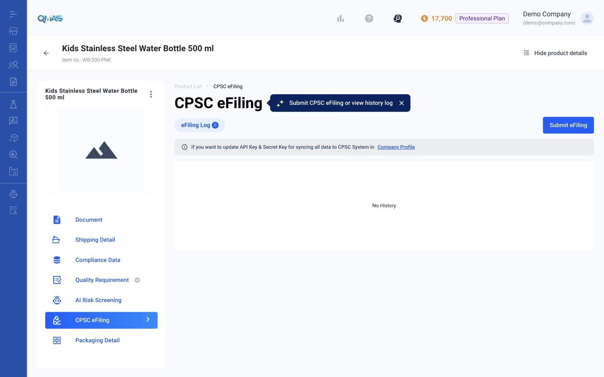

*CPSC eFiling tab.*

### 7. Packaging Detail

Lists the packaging components of the product. Click **Create Packaging Component** and fill in:

- **Basic Information**: name and description (required), identification no., function, legal role, weight, material type and name, status (Active, Inactive or Draft), and packaging images.
- **Dimension**, **Additional Information**, **Supplier Linkage** and **Technical Documentation** (expand each section).

Click **Confirm**. Use the **Status** filter to show active, inactive or draft components.

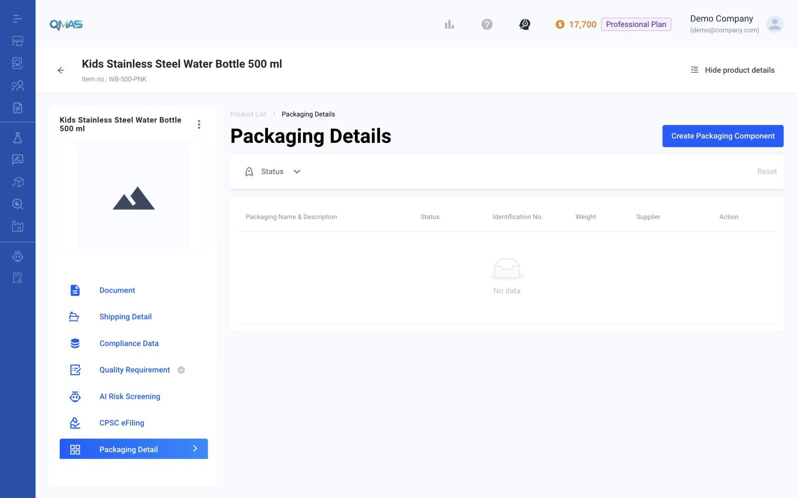

*Packaging Details tab.*

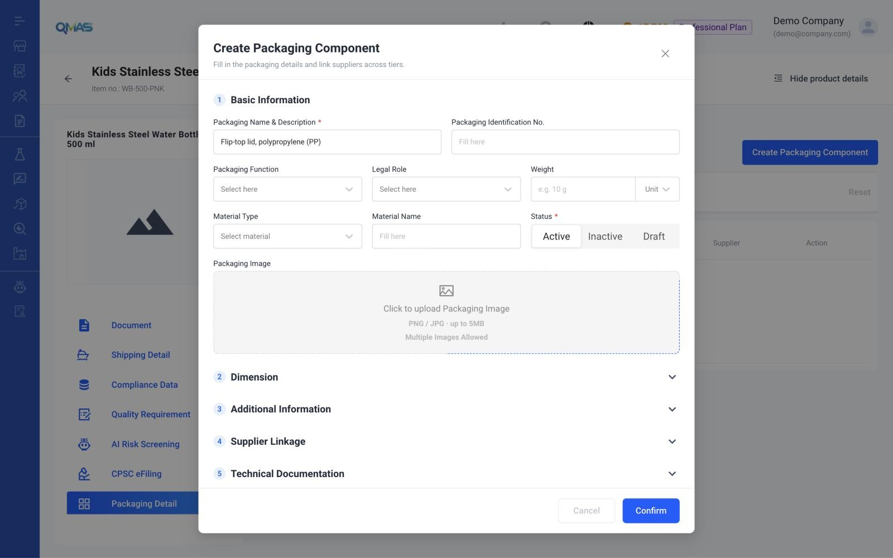

*Create Packaging Component.*

### 8. Import products in bulk

On the Product Management list, click **Import Product**. Download the ICW Product template (**download here**), fill it in, upload the Excel file (one file at a time), then click **Next**. Only the ICW template can be used.

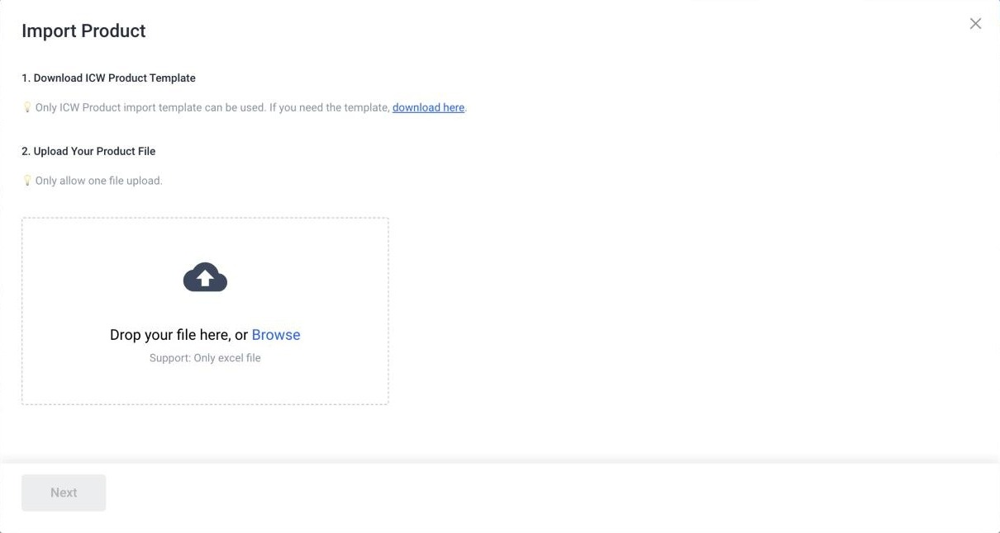

*Import Product.*

## Tips

- **Hide product details** at the top right hides the product card on the left.
- Link test reports to Test Data. eFiling can reuse this data when you quick-select test data.
- Use requirement **Templates** so similar products get the same requirements.

## FAQ

**Q: How do I add a test result to a product?**

A: Open the product → Compliance Data → Test Data → Add Data. Fill in Result, Export Market, Legislation/Test Item, Issue Party, link the report, then Confirm.

**Q: How do I share a product document?**

A: Open the product → Document, tick the file, click Share, choose the link expiry, then Copy or By Email.

**Q: How do I add quality requirements to a product?**

A: Open the product → Quality Requirement → Add Requirement, or ⋯ → Templates to apply a saved template.

**Q: Where do I record packaging information?**

A: Open the product → Packaging Detail → Create Packaging Component.

**Q: How do I import many products?**

A: On Product Management, click Import Product, download the ICW template, fill it in and upload it.

**Q: How do I reuse quality requirements for many products?**

A: Open a product → Quality Requirement → ⋯ → Templates → Save As Template. On other products use ⋯ → Templates → Apply Template.

**Q: How do I prove a requirement is met?**

A: On the requirement click +, attach the test or certificate data, then ⋯ → Mark As Completed.
