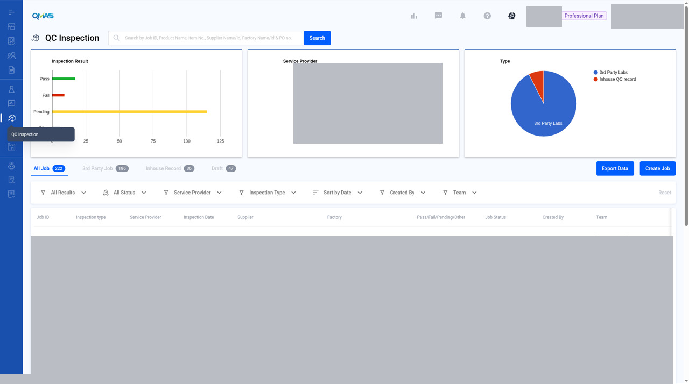
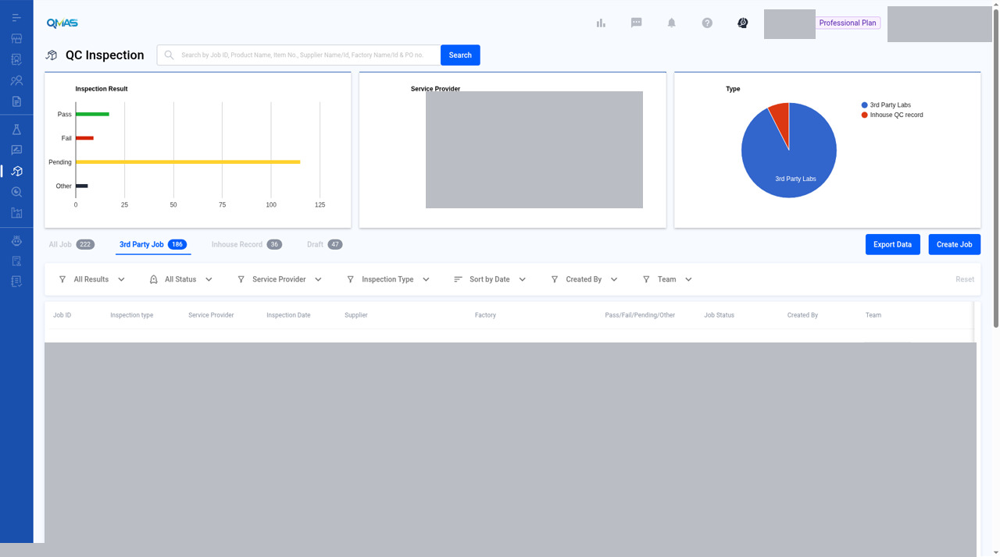
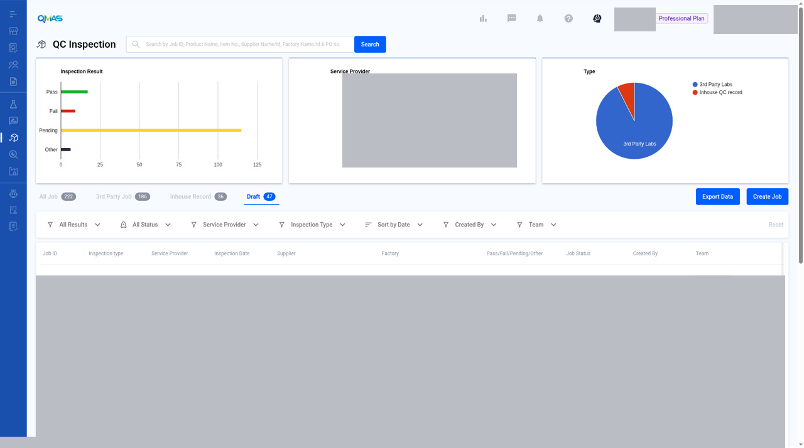
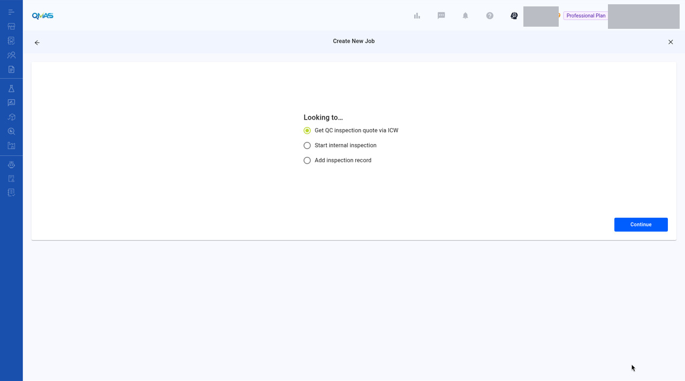
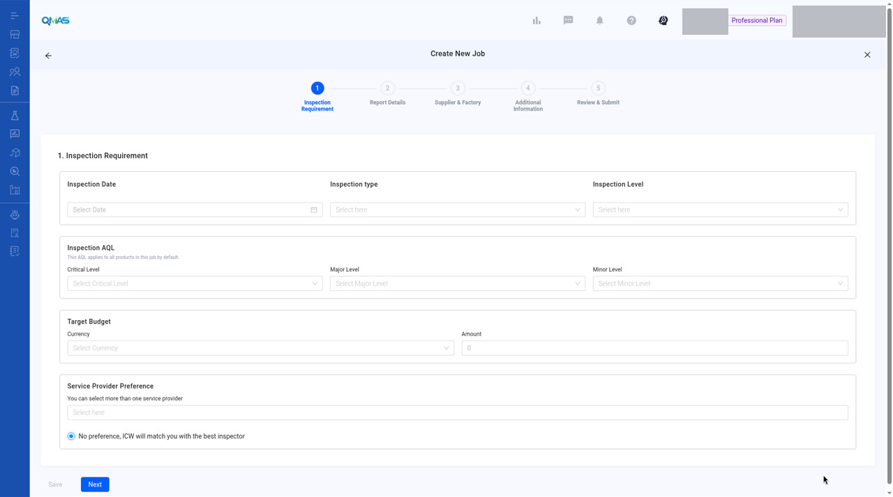

# QC Inspection — Get a QC Inspection Quote via ICW

> Updated working draft 2026-11-13-draft. This file is not deployed. Existing published version: https://marconip2026.github.io/qmas-user-guide/

## Source and verification

**Mixed.** The reviewed list and Looking-to create path are current UI verified. Quote Available, QUOTES, and SELECT are older Help Center wording and are not dev-verified.

Do not mark this whole module unverified. Source: QMAS Help Center — How To Request Quotation For QC Inspection From Global Laboratories, last edited 2026-11-04 12:15:22 HKT. The November 2026 update covers the create path. The later quote flow still needs verification.

- [How To Request Quotation For QC Inspection From Global Laboratories](https://app.notion.com/p/bf607ad093d24e3c8d483dd85d9a474e) (last edited 2026-11-04 12:15:22 HKT). Create path is current UI verified. The later Quote Available flow is source-only, not dev-verified.

Help Center home: [QMAS Help Center](https://icw-io.notion.site/QMAS-Help-Center-5cd9414da2474d16a7c405a3542fe4af) (last edited 2026-01-20 13:54:13 HKT). User Guide index: [User Guide](https://app.notion.com/p/a92963a30e584145bb457a62b7706541) (last edited 2026-01-16 15:44:49 HKT). Public icw-io addresses for individual articles were not verified, so those links use app.notion.com.

Ask ICW to quote and arrange a third-party QC inspection for your products.

- **Module:** QC Inspection
- **Start here:** https://qmas.icw.io/inspection → **Create Job** → **Get QC inspection quote via ICW**
- **Direct link:** https://qmas.icw.io/inspection/jobs/new
- **Steps:** 1 Inspection Requirement → 2 Report Details → 3 Supplier & Factory → 4 Additional Information → 5 Review & Submit
- **Checked against:** QMAS dev, 4 Nov 2026

## Overview

1. Open **QC Inspection**, click **Create Job**, choose **Get QC inspection quote via ICW** and click **Continue**.
2. **Inspection Requirement**: date, type, level, AQL, budget and provider preference.
3. **Report Details**: products and POs to inspect.
4. **Supplier & Factory**: who makes the goods and where the inspection takes place.
5. **Additional Information**: files and remarks.
6. **Review & Submit**: check everything and click **Submit**.

## Step-by-step

### 1. Open QC Inspection

In the left menu, open **QC Inspection**. The charts show inspection results, service providers and job types. Tabs list **All Job**, **3rd Party Job**, **Inhouse Record** and **Draft**. Click **Create Job**.

*QC Inspection list with Create Job.*

Job rows are masked. Tabs, column headers, and Create Job stay visible. This is a 1280×800 desktop crop (1280×714), not a high-resolution screenshot.

*QC Inspection — 3rd Party Job tab.*

Supplementary screenshot, not one of the 98 inventory slots. Job rows are masked.

*QC Inspection — Draft tab.*

Supplementary screenshot, not one of the 98 inventory slots. Job rows are masked.

### 2. Choose what you are looking for

| Option | Use it when |
|---|---|
| Get QC inspection quote via ICW | You want ICW to arrange a third-party inspector. This guide. |
| Start internal inspection | Your own QC team will inspect. See the Internal QC Inspection guide. |
| Add inspection record | The inspection is already done and you want to record the result. |

Choose **Get QC inspection quote via ICW** and click **Continue**.

*Create New Job — Looking to…*

Default selection is Get QC inspection quote via ICW. Continue is visible. No personal data is filled in.

### 3. Inspection Requirement

- **Inspection Date**.
- **Inspection type**: Final Random, Loading, During Production, Re-Inspection, Initial Production, Fabric, 100% or Vendor Own Inspection.
- **Inspection Level**: General Inspection Level I–III or Special Level S-1 to S-4.
- **Inspection AQL**: Critical, Major and Minor levels. They apply to all products in this job by default.
- **Target Budget** (currency and amount) and **Service Provider Preference**. Leave “No preference, ICW will match you with the best inspector” selected if you have no preferred provider.

The reviewed screenshot of this step is the blank form. It includes Target Budget and Service Provider Preference. It is not a filled or submitted job. The filled step-1 screenshot is still pending.

*Create Job step 1 Inspection Requirement, blank (includes Target Budget and Service Provider Preference).*

Supplementary screenshot, not one of the 98 inventory slots. Blank form only.

> **Image pending privacy review:** `04-step1-filled.jpg`
>
> Reviewed replacement image not available yet. Follow the written steps above.

*Step 1 filled in. Click Save to keep a draft, or Next.*

### 4. Report Details

Click **Add Product**, search for the product, click **Select**, then **Confirm**.

> **Image pending privacy review:** `05-select-product.jpg`
>
> Reviewed replacement image not available yet. Follow the written steps above.

*Select related product(s) — search by name, item no., supplier or factory.*

For each product, fill in the **PO** details: customer name, customer PO #, PO #, order quantity and number of cartons. Use **Add New PO** for more POs, **Add Product** for more products, and **Add Report** or **Duplicate Report** if you need separate reports. Tick **Signed Sample Available** if there is one. Click **Next**.

> **Image pending privacy review:** `06-step2-report.jpg`
>
> Reviewed replacement image not available yet. Follow the written steps above.

*Report 1 with one product and its PO.*

### 5. Supplier & Factory

Click **Add Supplier** and select the supplier. Then click **Select Existing Factory** and choose the factory where the inspection will take place. Check the contact person, phone and email for each. Click **Next**.

> **Image pending privacy review:** `07-step3-supplier-factory.jpg`
>
> Reviewed replacement image not available yet. Follow the written steps above.

*Supplier and factory selected, with contact details.*

### 6. Additional Information

Upload reference files such as tech packs or previous reports, and write any special requirement in **Remark**. Click **Next**.

> **Image pending privacy review:** `08-step4-additional.jpg`
>
> Reviewed replacement image not available yet. Follow the written steps above.

*Step 4 Additional Information.*

### 7. Review & Submit

Check the summary. Click **Edit** on any section to change it. Click **Submit**.

> **Image pending privacy review:** `09-step5-review.jpg`
>
> Reviewed replacement image not available yet. Follow the written steps above.

*Step 5 Review & Submit.*

### 8. Done — job detail

QMAS shows “Create job successfully!” and opens the job. It has a Job ID and starts as **Under Review**. The **Quotes**, **Reports**, **Attachments** and **Invoices** tabs follow the job.

> **Image pending privacy review:** `10-job-detail.jpg`
>
> Reviewed replacement image not available yet. Follow the written steps above.

*The new inspection job.*

## Tips

- Click **Save** on any step to keep a draft. Drafts are on the **Draft** tab.
- Submit well before the inspection date so there is time for quoting and booking.

## FAQ

**Q: How do I book a third-party QC inspection?**

A: Go to QC Inspection (https://qmas.icw.io/inspection), click Create Job, choose Get QC inspection quote via ICW, then complete the 5 steps and Submit.

**Q: What is the difference between a QC inspection quote and an internal inspection?**

A: A quote via ICW uses a third-party inspector arranged by ICW. An internal inspection is done by your own QC team (Internal QC Inspection).

**Q: Can I save a QC job and finish it later?**

A: Yes. Click Save on any step. The job is kept on the Draft tab.

## Help Center additions and remaining gaps

This section adds Help Center material and named gaps. It does not replace the steps above.

- **Source-documented** — written in the original Help Center. The last-edited date is given. That does not by itself prove the current QMAS UI.
- **Dev-verified** — confirmed on qmas-dev.icw.io during guide work.
- **Gap** — named as missing or too thin. Not current behaviour until checked on dev.

Reviewed screenshots remain 56 of 98. Forty-two inventory slots are still pending. Six supplementary images are not part of the 98. Unreviewed screenshots were not copied.

### Source-documented — create path (Help Center updated 2026-11-04)

Source: How To Request Quotation For QC Inspection From Global Laboratories, https://app.notion.com/p/bf607ad093d24e3c8d483dd85d9a474e. Direct link cited there: https://qmas.icw.io/inspection/jobs/new.

The November 2026 create steps already match this page. The Help Center also says: choose **Get QC inspection quote via ICW** and click Continue; choose **Start internal inspection** if your own QC team will inspect; or **Add inspection record** to record a finished inspection. The Internal QC page covers starting an internal inspection. **Add inspection record** still has no guide.

The November 2026 steps also say: click **Save** on any step to finish later. Drafts are on the **Draft** tab.

### Source-documented — post-submit flow (older wording; needs verification)

1. After submission, the list status is **Under Review**.
2. When the quotation is ready, the status changes to **Quote Available**.
3. Click **View detail** next to Status.
4. Scroll to the **QUOTES** tab.
5. Choose a quotation and click **SELECT** to confirm the order.
6. Status becomes **Waiting for reserved booking**, then **Booking Reserved** when the booking is confirmed.
7. After the inspection is completed, the Help Center says you will receive the inspection report and the status will be **Completed**.

### Remaining gaps

- The full **Add inspection record** flow.
- Job-detail tabs Quotes, Reports, Attachments, and Invoices are named. One overview shot exists.
- All Job, 3rd Party, and Inhouse Record tabs, and more detail on the Draft tab.
- List filters, Export, and the row toolbar.
- Filed wording bugs (“Add New Po”, “XLSL”, level labels, empty product picker until search). Confirm the live UI. Do not invent fixes.

Help Center reconciliation 2026-11-13 (HKT). Original Help Center not edited. This draft is not the public guide. No Dify upload.
