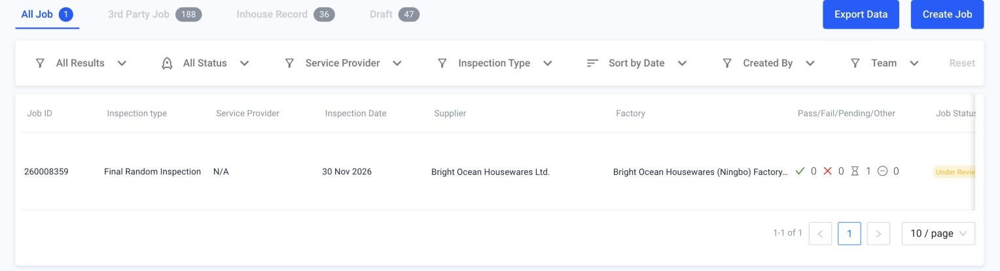
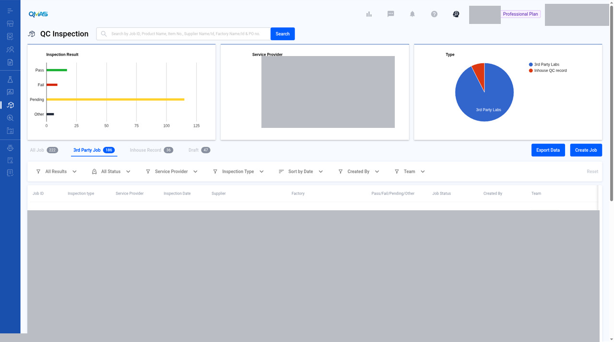
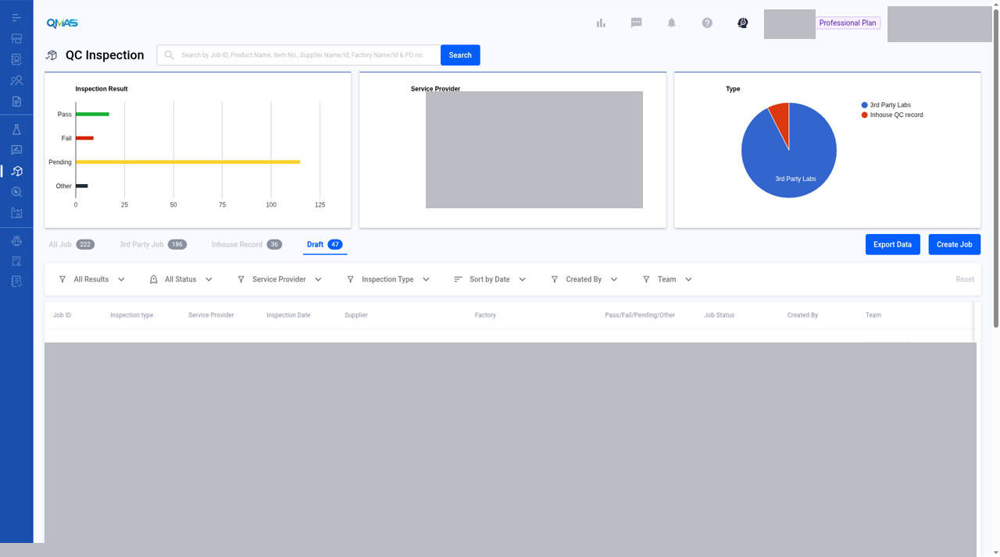
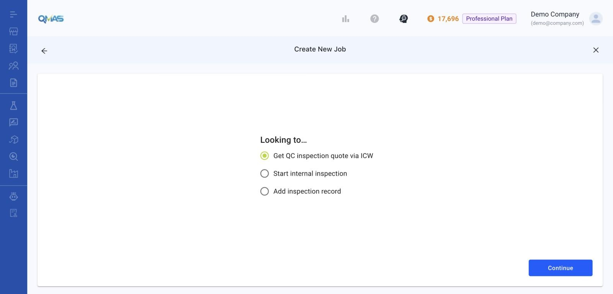
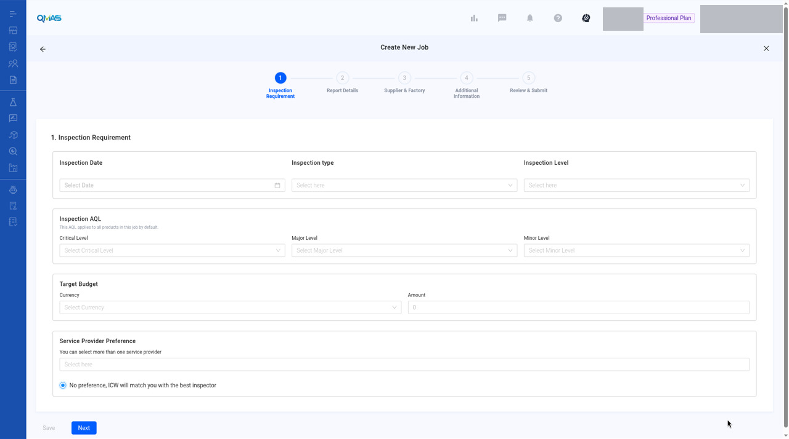

# QC Inspection — Get a QC Inspection Quote via ICW

Ask ICW to quote and arrange a third-party QC inspection for your products.

- **Module:** QC Inspection
- **Start here:** https://qmas.icw.io/inspection → **Create Job** → **Get QC inspection quote via ICW**
- **Direct link:** https://qmas.icw.io/inspection/jobs/new
- **Steps:** 1 Inspection Requirement → 2 Report Details → 3 Supplier & Factory → 4 Additional Information → 5 Review & Submit

## Overview

1. Open **QC Inspection**, click **Create Job**, choose **Get QC inspection quote via ICW** and click **Continue**.
2. **Inspection Requirement**: date, type, level, AQL, budget and provider preference.
3. **Report Details**: products and POs to inspect.
4. **Supplier & Factory**: who makes the goods and where the inspection takes place.
5. **Additional Information**: files and remarks.
6. **Review & Submit**: check everything and click **Submit**.

## Step-by-step

### 1. Open QC Inspection

In the left menu, open **QC Inspection**. The charts show inspection results, service providers and job types. Tabs list **All Job**, **3rd Party Job**, **Inhouse Record** and **Draft**. Click **Create Job**.

*QC Inspection list with Create Job.*

*QC Inspection — 3rd Party Job tab.*

*QC Inspection — Draft tab.*

### 2. Choose what you are looking for

| Option | Use it when |
|---|---|
| Get QC inspection quote via ICW | You want ICW to arrange a third-party inspector. This guide. |
| Start internal inspection | Your own QC team will inspect. See the Internal QC Inspection guide. |
| Add inspection record | The inspection is already done and you want to record the result. |

Choose **Get QC inspection quote via ICW** and click **Continue**.

*Create New Job — Looking to…*

### 3. Inspection Requirement

- **Inspection Date**.
- **Inspection type**: Final Random, Loading, During Production, Re-Inspection, Initial Production, Fabric, 100% or Vendor Own Inspection.
- **Inspection Level**: General Inspection Level I–III or Special Level S-1 to S-4.
- **Inspection AQL**: Critical, Major and Minor levels. They apply to all products in this job by default.
- **Target Budget** (currency and amount) and **Service Provider Preference**. Leave “No preference, ICW will match you with the best inspector” selected if you have no preferred provider.

*Create Job step 1 — Inspection Requirement, including Target Budget and Service Provider Preference.*

### 4. Report Details

Click **Add Product**, search for the product, click **Select**, then **Confirm**.

For each product, fill in the **PO** details: customer name, customer PO #, PO #, order quantity and number of cartons. Use **Add New PO** for more POs, **Add Product** for more products, and **Add Report** or **Duplicate Report** if you need separate reports. Tick **Signed Sample Available** if there is one. Click **Next**.

### 5. Supplier & Factory

Click **Add Supplier** and select the supplier. Then click **Select Existing Factory** and choose the factory where the inspection will take place. Check the contact person, phone and email for each. Click **Next**.

### 6. Additional Information

Upload reference files such as tech packs or previous reports, and write any special requirement in **Remark**. Click **Next**.

### 7. Review & Submit

Check the summary. Click **Edit** on any section to change it. Click **Submit**.

### 8. Done — job detail

QMAS shows “Create job successfully!” and opens the job. It has a Job ID and starts as **Under Review**. The **Quotes**, **Reports**, **Attachments** and **Invoices** tabs follow the job.

## Tips

- Click **Save** on any step to keep a draft. Drafts are on the **Draft** tab.
- Submit well before the inspection date so there is time for quoting and booking.

## FAQ

**Q: How do I book a third-party QC inspection?**

A: Go to QC Inspection (https://qmas.icw.io/inspection), click Create Job, choose Get QC inspection quote via ICW, then complete the 5 steps and Submit.

**Q: What is the difference between a QC inspection quote and an internal inspection?**

A: A quote via ICW uses a third-party inspector arranged by ICW. An internal inspection is done by your own QC team (Internal QC Inspection).

**Q: Can I save a QC job and finish it later?**

A: Yes. Click Save on any step. The job is kept on the Draft tab.
