# QMAS User Guide

> Updated working draft 2026-11-13-draft. This file is not deployed. Existing published version: https://marconip2026.github.io/qmas-user-guide/

Notion working hub: https://app.notion.com/p/4139c62c39fc8198ac49e172050cf65b

QMAS Chatbot: https://workflow-dev.icw.io/chat/QDSPY8f58691bu1P. Published about 17:40 HKT on 13 Nov 2026. The published product name is Marco Test 3.0. The published product text and 2 images were checked. The header in that app still reads QMAS Chatbot 2.0.

## Contents

- [Product Testing — Request a Quotation](#product-testing)
- [Getting Started — Home, Settings and Company Profile](#getting-started)
- [Product Management — Create and Edit a Product](#product-management)
- [Product Management — Every Tab of the Product Profile](#product-profile)
- [Test Plan — Request a Test Plan](#test-plan)
- [eFiling — Submit eFiling to CPSC](#efiling)
- [Supplier Management — Create a Supplier](#supplier-management)
- [Factory Management — Create a Factory](#factory-management)
- [Factory Audit — Request a Quotation](#factory-audit)
- [Document Management — Upload a Document](#document-management)
- [QC Inspection — Get a QC Inspection Quote via ICW](#qc-inspection)
- [Internal QC Inspection — Start an Internal Inspection](#internal-qc-inspection)
- [Document Review — Create a Review Job](#document-review)
- [AI Insight — Run an AI Risk Screening](#ai-insight)

# Product Testing — Request a Quotation

> Updated working draft 2026-11-13-draft. This file is not deployed. Existing published version: https://marconip2026.github.io/qmas-user-guide/

## Source and verification

**Mixed.** The reviewed create-job screens are current UI verified. Quote Available, Preliminary Accept, and Final Quote are older Help Center wording and are not dev-verified.

Do not mark this whole module unverified. Source: QMAS Help Center — How To Request Quotation For Product Testing From Global Laboratories, last edited 2026-11-04 11:18:27 HKT. The November 2026 update covers the create path. The later quote and accept flow still needs verification.

- [How To Request Quotation For Product Testing From Global Laboratories](https://app.notion.com/p/a57449507c7c4ceea2ed34a1dbbe9f12) (last edited 2026-11-04 11:18:27 HKT). Create path is current UI verified. Preliminary Accept and Final Quote are source-only, not dev-verified.

Help Center home: [QMAS Help Center](https://icw-io.notion.site/QMAS-Help-Center-5cd9414da2474d16a7c405a3542fe4af) (last edited 2026-01-20 13:54:13 HKT). User Guide index: [User Guide](https://app.notion.com/p/a92963a30e584145bb457a62b7706541) (last edited 2026-01-16 15:44:49 HKT). Public icw-io addresses for individual articles were not verified, so those links use app.notion.com.

Create a product testing job and get a quotation from a laboratory.

- **Module:** Product Testing
- **Start here:** [qmas.icw.io/product-testing](https://qmas.icw.io/product-testing) → **Create Job**
- **Direct link:** [qmas.icw.io/product-testing/create-job](https://qmas.icw.io/product-testing/create-job)
- **Steps:** 1 Product Info → 2 Requirements → 3 Provider Selection → 4 Done

## Overview

1. **Open Product Testing** and click **Create Job**.
2. **Product Info** — add an existing product or create a new one.
3. **Requirements** — set the export market, test items, quality requirements and service details.
4. **Provider Selection** — choose Connected Provider, ICW or TicMart, then **Submit**.
5. **Done** — the Order details page opens. Track the job there or in the Product Testing list.

## Step-by-step

### 1. Open Product Testing

In the left menu, open **Product Testing**. The page shows charts of job status, service provider and test results, and the list of all jobs. Click **Create Job** above the list.

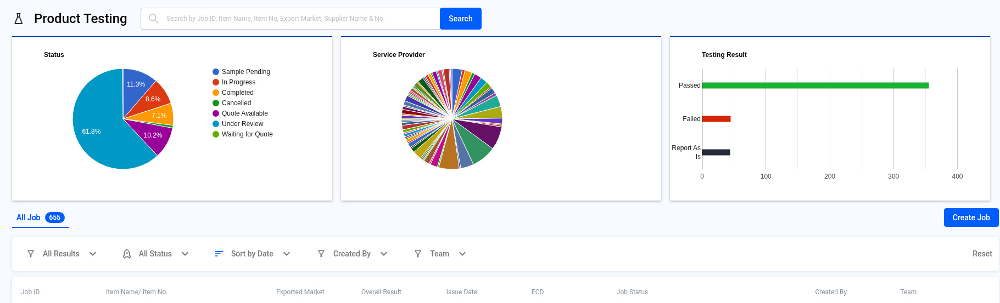

*Product Testing list — Create Job is at the top right of the job list.*

### 2. Product Info — select products

The **Request Quotations** wizard opens. Add the products for this testing order:

- **+ Existing Products** picks from your Product Management list.
- **+ Add Products** creates a new product here.

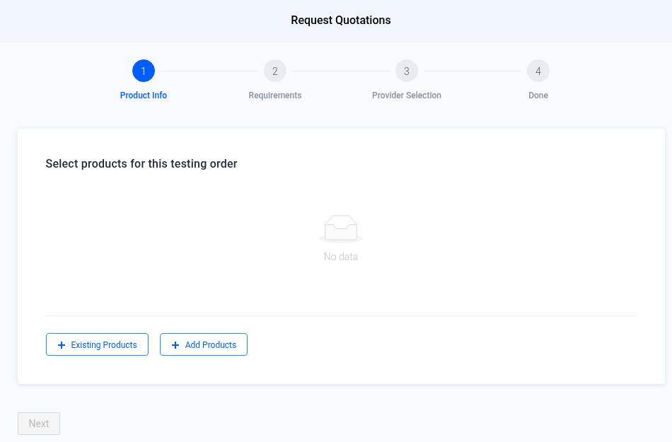

*Step 1 starts empty. Next stays disabled until a product is added.*

In the **Select Product(s)** pop-up, search by product name or ID, click **Select** on each product you need, then click **Confirm**. You can select more than one product.

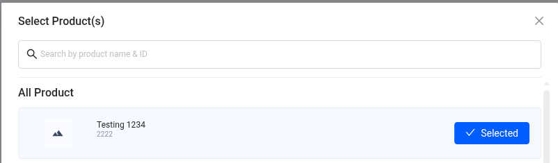

*A selected product shows a blue “✓ Selected” button.*

Check the product details. You can change **Item name on report** and **Item no. on report**, which are printed on the test report. Click **Add PO Information** to link a purchase order (optional). Then click **Next**.

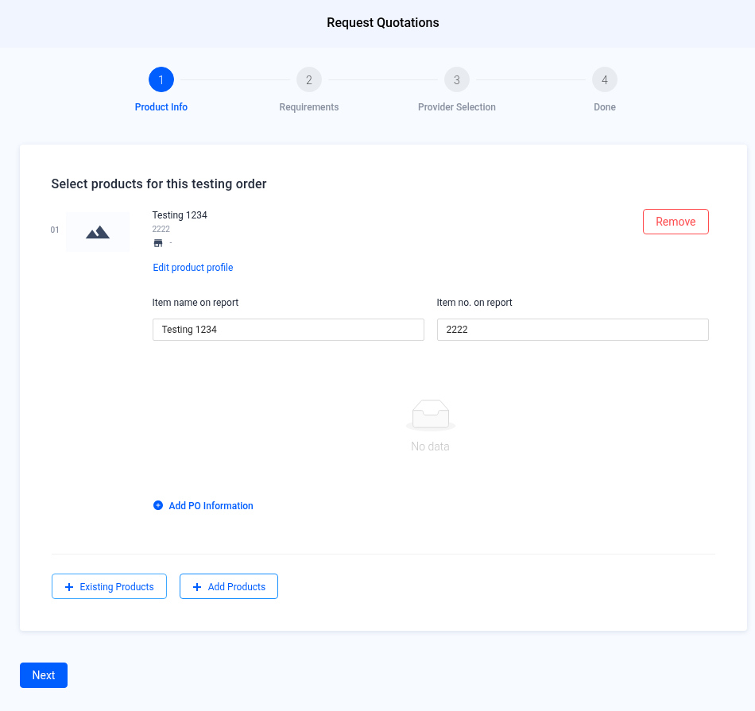

*Use Remove to drop a product, or Edit product profile to update it.*

### 3. Requirements

**1. Test Requirements**

- **Export Market** — where the product will be sold (required).
- **Test Item** (optional) — choose a country, then search for test items or citations.
- **Quality Requirement** — Create New Requirements, Add Existing Requirements, or Import Requirement Template.
- **Remarks** and **Attachment** (optional) — special instructions and reference files.

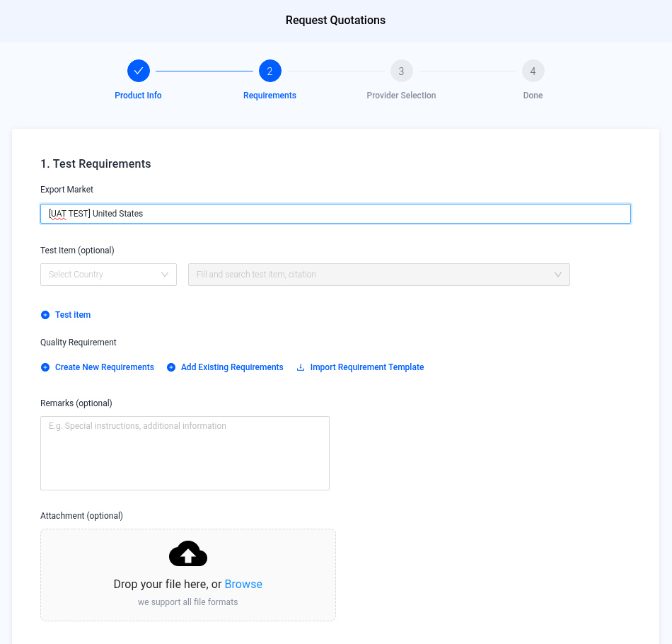

*Export Market filled in.*

**2. Additional Information**

- **Service Level** — Regular, Express or Shuttle / Emergency.
- **Country of Origin** — where the product is made (you can pick more than one).
- **Intended Usage** — General product, Adult product, Children product or Toys.
- **Buyer Name** (optional).

When all required fields are filled, **Next** turns blue. Click it.

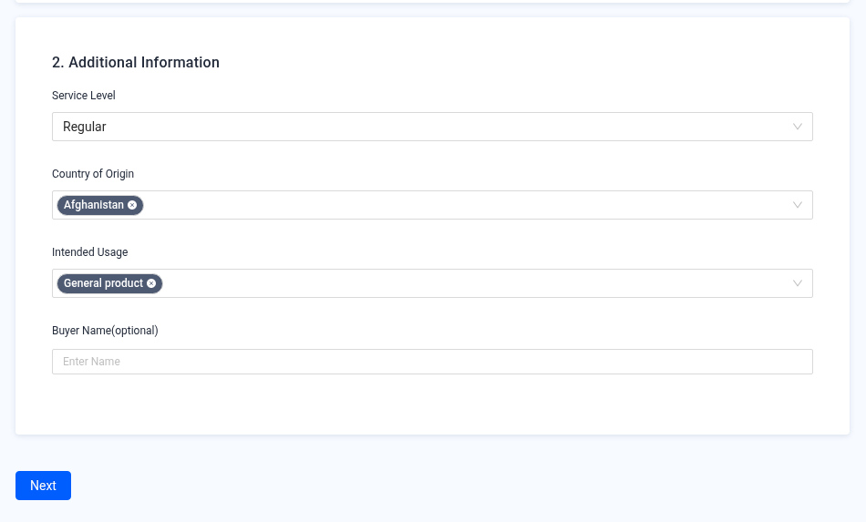

*Additional Information filled — Next is now enabled.*

### 4. Provider Selection

Choose who should quote this job. You can tick more than one:

| Option | Use it when |
|---|---|
| Connected Provider | You already work with a lab that is connected to your QMAS account. |
| ICW | You want ICW to find a lab. Pick a preferred lab, or leave “No Preference”. |
| TicMart (Marketplace) | You want quotations from labs in the TicMart marketplace. |

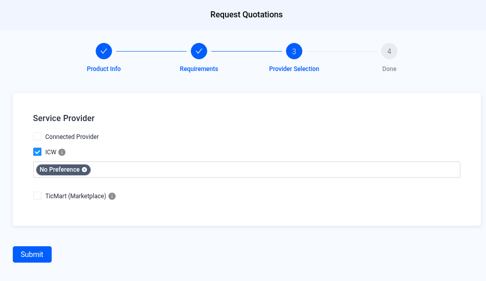

*ICW ticked with “No Preference”. Click Submit to send the request.*

### 5. Done — track your order

After you click **Submit**, QMAS shows “Product testing created successfully” and opens the **Order details** page. Your job has a new order number (for example 260008342) and starts as **Under Review**.

- **Product Testing Requirements**, **Products**, **Supplier**, **PO** and **Test Plan** tabs show what you submitted.
- **Quotations** on the right shows lab quotes when they arrive.
- The tabs below (Quotes, Failure Records, Reports, Attachments, Invoices, Tag, Activity Log, Message Board) follow the job until the report is ready.

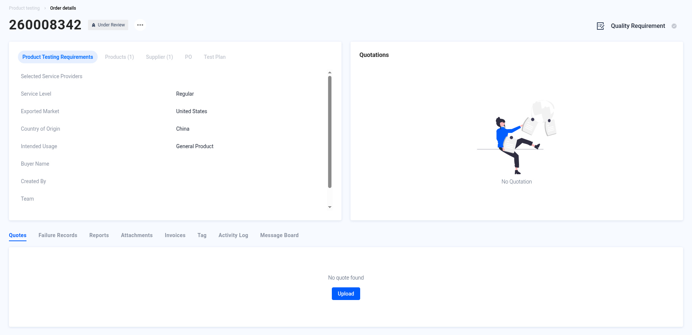

*The new order opens with status Under Review. You can find it again in the Product Testing list.*

## Tips

- Items marked **(optional)** can be skipped. Next stays grey until every required field on the step is filled. A field you leave empty turns red with a message, for example “Country of origin is required”.
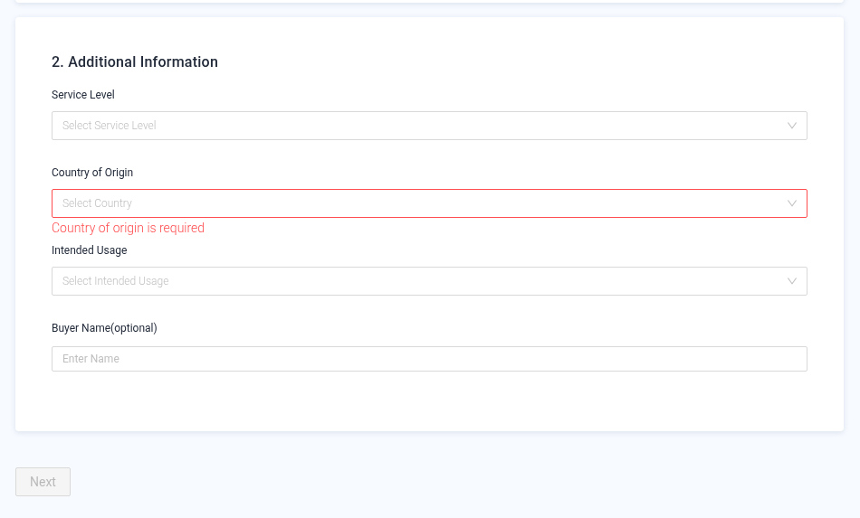

*Required field left empty.*
- Item name and item no. on report are what the lab prints on the test report. Check them before you continue.
- To leave the wizard, click **✕** at the top right.

## Help Center additions and remaining gaps

This section adds Help Center material and named gaps. It does not replace the steps above.

- **Source-documented** — written in the original Help Center. The last-edited date is given. That does not by itself prove the current QMAS UI.
- **Dev-verified** — confirmed on qmas-dev.icw.io during guide work.
- **Gap** — named as missing or too thin. Not current behaviour until checked on dev.

Reviewed screenshots remain 56 of 98. Forty-two inventory slots are still pending. Six supplementary images are not part of the 98. Unreviewed screenshots were not copied.

### Source-documented — create path (Help Center updated 2026-11-04)

Source: How To Request Quotation For Product Testing From Global Laboratories, https://app.notion.com/p/a57449507c7c4ceea2ed34a1dbbe9f12. Direct link cited there: https://qmas.icw.io/product-testing/create-job.

The November 2026 create steps already match this page. Help Center step 7 also says you can tick **Connected Provider** (a lab already linked to the account), **ICW** (ICW finds a lab; preferred lab or “No Preference”), and/or **TicMart (Marketplace)**, then Submit. This page still only has an ICW screenshot.

### Source-documented — post-submit quote flow (older wording; needs verification)

This “receive and confirm” section was not rewritten in November 2026.

1. After submission, the job appears on the list with status **under review**.
2. When the quotation is ready, the status changes to **Quote Available**.
3. Open order details. Under **Quotations**, select a quotation and click **Preliminary Accept**.
4. The Help Center says the designated agency or ICW agency service will then contact you about sample delivery.
5. “The price may vary according to the actual sample. Accept the **Final Quote** to proceed to product testing.”

A 2022 FAQ says cancelling an order is done by contacting customer support via email or online chat. Not re-verified.

### Remaining gaps

- Screenshots and current-UI confirmation for Connected Provider and TicMart.
- Job-detail tabs named in the create steps but not walked through: Quotes, Failure Records, Reports, Attachments, Invoices, Tag, Activity Log, Message Board.
- Edit, cancel, reopen, list search, status filters, and charts.

Help Center reconciliation 2026-11-13 (HKT). Original Help Center not edited. This draft is not the public guide. No Dify upload.

# Getting Started — Home, Settings and Company Profile

> Updated working draft 2026-11-13-draft. This file is not deployed. Existing published version: https://marconip2026.github.io/qmas-user-guide/

## Source and verification

**Mixed.** Home, Settings, and Company Profile are current UI verified, including the avatar account control and the five TicMate shortcuts. The 2024 Help Center onboarding steps are source-only and not dev-verified.

Do not mark this whole module unverified. The reviewed Home screenshots are current UI. Source: QMAS Help Center — Getting Started, last edited 2024-04-02 15:23:02 HKT, for the onboarding pointers only.

- [Getting Started](https://app.notion.com/p/cee08d7673aa467797efb39efe68bbdc) (last edited 2024-04-02 15:23:02 HKT). Onboarding pointers only. Source-only, not dev-verified.
- [Set Up Your Product Compliance Module](https://app.notion.com/p/3200ac0e049d4aa8b2409bad15cea3cd) (last edited 2024-04-02 19:08:58 HKT). Related 2024 setup pointer. Source-only, not dev-verified.
- [Set Up Your Supplier Management Module](https://app.notion.com/p/01167450c4d54a98a3670fe13e056f12) (last edited 2024-04-02 18:20:47 HKT). Related 2024 setup pointer. Source-only, not dev-verified.
- [FAQs](https://app.notion.com/p/84844e89cab14819b021b0aa8e33ef31) (last edited 2022-12-19 15:59:00 HKT). Related FAQ pointer. Source-only, not dev-verified.

Help Center home: [QMAS Help Center](https://icw-io.notion.site/QMAS-Help-Center-5cd9414da2474d16a7c405a3542fe4af) (last edited 2026-01-20 13:54:13 HKT). User Guide index: [User Guide](https://app.notion.com/p/a92963a30e584145bb457a62b7706541) (last edited 2026-01-16 15:44:49 HKT). Public icw-io addresses for individual articles were not verified, so those links use app.notion.com.

Find your way around QMAS: the Home page, the top bar and your company settings.

- **Home:** https://qmas.icw.io/home
- **Company Profile:** https://qmas.icw.io/company-profile
- **Checked against:** QMAS dev, 9 Nov 2026

## Overview

1. **Home** shows quick workflows, items that need your attention, and an overview of your business.
2. The **left menu** opens each module.
3. The **top bar** has analytics, messages, notifications, the account avatar, help and credits.
4. **Settings** opens from the **avatar** (account control) in the top bar. The menu includes Company Profile, Password, Languages, Account Management, Assign TicMart Job and Logout.

## Step-by-step

### 1. Home

**TicMate** says “I’m TicMate. What would you like to do today?” and lists these workflow shortcuts:

- **Generate product risk assessment report** (AI Assessment workflow).
- **Generate export market requirements** (AI Insight workflow).
- **CPSC eFiling**. If it shows “API Setup Required”, set up your Certifier ID in Company Profile first.
- **Request product testing with your lab partner** (Product Testing).
- **Request technical files from your supplier/factory** (Document Review).

**Attention** counts the items that need action in each module, such as Product Testing, Document Review, QC Inspection, IQC Inspection, Factory Audit, Pending Review Doc and Expired Doc. Click a card to see them.

**Business Overview** shows your active products, suppliers, factories and partners. Click **›** to open the list.

**Ask TicMate** on the right edge opens the TicMate assistant.

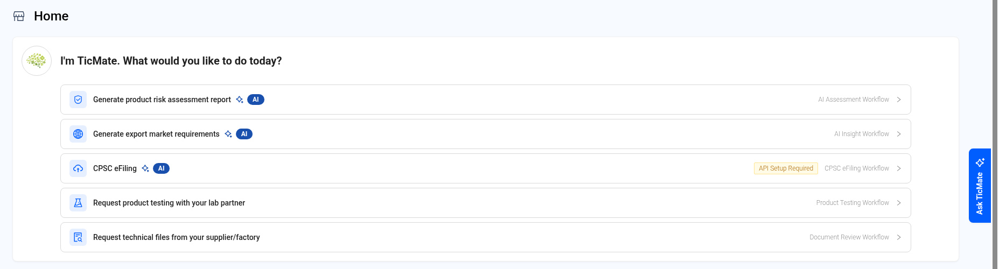

*Home page.*

This reviewed screenshot shows the TicMate workflow shortcuts. Attention and Business Overview are described in the steps and are not in this crop.

### 2. Settings menu

Click your **avatar** (account control) in the top bar:

| Option | What it does |
|---|---|
| Company Profile | Company details, certificates, documents, product categories and CPSC eFiling Certifier ID. |
| Password | Change your password. |
| Languages | Change the system language. |
| Account Management | Manage your company's user accounts. |
| Assign TicMart Job | Assign jobs from the TicMart marketplace. |
| Logout | Signs you out of QMAS. |

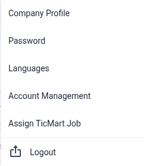

*Settings menu.*

Menu opened from the account avatar: Company Profile, Password, Languages, Account Management, Assign TicMart Job and Logout.

### 3. Company Profile

Click the pencil icon next to the company name to edit it. The **Overview**, **Certificate** and **Document** tabs hold your company information. **CPSC eFiling - Certifier ID** is where you add and manage the API key for eFiling. **Product Category** lists the categories your company works with.

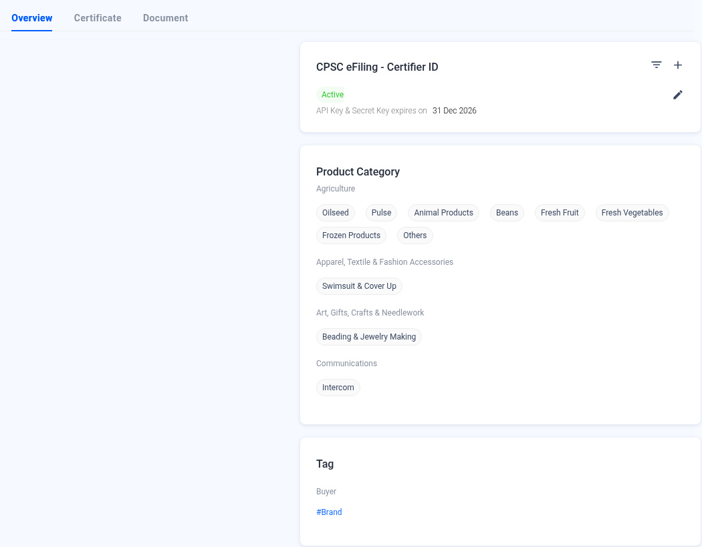

*Company Profile.*

## Tips

- The question-mark icon opens the QMAS Help Center.
- The coin icon shows your credits and tokens for paid features such as AI Insight.

## FAQ

**Q: How do I change the language?**

A: Click your avatar (account control) in the top bar, then Languages.

**Q: How do I change my password?**

A: Click your avatar (account control) in the top bar, then Password.

**Q: Where do I edit my company information?**

A: Click your avatar (account control), then Company Profile (https://qmas.icw.io/company-profile).

## Help Center additions and remaining gaps

This section adds Help Center material and named gaps. It does not replace the steps above.

- **Source-documented** — written in the original Help Center. The last-edited date is given. That does not by itself prove the current QMAS UI.
- **Dev-verified** — confirmed on qmas-dev.icw.io during guide work.
- **Gap** — named as missing or too thin. Not current behaviour until checked on dev.

Reviewed screenshots remain 56 of 98. Forty-two inventory slots are still pending. Six supplementary images are not part of the 98. Unreviewed screenshots were not copied.

### Dev-verified — already in the steps above

Settings opens from the **avatar / account control**. That correction is already in the steps above.

Home shows **5** TicMate workflow shortcuts: AI Assessment, AI Insight, CPSC eFiling, Product Testing, Document Review.

### Source-documented — Help Center onboarding (last edited 2024-04-02)

Source: Help Center Getting Started, https://app.notion.com/p/cee08d7673aa467797efb39efe68bbdc. This does not replace the Home walkthrough above.

The 2024 landing tells new accounts to watch the walkthrough videos, set up Product Compliance and Supplier Management, schedule an onboarding session after the customer-success email (or use Help Center Support if that email is missing), then use the Help Center and product-update emails.

Those 2024 setup guides still say “top menu bar”. Prefer this page and the current create guides for live steps.

- Set Up Your Product Compliance Module (2024-04-02), historical: https://app.notion.com/p/3200ac0e049d4aa8b2409bad15cea3cd
- Set Up Your Supplier Management Module (2024-04-02), historical: https://app.notion.com/p/01167450c4d54a98a3670fe13e056f12

Help Center videos were not re-watched and are not current-UI evidence:

- Introduction of QMAS: https://www.youtube.com/watch?v=Qn02Yu-0Ppk
- Manage your product compliance with QMAS: https://www.youtube.com/watch?v=3zpn_gHhW7s
- How to request quotation for product testing with QMAS: https://www.youtube.com/watch?v=AaZ9zHeQ23s
- How to manage your supplier information with QMAS: https://www.youtube.com/watch?v=xZyHOMg7_yc

### Source-documented — FAQs (last edited 2022-12-19)

Source: https://app.notion.com/p/84844e89cab14819b021b0aa8e33ef31

- Ordering product testing: the FAQ points at the Help Center Product Testing article.
- Cancelling a product testing order: “contact our customer support team via email or online chat.” Not re-verified against current Support or in-app cancel behaviour.
- Integrating an existing supplier or product database: the 2022 FAQ says an import feature is available and mentions an enterprise API plan. Treat the plan and API wording as historical until confirmed.

### Remaining gaps

- **Notifications** and **Messages** centers. No Help Center article. Exact paths need a dev check. No new module was invented.
- Company Profile Certificate, Document, and CPSC eFiling Certifier ID setup. The page above is an overview only.
- Attention card drill-downs, including Factory Audit and Pending/Expired Doc.
- TicMate / Ask TicMate usage beyond the shortcut list.
- Login page. Older notes say it is outdated. It is not on the public guide.
- Naming is still undecided: Home **AI Assessment** and **AI Insight**, menu **AI Risk Screening**, and this guide title **AI Insight**.

Help Center reconciliation 2026-11-13 (HKT). Original Help Center not edited. This draft is not the public guide. No Dify upload.

# Product Management — Create and Edit a Product

> Updated working draft 2026-11-13-draft. This file is not deployed. Existing published version: https://marconip2026.github.io/qmas-user-guide/

## Source and verification

**Mixed.** The reviewed create path and list filters are current UI verified. The Import Product pointer is Help Center text and is not dev-verified.

Do not mark this whole module unverified. Source: QMAS Help Center — Manage your QMAS Product Information Pack, last edited 2026-11-04 11:39:48 HKT. Current UI verified for the create and edit path. One inventory slot, 08-product-added, is still not captured.

- [Manage your QMAS Product Information Pack](https://app.notion.com/p/3a2b2d2eeedc42388ab6fc997070df61) (last edited 2026-11-04 11:39:48 HKT). Create path is current UI verified. Import Product is source-only, not dev-verified.

Help Center home: [QMAS Help Center](https://icw-io.notion.site/QMAS-Help-Center-5cd9414da2474d16a7c405a3542fe4af) (last edited 2026-01-20 13:54:13 HKT). User Guide index: [User Guide](https://app.notion.com/p/a92963a30e584145bb457a62b7706541) (last edited 2026-01-16 15:44:49 HKT). Public icw-io addresses for individual articles were not verified, so those links use app.notion.com.

Add a product profile to QMAS so you can attach documents, compliance data, testing and eFiling to it.

- **Module:** Product Management
- **Start here:** https://qmas.icw.io/product/list → **+ New Product**
- **Direct link:** https://qmas.icw.io/add-product
- **Steps:** 1 Product Profile → 2 Related Product → Done
- **Checked against:** QMAS dev, 9 Nov 2026

## Overview

1. Open **Product Management** and click **+ New Product**.
2. **Product Profile**: fill in product details, then choose a supplier. Shipping information, factory and additional info are optional.
3. **Related Product** (optional): link related products, then click **Done**.
4. The product appears at the top of the Product Management list. Open it to see the product profile.
5. To change it later, open the product, click **⋮** next to the name, then **Edit product**.

## Step-by-step

### 1. Open Product Management

In the left menu, open **Product Management**. Click **+ New Product** at the top right. To add many products at once, use **Import Product**.

Filter the list with **Product Category**, **Customer Product Category**, **Product Number**, **Status**, **Created By** and **Team**. **Sort by Date modified** changes the order. **Reset** clears the filters.

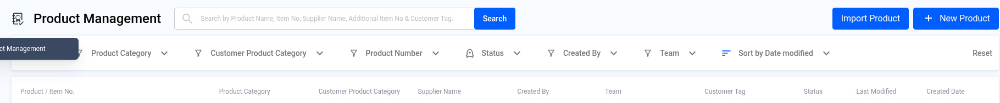

*Product Management list with Import Product and + New Product at the top right.*

Reviewed screenshot of the list filters and column headers. No data rows are shown.

### 2. Product Profile — product details

The **Add new product** wizard opens. Under **1. Product Details**, fill in:

- **Item No.** and **Product Name** (required).
- **Long Descriptions** (optional): purpose, materials and internal parts such as batteries or stuffing.
- **Additional Item No.** (optional).
- **Product Category (QMAS)**: click **Select Category**.
- **Customer Tag**, **Customer Product Category** (Level 1–3) and **Remark** (optional).

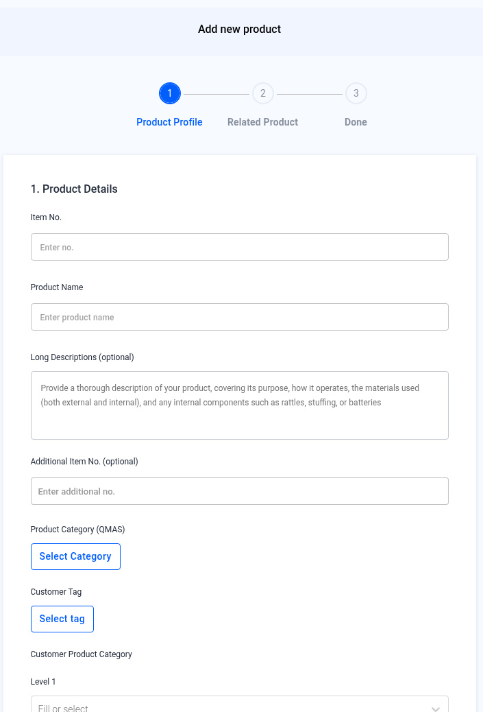

*Step 1 Product Profile — Product Details.*

In **Select Category**, search by name (for example “drinkware”), click the category, then click **Add category**.

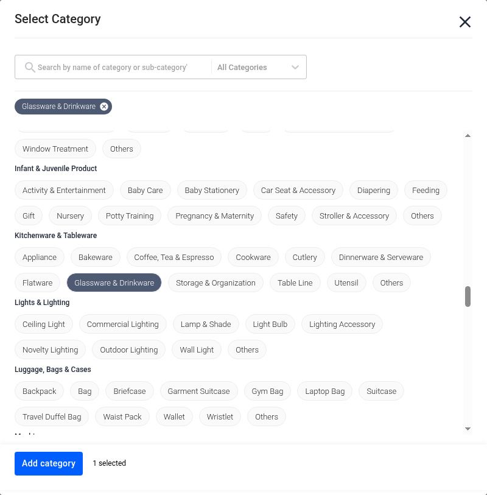

*Selected categories show as dark chips at the top. “1 selected” appears next to Add category.*

### 3. Product Profile — supplier

Under **2. Supplier**, choose **My supplier list** and click **Select supplier**, or choose **New supplier** to add one here.

In the pop-up, click **Select** on one supplier, then **Confirm**.

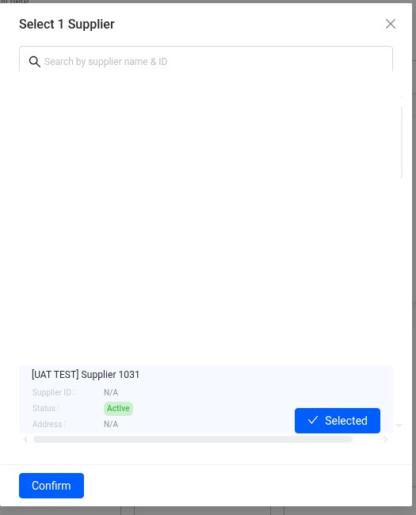

*Select 1 Supplier — you can link one supplier per product.*

The supplier card appears. Use **Change Supplier** to pick another one, or **Edit this profile** to update the supplier.

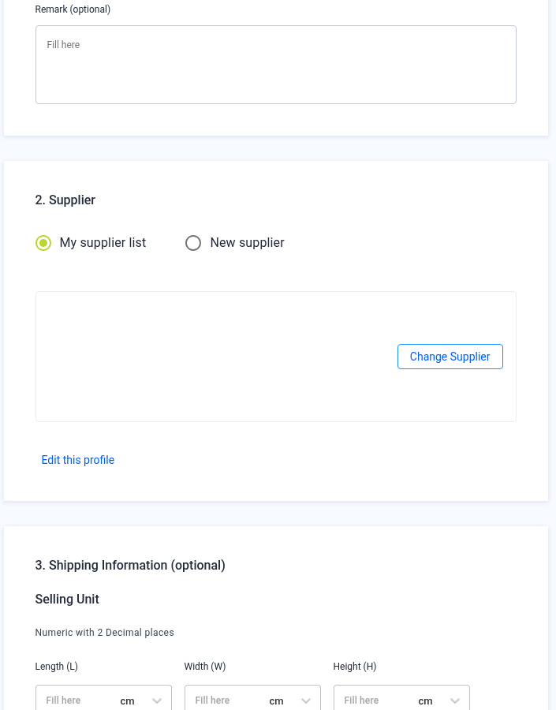

*Selected supplier, followed by 3. Shipping Information (optional).*

The supplier card body in this screenshot is intentionally blank. Change Supplier and Edit this profile remain visible. The selected test supplier is shown on the Select supplier screenshot.

### 4. Product Profile — optional sections

- **Shipping Information**: size, weight, tolerance and barcode for the selling unit, inner carton and outer carton.
- **Factory**: click **Select existing factory**.
- **Additional Info**: choose a **Buyer** (or **Add buyer**) and upload up to 30 **product photos** (JPG, JPEG, PNG).

Click **Next**.

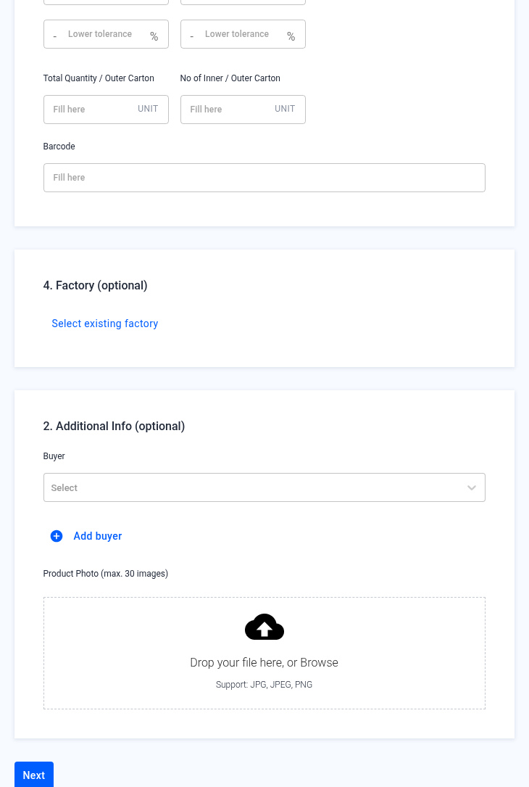

*Factory and Additional Info at the bottom of step 1, then Next.*

### 5. Related Product (optional)

Product linkage helps you manage compliance reports. For example, link a raw material or an assortment to several end products. Click **Select related product**, or skip this step. Click **Done**. **Unlink** removes a product from this step.

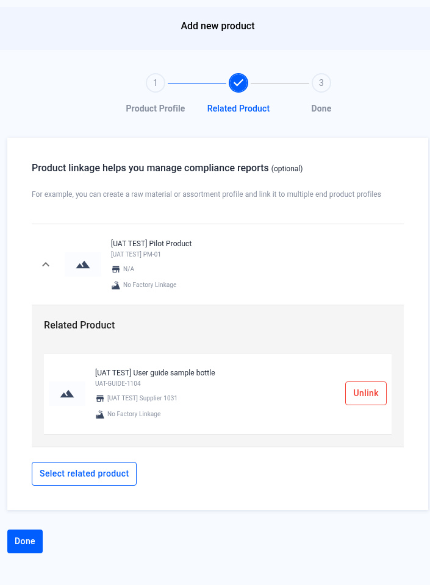

*Step 2 Related Product.*

### 6. Done — find your product

QMAS shows “Product added” and returns to the Product Management list. The new product is at the top.

The screenshot of that new row was not captured, because it would require creating a real product. The placeholder is not a picture of a finished create.

> **Not captured:** `08-product-added.jpg`
>
> Not captured. A real product was not created for this screenshot, so this placeholder is not confirmation of a completed create.

*The new product at the top of the list.*

Click the product to open its profile. From the left menu of the profile you can manage **Document**, **Shipping Detail**, **Compliance Data**, **Quality Requirement**, **AI Risk Screening**, **CPSC eFiling** and **Packaging Detail**.

The left menu also includes **QR Code**.

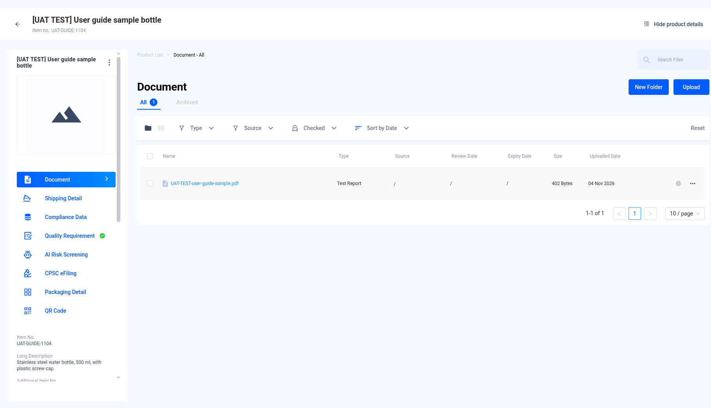

*Product profile.*

Left menu includes Document, Shipping Detail, Compliance Data, Quality Requirement, AI Risk Screening, CPSC eFiling, Packaging Detail and QR Code. The Document tab shows New Folder, Upload, All, Archived, Type, Source, Checked, Sort and Reset.

### 7. Edit, copy or deactivate a product

On the product profile, click **⋮** next to the product name:

| Option | What it does |
|---|---|
| Edit product | Opens the same wizard with your saved details. Change them, then click Next and Done. |
| Testing order | Starts a Product Testing order for this product. |
| Make a copy | Creates a new product with the same details. |
| Mark as inactive | Sets the product to inactive. |

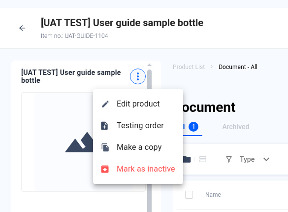

*The ⋮ menu on the product profile.*

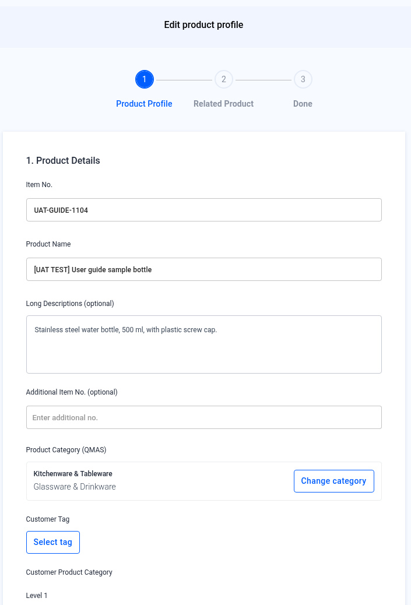

*Edit product profile — the same steps as creating a product.*

## Tips

- Search the list before you create a product so you don’t add a duplicate.
- Shipping information is optional when you create the product. You can add it later from **Shipping Detail** on the profile.

## FAQ

**Q: How do I create a new product in QMAS?**

A: Go to Product Management (https://qmas.icw.io/product/list), click + New Product, fill in Product Profile, then click Next and Done. Direct link: https://qmas.icw.io/add-product

**Q: How do I edit a product?**

A: Open the product from the Product Management list, click ⋮ next to the product name, then Edit product.

**Q: Can I add many products at once?**

A: Yes. Click Import Product on the Product Management list.

**Q: Where do I submit eFiling or add compliance data for a product?**

A: Open the product profile and use CPSC eFiling or Compliance Data in its left menu.

## Help Center additions and remaining gaps

This section adds Help Center material and named gaps. It does not replace the steps above.

- **Source-documented** — written in the original Help Center. The last-edited date is given. That does not by itself prove the current QMAS UI.
- **Dev-verified** — confirmed on qmas-dev.icw.io during guide work.
- **Gap** — named as missing or too thin. Not current behaviour until checked on dev.

Reviewed screenshots remain 56 of 98. Forty-two inventory slots are still pending. Six supplementary images are not part of the 98. Unreviewed screenshots were not copied.

### Dev-verified — list filters (2026-11-09)

The list filters are already in the steps above: **Product Category**, **Customer Product Category**, **Product Number**, **Status**, **Created By**, **Team**, sort, and **Reset**. The reviewed list screenshot shows those filters with no data rows.

Optional **Factory** and **Additional Info** (buyer, up to 30 product photos) are already in the wizard steps.

### Source-documented — Product Information Pack (last edited 2026-11-04)

Source: Manage your QMAS Product Information Pack, https://app.notion.com/p/3a2b2d2eeedc42388ab6fc997070df61. The November 2026 create steps follow the same path as this page.

**Import Product:** the Help Center intro says “To add many products at once, use **Import Product**.” The Product Profile FAQ already says to download the ICW template, fill it in, and upload it. A full multi-step import walkthrough is still missing. Do not invent extra import steps.

The 2024 setup guide still says “top menu bar, select PRODUCT MANAGEMENT”. Prefer the current left menu and this page.

### Remaining gaps

- Full Import Product wizard screenshots and field notes.
- List Export Data, row-select / bulk toolbar, and search. Only the filters above are dev-verified.
- Further Related Product linkage examples. **Unlink** is already named on the reviewed step 2 screenshot.
- Section numbering, stepper tick, and Title Case bugs are filed separately. Match the fixed UI once it ships. Do not invent the fix.

Help Center reconciliation 2026-11-13 (HKT). Original Help Center not edited. This draft is not the public guide. No Dify upload.

# Product Management — Every Tab of the Product Profile

> Updated working draft 2026-11-13-draft. This file is not deployed. Existing published version: https://marconip2026.github.io/qmas-user-guide/

## Source and verification

**Mixed.** The reviewed tab screenshots are current UI verified. Expiry reminders, share wording, and Get DoC are source-only and not dev-verified. There is no CPC or GCC Help Center article.

Do not mark this whole module unverified. Pending screenshot slots do not make the reviewed tabs unverified. Source: QMAS Help Center — Manage your QMAS Product Information Pack, last edited 2026-11-04 11:39:48 HKT. Reminder, share, and Get DoC sections were not part of the November 2026 rewrite.

- [Manage your QMAS Product Information Pack](https://app.notion.com/p/3a2b2d2eeedc42388ab6fc997070df61) (last edited 2026-11-04 11:39:48 HKT). Reviewed tabs are current UI verified. Reminder, share, and Get DoC wording is source-only, not dev-verified.

Help Center home: [QMAS Help Center](https://icw-io.notion.site/QMAS-Help-Center-5cd9414da2474d16a7c405a3542fe4af) (last edited 2026-01-20 13:54:13 HKT). User Guide index: [User Guide](https://app.notion.com/p/a92963a30e584145bb457a62b7706541) (last edited 2026-01-16 15:44:49 HKT). Public icw-io addresses for individual articles were not verified, so those links use app.notion.com.

After you create a product, its profile holds everything about it. This guide explains each tab in the profile's left menu and the import option on the product list.

- **Module:** Product Management
- **Open a profile:** https://qmas.icw.io/product/list → click a product
- **Tabs:** Document · Shipping Detail · Compliance Data · Quality Requirement · AI Risk Screening · CPSC eFiling · Packaging Detail · QR Code
- **See also:** Create and edit a product: [Product Management — Create and Edit a Product](product-management.md)
- **Checked against:** QMAS dev, 4 Nov 2026. Document, Shipping Detail, the empty Compliance Data tab, the in-progress Test Data form, the empty Certificate Data form, and the Quality Requirement shots included here were rechecked on QMAS dev, 9 Nov 2026.

## Overview

1. **Document**: upload, organise, share and set reminders for the product's files.
2. **Shipping Detail**: sizes, weights and barcodes for the selling unit and cartons.
3. **Compliance Data**: record test results, certificates and other compliance data.
4. **Quality Requirement**: list the product's quality requirements, use templates and send them to testing or document review.
5. **AI Risk Screening**: run AI compliance screenings for this product.
6. **CPSC eFiling**: submit eFiling for this product and see its eFiling log.
7. **Packaging Detail**: record each packaging component, its materials and suppliers.
8. **QR Code** is also in the left menu. This guide does not yet describe that screen.

## Step-by-step

### 1. Document

Shows every file linked to the product. Use **New Folder** to organise files and **Upload** to add a file (see the Document Management guide for the upload pop-up). Filter by **Type**, **Source** or **Checked**, switch between **All** and **Archived**, and search with **Search Files**. **Sort** and **Reset** sit with those filters.

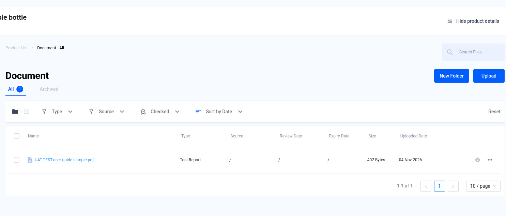

*Document tab with one UAT sample PDF and the filter controls.*

All (1), New Folder, Upload, Type, Source, Checked, Sort and Reset are visible. The file is a UAT sample PDF marked Test Report. Source and the date columns on that row are empty.

Tick one or more files to open the toolbar:

| Action | What it does |
|---|---|
| Set Data | Add compliance data (test, certificate or other) from this file. |
| Set Dates & Reminder | Set issue, expiry and review dates and an email reminder. |
| Archive | Move the file to the Archived tab. |
| Download | Download the file. |
| Share | Create a share link with an expiry period. Copy it or send it by email. |
| Rename / Edit Type | Change the file name or document type. |
| Move | Move the file to a folder. |
| Remove | Remove the file. |

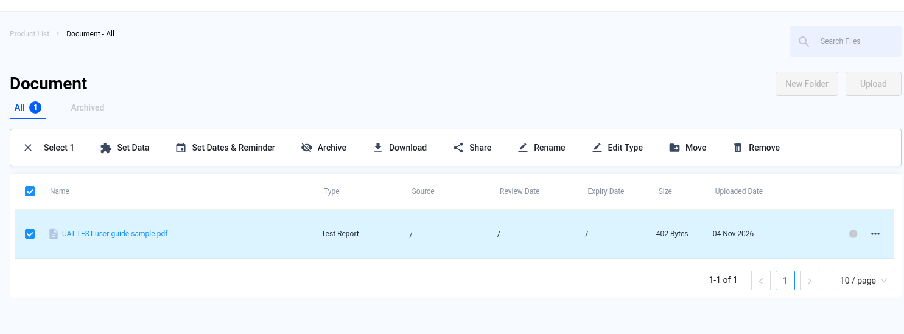

*Toolbar after selecting a file.*

The selection toolbar shows Set Data, Set Dates & Reminder, Archive, Download, Share, Rename, Edit Type, Move and Remove for the same UAT sample file.

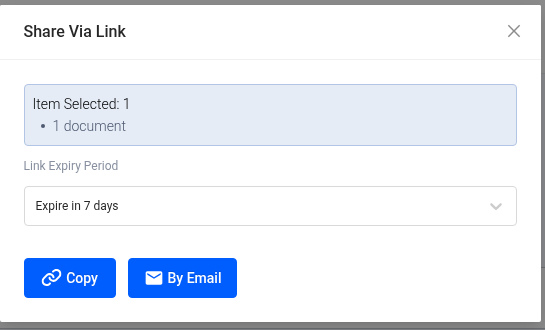

*Share Via Link — choose how long the link stays valid, then Copy or By Email.*

### 2. Shipping Detail

Shows the length, width, height, gross and net weight, quantity and barcode for the **Selling Unit**, **Inner Carton** and **Outer Carton**. To change them, click **⋮** next to the product name → **Edit product** and update **Shipping Information**. The reviewed screenshot shows 0.00 and N/A in those fields, not filled shipping values.

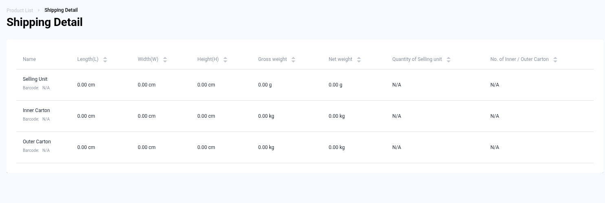

*Shipping Detail tab — empty values (0.00 / N/A).*

### 3. Compliance Data

Three sections: **Test Data**, **Certificate Data** and **Other**. Click **Add Data** (or **Add** once a section has records).

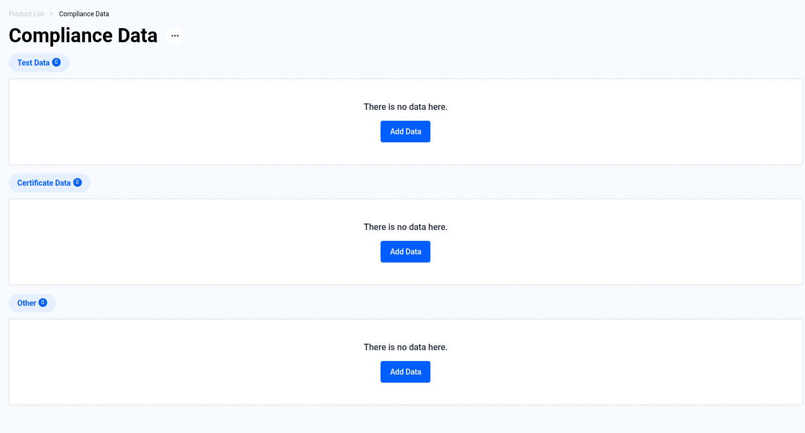

*Compliance Data tab before any data is added.*

Test Data, Certificate Data and Other each show 0 and “There is no data here.”, with Add Data. This is the captured empty state.

**Test Data** records one test result:

- **Result** (required): Passed, Failed or Report As Is.
- **Export Market** (required). For US eFiling, choose **United States (CPSC eFiling submission)**.
- **Legislation, Test Item & Citation** (required): type in this field. The reviewed screenshot sets Export Market to Africa and shows **+ Add '[UAT TEST]'**. It is not a legislation results list and not a saved Test Data record.
- **Report ID**, **Issue Party** (required), **Expiry Date** and **Test Date / Report Date**.
- Link the report under **Existing Product Document** (a file already on the product) or **New Document**.

![In-progress Test Data form. Result is unset, Export Market is Africa, and the legislation field shows + Add '[UAT TEST]'. Not a legislation results list and not a saved record.](images/product-profile/07-test-item-search.jpg)

*Test Data form — Export Market set; legislation field showing + Add ‘[UAT TEST]’ (not a completed saved record).*

> **Not captured:** `08-test-data-filled.jpg`
>
> Not captured. A Test Data record was not saved and a report was not linked for this screenshot. This placeholder is not a completed or saved record.

*Not captured. A completed Test Data record with a linked report is not in this draft.*

Click **Confirm** to close the Test Data form. This draft does not show a saved Test Data row. Screenshots of a completed record and of the table after saving were not captured, because each needs a real saved record.

> **Not captured:** `09-test-data-saved.jpg`
>
> Not captured. A saved Test Data row was not created for this screenshot. This placeholder is not proof of a saved record.

*Not captured. The Test Data table after saving is not in this draft.*

**Certificate Data** works the same way. Fill in the certificate **Type**, **Issue Party**, **Score / Overall Rating**, **Expiry Date** and **Certificate Date**, then link the certificate file. The reviewed screenshot shows that form empty.

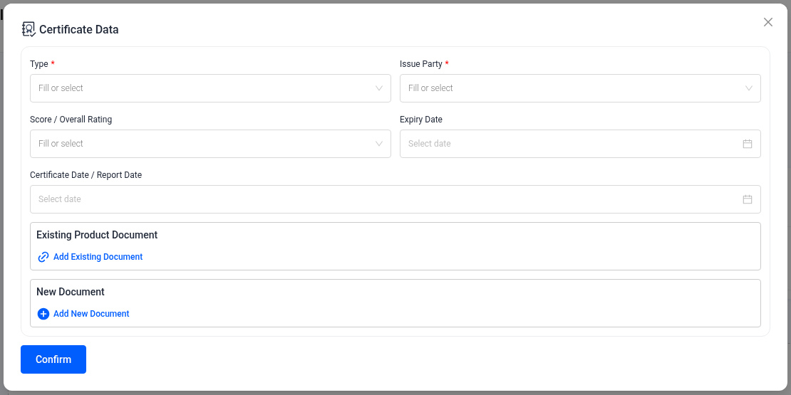

*Empty Certificate Data form.*

This screenshot does not show filled certificate values.

### 4. Quality Requirement

Quality Requirement lists what the product must meet, for example test standards or packaging rules. Each requirement has a **Type** (the group) and a **Name**. You can attach compliance data to it as proof, mark it completed, and reuse the list in Product Testing or Document Review.

The reviewed screenshot is not an empty tab. It shows one requirement with the name hidden, plus Test Plan, ⋯ and Add. The attachment area under that row is empty.

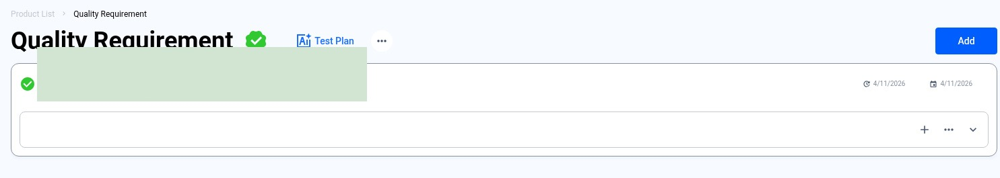

*Quality Requirement tab with one existing requirement (name redacted); Test Plan, ⋯, and Add visible — not an empty tab.*

**4a. Add a requirement yourself**

- Click **Add Requirement** (or **Add** at the top right once the list has items).
- **Type**: pick an existing type, or type a new one and choose **+ Create “…”**.
- **Name**: pick a name from the list for that type. Picking a different Type clears the Name.
- Tick **Mandatory** if the requirement must be met, then click **Confirm**.

The reviewed Add Requirement screenshot shows Type and Name empty, with Mandatory checked. It is not an example of a filled Type and Name.

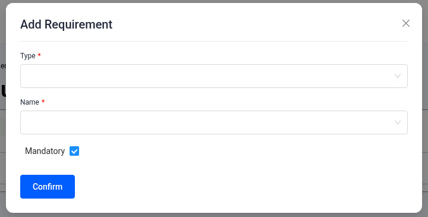

*Add Requirement modal — Type and Name empty, Mandatory checked (not a filled Type and Name example).*

**4b. Add requirements from a template (fastest)**

Click **⋯** next to the title → **Templates**:

| Option | What it does |
|---|---|
| Apply Template | Pick a saved template (use **View** to preview it) and click **Apply**. All its requirements are added. |
| Save As Template | Save this product's requirements as a template for other products. |
| Manage Templates | See and manage your saved templates. |

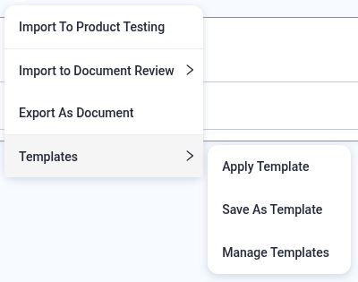

*⋯ → Templates.*

The open menu shows Import To Product Testing, Import to Document Review, Export As Document, and Templates: Apply Template, Save As Template and Manage Templates.

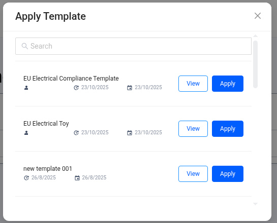

*Apply Template — View or Apply a saved template.*

The list shows EU Electrical Compliance Template, EU Electrical Toy and new template 001, each with View and Apply. Creator names are blanked in this screenshot.

QMAS shows “<template name> applied”. Requirements are grouped by Type; the number next to the Type is how many requirements it has.

The screenshot of the list after Apply Template was not captured, because that needs a real apply. The placeholder is not that list.

> **Not captured:** `22-requirement-list.jpg`
>
> Not captured. Apply Template was not run for this screenshot. This placeholder is not the requirement list after a template is applied.

*Requirements after applying a template.*

**4c. Attach proof and complete a requirement**

- Click **+** on a requirement to open **Attach Compliance Data**. Choose the **Test Data**, **Certificate Data** or **Other** tab, tick the records and click **Confirm**. If a record you just added is missing, click **Reload Data**. To add new data, go to Compliance Data first.
- Click **⌄** to expand a requirement and see the attached data. Click the bin icon to detach it.
- Click **⋯** on a requirement for **Edit**, **Duplicate**, **Upload Document**, **Mark As Completed** and **Remove**.
- **Mark As Completed** shows “Requirement Completed” and turns the requirement’s tick green.

> **Image pending privacy review:** `23-attach-compliance.jpg`
>
> Reviewed replacement image not available yet. Follow the written steps above.

*Attach Compliance Data — tick the test record.*

> **Image pending privacy review:** `24-requirement-attached.jpg`
>
> Reviewed replacement image not available yet. Follow the written steps above.

*The attached test data under the requirement.*

> **Image pending privacy review:** `25-requirement-row-menu.jpg`
>
> Reviewed replacement image not available yet. Follow the written steps above.

*⋯ menu on one requirement.*

> **Image pending privacy review:** `26-requirement-completed.jpg`
>
> Reviewed replacement image not available yet. Follow the written steps above.

*Requirement marked as completed.*

**4d. Send requirements to a job**

- **⋯ → Import To Product Testing**: tick the requirements (or **Select All**) and click **Confirm to Create Job**. Product Testing → Request Quotations opens with this product added, and the requirements appear under **Quality Requirement** in step 2.
- **⋯ → Import to Document Review** → **Create Job** or **Create Job for supplier**: opens the matching Document Review form for this product.
- **⋯ → Export As Document**: exports the requirement list as a document.

> **Image pending privacy review:** `29-import-to-pt.jpg`
>
> Reviewed replacement image not available yet. Follow the written steps above.

*Import To Product Testing — choose requirements, then Confirm to Create Job.*

> **Image pending privacy review:** `31-pt-requirement-carried.jpg`
>
> Reviewed replacement image not available yet. Follow the written steps above.

*The requirement carried into Product Testing step 2.*

> **Image pending privacy review:** `28-import-doc-review.jpg`
>
> Reviewed replacement image not available yet. Follow the written steps above.

*Import to Document Review → Create Job or Create Job for supplier.*

**4e. Test Plan (AI)**

Click **Test Plan** to let AI suggest a test plan. Fill in the **Product Description** (more detail gives better results), **Import Country** and **Product Intended Used By**, upload up to 6 product images, then click **Generate Test Plan**.

> **Image pending privacy review:** `27-test-plan.jpg`
>
> Reviewed replacement image not available yet. Follow the written steps above.

*Test Plan pop-up.*

### 5. AI Risk Screening

Lists the AI screenings for this product. Click **Add** to start one. The pop-up and results are explained in the [AI Insight](ai-insight.md) guide.

> **Image pending privacy review:** `17-ai-risk-screening.jpg`
>
> Reviewed replacement image not available yet. Follow the written steps above.

*AI Risk Screening tab.*

### 6. CPSC eFiling

Shows the **eFiling Log** for this product. Click **Submit eFiling** to create an eFiling. Before you can sync with CPSC, add your API Key and Secret Key in **Company Profile** (link in the grey note). The full flow is in the [eFiling](efiling.md) guide.

> **Image pending privacy review:** `16-cpsc-efiling.jpg`
>
> Reviewed replacement image not available yet. Follow the written steps above.

*CPSC eFiling tab.*

### 7. Packaging Detail

Lists the packaging components of the product. Click **Create Packaging Component** and fill in:

- **Basic Information**: name and description (required), identification no., function, legal role, weight, material type and name, status (Active, Inactive or Draft), and packaging images.
- **Dimension**, **Additional Information**, **Supplier Linkage** and **Technical Documentation** (expand each section).

Click **Confirm**. Use the **Status** filter to show active, inactive or draft components.

> **Image pending privacy review:** `14-packaging.jpg`
>
> Reviewed replacement image not available yet. Follow the written steps above.

*Packaging Details tab.*

> **Image pending privacy review:** `15-packaging-component.jpg`
>
> Reviewed replacement image not available yet. Follow the written steps above.

*Create Packaging Component.*

### 8. Import products in bulk

On the Product Management list, click **Import Product**. Download the ICW Product template (**download here**), fill it in, upload the Excel file (one file at a time), then click **Next**. Only the ICW template can be used.

> **Image pending privacy review:** `18-import-product.jpg`
>
> Reviewed replacement image not available yet. Follow the written steps above.

*Import Product.*

## Tips

- **Hide product details** at the top right hides the product card on the left.
- Link test reports to Test Data. eFiling can reuse this data when you quick-select test data.
- Use requirement **Templates** so similar products get the same requirements.

## FAQ

**Q: How do I add a test result to a product?**

A: Open the product → Compliance Data → Test Data → Add Data. Fill in Result, Export Market, Legislation/Test Item, Issue Party, link the report, then Confirm.

**Q: How do I share a product document?**

A: Open the product → Document, tick the file, click Share, choose the link expiry, then Copy or By Email.

**Q: How do I add quality requirements to a product?**

A: Open the product → Quality Requirement → Add Requirement, or ⋯ → Templates to apply a saved template.

**Q: Where do I record packaging information?**

A: Open the product → Packaging Detail → Create Packaging Component.

**Q: How do I import many products?**

A: On Product Management, click Import Product, download the ICW template, fill it in and upload it.

**Q: How do I reuse quality requirements for many products?**

A: Open a product → Quality Requirement → ⋯ → Templates → Save As Template. On other products use ⋯ → Templates → Apply Template.

**Q: How do I prove a requirement is met?**

A: On the requirement click +, attach the test or certificate data, then ⋯ → Mark As Completed.

## Help Center additions and remaining gaps

This section adds Help Center material and named gaps. It does not replace the steps above.

- **Source-documented** — written in the original Help Center. The last-edited date is given. That does not by itself prove the current QMAS UI.
- **Dev-verified** — confirmed on qmas-dev.icw.io during guide work.
- **Gap** — named as missing or too thin. Not current behaviour until checked on dev.

Reviewed screenshots remain 56 of 98. Forty-two inventory slots are still pending. Six supplementary images are not part of the 98. Unreviewed screenshots were not copied.

### Dev-verified — already in the steps above (2026-11-09)

The left menu includes **QR Code** as well as Document, Shipping Detail, Compliance Data, Quality Requirement, AI Risk Screening, CPSC eFiling, and Packaging Detail.

Document tab chrome on the reviewed screenshot: **New Folder**, **Upload**, **All / Archived**, filters **Type** / **Source** / **Checked**, and **Sort** (plus Reset).

When older Help Center wording disagrees with that chrome, prefer these dev-verified labels.

### Source-documented — reminders and Get DoC (not rewritten in November 2026)

Source: the same Product Information Pack article, last edited 2026-11-04. The document, reminder, and DoC sections were not rewritten in that November update. Treat the labels below as Help Center text, not as a current-UI claim.

Historical Help Center document wording uses **Upload file**, three dots next to Document → **New tab**, and **New folder**. Prefer **Upload** and **New Folder** from the dev-verified chrome when they differ.

**Expiry reminders:** select the document, choose **Set Reminder** in the toolbar, pick the date, click **Create**. The Help Center says the reminder is sent to the email inbox on that date. Needs a dev check.

**Declaration of Conformity (DoC):** the Help Center says you can request ICW to generate a DoC, “subjected to additional fee.” “Navigate to the document in the tool bar, then select **Get DoC**, then click **Send request**.” “You will receive your product DoC by email within 3 days.”

The Help Center does not document Generate **CPC** or **GCC**, or a separate PO DoC Management module. Those remain gaps. Do not invent those steps.

### Remaining gaps

- Current entry point for Generate CPC / GCC / DOC, if it is different from Get DoC.
- Test Plan (AI) after the pop-up: a generated plan, or applying it to requirements. See also the separate [Test Plan](test-plan.md) page for the 2024 top-menu article. Do not merge the two.
- Compliance Data **Other**; edit or delete of existing rows; packaging edit and status filter.
- Manage Templates, Save As Template, and Export As Document are text only today.
- Saved Test Data and the post-template requirement list were not captured. Those slots stay placeholders and are not pictures of saved data.

Help Center reconciliation 2026-11-13 (HKT). Original Help Center not edited. This draft is not the public guide. No Dify upload.

# Test Plan — Request a Test Plan

> Updated working draft 2026-11-13-draft. This file is not deployed. Existing published version: https://marconip2026.github.io/qmas-user-guide/

## Source and verification

**Source-only, not dev-verified.** This is the 2024 Help Center article, last edited 2024-03-28 15:44:01 HKT. It has no reviewed screenshots and it is not on the existing published site. It is not the Product Profile Test Plan (AI) pop-up.

Source: QMAS Help Center — How To Request A Test Plan, last edited 2024-03-28 15:44:01 HKT. Not current-UI verified. Do not invent a live /test-plan/ URL.

- [How To Request A Test Plan](https://app.notion.com/p/1a502da19803417aae2cd72190a1a542) (last edited 2024-03-28 15:44:01 HKT). The whole page. Source-only, not dev-verified.

Help Center home: [QMAS Help Center](https://icw-io.notion.site/QMAS-Help-Center-5cd9414da2474d16a7c405a3542fe4af) (last edited 2026-01-20 13:54:13 HKT). User Guide index: [User Guide](https://app.notion.com/p/a92963a30e584145bb457a62b7706541) (last edited 2026-01-16 15:44:49 HKT). Public icw-io addresses for individual articles were not verified, so those links use app.notion.com.

Source-documented only. The Help Center has a short 2024 article for a top-menu Test Plan. The published Product Profile guide instead shows a Test Plan (AI) pop-up on Quality Requirement. These may be different features. Do not merge them into one invented flow.

- **Status:** Source-documented only. Not dev-verified.
- **Help Center article:** How To Request A Test Plan
- **Help Center last edited:** 2024-03-28
- **Source:** https://app.notion.com/p/1a502da19803417aae2cd72190a1a542
- **Published-guide path:** [Product profile](product-profile.md) → Quality Requirement → Test Plan (AI)
- **Screenshots:** None on this page. The product-profile pop-up image is still pending review.

## Overview

1. **Historical Help Center path:** top menu **TEST PLAN**, then product details, then receive or download a PDF.
2. **Current published-guide path:** product profile → Quality Requirement → **Test Plan (AI)** pop-up.
3. The internal index previously marked Test Plan as coming soon. A dev check is still required.

## Step-by-step

### 1. Help Center steps (2024, quoted closely)

This is the entire Help Center article. It was last edited on 2024-03-28.

1. “Navigate to the top menu bar, select **TEST PLAN**.”
2. “Fill out your product details.”
3. “Receive your test plan, you can also download it in PDF format.”

Do not assume the 2024 top-menu path still exists.

### 2. What the published guide already shows

The [Product Profile](product-profile.md) guide documents a **Test Plan (AI)** control on Quality Requirement. Its pop-up slot is `27-test-plan.jpg`, still pending privacy review. That guide does not show a generated plan or an apply-to-requirements result.

Keep both descriptions until a dev check says they are the same feature.

## Tips

- Do not copy Help Center screenshots. Do not invent a generated-plan screenshot.

## FAQ

**Q: What still needs a dev check?**

A: Whether a standalone Test Plan entry remains in the left or top navigation; its current fields, outputs, and any fee or token; and, if it is gone, whether this 2024 article should be retired in favour of a longer Quality Requirement Test Plan (AI) guide.

# eFiling — Submit eFiling to CPSC

> Updated working draft 2026-11-13-draft. This file is not deployed. Existing published version: https://marconip2026.github.io/qmas-user-guide/

## Source and verification

**Current UI verified.** Current UI verified for the reviewed list and the blank Add Documents for AI Extract dialog. There is no Help Center user-guide article for these steps. This page does not submit a certificate to CPSC.

Do not mark this whole module unverified. The pack checklist link to an internal Documents page is not a Help Center source. Preview, submit, draft, and duplicate remain gaps.

No Help Center article is the source of the steps on this page.

Help Center home: [QMAS Help Center](https://icw-io.notion.site/QMAS-Help-Center-5cd9414da2474d16a7c405a3542fe4af) (last edited 2026-01-20 13:54:13 HKT). User Guide index: [User Guide](https://app.notion.com/p/a92963a30e584145bb457a62b7706541) (last edited 2026-01-16 15:44:49 HKT). Public icw-io addresses for individual articles were not verified, so those links use app.notion.com.

Create and submit CPSC eFiling certificates for your products, with AI that can fill the form from your test report.

- **Module:** eFiling
- **Start here:** https://qmas.icw.io/efiling → **Add eFiling**
- **Before you start:** Set up your CPSC Certifier ID and API keys in Company Profile → **CPSC eFiling - Certifier ID**.
- **Checked against:** QMAS dev, 4 Nov 2026

## Overview

1. Make sure your CPSC Certifier ID is set up in Company Profile.
2. Open **eFiling** and click **Add eFiling**.
3. Upload a report for **AI Extract**, select a document already in QMAS, or **Start With Blank**.
4. In **Quick Select eFiling Information**, check the Certifier ID and products, then click **Next**.
5. Complete the **eFiling Submission** form, then **Save Draft** or **Preview to Submit**.

## Step-by-step

### 1. Open eFiling

In the left menu, open **eFiling**. The list shows each eFiling with its log no., product, status, certifier ID, collection ID, product ID and version ID. Use **View** to open one or **Duplicate** to start a new version from it. Click **Add eFiling**.

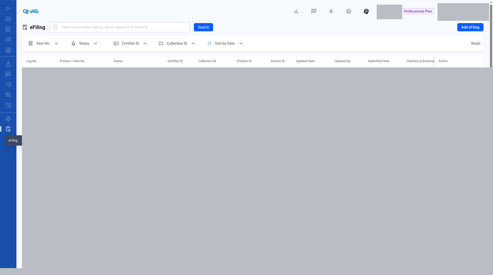

*eFiling list.*

Add eFiling is visible. List rows are masked. This is a 1280×800 desktop crop (1280×714), not a high-resolution screenshot.

### 2. Add documents for AI Extract

- **Upload Report & Auto-fill by AI**: drop a PDF test report. AI extracts the data and fills the form.
- **Select Document in QMAS**: choose a document already in Document Management, with no re-upload.
- **Start With Blank**: fill the form yourself.

The reviewed dialog is blank. No report was uploaded and no extraction was run. Next is disabled. Start With Blank is visible and was not used.

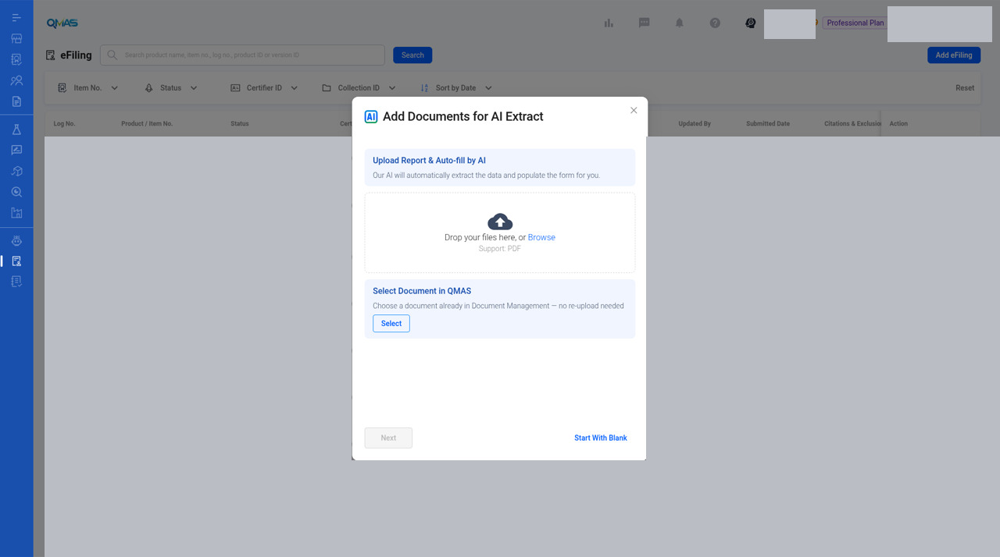

*Add Documents for AI Extract.*

Blank dialog. Upload Report & Auto-fill by AI and Select Document in QMAS are shown. No file, no extraction, and no submission.

### 3. Quick Select eFiling Information

Choose the **CPSC Certifier ID** and check the products to include. Click **Next**.

> **Image pending privacy review:** `03-quick-select.jpg`
>
> Reviewed replacement image not available yet. Follow the written steps above.

*Quick Select eFiling Information.*

### 4. eFiling Submission form

Fill in **eFiling Information** (Certifier ID, collection, point of contact) and **Product Detail**. Use **Link To QMAS Product** to connect the form to a product, or tick **Create As New Product**. Use **+ Add Product** at the top for a multi-product submission.

Then complete the remaining sections (lab, citations and exclusions). Click **Save Draft** to finish later, or **Preview to Submit** to check and send to CPSC.

> **Image pending privacy review:** `04-submission-form.jpg`
>
> Reviewed replacement image not available yet. Follow the written steps above.

*eFiling Submission form.*

If you close the form without saving, QMAS asks you to confirm. Unsaved values are lost. Saved drafts stay in the eFiling list.

## Tips

- AI Extract works best with a clear PDF test report.
- Within 48 hours you can resubmit with the same Version ID to overwrite. After that, use a new Version ID.

## FAQ

**Q: How do I submit eFiling to CPSC?**

A: Go to eFiling (https://qmas.icw.io/efiling), click Add eFiling, upload a report for AI Extract or Start With Blank, check the Quick Select information, complete the eFiling Submission form, then Preview to Submit.

**Q: Where do I set up my CPSC API key?**

A: Settings (avatar / account control) → Company Profile → CPSC eFiling - Certifier ID.

**Q: Can AI fill in the eFiling form?**

A: Yes. In Add eFiling, upload a PDF report under Upload Report & Auto-fill by AI.

## Help Center additions and remaining gaps

This section adds Help Center material and named gaps. It does not replace the steps above.

- **Source-documented** — written in the original Help Center. The last-edited date is given. That does not by itself prove the current QMAS UI.
- **Dev-verified** — confirmed on qmas-dev.icw.io during guide work.
- **Gap** — named as missing or too thin. Not current behaviour until checked on dev.

Reviewed screenshots remain 56 of 98. Forty-two inventory slots are still pending. Six supplementary images are not part of the 98. Unreviewed screenshots were not copied.

### Help Center finding

There is no Help Center User Guide article for eFiling.

The Product Information Pack checklist links “How to submit eFiling to CPSC” to an internal Documents / User Guide page, not to the public Help Center: https://app.notion.com/p/32e9c62c39fc80faa0e3e510e7f30265. Do not treat that page as a Help Center source. Prefer this page for user-facing steps. This guide does not submit a certificate to CPSC.

### Remaining gaps

- Preview to Submit, draft resume, Duplicate, and View are mentioned above and have no shots.
- Certifier ID and API key setup in Company Profile.
- Select Document in QMAS, and Start With Blank.
- Multi-product submission and Link To QMAS Product detail.

Help Center reconciliation 2026-11-13 (HKT). Original Help Center not edited. This draft is not the public guide. No Dify upload.

# Supplier Management — Create a Supplier

> Updated working draft 2026-11-13-draft. This file is not deployed. Existing published version: https://marconip2026.github.io/qmas-user-guide/

## Source and verification

**Mixed.** The reviewed create path and the readonly Overview and empty Certificate tab are current UI verified. Edit, import, invite, and connection statuses are source-only and not dev-verified.

Do not mark this whole module unverified. Source: QMAS Help Center — Manage your QMAS Supplier Compliance Profile, last edited 2026-01-16 15:38:01 HKT. The article was not marked Updated November 2026.

- [Manage your QMAS Supplier Compliance Profile](https://app.notion.com/p/aa532b63c9554db99b57676ee83d489c) (last edited 2026-01-16 15:38:01 HKT). Create path and reviewed profile screens are current UI verified. Edit, import, invite, and connection statuses are source-only, not dev-verified.

Help Center home: [QMAS Help Center](https://icw-io.notion.site/QMAS-Help-Center-5cd9414da2474d16a7c405a3542fe4af) (last edited 2026-01-20 13:54:13 HKT). User Guide index: [User Guide](https://app.notion.com/p/a92963a30e584145bb457a62b7706541) (last edited 2026-01-16 15:44:49 HKT). Public icw-io addresses for individual articles were not verified, so those links use app.notion.com.

Add a supplier profile so you can link it to products, factories, documents and service jobs.

- **Module:** Supplier / Factory Management
- **Start here:** https://qmas.icw.io/supplier-manager/suppliers → **Create Supplier**
- **Direct link:** https://qmas.icw.io/supplier-manager/create
- **Steps:** 1 Supplier Profile → 2 Classification → 3 Certification → Done
- **Checked against:** QMAS dev, 4 Nov 2026

## Overview

1. Open **Supplier / Factory Management**, stay on the **Supplier** tab and click **Create Supplier**.
2. **Supplier Profile**: company overview and contact.
3. **Classification** (optional): product category and tags.
4. **Certification** (optional): add certificates, then click **Done**.
5. The supplier profile opens.

## Step-by-step

### 1. Open Supplier / Factory Management

In the left menu, open **Supplier / Factory Management**. The **Supplier** tab lists your suppliers with their location, category, status, connect status and rating.

Click **Create Supplier**. You can also use **Import Supplier** to add many suppliers from a file, or **Invite Supplier** to invite a supplier to connect with you on QMAS.

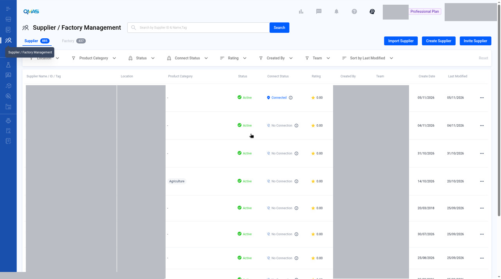

*Supplier tab with Import Supplier, Create Supplier and Invite Supplier.*

### 2. Supplier Profile — company overview

- **Upload Logo** (optional).
- **Supplier ID** (optional): your own reference number.
- **Supplier Name**: English name (required) and local-language name (optional).
- **Location**: country or region, then province and city.
- **Address** and **Website** (optional).

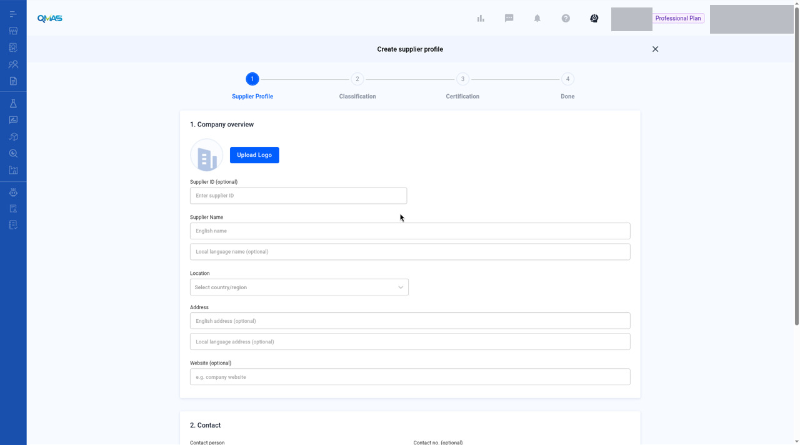

*Create supplier profile — step 1, Company overview.*

### 3. Supplier Profile — contact

Under **2. Contact**, fill in the **Contact person**, **Contact Email** and at least one **Email address**. For each email address, choose a type: Company, QA, Sales or Other. Click **Add email** for more. **Contact no.** is optional.

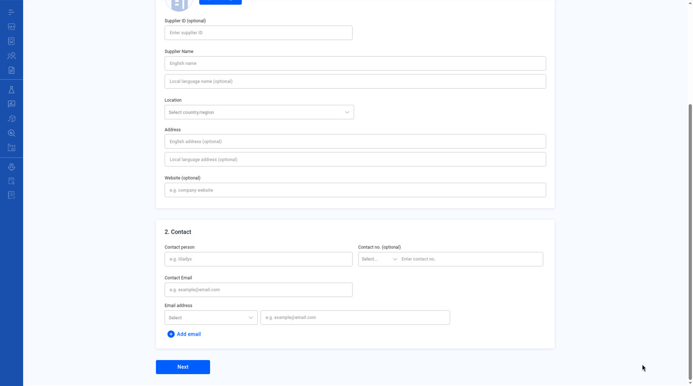

*Contact section.*

If a required field is empty when you click **Next**, it turns red, for example “Type is required” or “Email is required”. This screenshot also shows **English name is required**, **Location is required**, and **Contact person is required**. Next triggers the errors, not Submit. The fields still show empty or example placeholders, not a completed profile.

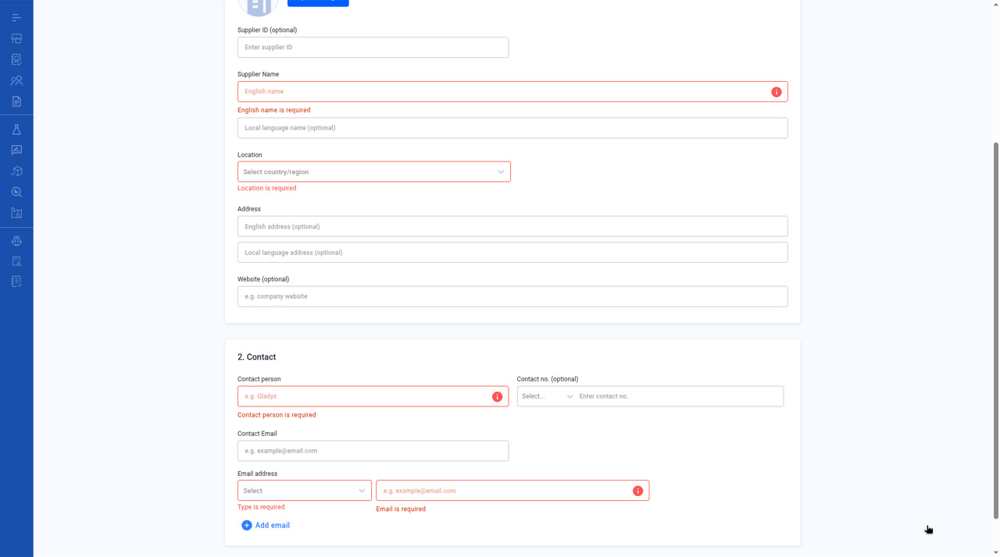

*The email type and email address are required.*

Also shows required errors on English name, Location, and Contact person. Triggered by Next, not Submit. Blank or example placeholders only.

### 4. Classification (optional)

Click **Select category** to choose the product categories this supplier offers. Click **Select tag** to add your own tags. Click **Next**.

> **Image pending privacy review:** `05-step2-classification.jpg`
>
> Reviewed replacement image not available yet. Follow the written steps above.

*Step 2 Classification.*

### 5. Certification (optional)

Click **Add** to upload a certificate. Choose the certification type, upload the file, and fill in the rating, issue party and dates. Click **Done** to create the supplier.

> **Image pending privacy review:** `06-step3-certification.jpg`
>
> Reviewed replacement image not available yet. Follow the written steps above.

*Step 3 Certification.*

### 6. Done — supplier profile

The supplier profile opens. Use the tabs **Overview**, **Product**, **Factory**, **Certificate**, **Document** and **Compliance Data** to manage everything linked to this supplier. Click the pencil icon next to the name, or next to **Contact**, to edit.

The reviewed screenshot is a readonly Overview of an existing profile. Product Category, Tag and Rating are empty. It is not the create-certification wizard, and no record was written for this shot.

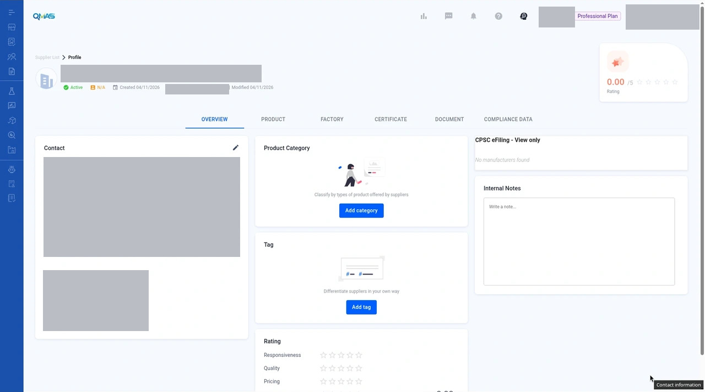

*Supplier profile — Overview tab.*

Readonly Overview. Category, Tag and Rating are empty. Created and Modified dates stay visible. This is a 1280×800 desktop crop (1280×714), not a high-resolution screenshot.

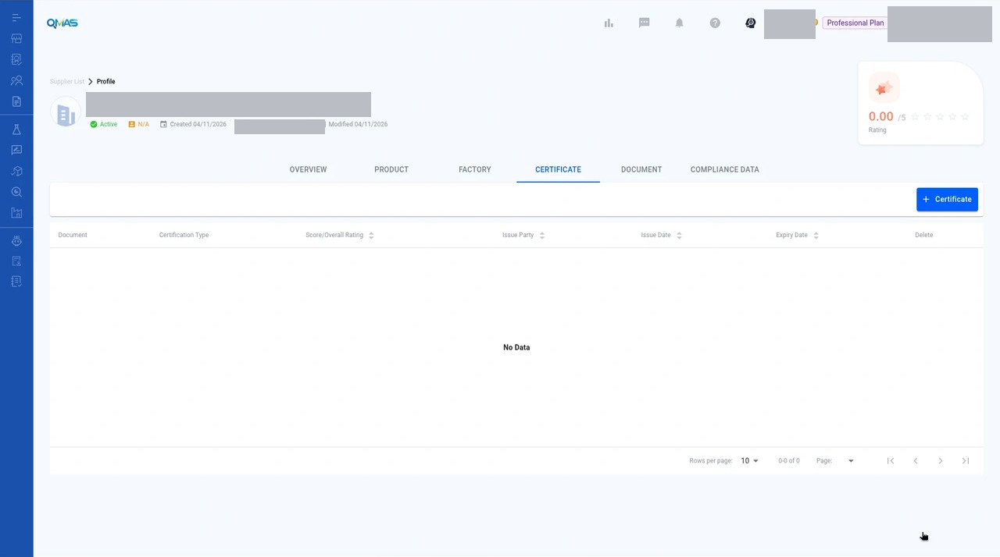

*Supplier profile — Certificate tab, empty (No Data).*

Supplementary screenshot, not one of the 98 inventory slots. Genuine empty Certificate tab on the same profile. This is not Step 3 Certification. No record was created or changed.

## Tips

- Search the Supplier list before you create a supplier so you don’t add a duplicate.
- Consistent tags make filtering the list easier later.

## FAQ

**Q: How do I create a new supplier?**

A: Go to Supplier / Factory Management (https://qmas.icw.io/supplier-manager/suppliers), click Create Supplier, fill in Supplier Profile, then Next, Next and Done. Direct link: https://qmas.icw.io/supplier-manager/create

**Q: Can I add many suppliers at once?**

A: Yes. Click Import Supplier on the Supplier tab.

**Q: How do I invite a supplier to QMAS?**

A: Click Invite Supplier on the Supplier tab.

**Q: How do I edit a supplier?**

A: Open the supplier from the list and click the pencil icon next to its name or next to Contact.

## Help Center additions and remaining gaps

This section adds Help Center material and named gaps. It does not replace the steps above.

- **Source-documented** — written in the original Help Center. The last-edited date is given. That does not by itself prove the current QMAS UI.
- **Dev-verified** — confirmed on qmas-dev.icw.io during guide work.
- **Gap** — named as missing or too thin. Not current behaviour until checked on dev.

Reviewed screenshots remain 56 of 98. Forty-two inventory slots are still pending. Six supplementary images are not part of the 98. Unreviewed screenshots were not copied.

### Source-documented — profile, import, and invite (last edited 2026-01-16)

Source: Manage your QMAS Supplier Compliance Profile, https://app.notion.com/p/aa532b63c9554db99b57676ee83d489c. It was not marked “Updated November 2026”. Labels need a dev check before they are published as current UI.

The 2024 setup guide is an older subset (no Import or Invite) and still says “top menu bar”. Prefer the create steps above, and the January 2026 article for the items below.

**Edit and add documents** (Help Center): edit company and contact information with the icon next to each section. Edit categories and tags with the pen icon. **Add rating** lists Responsiveness, Quality, Pricing, and Market Awareness. Add **Internal notes** for others in the company. Add missed certificates or documents later in the **CERTIFICATE** and **DOCUMENT** sections.

**Product and Factory linkage** (Help Center): related products use **+Product Linkage** (existing product list, or **New Product**). Related factories are under **FACTORY**, then **+Factory Linkage** (**Current Factory** or **New Factory**).

**Import Supplier** (Help Center): click **Import Supplier**, then **Download here** for the template, fill it in (the article says create, update, and delete are supported), upload, and click **Next**. A toast confirms completion.

Invite / connect a supplier “allows you to assign Document Review jobs to your connected suppliers.”

1. Click **Invite Supplier**.
2. Choose a supplier from the existing list, or invite a new supplier by entering their name.
3. Optionally enter a custom message for the invitation email.
4. Click **Invite**. The Help Center says an invitation email is sent to the supplier’s email address.
5. The supplier can accept via the invite link or, if they already have a QMAS account, via a pop-up the next time they log in.

Help Center connection statuses: **Invite** (invitation sent), **No Connection** (cannot interact via the platform), **Connected** (can be assigned Document Review jobs).

### Remaining gaps

- Current-UI confirmation of the labels above, especially linkage buttons and connection statuses.
- Screenshots for import, invite, ratings, notes, and tabs other than Overview.
- List filters, Export, and the row toolbar.
- Contact Email versus Email address, and Title Case. Filed bugs; re-check on dev. Do not invent the corrected labels.

Help Center reconciliation 2026-11-13 (HKT). Original Help Center not edited. This draft is not the public guide. No Dify upload.

# Factory Management — Create a Factory

> Updated working draft 2026-11-13-draft. This file is not deployed. Existing published version: https://marconip2026.github.io/qmas-user-guide/

## Source and verification

**Mixed.** The reviewed create path and the readonly Overview and empty Certificate tab are current UI verified. Edit, rating, notes, and import are source-only and not dev-verified.

Do not mark this whole module unverified. Source: QMAS Help Center — Manage your QMAS Factory Compliance Profile, last edited 2026-01-16 16:11:21 HKT. The article was not marked Updated November 2026.

- [Manage your QMAS Factory Compliance Profile](https://app.notion.com/p/2ea9c62c39fc80198eddc3c9e7d20007) (last edited 2026-01-16 16:11:21 HKT). Create path and reviewed profile screens are current UI verified. Edit, import, rating, and notes are source-only, not dev-verified.

Help Center home: [QMAS Help Center](https://icw-io.notion.site/QMAS-Help-Center-5cd9414da2474d16a7c405a3542fe4af) (last edited 2026-01-20 13:54:13 HKT). User Guide index: [User Guide](https://app.notion.com/p/a92963a30e584145bb457a62b7706541) (last edited 2026-01-16 15:44:49 HKT). Public icw-io addresses for individual articles were not verified, so those links use app.notion.com.

Add a factory profile with its location, scale, equipment and certificates, so you can link it to suppliers, products and inspections.

- **Module:** Supplier / Factory Management
- **Start here:** https://qmas.icw.io/supplier-manager/suppliers → **Factory** tab → **Create Factory**
- **Direct link:** https://qmas.icw.io/supplier-manager/factory/create
- **Steps:** 1 Factory Profile → 2 Classification → 3 Certification → Done
- **Checked against:** QMAS dev, 4 Nov 2026

## Overview

1. Open **Supplier / Factory Management**, click the **Factory** tab, then **Create Factory**.
2. **Factory Profile**: overview, scale, equipment and contact.
3. **Classification** (optional): product category and tags.
4. **Certification** (optional): add audit reports or certificates, then click **Done**.
5. The factory profile opens.

## Step-by-step

### 1. Open the Factory tab

In the left menu, open **Supplier / Factory Management** and click the **Factory** tab. It lists your factories with location, status and audit certificates.

Click **Create Factory**, or **Import Factory** to add many factories from a file.

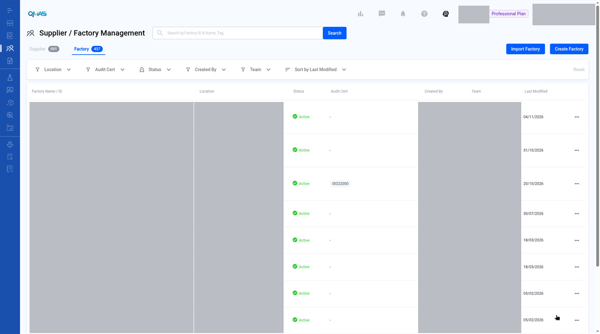

*Factory tab with Import Factory and Create Factory.*

### 2. Factory Profile — overview

- **Upload Logo** and **Factory ID** (optional).
- **Factory Name**: English name (required) and local-language name (optional).
- **Location**: country or region, then province and city.
- **Address**: English address (required) and local-language address (optional).
- **Website** (optional).

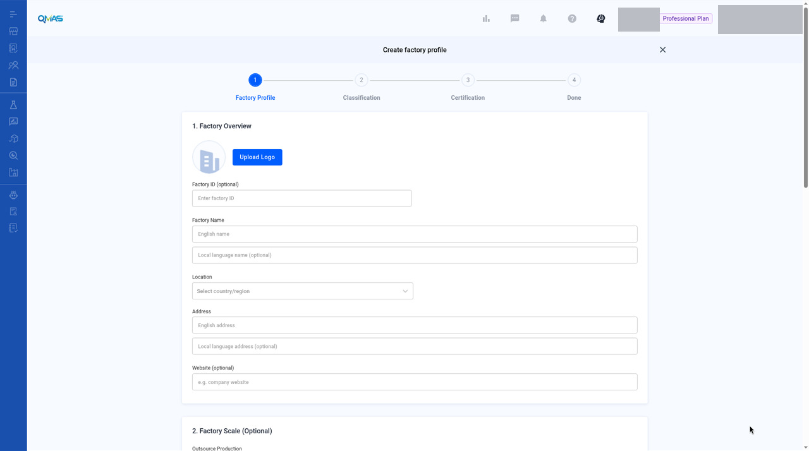

*Create factory profile — step 1, Factory Overview.*

### 3. Factory Profile — scale and equipment (optional)

**Factory Scale**: outsource production, total employees, number of workers, factory size (square meters) and annual volume.

The equipment section lists machines and **Automation Production Line** entries: machine name, brand and model no., quantity and monthly production volume. Click **Add** for more rows.

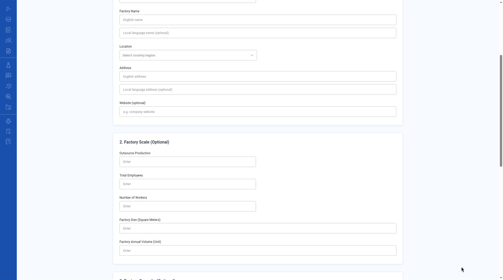

*2. Factory Scale (optional).*

Scrolled view. Factory Scale is fully visible. Lower Factory Overview fields are blank placeholders, and a sliver of 3. Factory Capacity is also in frame.

### 4. Factory Profile — contact

Under **4. Contact**, fill in the **Contact person** and an **Email address** with its type (Company, QA, Sales or Other). **Contact no.** is optional. Click **Next**.

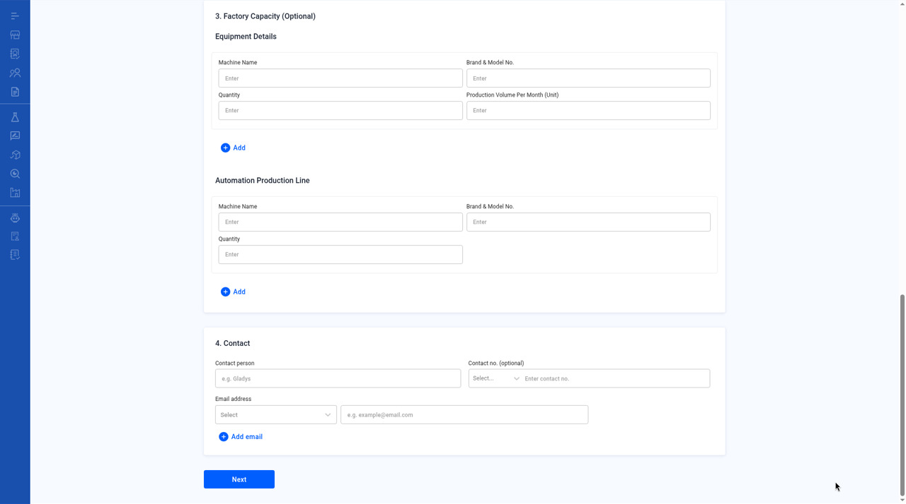

*Contact section and Next.*

Scrolled view. 3. Factory Capacity is blank and visible above 4. Contact and Next.

If Contact person or the email type and address are empty, **Next** (not Submit) marks them required. The fields stay on example placeholders.

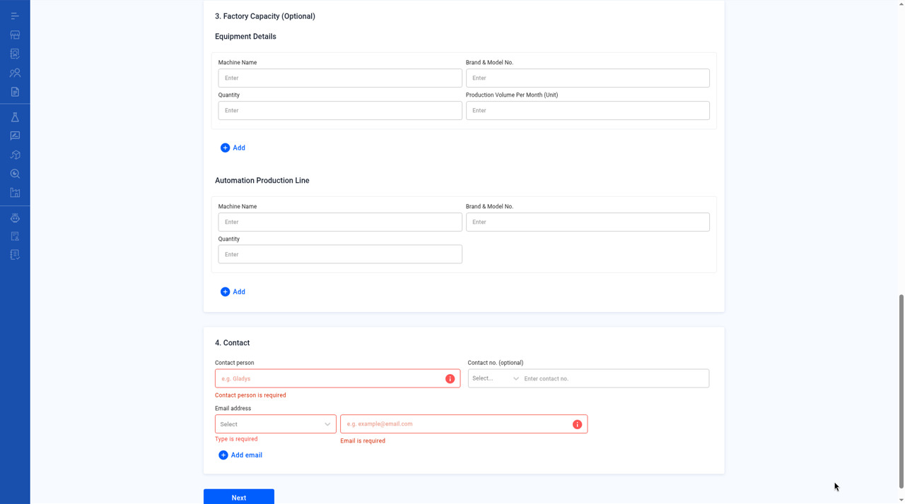

*Factory create-profile required-field validation after Next (not Submit): Contact person, email type and email address.*

Supplementary screenshot. It is not one of the 98 published inventory slots. Same scrolled Contact view as the previous image, after Next.

### 5. Classification (optional)

Click **Select category** for the product categories this factory makes, and **Select tag** for your own tags. Click **Next**.

> **Image pending privacy review:** `05-step2-classification.jpg`
>
> Reviewed replacement image not available yet. Follow the written steps above.

*Step 2 Classification.*

### 6. Certification (optional)

Click **Add** to attach an audit report or certificate. In **Add Certification**, choose the certification type, upload the file (JPG, JPEG, PNG, PDF, DOC or XLS), and fill in the score or overall rating, issue party, issue date and expiry date. Click **Add**.

> **Image pending privacy review:** `07-add-certification.jpg`
>
> Reviewed replacement image not available yet. Follow the written steps above.

*Add Certification pop-up.*

Click **Done** to create the factory.

> **Image pending privacy review:** `06-step3-certification.jpg`
>
> Reviewed replacement image not available yet. Follow the written steps above.

*Step 3 Certification.*

### 7. Done — factory profile

QMAS shows “Create factory successfully!” and opens the factory profile. Use the tabs **Overview**, **Supplier**, **Certificate**, **Document** and **Compliance Data** to manage what is linked to this factory.

The reviewed screenshot is a readonly Overview of an existing profile. Product Category, Tag, Factory Capacity and Factory Scale are empty. It is not the Add Certification pop-up, and no record was written for this shot.

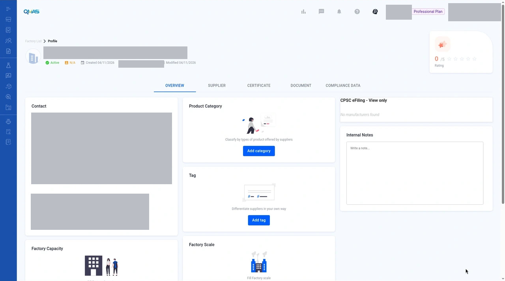

*Factory profile — Overview tab.*

Readonly Overview. Category, Tag, Capacity and Scale are empty. Created and Modified dates stay visible. This is a 1280×800 desktop crop (1280×714), not a high-resolution screenshot.

*Factory profile — Certificate tab, empty (No Data).*

Supplementary screenshot, not one of the 98 inventory slots. Genuine empty Certificate tab on the same profile. This is not Step 3 Certification or the Add Certification pop-up. No record was created or changed.

## Tips

- Set the expiry date on audit certificates so you can see when they need renewing.

## FAQ

**Q: How do I create a new factory?**

A: Go to Supplier / Factory Management, click the Factory tab, then Create Factory. Fill in Factory Profile, then Next, Next and Done. Direct link: https://qmas.icw.io/supplier-manager/factory/create

**Q: Can I add many factories at once?**

A: Yes. Click Import Factory on the Factory tab.

**Q: Where do I upload a factory audit certificate?**

A: In step 3 Certification of Create Factory, or later from the Certificate tab of the factory profile.

## Help Center additions and remaining gaps

This section adds Help Center material and named gaps. It does not replace the steps above.

- **Source-documented** — written in the original Help Center. The last-edited date is given. That does not by itself prove the current QMAS UI.
- **Dev-verified** — confirmed on qmas-dev.icw.io during guide work.
- **Gap** — named as missing or too thin. Not current behaviour until checked on dev.

Reviewed screenshots remain 56 of 98. Forty-two inventory slots are still pending. Six supplementary images are not part of the 98. Unreviewed screenshots were not copied.

### Source-documented — edit, documents, and import (last edited 2026-01-16)

Source: Manage your QMAS Factory Compliance Profile, https://app.notion.com/p/2ea9c62c39fc80198eddc3c9e7d20007. Not marked “Updated November 2026”. Labels need a dev check.

Edit company and contact information with the icon next to each section. Edit categories and tags with the pen icon.

**Add rating** uses the same four dimensions as suppliers in the Help Center (Responsiveness, Quality, Pricing, Market Awareness). Confirm whether a factory rating still exists and still uses these labels.

**Internal notes.** Add missed certificates or documents later in the **CERTIFICATE** and **DOCUMENT** sections.

The Help Center text has typographical errors (“thisfactory”, “factyory”). Those are not UI labels.

**Import Factory:** click **Import Factory**, then **Download here** for the factory template, fill it in (the article says create, update, and delete are supported), upload, and click **Next**. A toast confirms completion. One Help Center step title still says “Upload the filled **supplier** template”. Treat that as a source typo unless dev shows that exact wording.

Do not blanket-replace “supplier” wording on Factory screens. A filed bug asks for a context-by-context check.

### Remaining gaps

- Profile tabs Supplier, Certificate, Document, and Compliance Data are named, not walked through.
- Overview Product Category and Tag empty-state wording.
- List filters, Export, and the row toolbar.
- Screenshots for import, rating, notes, and tabs other than Overview.

Help Center reconciliation 2026-11-13 (HKT). Original Help Center not edited. This draft is not the public guide. No Dify upload.

# Factory Audit — Request a Quotation

> Updated working draft 2026-11-13-draft. This file is not deployed. Existing published version: https://marconip2026.github.io/qmas-user-guide/

## Source and verification

**Source-only, not dev-verified.** This repeats the 2024 Help Center article, last edited 2024-04-02 18:08:00 HKT. It is not confirmed on the current dev site, it has no reviewed screenshots, and it is not on the existing published site.

Source: QMAS Help Center — How To Request Quotation For Factory Audit From Global Laboratories, last edited 2024-04-02 18:08:00 HKT. Not current-UI verified. Do not invent a live /factory-audit/ URL.

- [How To Request Quotation For Factory Audit From Global Laboratories](https://app.notion.com/p/8bdd7dbfdb1347dd86da4694aba5dd1e) (last edited 2024-04-02 18:08:00 HKT). The whole page. Source-only, not dev-verified.

Help Center home: [QMAS Help Center](https://icw-io.notion.site/QMAS-Help-Center-5cd9414da2474d16a7c405a3542fe4af) (last edited 2026-01-20 13:54:13 HKT). User Guide index: [User Guide](https://app.notion.com/p/a92963a30e584145bb457a62b7706541) (last edited 2026-01-16 15:44:49 HKT). Public icw-io addresses for individual articles were not verified, so those links use app.notion.com.

Source-documented only. The original Help Center describes how to request a factory audit quotation, confirm a booking, and open the report and invoice. This article was last edited on 2024-04-02 and was not updated in November 2026. It is not confirmed on the current QMAS dev site. There is no published guide page and no reviewed screenshot.

- **Status:** Source-documented only. Not dev-verified.
- **Help Center article:** How To Request Quotation For Factory Audit From Global Laboratories
- **Help Center last edited:** 2024-04-02
- **Source:** https://app.notion.com/p/8bdd7dbfdb1347dd86da4694aba5dd1e
- **Screenshots:** None. Unreviewed Help Center images are not included.

## Overview

1. The Help Center says: “The QMAS Factory Audit Process Management Module lets you execute and monitor your factory audit workflow online.”
2. The 2024 article covers a quotation, booking confirmation, progress, the report, and invoices.
3. Getting Started Attention cards already name **Factory Audit**, but the exact current path was not re-opened on dev.

## Step-by-step

### 1. Request a quotation (2024 labels)

These labels are Help Center text from 2024. Confirm them on dev before treating them as the current buttons.

1. In the left menu, go to **Factory Audit** and click **Create Factory Audit Order**.
2. Fill out **Audit Requirements**, then click **NEXT**.
3. Fill out **Factory info** and contact person information, then click **Submit**.

### 2. Receive a quotation and confirm the booking

The Help Center says to return to **Factory Audit List** “at the top menu bar”. That top-menu wording is likely outdated. Confirm whether the list is in the left menu.

1. After submit, job status is **Under Review**.
2. When the request is approved, status becomes **Waiting for Quote**.
3. When quotes are ready, status becomes **Quote Available**.
4. Click **View Detail**.
5. Quotes are under the **QUOTES** tab.
6. Click **Accept Quotes** to confirm the booking.

### 3. Monitor progress

1. After accepting the quotation, status becomes **Waiting for reserve booking**.
2. When the booking is confirmed, status becomes **Booking Reserved**.
3. When the audit is completed, status becomes **Completed**.

The Help Center source has typographical errors (“you quotes”, “you job status swill change”). Those are not treated as UI labels.

### 4. View the report and invoice

1. Click **View Detail** next to the job status.
2. Open the **REPORT** tab to view the audit report.
3. Locate the invoice under **INVOICES**.

## Tips

- Do not copy Help Center screenshots into this public draft. They were not privacy-reviewed.
- Before anyone calls these labels current, check the left-nav name, the create button, the status names, **Accept Quotes**, and whether Quotes, Report, and Invoices tabs still exist.

## FAQ

**Q: Is this the current Factory Audit screen?**

A: Not confirmed. This page repeats the 2024 Help Center article only. Verify it on qmas-dev.icw.io before publishing it as current UI.

# Document Management — Upload a Document

> Updated working draft 2026-11-13-draft. This file is not deployed. Existing published version: https://marconip2026.github.io/qmas-user-guide/

## Source and verification

**Current UI verified.** Current UI verified for the reviewed list screenshot. There is no Help Center article for this module. Product Profile document steps are a different page.

Do not mark this whole module unverified. Pending upload slots and the lifecycle tabs remain gaps.

No Help Center article is the source of the steps on this page.

Help Center home: [QMAS Help Center](https://icw-io.notion.site/QMAS-Help-Center-5cd9414da2474d16a7c405a3542fe4af) (last edited 2026-01-20 13:54:13 HKT). User Guide index: [User Guide](https://app.notion.com/p/a92963a30e584145bb457a62b7706541) (last edited 2026-01-16 15:44:49 HKT). Public icw-io addresses for individual articles were not verified, so those links use app.notion.com.

Upload a compliance document, link it to products, suppliers or factories, set its dates and reminders, and add compliance data.

- **Module:** Document Management
- **Start here:** https://qmas.icw.io/document-management → **Upload**
- **Pop-up tabs:** Save To → Dates & Reminder → Compliance Data → Confirm
- **Checked against:** QMAS dev, 4 Nov 2026

## Overview

1. Open **Document Management** and click **Upload**, then choose one or more files from your computer.
2. In **Upload Document**, choose the document **Type**.
3. **Save To**: link the document to suppliers, factories or products.
4. **Dates & Reminder**: set issue, expiry and review dates and an email reminder.
5. **Compliance Data**: add test data, certificate data or other data. Click **Confirm**.

## Step-by-step

### 1. Open Document Management

In the left menu, open **Document Management**. The tabs show **All**, **Pending Review**, **Expired**, **Archived** and **Trash** documents. Click **Upload** at the top right and choose your file.

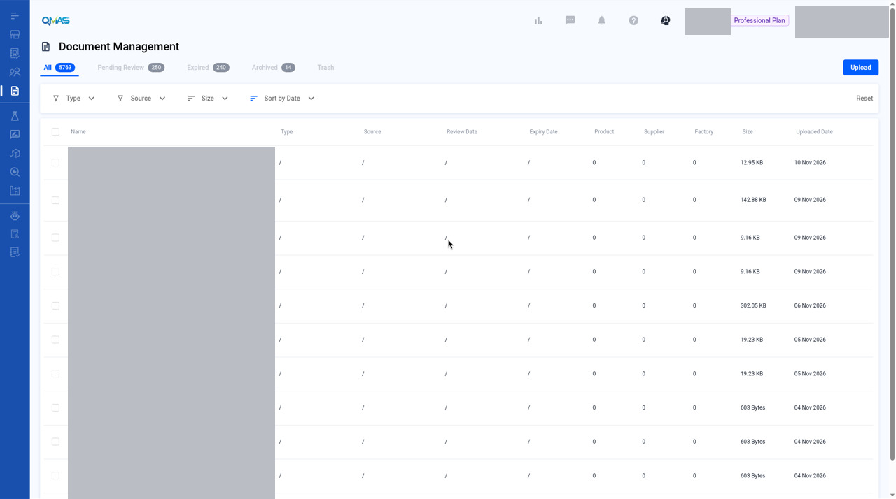

*Document Management list with the Upload button.*

File names in this screenshot are masked. Tabs, column headers, and Upload stay visible.

### 2. Choose the document type

The **Upload Document** pop-up shows the file name. Click the pencil icon to rename it. Under **Type**, type or select a document type, for example **Test Report**.

> **Image pending privacy review:** `02-upload-modal.jpg`
>
> Reviewed replacement image not available yet. Follow the written steps above.

*Upload Document pop-up.*

### 3. Save To — link the document

On the **Save To** tab, click **Add Supplier**, **Add Factory** or **Add Product**. Select the items in the pop-up and click **Confirm**. A document can be linked to several items. Click **Remove** to unlink one.

> **Image pending privacy review:** `03-save-to.jpg`
>
> Reviewed replacement image not available yet. Follow the written steps above.

*The document linked to a product.*

### 4. Dates & Reminder

Set the **Issue Date**, **Expiry Date** and **Review Date**. Under **Email Reminder**, choose **On Expiry Date**, **On Review Date** or **Custom** to get an email reminder. Use **Clear All Settings** to start again.

> **Image pending privacy review:** `04-dates-reminder.jpg`
>
> Reviewed replacement image not available yet. Follow the written steps above.

*Dates & Reminder tab.*

### 5. Compliance Data

Click **Edit** next to **Test Data**, **Certificate Data** or **Other** to record the details from the document, such as test items and results or certificate numbers.

> **Image pending privacy review:** `05-compliance-data.jpg`
>
> Reviewed replacement image not available yet. Follow the written steps above.

*Compliance Data tab.*

### 6. Confirm

Click **Confirm**. QMAS shows a success message and the document appears at the top of the list, with its type and the number of linked products, suppliers and factories.

> **Image pending privacy review:** `06-uploaded.jpg`
>
> Reviewed replacement image not available yet. Follow the written steps above.

*The uploaded document at the top of the list.*

## Tips

- Set an expiry date and reminder for certificates and test reports so you know before they expire.
- You can also upload documents from a product, supplier or factory profile.

## FAQ

**Q: How do I upload a document?**

A: Go to Document Management (https://qmas.icw.io/document-management), click Upload, choose the file, set the Type, link it under Save To, then click Confirm.

**Q: How do I get a reminder before a document expires?**

A: In the Upload Document pop-up, open Dates & Reminder, set the Expiry Date, then choose an Email Reminder option.

**Q: Where can I see expired documents?**

A: Open the Expired tab in Document Management.

## Help Center additions and remaining gaps

This section adds Help Center material and named gaps. It does not replace the steps above.

- **Source-documented** — written in the original Help Center. The last-edited date is given. That does not by itself prove the current QMAS UI.
- **Dev-verified** — confirmed on qmas-dev.icw.io during guide work.
- **Gap** — named as missing or too thin. Not current behaviour until checked on dev.

Reviewed screenshots remain 56 of 98. Forty-two inventory slots are still pending. Six supplementary images are not part of the 98. Unreviewed screenshots were not copied.

### Help Center finding

There is no Help Center article for the Document Management module.

Upload, folders, share, and **Set Reminder** in the Product Information Pack are written against the product profile Document tab, not this module. See the [Product Profile](product-profile.md) page. Do not copy those steps here as if they were Document Management module steps.

### Remaining gaps

- Workflows for **Pending Review**, **Expired**, **Archived**, and **Trash**.
- Post-upload row toolbar (share, archive, download, rename, move). Needs a dev check on this module.
- Filters, search, and Export.
- Edit dates, reminder, or compliance after upload.
- The upload toast “Upload Document Succeed” is a filed bug. Keep neutral “success message” language until the UI is fixed.

Help Center reconciliation 2026-11-13 (HKT). Original Help Center not edited. This draft is not the public guide. No Dify upload.

# QC Inspection — Get a QC Inspection Quote via ICW

> Updated working draft 2026-11-13-draft. This file is not deployed. Existing published version: https://marconip2026.github.io/qmas-user-guide/

## Source and verification

**Mixed.** The reviewed list and Looking-to create path are current UI verified. Quote Available, QUOTES, and SELECT are older Help Center wording and are not dev-verified.

Do not mark this whole module unverified. Source: QMAS Help Center — How To Request Quotation For QC Inspection From Global Laboratories, last edited 2026-11-04 12:15:22 HKT. The November 2026 update covers the create path. The later quote flow still needs verification.

- [How To Request Quotation For QC Inspection From Global Laboratories](https://app.notion.com/p/bf607ad093d24e3c8d483dd85d9a474e) (last edited 2026-11-04 12:15:22 HKT). Create path is current UI verified. The later Quote Available flow is source-only, not dev-verified.

Help Center home: [QMAS Help Center](https://icw-io.notion.site/QMAS-Help-Center-5cd9414da2474d16a7c405a3542fe4af) (last edited 2026-01-20 13:54:13 HKT). User Guide index: [User Guide](https://app.notion.com/p/a92963a30e584145bb457a62b7706541) (last edited 2026-01-16 15:44:49 HKT). Public icw-io addresses for individual articles were not verified, so those links use app.notion.com.

Ask ICW to quote and arrange a third-party QC inspection for your products.

- **Module:** QC Inspection
- **Start here:** https://qmas.icw.io/inspection → **Create Job** → **Get QC inspection quote via ICW**
- **Direct link:** https://qmas.icw.io/inspection/jobs/new
- **Steps:** 1 Inspection Requirement → 2 Report Details → 3 Supplier & Factory → 4 Additional Information → 5 Review & Submit
- **Checked against:** QMAS dev, 4 Nov 2026

## Overview

1. Open **QC Inspection**, click **Create Job**, choose **Get QC inspection quote via ICW** and click **Continue**.
2. **Inspection Requirement**: date, type, level, AQL, budget and provider preference.
3. **Report Details**: products and POs to inspect.
4. **Supplier & Factory**: who makes the goods and where the inspection takes place.
5. **Additional Information**: files and remarks.
6. **Review & Submit**: check everything and click **Submit**.

## Step-by-step

### 1. Open QC Inspection

In the left menu, open **QC Inspection**. The charts show inspection results, service providers and job types. Tabs list **All Job**, **3rd Party Job**, **Inhouse Record** and **Draft**. Click **Create Job**.

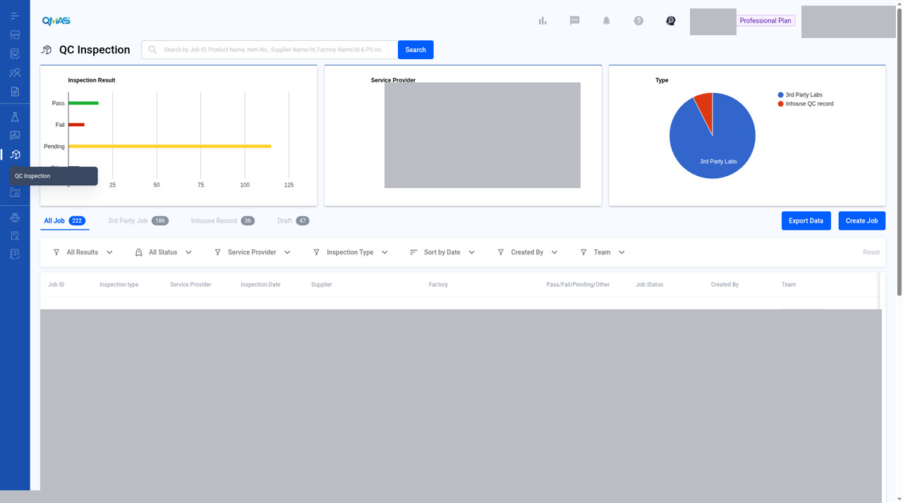

*QC Inspection list with Create Job.*

Job rows are masked. Tabs, column headers, and Create Job stay visible. This is a 1280×800 desktop crop (1280×714), not a high-resolution screenshot.

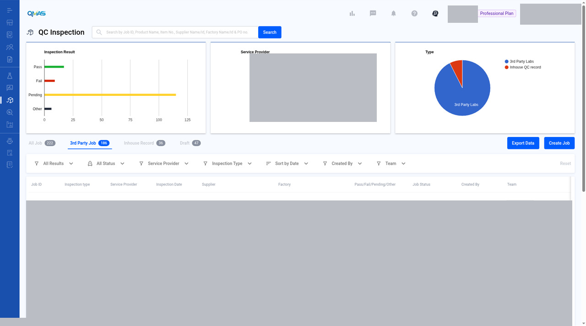

*QC Inspection — 3rd Party Job tab.*

Supplementary screenshot, not one of the 98 inventory slots. Job rows are masked.

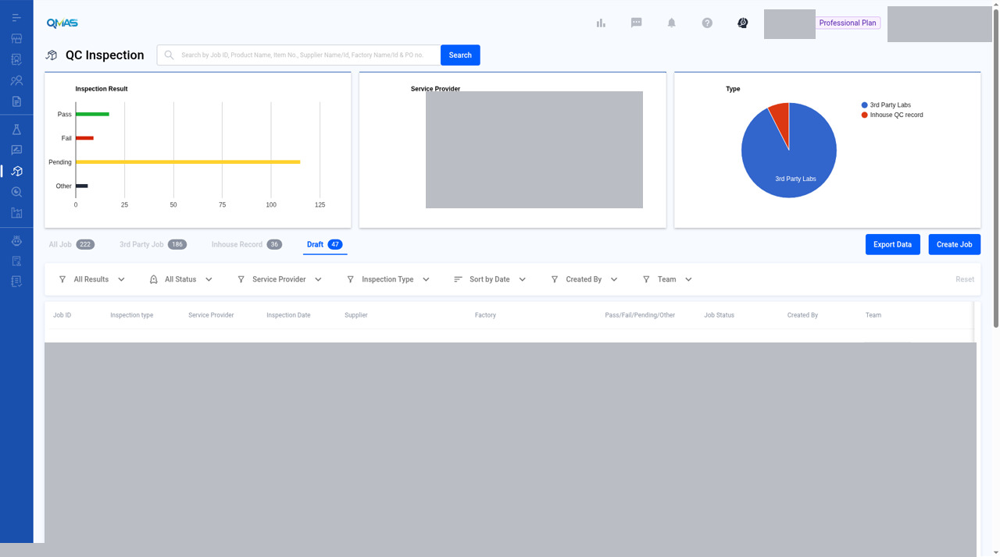

*QC Inspection — Draft tab.*

Supplementary screenshot, not one of the 98 inventory slots. Job rows are masked.

### 2. Choose what you are looking for

| Option | Use it when |
|---|---|
| Get QC inspection quote via ICW | You want ICW to arrange a third-party inspector. This guide. |
| Start internal inspection | Your own QC team will inspect. See the Internal QC Inspection guide. |
| Add inspection record | The inspection is already done and you want to record the result. |

Choose **Get QC inspection quote via ICW** and click **Continue**.

*Create New Job — Looking to…*

Default selection is Get QC inspection quote via ICW. Continue is visible. No personal data is filled in.

### 3. Inspection Requirement

- **Inspection Date**.
- **Inspection type**: Final Random, Loading, During Production, Re-Inspection, Initial Production, Fabric, 100% or Vendor Own Inspection.
- **Inspection Level**: General Inspection Level I–III or Special Level S-1 to S-4.
- **Inspection AQL**: Critical, Major and Minor levels. They apply to all products in this job by default.
- **Target Budget** (currency and amount) and **Service Provider Preference**. Leave “No preference, ICW will match you with the best inspector” selected if you have no preferred provider.

The reviewed screenshot of this step is the blank form. It includes Target Budget and Service Provider Preference. It is not a filled or submitted job. The filled step-1 screenshot is still pending.

*Create Job step 1 Inspection Requirement, blank (includes Target Budget and Service Provider Preference).*

Supplementary screenshot, not one of the 98 inventory slots. Blank form only.

> **Image pending privacy review:** `04-step1-filled.jpg`
>
> Reviewed replacement image not available yet. Follow the written steps above.

*Step 1 filled in. Click Save to keep a draft, or Next.*

### 4. Report Details

Click **Add Product**, search for the product, click **Select**, then **Confirm**.

> **Image pending privacy review:** `05-select-product.jpg`
>
> Reviewed replacement image not available yet. Follow the written steps above.

*Select related product(s) — search by name, item no., supplier or factory.*

For each product, fill in the **PO** details: customer name, customer PO #, PO #, order quantity and number of cartons. Use **Add New PO** for more POs, **Add Product** for more products, and **Add Report** or **Duplicate Report** if you need separate reports. Tick **Signed Sample Available** if there is one. Click **Next**.

> **Image pending privacy review:** `06-step2-report.jpg`
>
> Reviewed replacement image not available yet. Follow the written steps above.

*Report 1 with one product and its PO.*

### 5. Supplier & Factory

Click **Add Supplier** and select the supplier. Then click **Select Existing Factory** and choose the factory where the inspection will take place. Check the contact person, phone and email for each. Click **Next**.

> **Image pending privacy review:** `07-step3-supplier-factory.jpg`
>
> Reviewed replacement image not available yet. Follow the written steps above.

*Supplier and factory selected, with contact details.*

### 6. Additional Information

Upload reference files such as tech packs or previous reports, and write any special requirement in **Remark**. Click **Next**.

> **Image pending privacy review:** `08-step4-additional.jpg`
>
> Reviewed replacement image not available yet. Follow the written steps above.

*Step 4 Additional Information.*

### 7. Review & Submit

Check the summary. Click **Edit** on any section to change it. Click **Submit**.

> **Image pending privacy review:** `09-step5-review.jpg`
>
> Reviewed replacement image not available yet. Follow the written steps above.

*Step 5 Review & Submit.*

### 8. Done — job detail

QMAS shows “Create job successfully!” and opens the job. It has a Job ID and starts as **Under Review**. The **Quotes**, **Reports**, **Attachments** and **Invoices** tabs follow the job.

> **Image pending privacy review:** `10-job-detail.jpg`
>
> Reviewed replacement image not available yet. Follow the written steps above.

*The new inspection job.*

## Tips

- Click **Save** on any step to keep a draft. Drafts are on the **Draft** tab.
- Submit well before the inspection date so there is time for quoting and booking.

## FAQ

**Q: How do I book a third-party QC inspection?**

A: Go to QC Inspection (https://qmas.icw.io/inspection), click Create Job, choose Get QC inspection quote via ICW, then complete the 5 steps and Submit.

**Q: What is the difference between a QC inspection quote and an internal inspection?**

A: A quote via ICW uses a third-party inspector arranged by ICW. An internal inspection is done by your own QC team (Internal QC Inspection).

**Q: Can I save a QC job and finish it later?**

A: Yes. Click Save on any step. The job is kept on the Draft tab.

## Help Center additions and remaining gaps

This section adds Help Center material and named gaps. It does not replace the steps above.

- **Source-documented** — written in the original Help Center. The last-edited date is given. That does not by itself prove the current QMAS UI.
- **Dev-verified** — confirmed on qmas-dev.icw.io during guide work.
- **Gap** — named as missing or too thin. Not current behaviour until checked on dev.

Reviewed screenshots remain 56 of 98. Forty-two inventory slots are still pending. Six supplementary images are not part of the 98. Unreviewed screenshots were not copied.

### Source-documented — create path (Help Center updated 2026-11-04)

Source: How To Request Quotation For QC Inspection From Global Laboratories, https://app.notion.com/p/bf607ad093d24e3c8d483dd85d9a474e. Direct link cited there: https://qmas.icw.io/inspection/jobs/new.

The November 2026 create steps already match this page. The Help Center also says: choose **Get QC inspection quote via ICW** and click Continue; choose **Start internal inspection** if your own QC team will inspect; or **Add inspection record** to record a finished inspection. The Internal QC page covers starting an internal inspection. **Add inspection record** still has no guide.

The November 2026 steps also say: click **Save** on any step to finish later. Drafts are on the **Draft** tab.

### Source-documented — post-submit flow (older wording; needs verification)

1. After submission, the list status is **Under Review**.
2. When the quotation is ready, the status changes to **Quote Available**.
3. Click **View detail** next to Status.
4. Scroll to the **QUOTES** tab.
5. Choose a quotation and click **SELECT** to confirm the order.
6. Status becomes **Waiting for reserved booking**, then **Booking Reserved** when the booking is confirmed.
7. After the inspection is completed, the Help Center says you will receive the inspection report and the status will be **Completed**.

### Remaining gaps

- The full **Add inspection record** flow.
- Job-detail tabs Quotes, Reports, Attachments, and Invoices are named. One overview shot exists.
- All Job, 3rd Party, and Inhouse Record tabs, and more detail on the Draft tab.
- List filters, Export, and the row toolbar.
- Filed wording bugs (“Add New Po”, “XLSL”, level labels, empty product picker until search). Confirm the live UI. Do not invent fixes.

Help Center reconciliation 2026-11-13 (HKT). Original Help Center not edited. This draft is not the public guide. No Dify upload.

# Internal QC Inspection — Start an Internal Inspection

> Updated working draft 2026-11-13-draft. This file is not deployed. Existing published version: https://marconip2026.github.io/qmas-user-guide/

## Source and verification

**Mixed.** The reviewed list, Looking-to, and blank step 1 are current UI verified. There is no standalone Help Center article. The QC article only names Start internal inspection, and that mention is source-only. Steps 2–5 stay written text.

Do not mark this whole module unverified. Source: QMAS Help Center — How To Request Quotation For QC Inspection From Global Laboratories, last edited 2026-11-04 12:15:22 HKT, for the Looking-to mention only.

- [How To Request Quotation For QC Inspection From Global Laboratories](https://app.notion.com/p/bf607ad093d24e3c8d483dd85d9a474e) (last edited 2026-11-04 12:15:22 HKT). Looking-to mention only. The reviewed start-internal screens on this page stay current UI verified.

Help Center home: [QMAS Help Center](https://icw-io.notion.site/QMAS-Help-Center-5cd9414da2474d16a7c405a3542fe4af) (last edited 2026-01-20 13:54:13 HKT). User Guide index: [User Guide](https://app.notion.com/p/a92963a30e584145bb457a62b7706541) (last edited 2026-01-16 15:44:49 HKT). Public icw-io addresses for individual articles were not verified, so those links use app.notion.com.

Schedule an inspection that your own QC team carries out, without a third-party provider.

- **Module:** Internal QC Inspection
- **Start here:** https://qmas.icw.io/inspection/internal/list → **Create Job**
- **Direct link:** https://qmas.icw.io/inspection/jobs/new?type=internalInspection
- **Steps:** 1 Inspection Requirement → 2 Report Details → 3 Supplier & Factory → 4 Additional Information → 5 Review & Submit
- **Checked against:** QMAS dev, 4 Nov 2026

## Overview

1. Open **Internal QC Inspection** and click **Create Job**. **Start internal inspection** is already selected. Click **Continue**.
2. **Inspection Requirement**: date, type, level and AQL.
3. **Report Details**, **Supplier & Factory** and **Additional Information** work the same way as in the QC Inspection quote flow.
4. **Review & Submit**: check everything and click **Submit**.

## Step-by-step

### 1. Open Internal QC Inspection

In the left menu, open **Internal QC Inspection**. The tabs show **All Job**, **Onsite Job Calendar** and **Draft**. Click **Create Job**. To add many jobs at once, use **Import Job**.

*Internal QC Inspection list with Import Job and Create Job.*

Import Job and Create Job are visible. Job rows are masked. This is a 1280×800 desktop crop (1280×714), not a high-resolution screenshot.

### 2. Start internal inspection

**Start internal inspection** is selected. Click **Continue**.

*Create New Job — Start internal inspection selected.*

Start internal inspection is selected. Continue is visible. No personal data is filled in.

### 3. Inspection Requirement

Choose the **Inspection Date**, **Inspection type**, **Inspection Level** and the **AQL** (Critical, Major, Minor). There is no budget or service provider, because your own team does the inspection. Click **Next**.

The reviewed screenshot is that blank form. It does not show Target Budget or Service Provider Preference. Wizard steps 2–5 are labels only. Those screens were not captured and were not invented.

*Step 1 Inspection Requirement for an internal inspection.*

Blank form. No Target Budget or Service Provider Preference, unlike the QC quote flow. Steps 2–5 remain pending.

### 4. Steps 2–5

The next steps are the same as in the QC Inspection quote flow. See the [QC Inspection](qc-inspection.md) guide for those steps.

- **Report Details**: add products and their POs.
- **Supplier & Factory**: select the supplier and the factory to inspect.
- **Additional Information**: upload reference files and add remarks.
- **Review & Submit**: check the summary, then click **Submit**. The job opens with its Job ID.

## Tips

- If you need a third-party inspector instead, use QC Inspection → Create Job → **Get QC inspection quote via ICW**.
- Click **Save** on any step to keep a draft.

## FAQ

**Q: How do I start an internal inspection?**

A: Go to Internal QC Inspection (https://qmas.icw.io/inspection/internal/list), click Create Job, keep Start internal inspection selected, click Continue and complete the 5 steps. Direct link: https://qmas.icw.io/inspection/jobs/new?type=internalInspection

**Q: Can I import internal inspection jobs?**

A: Yes. Click Import Job on the Internal QC Inspection list.

## Help Center additions and remaining gaps

This section adds Help Center material and named gaps. It does not replace the steps above.

- **Source-documented** — written in the original Help Center. The last-edited date is given. That does not by itself prove the current QMAS UI.
- **Dev-verified** — confirmed on qmas-dev.icw.io during guide work.
- **Gap** — named as missing or too thin. Not current behaviour until checked on dev.

Reviewed screenshots remain 56 of 98. Forty-two inventory slots are still pending. Six supplementary images are not part of the 98. Unreviewed screenshots were not copied.

### Help Center finding

There is no standalone Internal QC Help Center article.

The November 2026 QC article mentions **Start internal inspection** as a Looking-to option when your own QC team will inspect. That is the only Help Center mention. It does not document steps 2–5, Import Job, or the Onsite Job Calendar.

### Remaining gaps

- Own screenshots, or a clearly labelled “same as QC” set, for steps 2–5 and the completed job detail.
- **Import Job**.
- **Onsite Job Calendar** tab.
- Draft tab and job detail after submit.
- Difference callouts versus third-party QC beyond “no budget/provider”.

Help Center reconciliation 2026-11-13 (HKT). Original Help Center not edited. This draft is not the public guide. No Dify upload.

# Document Review — Create a Review Job

> Updated working draft 2026-11-13-draft. This file is not deployed. Existing published version: https://marconip2026.github.io/qmas-user-guide/

## Source and verification

**Mixed.** The reviewed list and blank create-job screens are current UI verified. There is no Document Review Help Center article. The supplier article only says a connected supplier can be assigned Document Review jobs, and that mention is source-only.

Do not mark this whole module unverified. Approve, reject, and resubmit remain gaps. Source: QMAS Help Center — Manage your QMAS Supplier Compliance Profile, last edited 2026-01-16 15:38:01 HKT, for the invite mention only.

- [Manage your QMAS Supplier Compliance Profile](https://app.notion.com/p/aa532b63c9554db99b57676ee83d489c) (last edited 2026-01-16 15:38:01 HKT). Invite and connection mention only. It does not describe how to conclude a review job.

Help Center home: [QMAS Help Center](https://icw-io.notion.site/QMAS-Help-Center-5cd9414da2474d16a7c405a3542fe4af) (last edited 2026-01-20 13:54:13 HKT). User Guide index: [User Guide](https://app.notion.com/p/a92963a30e584145bb457a62b7706541) (last edited 2026-01-16 15:44:49 HKT). Public icw-io addresses for individual articles were not verified, so those links use app.notion.com.

Get compliance documents (CPC, GCC, DoC, test reports, TCF) reviewed by a lab or by yourself, whether you upload them or your supplier does.

- **Module:** Document Review
- **Start here:** https://qmas.icw.io/document-review → **Create Job** or **Create Job for supplier**
- **Direct links:** You upload: https://qmas.icw.io/document-review/upload-document/create · Supplier uploads: https://qmas.icw.io/document-review/upload-document/request
- **Checked against:** QMAS dev, 4 Nov 2026

## Overview

1. Choose the flow that fits (table below).
2. Fill in **Job Type**, **Product Information** and the documents to review.
3. For a supplier job, choose the **connected supplier** who will upload.
4. Choose a **partner** (optional) and the **Service Provider**: a connected lab, or **Job Owner Review** to review yourself.
5. Click **Confirm**. Follow the status on the Document Review list until the review is concluded.

## Step-by-step

### 1. Choose your flow

| Flow | Button | Who uploads | Who reviews |
|---|---|---|---|
| A. Upload for lab review | Create Job | You | Connected lab |
| B. Supplier uploads for lab review | Create Job for supplier | Your connected supplier | Connected lab (Connected Provider) |
| C. Supplier uploads for your own review | Create Job for supplier | Your connected supplier | You (Job Owner Review) |

In the left menu, open **Document Review**. The dashboard shows service providers, jobs over 12 months, status and reject reasons. The tabs **All Job**, **My Job** and **View Only** list the jobs.

*Document Review with Create Job and Create Job for supplier.*

### 2. Job Type

Choose the **Job Type** (for example Document Review) and tick **CPC/GCC/DOC Review** and/or **Compliance Review**. Optionally fill in **Buyer Name**, **Service Required** (Regular by default) and **Submission Remark**. The screenshot shows this form at those defaults, before a review type is ticked or a product is added. It is not a submitted job.

*Create Job — 1. Job Type and 2. Product Information.*

Blank/default form, not a submitted job. Job Type shows the Document Review default and Service Required shows Regular. Sections 3 and 4 are also in view. The account header was redacted.

### 3. Product Information

Keep **Select Product For Review = Yes**. Click **Existing Product** to pick products, or **New Product** to create one. For each product, check the **Basic Information**, then fill in **Additional Information**: Test Age Grade, Label Age Grade, Export Market and Country Of Origin are required.

> **Image pending privacy review:** `03-product-info.jpg`
>
> Reviewed replacement image not available yet. Follow the written steps above.

*Basic Information and Additional Information for the selected product.*

Below that you can add **PO Information**, upload **Product Pictures & Reference Documents**, set the **TCF Requests** (choose document types or import a TCF template) and add **Quality Requirements**.

> **Image pending privacy review:** `04-tcf-requirements.jpg`
>
> Reviewed replacement image not available yet. Follow the written steps above.

*TCF Requests and Requirements.*

### 4. Documents for Review, partner and provider (Flow A)

Under **Documents for Review**, click **Upload files** (at least one file is required). The reviewer gives a conclusion only on documents in this section.

**Select Partner** (optional): choose Yes to let one partner view the job.

**Service Provider**: choose the connected lab under **Connected Provider**. Click **Confirm**.

> **Image pending privacy review:** `05-docs-partner-provider.jpg`
>
> Reviewed replacement image not available yet. Follow the written steps above.

*Documents for Review, Select Partner and Service Provider.*

### 5. Create Job for supplier (Flows B and C)

Click **Create Job for supplier**. Fill in Job Type and Product Information as above. Then:

The screenshot is the default form: no supplier is selected, and section 5 is clipped at the bottom.

- **Select Connected Supplier**: choose the supplier who will upload. Only suppliers connected with you on QMAS are listed. See Supplier Management → Invite Supplier.
- **Select Partner** (optional).
- **Service Provider**: choose **Connected Provider** and a lab for Flow B, or **Job Owner Review** for Flow C.
- Click **Confirm**. The supplier gets a notification to upload the documents.

*Create Job for Supplier.*

Blank/default form, not a submitted job. Sections 1–5 are in view and section 5 is clipped at the bottom. No supplier is selected. The account header was redacted.

> **Image pending privacy review:** `07-supplier-job-provider.jpg`
>
> Reviewed replacement image not available yet. Follow the written steps above.

*Select Connected Supplier, Select Partner and Service Provider (Connected Provider or Job Owner Review).*

### 6. Follow the review

- Flow A and B: the job shows **Being Processed** while the lab reviews. The lab concludes each document as **Approve**, **Reject** or **Waiting for Additional Information**.
- Flow C: when the supplier has uploaded, open the job, click **View detail**, and conclude each document yourself with **Approve**, **Reject**, **N/A** or **Waiting for additional information**. Click **Confirm**.
- If a document is rejected or more information is needed, read the comment and upload a corrected file.
- When all documents are approved, complete the job.

## Tips

- Flows B and C need a connected supplier. Invite the supplier first from Supplier / Factory Management → Invite Supplier.
- Save a TCF document-type list as a template so you can reuse it in the next job.

## FAQ

**Q: How do I send documents to a lab for review?**

A: Go to Document Review (https://qmas.icw.io/document-review), click Create Job, fill in Job Type and Product Information, upload files under Documents for Review, choose the lab under Service Provider, and click Confirm.

**Q: How do I ask my supplier to upload documents for review?**

A: Click Create Job for supplier on Document Review, choose the connected supplier, then choose Connected Provider (lab review) or Job Owner Review (you review) and click Confirm.

**Q: What does Job Owner Review mean?**

A: You review the supplier's documents yourself instead of a lab.

**Q: Why can't I find my supplier in Select Connected Supplier?**

A: Only suppliers connected with you on QMAS are listed. Invite them from Supplier / Factory Management → Invite Supplier.

## Help Center additions and remaining gaps

This section adds Help Center material and named gaps. It does not replace the steps above.

- **Source-documented** — written in the original Help Center. The last-edited date is given. That does not by itself prove the current QMAS UI.
- **Dev-verified** — confirmed on qmas-dev.icw.io during guide work.
- **Gap** — named as missing or too thin. Not current behaviour until checked on dev.

Reviewed screenshots remain 56 of 98. Forty-two inventory slots are still pending. Six supplementary images are not part of the 98. Unreviewed screenshots were not copied.

### Help Center finding

There is no Document Review Help Center article.

The only related Help Center text is on the supplier profile article (last edited 2026-01-16): inviting or connecting a supplier “allows you to assign Document Review jobs to your connected suppliers.” Statuses Invite, No Connection, and Connected are documented there. That text does not describe how to conclude a review job.

### Remaining gaps

- Job detail after create: View detail, conclusion controls (the steps above name Approve, Reject, N/A, and Waiting), and re-upload after reject. Zero screenshots.
- List filters, Export, and My Job versus View Only.
- Save or reuse a TCF template (tip only today).
- The Quality Requirements block on the create form is thin.
- Filed typos (“Exising Product”, “JEPG”, “Select Connect Supplier”). This guide uses corrected English. Confirm the live UI.

Help Center reconciliation 2026-11-13 (HKT). Original Help Center not edited. This draft is not the public guide. No Dify upload.

# AI Insight — Run an AI Risk Screening

> Updated working draft 2026-11-13-draft. This file is not deployed. Existing published version: https://marconip2026.github.io/qmas-user-guide/

## Source and verification

**Current UI verified.** Current UI verified for the reviewed AI Risk Screening list and the blank New AI Risk Screening dialog. There is no Help Center article for AI Insight, AI Risk Screening, or AI Assessment. No screening was run.

Do not mark this whole module unverified. A completed report and Verify Information remain gaps.

No Help Center article is the source of the steps on this page.

Help Center home: [QMAS Help Center](https://icw-io.notion.site/QMAS-Help-Center-5cd9414da2474d16a7c405a3542fe4af) (last edited 2026-01-20 13:54:13 HKT). User Guide index: [User Guide](https://app.notion.com/p/a92963a30e584145bb457a62b7706541) (last edited 2026-01-16 15:44:49 HKT). Public icw-io addresses for individual articles were not verified, so those links use app.notion.com.

Upload product photos and let AI identify compliance risks and requirements for your import region. You get a compliance guideline report (PDF).

- **Module:** AI Insight (shown as “AI Risk Screening” in the QMAS menu)
- **Start here:** https://qmas.icw.io/ai-risk-screening → **Add**, or a product profile → **AI Risk Screening** → **Add**
- **Uses:** Tokens. Your balance shows as **Available Token** in the pop-up.
- **Checked against:** QMAS dev, 4 Nov 2026

## Overview

1. Open **AI Risk Screening** from the left menu (or from a product profile) and click **Add**.
2. Upload up to 6 product photos and choose the **Import Region** and **Output Mode**.
3. Click **Verify Information** (recommended) or **Skip Verify & Generate Report**.
4. When the status is **Completed**, open the report from the list.

## Step-by-step

### 1. Open AI Risk Screening

In the left menu, open **AI Risk Screening**. The list shows every screening with its import region, output mode (Full or Lite), status and upload date. Click **Add**.

The guide still files this module under AI Insight. The current screen title and address are AI Risk Screening (`/ai-risk-screening`).

*AI Risk Screening list.*

Current UI name is AI Risk Screening. Search, the All tab, filters and Add are visible. List rows are masked. No screening was run. This is a 1280×800 desktop crop (1280×714), not a high-resolution screenshot.

You can also start from a product: open the product profile, choose **AI Risk Screening** in its left menu, then click **Add**.

> **Image pending privacy review:** `04-product-profile-entry.jpg`
>
> Reviewed replacement image not available yet. Follow the written steps above.

*AI Risk Screening inside a product profile.*

### 2. Fill in the screening

- **Product Page URL** (optional): a link to the product page.
- **Product Images** (required): up to 6 photos from different views. PNG, JPEG, JPG, WEBP, GIF, AVIF or HEIC.
- **Import Region** (required): where the product will be sold.
- **Output Mode** (required): **Full** or **Lite** report.
- **Screening Age Grade** (optional): the age grade to screen against, for example 3+ or 8+.

**Available Token** shows your balance. The number in this screenshot is redacted.

The reviewed pop-up is blank. Product Page URL is only the placeholder, no images are uploaded, and Import Region, Output Mode and Screening Age Grade are empty. Verify Information and Skip Verify & Generate Report are visible and were not used. No report was generated.

*New AI Risk Screening pop-up.*

Dialog title is AI Risk Screening. Blank form only. No photos uploaded and neither action button was used.

### 3. Verify and generate

Click **Verify Information** (recommended: verification improves accuracy and gives a more reliable report), or **Skip Verify & Generate Report** to go straight to the report.

The new screening appears in the list. When its status is **Completed**, the report is ready. Click the **ⓘ** icon to see the screening details.

> **Image pending privacy review:** `03-screening-details.jpg`
>
> Reviewed replacement image not available yet. Follow the written steps above.

*Screening details: product name, import region, age grade, categories, materials, battery/AC/food-contact flags and output mode.*

## Tips

- Use clear photos from several angles (front, back, label, packaging) for a better result.
- Check your Available Token balance before you generate.

## FAQ

**Q: How do I run an AI risk screening / AI Insight?**

A: Go to AI Risk Screening (https://qmas.icw.io/ai-risk-screening), click Add, upload product photos, choose Import Region and Output Mode, then click Verify Information or Skip Verify & Generate Report.

**Q: Where do I see my token balance?**

A: In the AI Risk Screening pop-up, under Available Token.

**Q: What is the difference between Full and Lite?**

A: They are the two report output modes. Choose one in Output Mode when you add a screening.

## Help Center additions and remaining gaps

This section adds Help Center material and named gaps. It does not replace the steps above.

- **Source-documented** — written in the original Help Center. The last-edited date is given. That does not by itself prove the current QMAS UI.
- **Dev-verified** — confirmed on qmas-dev.icw.io during guide work.
- **Gap** — named as missing or too thin. Not current behaviour until checked on dev.

Reviewed screenshots remain 56 of 98. Forty-two inventory slots are still pending. Six supplementary images are not part of the 98. Unreviewed screenshots were not copied.

### Help Center finding

There is no Help Center article for AI Insight, AI Risk Screening, or AI Assessment.

### Remaining gaps

- Completed report: open it, download the PDF, and what Full versus Lite actually contain.
- **Verify Information** intermediate UI. It is the recommended path and is not shown.
- Empty state. A wrong empty-state description is a filed bug. Wait for the fixed UI.
- Naming is still undecided: this guide title **AI Insight**, menu **AI Risk Screening**, Home **AI Assessment** and **AI Insight**.
- Token spend: the guide already warns. Do not run a screening unless asked.

Help Center reconciliation 2026-11-13 (HKT). Original Help Center not edited. This draft is not the public guide. No Dify upload.
