# QMAS User Guide

## Contents

- [Product Testing — Request a Quotation](#product-testing)
- [Getting Started — Home, Settings and Company Profile](#getting-started)
- [Product Management — Create and Edit a Product](#product-management)
- [Product Management — Every Tab of the Product Profile](#product-profile)
- [Test Plan — Get an AI Test Plan for a Product](#test-plan)
- [eFiling — Submit eFiling to CPSC](#efiling)
- [Supplier Management — Create a Supplier](#supplier-management)
- [Factory Management — Create a Factory](#factory-management)
- [Factory Audit — Request a Factory Audit](#factory-audit)
- [Document Management — Upload a Document](#document-management)
- [QC Inspection — Get a QC Inspection Quote via ICW](#qc-inspection)
- [Internal QC Inspection — Start an Internal Inspection](#internal-qc-inspection)
- [Document Review — Create a Review Job](#document-review)
- [AI Insight — Run an AI Risk Screening](#ai-insight)

# Product Testing — Request a Quotation

Create a product testing job and get a quotation from a laboratory.

- **Module:** Product Testing
- **Start here:** [qmas.icw.io/product-testing](https://qmas.icw.io/product-testing) → **Create Job**
- **Direct link:** [qmas.icw.io/product-testing/create-job](https://qmas.icw.io/product-testing/create-job)
- **Steps:** 1 Product Info → 2 Requirements → 3 Provider Selection → 4 Done

## Overview

1. **Open Product Testing** and click **Create Job**.
2. **Product Info** — add an existing product or create a new one.
3. **Requirements** — set the export market, test items, quality requirements and service details.
4. **Provider Selection** — choose Connected Provider, ICW or TicMart, then **Submit**.
5. **Done** — the Order details page opens. Track the job there or in the Product Testing list.

## Step-by-step

### 1. Open Product Testing

In the left menu, open **Product Testing**. The page shows charts of job status, service provider and test results, and the list of all jobs. Click **Create Job** above the list.

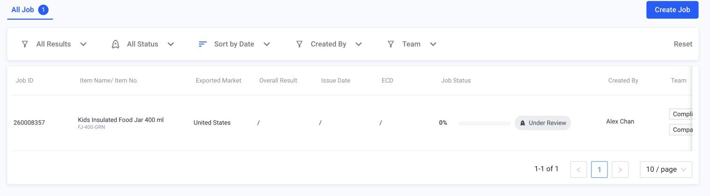

*Product Testing list — Create Job is at the top right of the job list.*

### 2. Product Info — select products

The **Request Quotations** wizard opens. Add the products for this testing order:

- **+ Existing Products** picks from your Product Management list.
- **+ Add Products** creates a new product here.

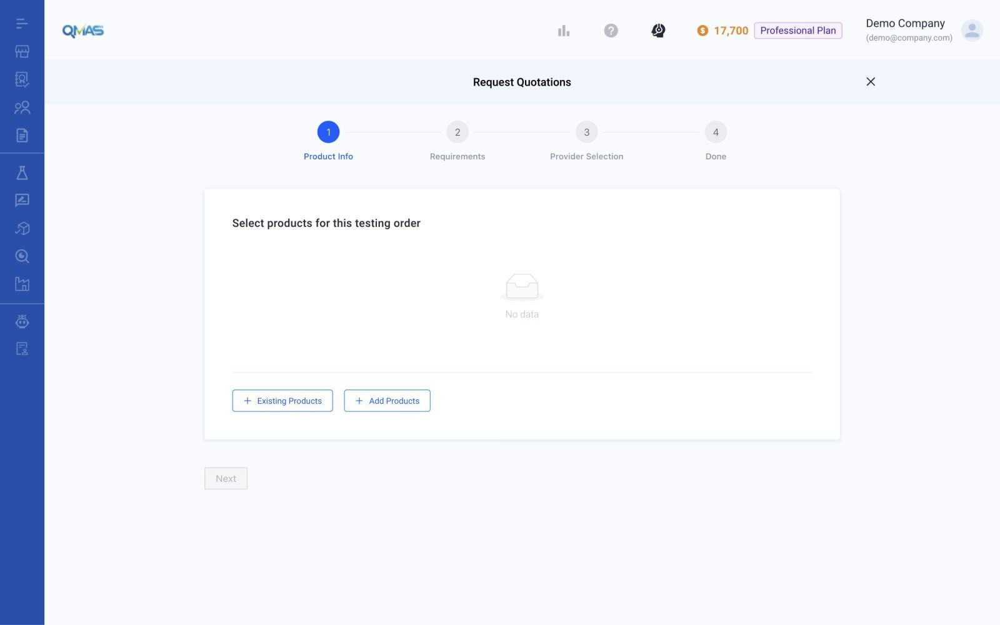

*Step 1 starts empty. Next stays disabled until a product is added.*

In the **Select Product(s)** pop-up, search by product name or ID, click **Select** on each product you need, then click **Confirm**. You can select more than one product.

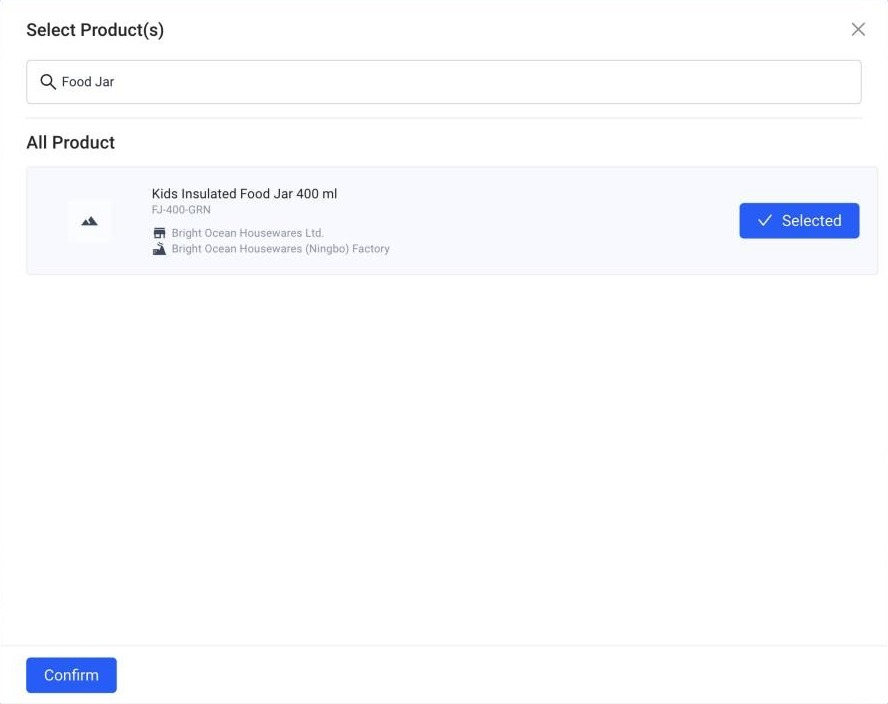

*A selected product shows a blue “✓ Selected” button.*

Check the product details. You can change **Item name on report** and **Item no. on report**, which are printed on the test report. Click **Add PO Information** to link a purchase order (optional). Then click **Next**.

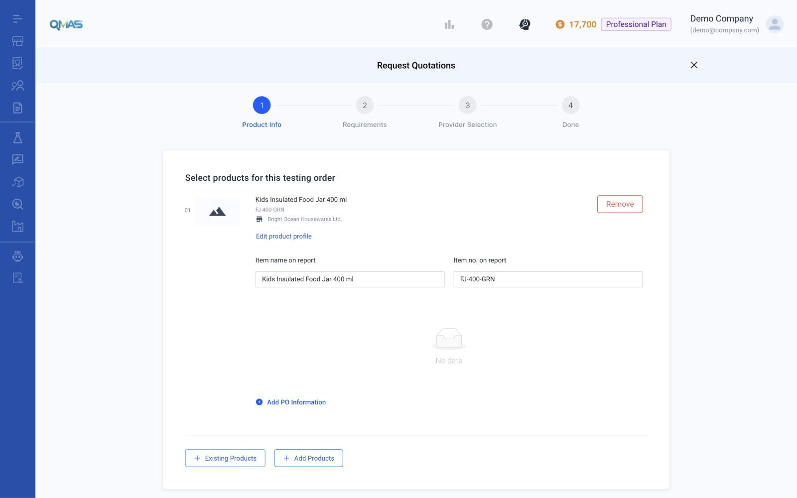

*Use Remove to drop a product, or Edit product profile to update it.*

### 3. Requirements

**1. Test Requirements**

- **Export Market** — where the product will be sold (required).
- **Test Item** (optional) — choose a country, then search for test items or citations.
- **Quality Requirement** — Create New Requirements, Add Existing Requirements, or Import Requirement Template.
- **Remarks** and **Attachment** (optional) — special instructions and reference files.

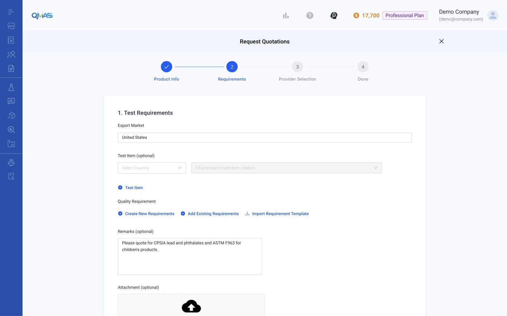

*Export Market filled in.*

**2. Additional Information**

- **Service Level** — Regular, Express or Shuttle / Emergency.
- **Country of Origin** — where the product is made (you can pick more than one).
- **Intended Usage** — General product, Adult product, Children product or Toys.
- **Buyer Name** (optional).

When all required fields are filled, **Next** turns blue. Click it.

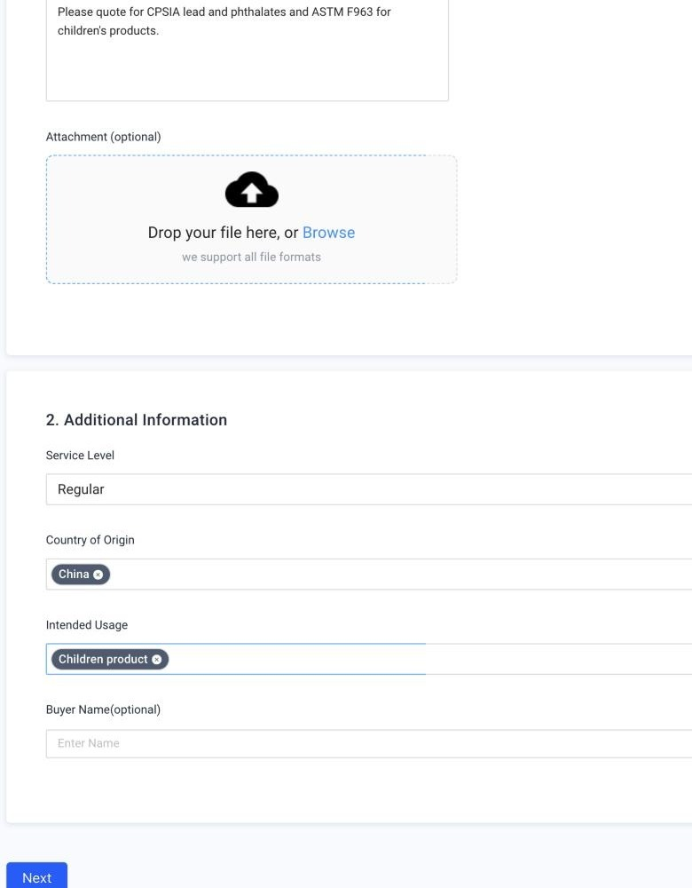

*Additional Information filled — Next is now enabled.*

### 4. Provider Selection

Choose who should quote this job. You can tick more than one:

| Option | Use it when |
|---|---|
| Connected Provider | You already work with a lab that is connected to your QMAS account. |
| ICW | You want ICW to find a lab. Pick a preferred lab, or leave “No Preference”. |
| TicMart (Marketplace) | You want quotations from labs in the TicMart marketplace. |

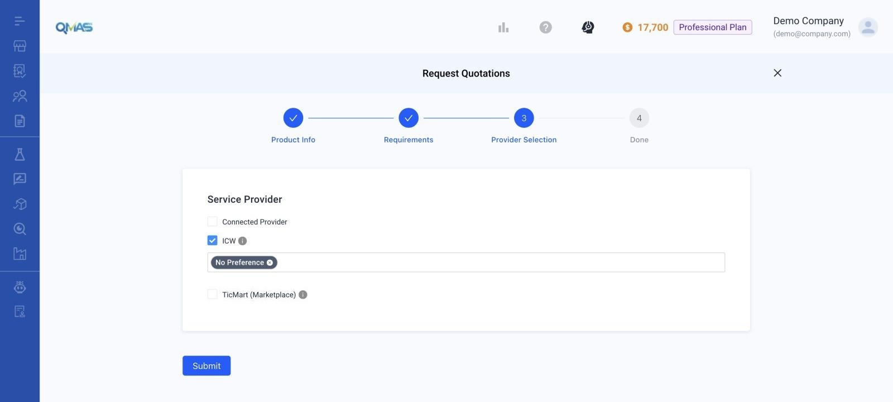

*ICW ticked with “No Preference”. Click Submit to send the request.*

### 5. Done — track your order

After you click **Submit**, QMAS shows “Product testing created successfully” and opens the **Order details** page. Your job has a new order number (for example 260008357) and starts as **Under Review**.

- **Product Testing Requirements**, **Products**, **Supplier**, **PO** and **Test Plan** tabs show what you submitted.
- **Quotations** on the right shows lab quotes when they arrive.
- The tabs below (Quotes, Failure Records, Reports, Attachments, Invoices, Tag, Activity Log, Message Board) follow the job until the report is ready.

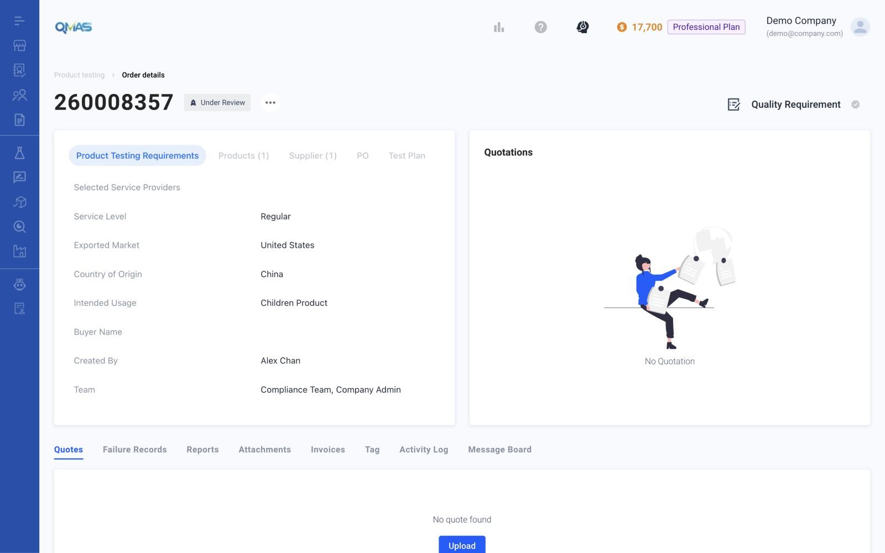

*The new order opens with status Under Review. You can find it again in the Product Testing list.*

## Tips

- Items marked **(optional)** can be skipped. Next stays grey until every required field on the step is filled. A field you leave empty turns red with a message, for example “Country of origin is required”.
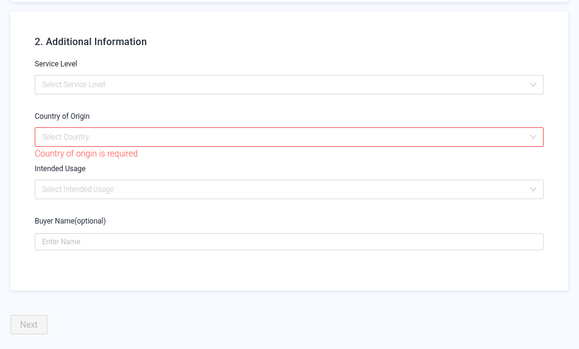

*Required field left empty.*
- Item name and item no. on report are what the lab prints on the test report. Check them before you continue.
- To leave the wizard, click **✕** at the top right.

# Getting Started — Home, Settings and Company Profile

Find your way around QMAS: the Home page, the top bar and your company settings.

- **Home:** https://qmas.icw.io/home
- **Company Profile:** https://qmas.icw.io/company-profile

## Overview

1. **Home** shows quick workflows, items that need your attention, and an overview of your business.
2. The **left menu** opens each module.
3. The **top bar** has analytics, messages, notifications, the account avatar, help and credits.
4. **Settings** opens from the **avatar** (account control) in the top bar. The menu includes Company Profile, Password, Languages, Account Management, Assign TicMart Job and Logout.

## Step-by-step

### 1. Home

**TicMate** says “I’m TicMate. What would you like to do today?” and lists these workflow shortcuts:

- **Generate product risk assessment report** (AI Assessment workflow).
- **Generate export market requirements** (AI Insight workflow).
- **CPSC eFiling**. If it shows “API Setup Required”, set up your Certifier ID in Company Profile first.
- **Request product testing with your lab partner** (Product Testing).
- **Request technical files from your supplier/factory** (Document Review).

**Attention** counts the items that need action in each module, such as Product Testing, Document Review, QC Inspection, IQC Inspection, Factory Audit, Pending Review Doc and Expired Doc. Click a card to see them.

**Business Overview** shows your active products, suppliers, factories and partners. Click **›** to open the list.

**Ask TicMate** on the right edge opens the TicMate assistant.

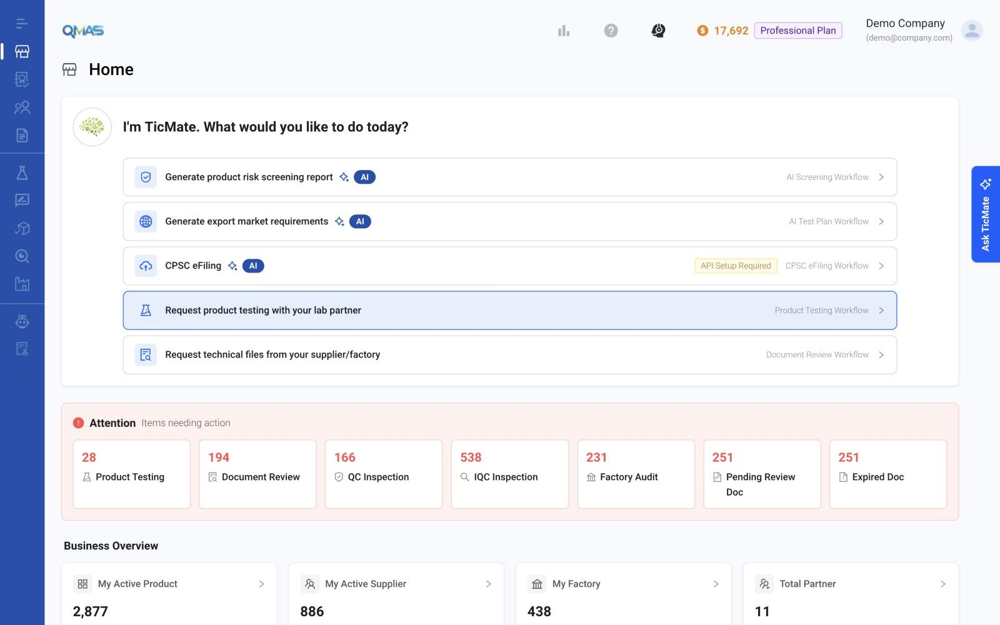

*Home page.*

### 2. Settings menu

Click your **avatar** (account control) in the top bar:

| Option | What it does |
|---|---|
| Company Profile | Company details, certificates, documents, product categories and CPSC eFiling Certifier ID. |
| Password | Change your password. |
| Languages | Change the system language. |
| Account Management | Manage your company's user accounts. |
| Assign TicMart Job | Assign jobs from the TicMart marketplace. |
| Logout | Signs you out of QMAS. |

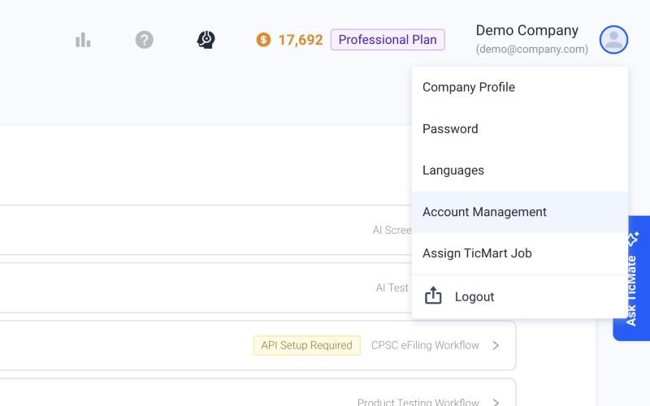

*Settings menu.*

### 3. Company Profile

Click the pencil icon next to the company name to edit it. The **Overview**, **Certificate** and **Document** tabs hold your company information. **CPSC eFiling - Certifier ID** is where you add and manage the API key for eFiling. **Product Category** lists the categories your company works with.

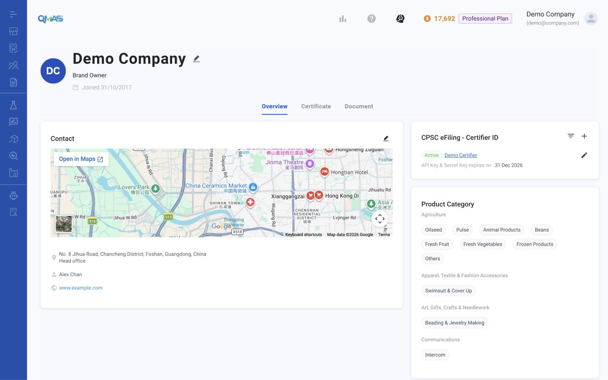

*Company Profile.*

## Tips

- The question-mark icon opens the QMAS Help Center.
- The coin icon shows your credits and tokens for paid features such as AI Insight.

## FAQ

**Q: How do I change the language?**

A: Click your avatar (account control) in the top bar, then Languages.

**Q: How do I change my password?**

A: Click your avatar (account control) in the top bar, then Password.

**Q: Where do I edit my company information?**

A: Click your avatar (account control), then Company Profile (https://qmas.icw.io/company-profile).

# Product Management — Create and Edit a Product

Add a product profile to QMAS so you can attach documents, compliance data, testing and eFiling to it.

- **Module:** Product Management
- **Start here:** https://qmas.icw.io/product/list → **+ New Product**
- **Direct link:** https://qmas.icw.io/add-product
- **Steps:** 1 Product Profile → 2 Related Product → Done

## Overview

1. Open **Product Management** and click **+ New Product**.
2. **Product Profile**: fill in product details, then choose a supplier. Shipping information, factory and additional info are optional.
3. **Related Product** (optional): link related products, then click **Done**.
4. The product appears at the top of the Product Management list. Open it to see the product profile.
5. To change it later, open the product, click **⋮** next to the name, then **Edit product**.

## Step-by-step

### 1. Open Product Management

In the left menu, open **Product Management**. Click **+ New Product** at the top right. To add many products at once, use **Import Product**.

Filter the list with **Product Category**, **Customer Product Category**, **Product Number**, **Status**, **Created By** and **Team**. **Sort by Date modified** changes the order. **Reset** clears the filters.

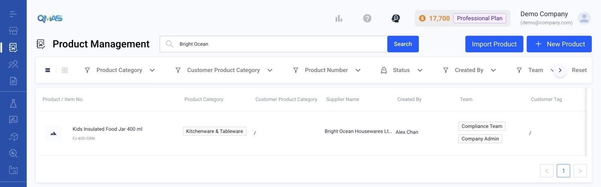

*Product Management list with Import Product and + New Product at the top right.*

### 2. Product Profile — product details

The **Add new product** wizard opens. Under **1. Product Details**, fill in:

- **Item No.** and **Product Name** (required).
- **Long Descriptions** (optional): purpose, materials and internal parts such as batteries or stuffing.
- **Additional Item No.** (optional).
- **Product Category (QMAS)**: click **Select Category**.
- **Customer Tag**, **Customer Product Category** (Level 1–3) and **Remark** (optional).

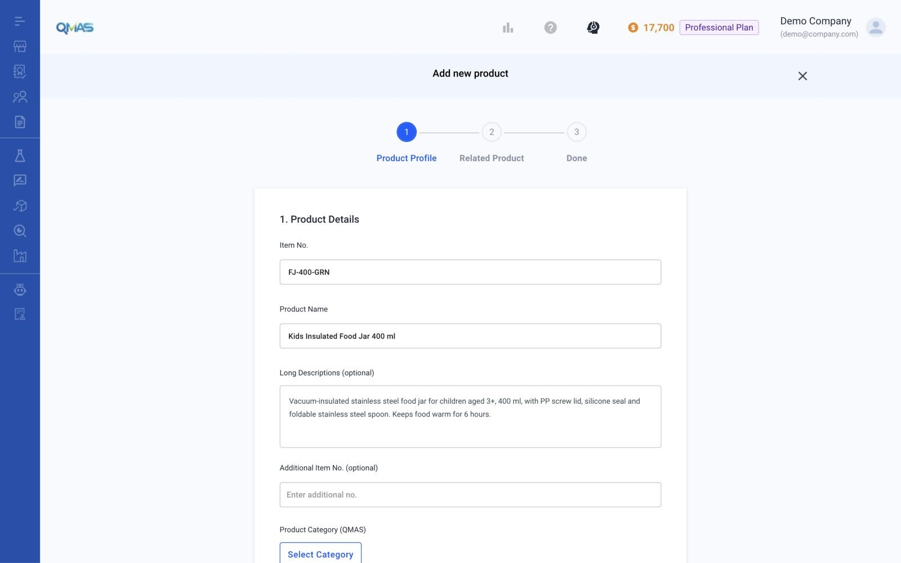

*Step 1 Product Profile — Product Details.*

In **Select Category**, search by name (for example “drinkware”), click the category, then click **Add category**.

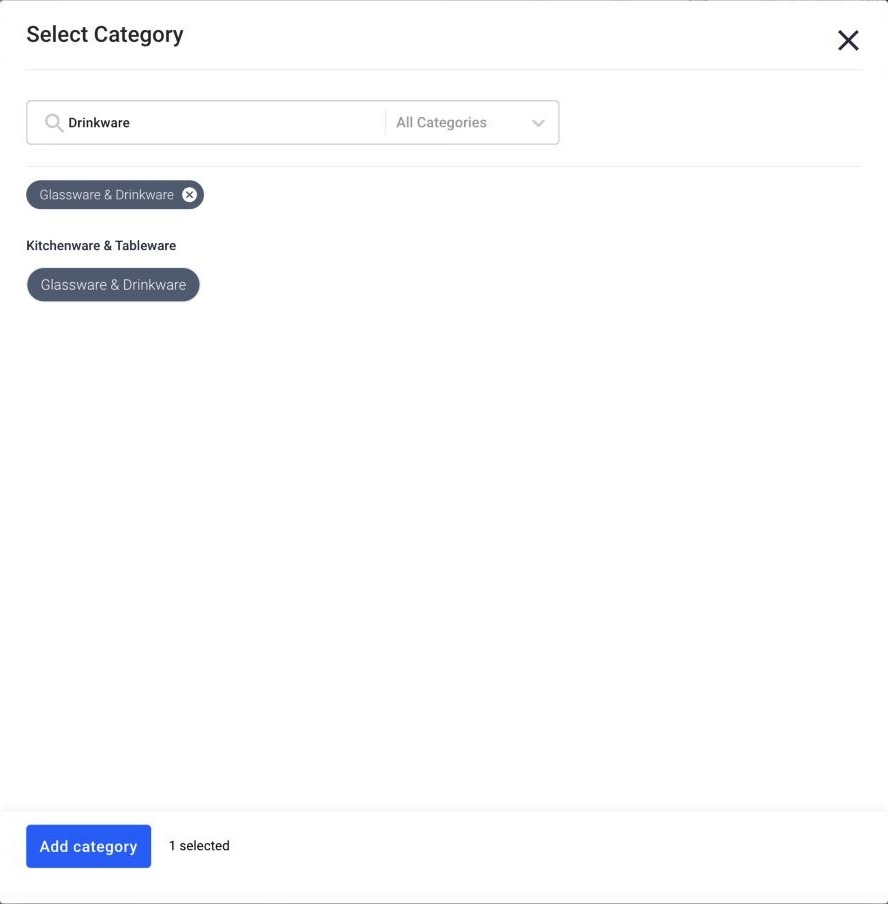

*Selected categories show as dark chips at the top. “1 selected” appears next to Add category.*

### 3. Product Profile — supplier

Under **2. Supplier**, choose **My supplier list** and click **Select supplier**, or choose **New supplier** to add one here.

In the pop-up, click **Select** on one supplier, then **Confirm**.

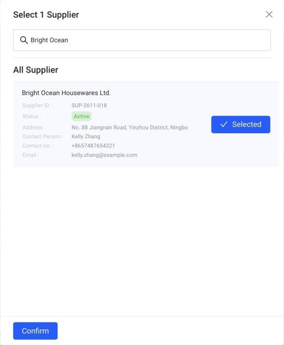

*Select 1 Supplier — you can link one supplier per product.*

The supplier card appears. Use **Change Supplier** to pick another one, or **Edit this profile** to update the supplier.

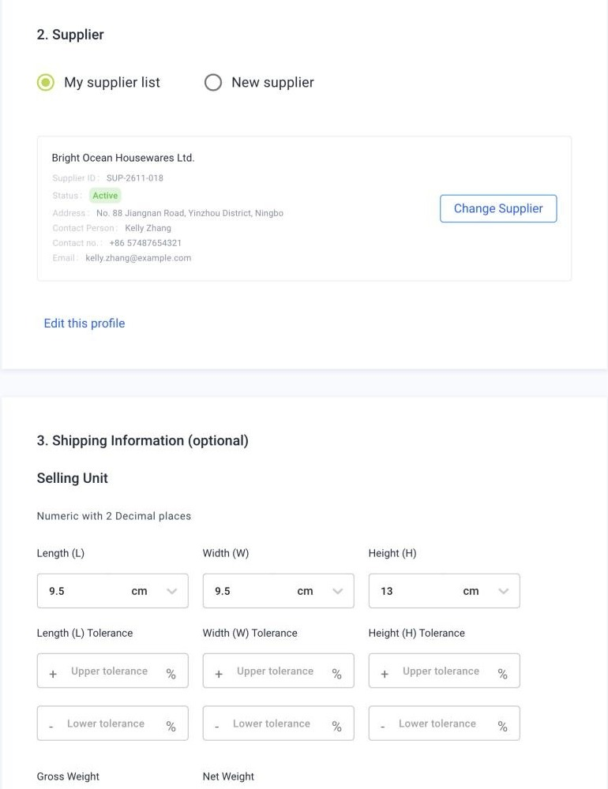

*Selected supplier, followed by 3. Shipping Information (optional).*

### 4. Product Profile — optional sections

- **Shipping Information**: size, weight, tolerance and barcode for the selling unit, inner carton and outer carton.
- **Factory**: click **Select existing factory**.
- **Additional Info**: choose a **Buyer** (or **Add buyer**) and upload up to 30 **product photos** (JPG, JPEG, PNG).

Click **Next**.

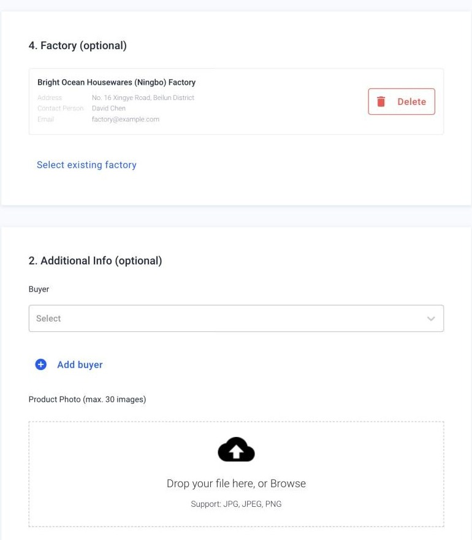

*Factory and Additional Info at the bottom of step 1, then Next.*

### 5. Related Product (optional)

Product linkage helps you manage compliance reports. For example, link a raw material or an assortment to several end products. Click **Select related product**, or skip this step. Click **Done**. **Unlink** removes a product from this step.

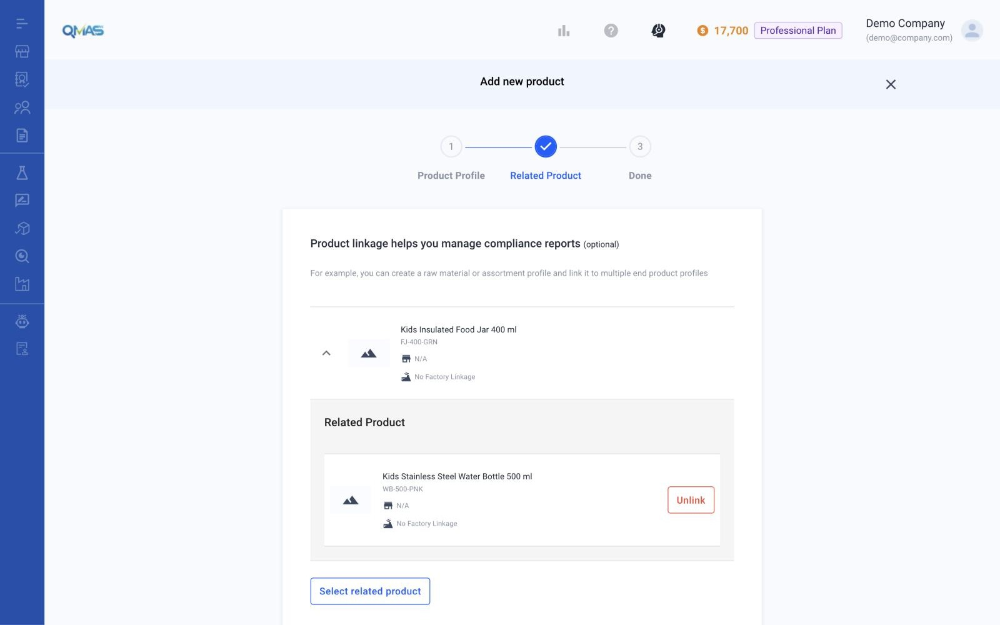

*Step 2 Related Product.*

### 6. Done — find your product

QMAS shows “Product added” and returns to the Product Management list. The new product is at the top.

Click the product to open its profile. From the left menu of the profile you can manage **Document**, **Shipping Detail**, **Compliance Data**, **Quality Requirement**, **AI Risk Screening**, **CPSC eFiling** and **Packaging Detail**.

The left menu also includes **QR Code**.

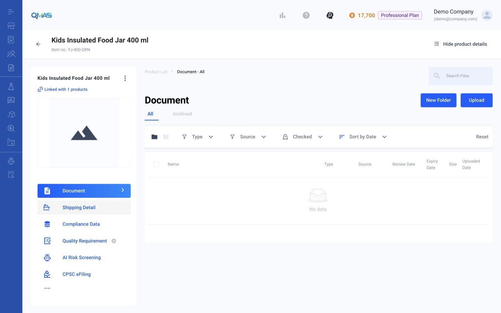

*Product profile.*

### 7. Edit, copy or deactivate a product

On the product profile, click **⋮** next to the product name:

| Option | What it does |
|---|---|
| Edit product | Opens the same wizard with your saved details. Change them, then click Next and Done. |
| Testing order | Starts a Product Testing order for this product. |
| Make a copy | Creates a new product with the same details. |
| Mark as inactive | Sets the product to inactive. |

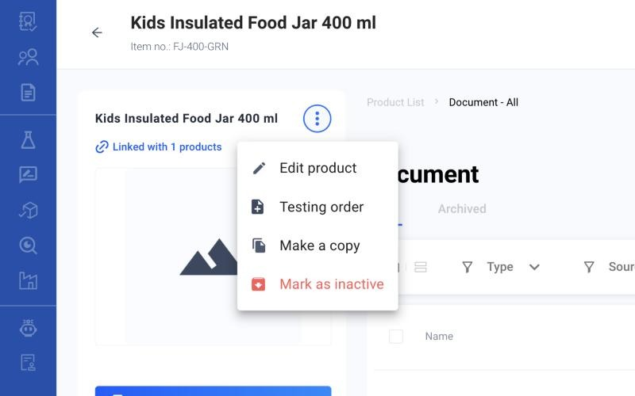

*The ⋮ menu on the product profile.*

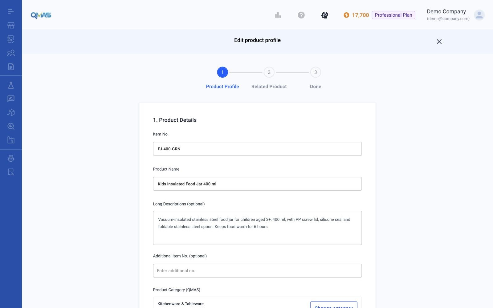

*Edit product profile — the same steps as creating a product.*

## Tips

- Search the list before you create a product so you don’t add a duplicate.
- Shipping information is optional when you create the product. You can add it later from **Shipping Detail** on the profile.

## FAQ

**Q: How do I create a new product in QMAS?**

A: Go to Product Management (https://qmas.icw.io/product/list), click + New Product, fill in Product Profile, then click Next and Done. Direct link: https://qmas.icw.io/add-product

**Q: How do I edit a product?**

A: Open the product from the Product Management list, click ⋮ next to the product name, then Edit product.

**Q: Can I add many products at once?**

A: Yes. Click Import Product on the Product Management list.

**Q: Where do I submit eFiling or add compliance data for a product?**

A: Open the product profile and use CPSC eFiling or Compliance Data in its left menu.

# Product Management — Every Tab of the Product Profile

After you create a product, its profile holds everything about it. This guide explains each tab in the profile's left menu and the import option on the product list.

- **Module:** Product Management
- **Open a profile:** https://qmas.icw.io/product/list → click a product
- **Tabs:** Document · Shipping Detail · Compliance Data · Quality Requirement · AI Risk Screening · CPSC eFiling · Packaging Detail · QR Code
- **See also:** Create and edit a product: [Product Management — Create and Edit a Product](product-management.md)

## Overview

1. **Document**: upload, organise, share and set reminders for the product's files.
2. **Shipping Detail**: sizes, weights and barcodes for the selling unit and cartons.
3. **Compliance Data**: record test results, certificates and other compliance data.
4. **Quality Requirement**: list the product's quality requirements, use templates and send them to testing or document review.
5. **AI Risk Screening**: run AI compliance screenings for this product.
6. **CPSC eFiling**: submit eFiling for this product and see its eFiling log.
7. **Packaging Detail**: record each packaging component, its materials and suppliers.

## Step-by-step

### 1. Document

Shows every file linked to the product. Use **New Folder** to organise files and **Upload** to add a file (see the Document Management guide for the upload pop-up). Filter by **Type**, **Source** or **Checked**, switch between **All** and **Archived**, and search with **Search Files**. **Sort** and **Reset** sit with those filters.

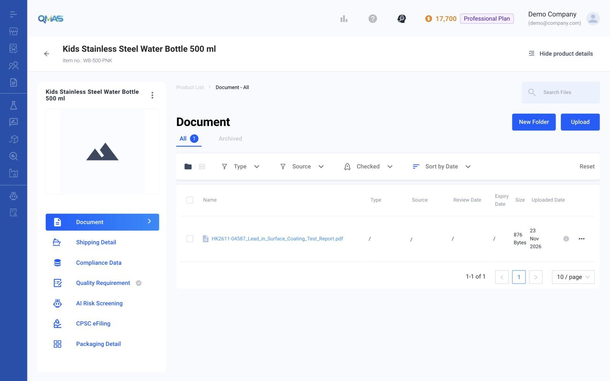

*Document tab with one test report and the filter controls.*

Tick one or more files to open the toolbar:

| Action | What it does |
|---|---|
| Set Data | Add compliance data (test, certificate or other) from this file. |
| Set Dates & Reminder | Set issue, expiry and review dates and an email reminder. |
| Archive | Move the file to the Archived tab. |
| Download | Download the file. |
| Share | Create a share link with an expiry period. Copy it or send it by email. |
| Rename / Edit Type | Change the file name or document type. |
| Move | Move the file to a folder. |
| Remove | Remove the file. |

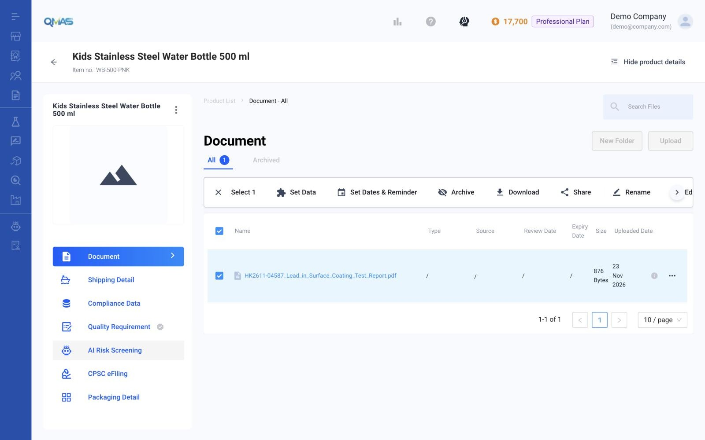

*Toolbar after selecting a file.*

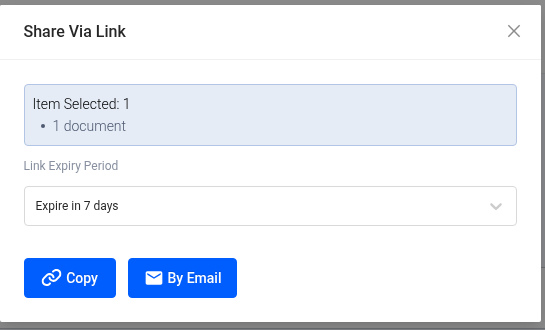

*Share Via Link — choose how long the link stays valid, then Copy or By Email.*

### 2. Shipping Detail

Shows the length, width, height, gross and net weight, quantity and barcode for the **Selling Unit**, **Inner Carton** and **Outer Carton**. To change them, click **⋮** next to the product name → **Edit product** and update **Shipping Information**.

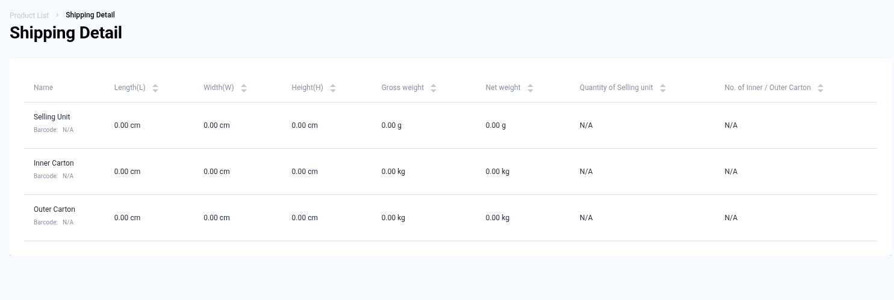

*Shipping Detail tab.*

### 3. Compliance Data

Three sections: **Test Data**, **Certificate Data** and **Other**. Click **Add Data** (or **Add** once a section has records).

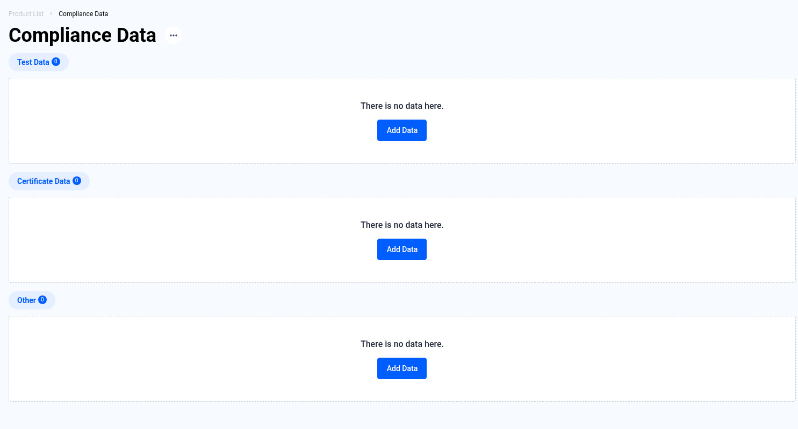

*Compliance Data tab before any data is added.*

**Test Data** records one test result:

- **Result** (required): Passed, Failed or Report As Is.
- **Export Market** (required). For US eFiling, choose **United States (CPSC eFiling submission)**.
- **Legislation, Test Item & Citation** (required): type a keyword such as “lead” and pick the test item from the list.
- **Report ID**, **Issue Party** (required), **Expiry Date** and **Test Date / Report Date**.
- Link the report under **Existing Product Document** (a file already on the product) or **New Document** (upload a new file).

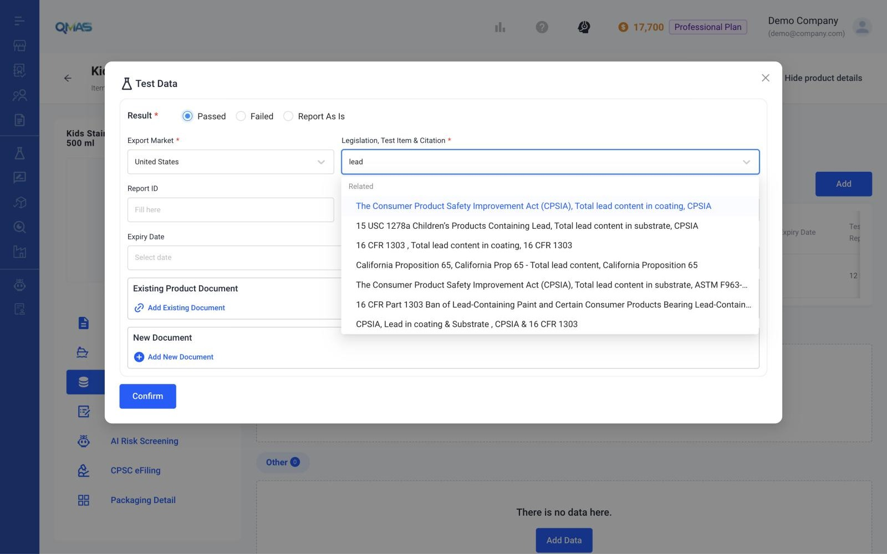

*Search legislation and test items by keyword.*

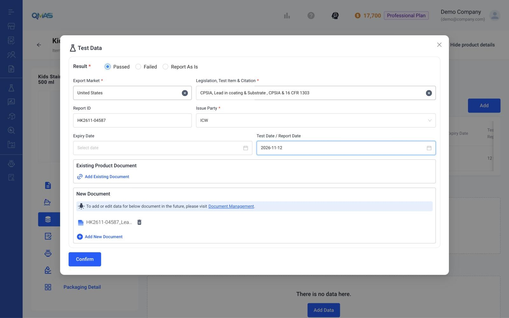

*A completed Test Data record with the report attached.*

Click **Confirm**. QMAS shows “Data Created” and the record appears in the Test Data table with its export market, legislation, test item, citation, report ID and issue party.

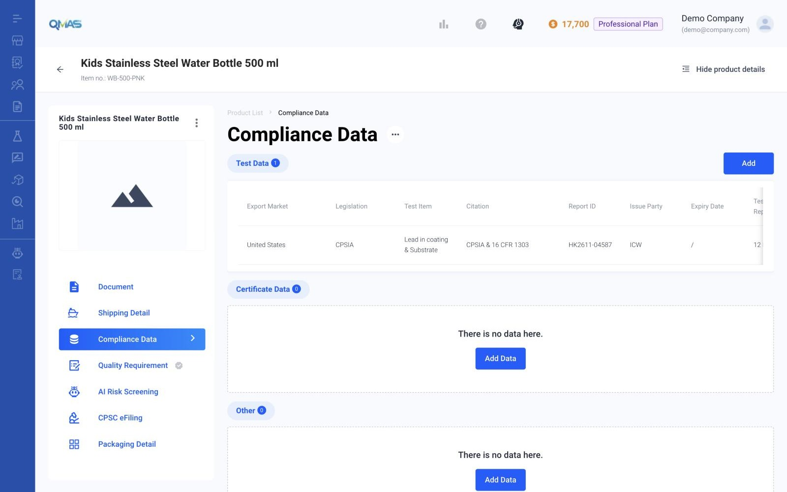

*Saved test data.*

**Certificate Data** works the same way. Fill in the certificate **Type**, **Issue Party**, **Score / Overall Rating**, **Expiry Date** and **Certificate Date**, then link the certificate file.

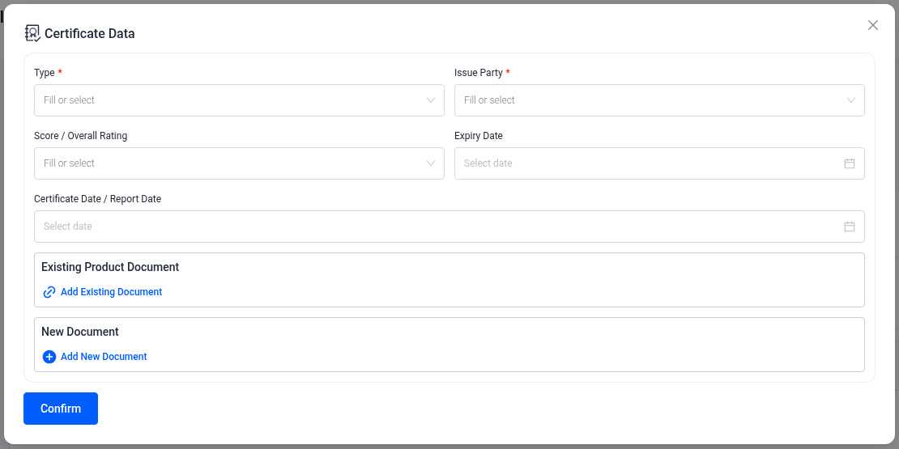

*Certificate Data form.*

### 4. Quality Requirement

Quality Requirement lists what the product must meet, for example a chemical test or a physical test. Each requirement has a **Type** (the group) and a **Name**. You can attach compliance data to a requirement as proof, mark it as completed, and send the requirements to Product Testing or Document Review.

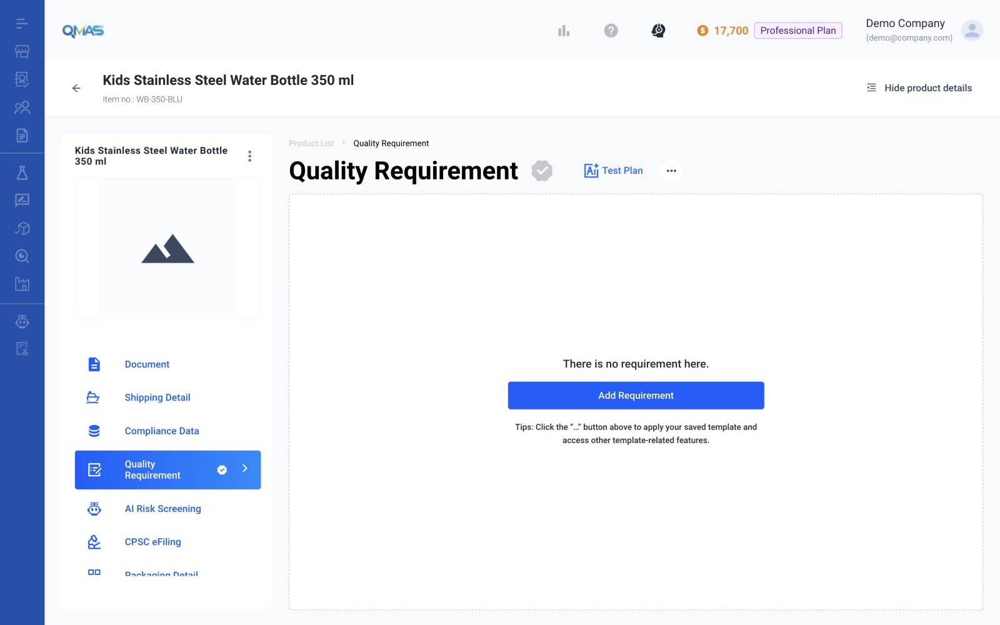

*Quality Requirement tab before any requirement is added: Add Requirement, Test Plan and the ⋯ menu.*

**4a. Add a requirement yourself**

- Click **Add Requirement** (or **Add** at the top right once the list has items).
- **Type**: pick an existing type, or type a new one and choose **+ Create “…”**. Example: *Chemical Testing*.
- **Name**: pick a name from the list for that type, or type a new one and choose **+ Create “…”**. Example: *Lead in Surface Coating (16 CFR 1303)*. Picking a different Type clears the Name.
- Tick **Mandatory** if the requirement must be met, then click **Confirm**. QMAS shows “Requirement Created”.

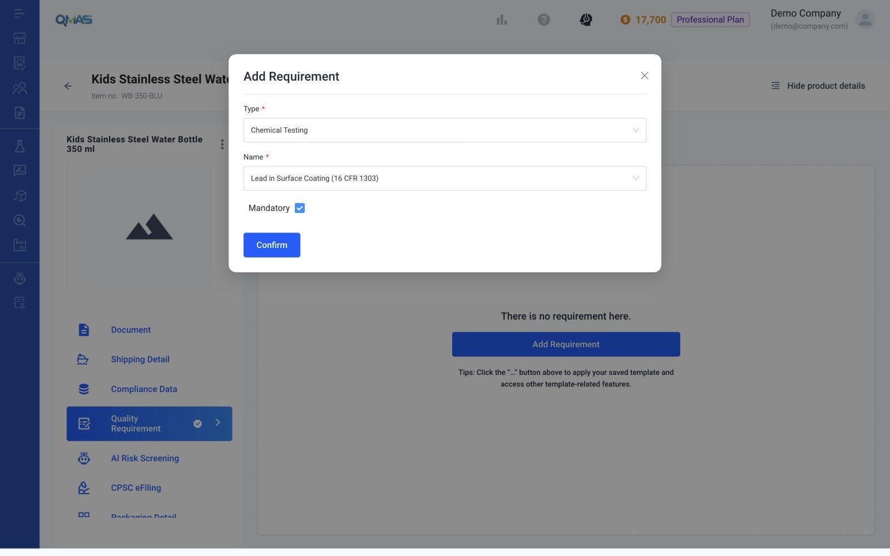

*Add Requirement with Type, Name and Mandatory filled in.*

Requirements are grouped by Type. The number next to the Type is how many requirements it has, and a red * marks a mandatory requirement.

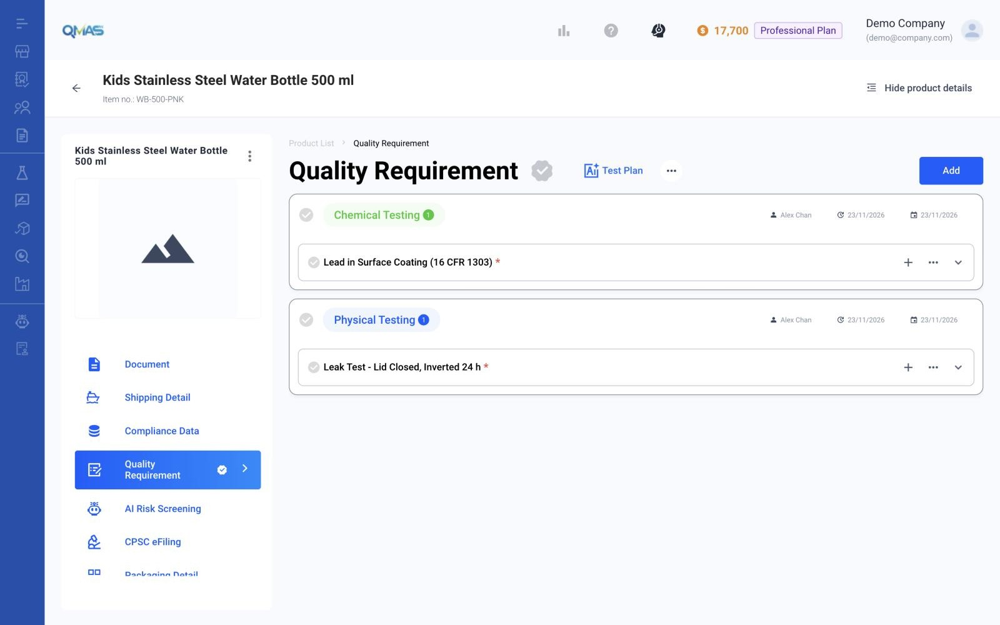

*Requirements grouped by Type: Chemical Testing and Physical Testing.*

**4b. Reuse requirements with templates**

Click **⋯** next to the title → **Templates**:

| Option | What it does |
|---|---|
| Apply Template | Search for a saved template, use **View** to preview it, then click **Apply**. All its requirements are added to this product. |
| Save As Template | Save this product's requirements as a template. Type a new name and choose **+ Create “…”**, then click **Confirm**. QMAS shows “Template saved”. |
| Manage Templates | See and manage your saved templates. |

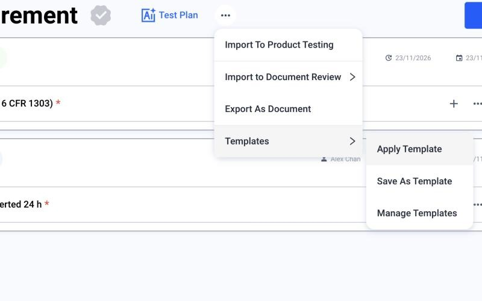

*⋯ → Templates: Apply Template, Save As Template and Manage Templates.*

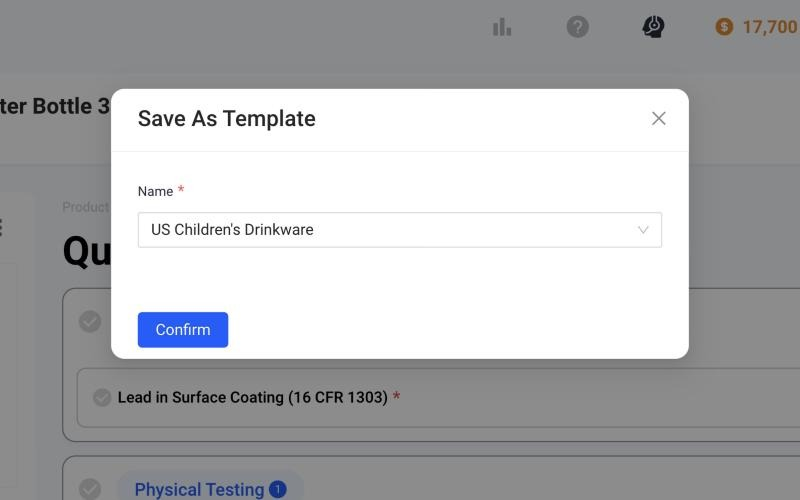

*Save As Template — name the template, then click Confirm.*

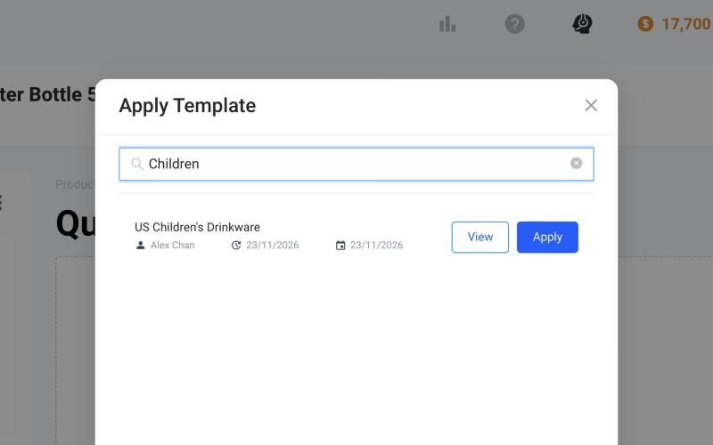

*Apply Template — search, View or Apply a saved template.*

After you click **Apply**, QMAS shows “<template name> applied” and the template's requirements appear in the list.

**4c. Attach proof and complete a requirement**

- Click **+** on a requirement to open **Attach Compliance Data**. Choose the **Test Data**, **Certificate Data** or **Other** tab, tick the records and click **Confirm**. QMAS shows “Data Added”. If a record you just added is missing, click **Reload Data**. To add new data, go to the Compliance Data tab first.
- The attached data appears under the requirement. Click **⌄** to expand or collapse it, and the bin icon to detach it.
- Click **⋯** on a requirement for **Edit**, **Duplicate**, **Upload Document**, **Mark As Completed** and **Remove**.
- **Mark As Completed** shows “Requirement Completed” and turns the requirement’s tick green.

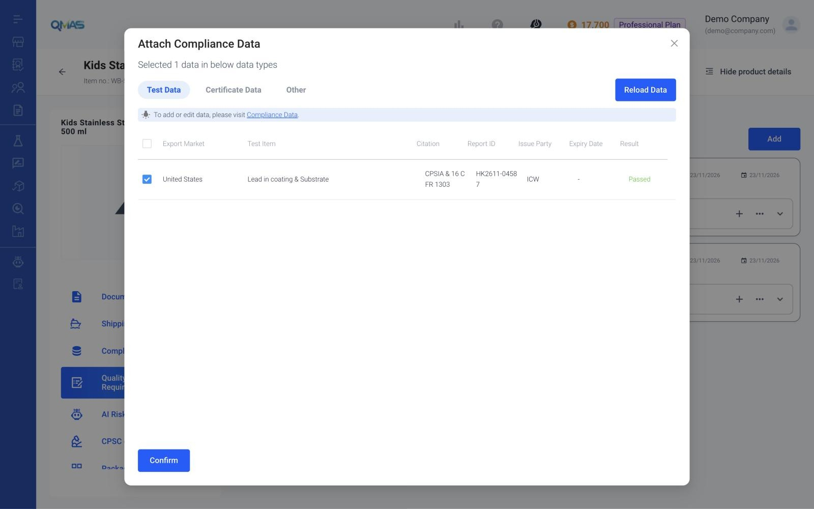

*Attach Compliance Data — tick the test record, then click Confirm.*

*The attached test data under the requirement.*

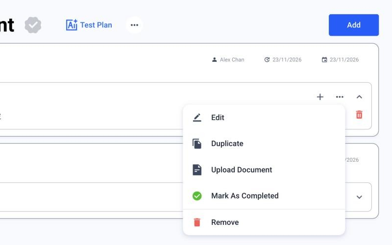

*⋯ menu on one requirement.*

*Requirement marked as completed — the ticks turn green.*

**4d. Send requirements to a job**

- **⋯ → Import To Product Testing**: click **Select** on each requirement (or **Select All**), then click **Confirm to Create Job**. Product Testing → Request Quotations opens with this product added, and the requirements appear under **Quality Requirement** in step 2.
- **⋯ → Import to Document Review** → **Create Job** or **Create Job for supplier**: opens the matching Document Review form for this product.
- **⋯ → Export As Document**: exports the requirement list as a document.

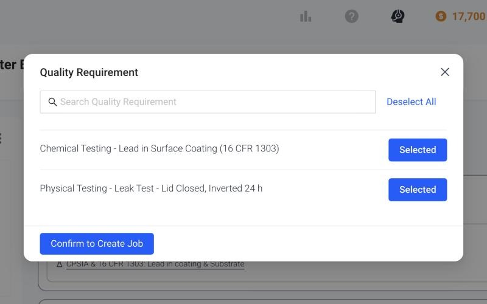

*Import To Product Testing — select requirements, then Confirm to Create Job.*

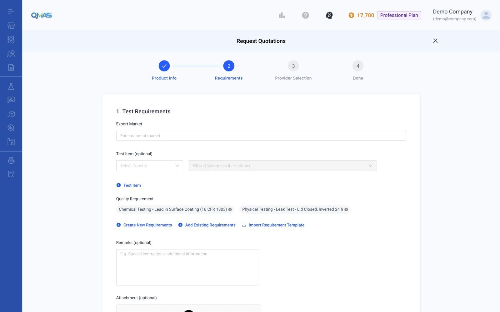

*The requirements carried into Product Testing step 2.*

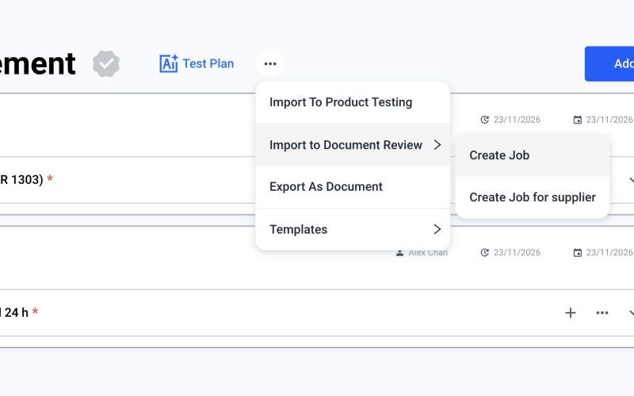

*Import to Document Review → Create Job or Create Job for supplier.*

**4e. Test Plan (AI)**

Click **Test Plan** to let AI suggest a test plan. Fill in the **Product Description** (more detail gives better results), **Import Country** and **Product Intended Used By**, upload up to 6 product images, then click **Generate Test Plan**.

*Test Plan pop-up.*

### 5. AI Risk Screening

Lists the AI screenings for this product. Click **Add** to start one. The pop-up and results are explained in the [AI Insight](ai-insight.md) guide.

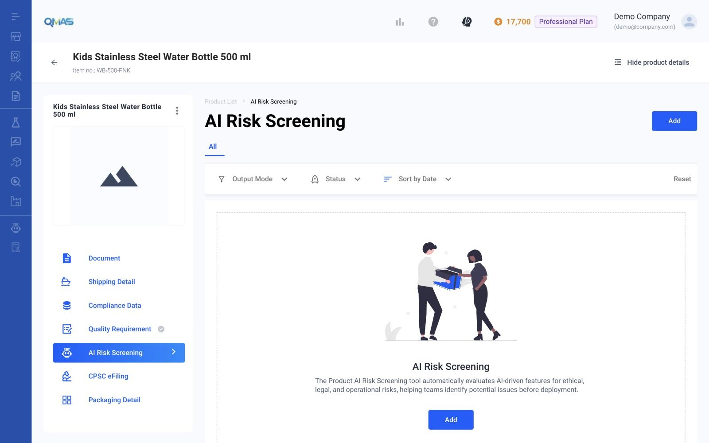

*AI Risk Screening tab.*

### 6. CPSC eFiling

Shows the **eFiling Log** for this product. Click **Submit eFiling** to create an eFiling. Before you can sync with CPSC, add your API Key and Secret Key in **Company Profile** (link in the grey note). The full flow is in the [eFiling](efiling.md) guide.

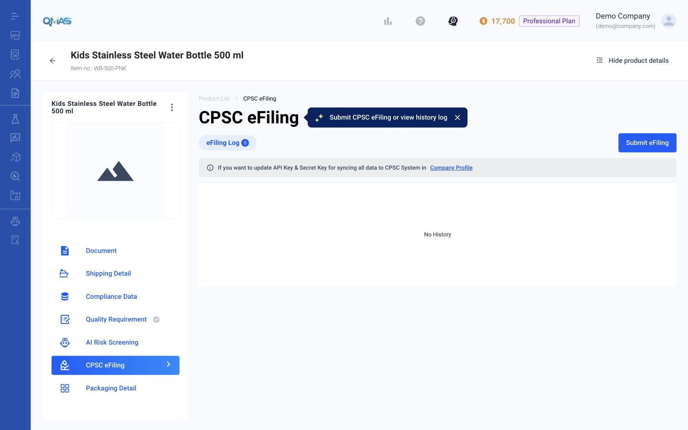

*CPSC eFiling tab.*

### 7. Packaging Detail

Lists the packaging components of the product. Click **Create Packaging Component** and fill in:

- **Basic Information**: name and description (required), identification no., function, legal role, weight, material type and name, status (Active, Inactive or Draft), and packaging images.
- **Dimension**, **Additional Information**, **Supplier Linkage** and **Technical Documentation** (expand each section).

Click **Confirm**. Use the **Status** filter to show active, inactive or draft components.

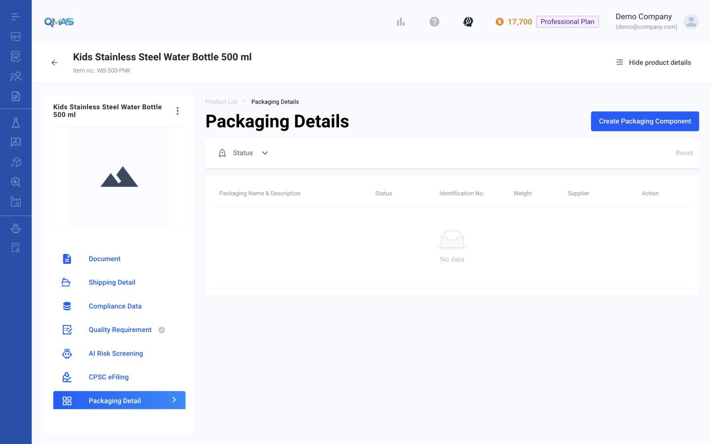

*Packaging Details tab.*

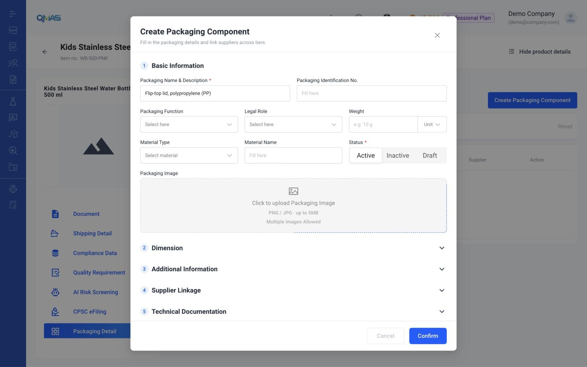

*Create Packaging Component.*

### 8. Import products in bulk

On the Product Management list, click **Import Product**. Download the ICW Product template (**download here**), fill it in, upload the Excel file (one file at a time), then click **Next**. Only the ICW template can be used.

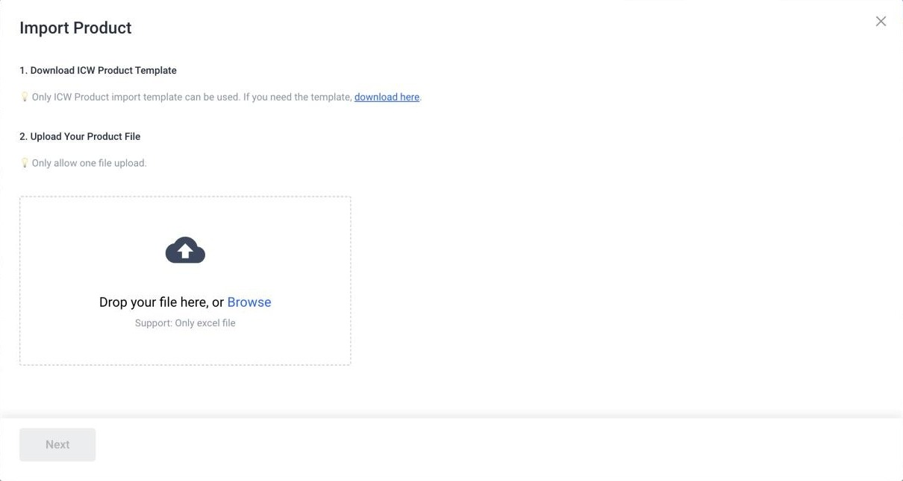

*Import Product.*

## Tips

- **Hide product details** at the top right hides the product card on the left.
- Link test reports to Test Data. eFiling can reuse this data when you quick-select test data.
- Use requirement **Templates** so similar products get the same requirements.

## FAQ

**Q: How do I add a test result to a product?**

A: Open the product → Compliance Data → Test Data → Add Data. Fill in Result, Export Market, Legislation/Test Item, Issue Party, link the report, then Confirm.

**Q: How do I share a product document?**

A: Open the product → Document, tick the file, click Share, choose the link expiry, then Copy or By Email.

**Q: How do I add quality requirements to a product?**

A: Open the product → Quality Requirement → Add Requirement, or ⋯ → Templates to apply a saved template.

**Q: Where do I record packaging information?**

A: Open the product → Packaging Detail → Create Packaging Component.

**Q: How do I import many products?**

A: On Product Management, click Import Product, download the ICW template, fill it in and upload it.

**Q: How do I reuse quality requirements for many products?**

A: Open a product → Quality Requirement → ⋯ → Templates → Save As Template. On other products use ⋯ → Templates → Apply Template.

**Q: How do I prove a requirement is met?**

A: On the requirement click +, attach the test or certificate data, then ⋯ → Mark As Completed.

# Test Plan — Get an AI Test Plan for a Product

Test Plan uses AI to suggest the tests a product needs, based on its description, import country, intended users and photos. You open it from a product's Quality Requirement tab.

- **Module:** Product Management → product profile → Quality Requirement
- **Open:** https://qmas.icw.io/product/list → click a product → Quality Requirement → Test Plan
- **See also:** [Product Management — Every Tab of the Product Profile](product-profile.md)

## Overview

1. Open a product and go to **Quality Requirement**.
2. Click **Test Plan**.
3. Fill in the product information and upload photos.
4. Click **Generate Test Plan**.

## Step-by-step

### 1. Open Test Plan

On **Product Management**, click a product to open its profile. In the left menu, click **Quality Requirement**, then click **Test Plan** next to the title.

### 2. Fill in the information

- **Product Description** (required): describe the product. More detail gives better results. QMAS fills in the product name for you.
- **Import Country** (required): where the product will be sold.
- **Product Intended Used By** (required): who the product is for.
- **Product Images (Multiple Views)** (required): upload up to 6 photos (PNG, JPEG, JPG, WEBP, GIF, AVIF or HEIC).

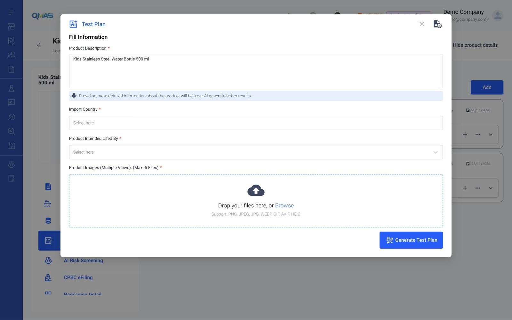

*Test Plan pop-up.*

### 3. Generate the test plan

Click **Generate Test Plan**. To add tests as quality requirements, use **Add Requirement** or a template on the same Quality Requirement tab.

## Tips

- Give a detailed product description, including materials, age grade and functions, for a more accurate plan.
- Upload photos from several angles.

## FAQ

**Q: Where is Test Plan?**

A: Open a product → Quality Requirement → Test Plan.

**Q: What do I need to generate a test plan?**

A: A product description, the import country, who the product is intended for, and product photos.

# eFiling — Submit eFiling to CPSC

Create and submit CPSC eFiling certificates for your products, with AI that can fill the form from your test report.

- **Module:** eFiling
- **Start here:** https://qmas.icw.io/efiling → **Add eFiling**
- **Before you start:** Set up your CPSC Certifier ID and API keys in Company Profile → **CPSC eFiling - Certifier ID**.

## Overview

1. Make sure your CPSC Certifier ID is set up in Company Profile.
2. Open **eFiling** and click **Add eFiling**.
3. Upload a report for **AI Extract**, select a document already in QMAS, or **Start With Blank**.
4. In **Quick Select eFiling Information**, check the Certifier ID and products, then click **Next**.
5. Complete the **eFiling Submission** form, then **Save Draft** or **Preview to Submit**.

## Step-by-step

### 1. Open eFiling

In the left menu, open **eFiling**. The list shows each eFiling with its log no., product, status, certifier ID, collection ID, product ID and version ID. Use **View** to open one (**Edit** for a draft) or **Duplicate** to start a new version from it. Click **Add eFiling**.

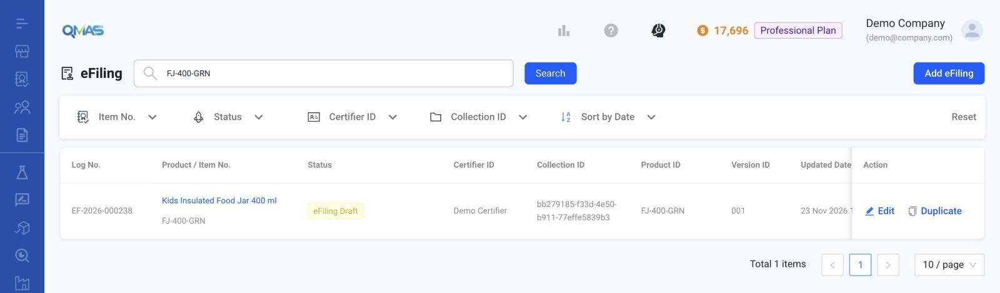

*eFiling list, searched by item no., with a saved draft.*

### 2. Add documents for AI Extract

- **Upload Report & Auto-fill by AI**: drop a PDF test report. AI extracts the data and fills the form.
- **Select Document in QMAS**: choose a document already in Document Management, with no re-upload.
- **Start With Blank**: fill the form yourself.

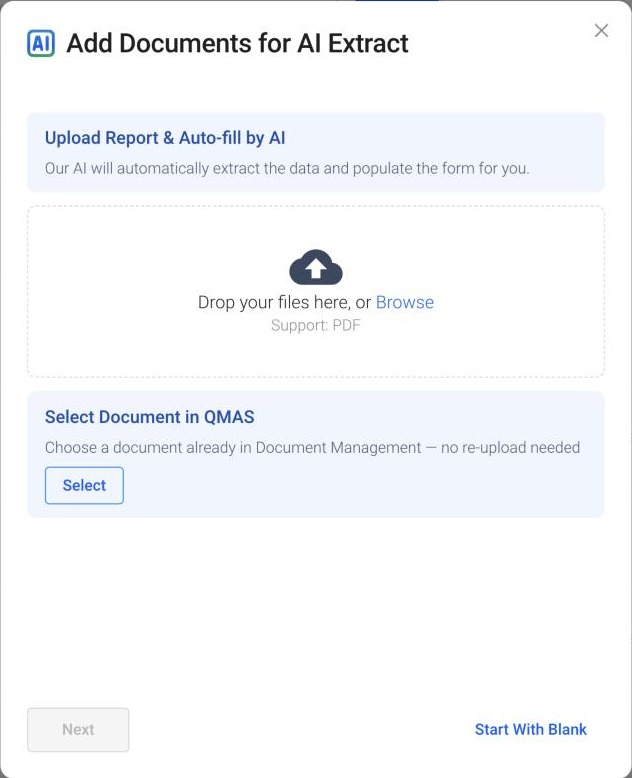

*Add Documents for AI Extract.*

### 3. Quick Select eFiling Information

Choose the **CPSC Certifier ID** and check the products to include. Click **Next**.

*Quick Select eFiling Information.*

### 4. eFiling Submission form

Fill in **eFiling Information** (Certifier ID, collection, point of contact) and **Product Detail**. Use **Link To QMAS Product** to connect the form to a product, or tick **Create As New Product**. Use **+ Add Product** at the top for a multi-product submission.

Then complete the remaining sections (lab, citations and exclusions). Click **Save Draft** to finish later, or **Preview to Submit** to check and send to CPSC.

*eFiling Submission form linked to a QMAS product.*

If you close the form without saving, QMAS asks you to confirm. Unsaved values are lost. Saved drafts stay in the eFiling list.

## Tips

- AI Extract works best with a clear PDF test report.
- Within 48 hours you can resubmit with the same Version ID to overwrite. After that, use a new Version ID.

## FAQ

**Q: How do I submit eFiling to CPSC?**

A: Go to eFiling (https://qmas.icw.io/efiling), click Add eFiling, upload a report for AI Extract or Start With Blank, check the Quick Select information, complete the eFiling Submission form, then Preview to Submit.

**Q: Where do I set up my CPSC API key?**

A: Settings (avatar / account control) → Company Profile → CPSC eFiling - Certifier ID.

**Q: Can AI fill in the eFiling form?**

A: Yes. In Add eFiling, upload a PDF report under Upload Report & Auto-fill by AI.

# Supplier Management — Create a Supplier

Add a supplier profile so you can link it to products, factories, documents and service jobs.

- **Module:** Supplier / Factory Management
- **Start here:** https://qmas.icw.io/supplier-manager/suppliers → **Create Supplier**
- **Direct link:** https://qmas.icw.io/supplier-manager/create
- **Steps:** 1 Supplier Profile → 2 Classification → 3 Certification → Done

## Overview

1. Open **Supplier / Factory Management**, stay on the **Supplier** tab and click **Create Supplier**.
2. **Supplier Profile**: company overview and contact.
3. **Classification** (optional): product category and tags.
4. **Certification** (optional): add certificates, then click **Done**.
5. The supplier profile opens.

## Step-by-step

### 1. Open Supplier / Factory Management

In the left menu, open **Supplier / Factory Management**. The **Supplier** tab lists your suppliers with their location, category, status, connect status and rating.

Click **Create Supplier**. You can also use **Import Supplier** to add many suppliers from a file, or **Invite Supplier** to invite a supplier to connect with you on QMAS.

*Supplier tab with Import Supplier, Create Supplier and Invite Supplier.*

### 2. Supplier Profile — company overview

- **Upload Logo** (optional).
- **Supplier ID** (optional): your own reference number.
- **Supplier Name**: English name (required) and local-language name (optional).
- **Location**: country or region, then province and city.
- **Address** and **Website** (optional).

*Create supplier profile — step 1, Company overview.*

### 3. Supplier Profile — contact

Under **2. Contact**, fill in the **Contact person**, **Contact Email** and at least one **Email address**. For each email address, choose a type: Company, QA, Sales or Other. Click **Add email** for more. **Contact no.** is optional.

*Contact section.*

If a required field is empty when you click **Next**, it turns red, for example “Type is required”, “Email is required”, “English name is required”, “Location is required” or “Contact person is required”.

*Required fields turn red when you click Next.*

### 4. Classification (optional)

Click **Select category** to choose the product categories this supplier offers. Click **Select tag** to add your own tags. Click **Next**.

*Step 2 Classification.*

### 5. Certification (optional)

Click **Add** to upload a certificate. Choose the certification type, upload the file, and fill in the rating, issue party and dates. Click **Done** to create the supplier.

*Step 3 Certification — click Add to upload a certificate, or Done.*

### 6. Done — supplier profile

The supplier profile opens. Use the tabs **Overview**, **Product**, **Factory**, **Certificate**, **Document** and **Compliance Data** to manage everything linked to this supplier. Click the pencil icon next to the name, or next to **Contact**, to edit.

*Supplier profile — Overview tab.*

*Supplier profile — Certificate tab. Click + Certificate to add one.*

## Tips

- Search the Supplier list before you create a supplier so you don’t add a duplicate.
- Consistent tags make filtering the list easier later.

## FAQ

**Q: How do I create a new supplier?**

A: Go to Supplier / Factory Management (https://qmas.icw.io/supplier-manager/suppliers), click Create Supplier, fill in Supplier Profile, then Next, Next and Done. Direct link: https://qmas.icw.io/supplier-manager/create

**Q: Can I add many suppliers at once?**

A: Yes. Click Import Supplier on the Supplier tab.

**Q: How do I invite a supplier to QMAS?**

A: Click Invite Supplier on the Supplier tab.

**Q: How do I edit a supplier?**

A: Open the supplier from the list and click the pencil icon next to its name or next to Contact.

# Factory Management — Create a Factory

Add a factory profile with its location, scale, equipment and certificates, so you can link it to suppliers, products and inspections.

- **Module:** Supplier / Factory Management
- **Start here:** https://qmas.icw.io/supplier-manager/suppliers → **Factory** tab → **Create Factory**
- **Direct link:** https://qmas.icw.io/supplier-manager/factory/create
- **Steps:** 1 Factory Profile → 2 Classification → 3 Certification → Done

## Overview

1. Open **Supplier / Factory Management**, click the **Factory** tab, then **Create Factory**.
2. **Factory Profile**: overview, scale, equipment and contact.
3. **Classification** (optional): product category and tags.
4. **Certification** (optional): add audit reports or certificates, then click **Done**.
5. The factory profile opens.

## Step-by-step

### 1. Open the Factory tab

In the left menu, open **Supplier / Factory Management** and click the **Factory** tab. It lists your factories with location, status and audit certificates.

Click **Create Factory**, or **Import Factory** to add many factories from a file.

*Factory tab with Import Factory and Create Factory.*

### 2. Factory Profile — overview

- **Upload Logo** and **Factory ID** (optional).
- **Factory Name**: English name (required) and local-language name (optional).
- **Location**: country or region, then province and city.
- **Address**: English address (required) and local-language address (optional).
- **Website** (optional).

*Create factory profile — step 1, Factory Overview.*

### 3. Factory Profile — scale and equipment (optional)

**Factory Scale**: outsource production, total employees, number of workers, factory size (square meters) and annual volume.

The equipment section lists machines and **Automation Production Line** entries: machine name, brand and model no., quantity and monthly production volume. Click **Add** for more rows.

*2. Factory Scale and 3. Factory Capacity (both optional).*

### 4. Factory Profile — contact

Under **4. Contact**, fill in the **Contact person** and an **Email address** with its type (Company, QA, Sales or Other). **Contact no.** is optional. Click **Next**.

*Contact section and Next.*

If Contact person or the email type and address are empty, **Next** marks them as required.

*Required fields turn red after you click Next.*

### 5. Classification (optional)

Click **Select category** for the product categories this factory makes, and **Select tag** for your own tags. Click **Next**.

*Step 2 Classification.*

### 6. Certification (optional)

Click **Add** to attach an audit report or certificate. In **Add Certification**, choose the certification type, upload the file (JPG, JPEG, PNG, PDF, DOC or XLS), and fill in the score or overall rating, issue party, issue date and expiry date. Click **Add**.

*Add Certification pop-up.*

Click **Done** to create the factory.

*Step 3 Certification — click Add, or Done to create the factory.*

### 7. Done — factory profile

QMAS shows “Create factory successfully!” and opens the factory profile. Use the tabs **Overview**, **Supplier**, **Certificate**, **Document** and **Compliance Data** to manage what is linked to this factory.

*Factory profile — Overview tab.*

*Factory profile — Certificate tab. Click + Certificate to add one.*

## Tips

- Set the expiry date on audit certificates so you can see when they need renewing.

## FAQ

**Q: How do I create a new factory?**

A: Go to Supplier / Factory Management, click the Factory tab, then Create Factory. Fill in Factory Profile, then Next, Next and Done. Direct link: https://qmas.icw.io/supplier-manager/factory/create

**Q: Can I add many factories at once?**

A: Yes. Click Import Factory on the Factory tab.

**Q: Where do I upload a factory audit certificate?**

A: In step 3 Certification of Create Factory, or later from the Certificate tab of the factory profile.

# Factory Audit — Request a Factory Audit

Request a social-compliance or quality audit for a factory, such as SEDEX, BSCI, FAMA or WRAP, and track the audit jobs in one list.

- **Module:** Factory Audit
- **Open:** https://qmas.icw.io/factory_audit
- **Start here:** Factory Audit → Create Factory Audit Order

## Overview

1. Open **Factory Audit** in the left menu.
2. Click **Create Factory Audit Order**.
3. Step 1 **Audit Requirements**: choose the audit scheme and date.
4. Step 2 **Factory**: enter the factory and its contact.
5. Click **Submit**, or **Save Draft** to finish later.

## Step-by-step

### 1. Open Factory Audit

In the left menu, open **Factory Audit**. The **Jobs** tab lists your audit jobs with the factory name and address, audit scheme, creator, team, audit date, date created and job status. Use **Audit Scheme**, **Job Status**, **Sort by Date**, **Created By** and **Team** to filter, or search by factory name. Click **Reset** to clear the filters.

Click **Create Factory Audit Order** at the top right.

### 2. Audit Requirements

- **Audit Scheme**: SEDEX 4P, SEDEX 2P, BSCI, FAMA, WRAP or Other.
- For SEDEX, choose the **announcement type** (Announced, Semi-announced or Unannounced) and answer **Are you SEDEX Member?** (Yes, No or Provide Later). If you answer Yes, enter your SEDEX no.
- **Audit Date**: the date you want the audit.
- **Remarks** (optional): anything the auditor should know.

Click **Next**, or **Save Draft** to finish later.

### 3. Factory

- **1. Factory Info**: factory name in English (and the local-language name if you have it), location (country/region, province, city), address and number of employees.
- **2. Factory Contact**: contact person, contact number, email address and factory telephone.

Click **Submit** to send the request, or **Save Draft** to finish later. The job then appears in the **Jobs** list.

## Tips

- Use the Home page **Attention** card for Factory Audit to see audit jobs that need your action.
- Save a draft if you are waiting for the factory's contact details.

## FAQ

**Q: Which audit schemes can I request?**

A: SEDEX 4P, SEDEX 2P, BSCI, FAMA, WRAP, or Other.

**Q: Can I finish the request later?**

A: Yes. Click Save Draft on either step.

**Q: Where do I see my audit jobs?**

A: Open Factory Audit in the left menu. The Jobs tab lists every audit job and its status.

# Document Management — Upload a Document

Upload a compliance document, link it to products, suppliers or factories, set its dates and reminders, and add compliance data.

- **Module:** Document Management
- **Start here:** https://qmas.icw.io/document-management → **Upload**
- **Pop-up tabs:** Save To → Dates & Reminder → Compliance Data → Confirm

## Overview

1. Open **Document Management** and click **Upload**, then choose one or more files from your computer.
2. In **Upload Document**, choose the document **Type**.
3. **Save To**: link the document to suppliers, factories or products.
4. **Dates & Reminder**: set issue, expiry and review dates and an email reminder.
5. **Compliance Data**: add test data, certificate data or other data. Click **Confirm**.

## Step-by-step

### 1. Open Document Management

In the left menu, open **Document Management**. The tabs show **All**, **Pending Review**, **Expired**, **Archived** and **Trash** documents. Click **Upload** at the top right and choose your file.

*Document Management list with the Upload button.*

### 2. Choose the document type

The **Upload Document** pop-up shows the file name. Click the pencil icon to rename it. Under **Type**, type or select a document type, for example **Test Report**.

*Upload Document pop-up.*

### 3. Save To — link the document

On the **Save To** tab, click **Add Supplier**, **Add Factory** or **Add Product**. Select the items in the pop-up and click **Confirm**. A document can be linked to several items. Click **Remove** to unlink one.

*The document linked to a product.*

### 4. Dates & Reminder

Set the **Issue Date**, **Expiry Date** and **Review Date**. Under **Email Reminder**, choose **On Expiry Date**, **On Review Date** or **Custom** to get an email reminder. Add a **Note** to include in the reminder email. Use **Clear All Settings** to start again.

*Dates & Reminder tab.*

### 5. Compliance Data

Click **Edit** next to **Test Data**, **Certificate Data** or **Other** to record the details from the document, such as test items and results or certificate numbers.

*Compliance Data tab.*

### 6. Confirm

Click **Confirm**. QMAS shows a success message and the document appears at the top of the list, with its type and the number of linked products, suppliers and factories.

*The uploaded document at the top of the list.*

## Tips

- Set an expiry date and reminder for certificates and test reports so you know before they expire.
- You can also upload documents from a product, supplier or factory profile.

## FAQ

**Q: How do I upload a document?**

A: Go to Document Management (https://qmas.icw.io/document-management), click Upload, choose the file, set the Type, link it under Save To, then click Confirm.

**Q: How do I get a reminder before a document expires?**

A: In the Upload Document pop-up, open Dates & Reminder, set the Expiry Date, then choose an Email Reminder option.

**Q: Where can I see expired documents?**

A: Open the Expired tab in Document Management.

# QC Inspection — Get a QC Inspection Quote via ICW

Ask ICW to quote and arrange a third-party QC inspection for your products.

- **Module:** QC Inspection
- **Start here:** https://qmas.icw.io/inspection → **Create Job** → **Get QC inspection quote via ICW**
- **Direct link:** https://qmas.icw.io/inspection/jobs/new
- **Steps:** 1 Inspection Requirement → 2 Report Details → 3 Supplier & Factory → 4 Additional Information → 5 Review & Submit

## Overview

1. Open **QC Inspection**, click **Create Job**, choose **Get QC inspection quote via ICW** and click **Continue**.
2. **Inspection Requirement**: date, type, level, AQL, budget and provider preference.
3. **Report Details**: products and POs to inspect.
4. **Supplier & Factory**: who makes the goods and where the inspection takes place.
5. **Additional Information**: files and remarks.
6. **Review & Submit**: check everything and click **Submit**.

## Step-by-step

### 1. Open QC Inspection

In the left menu, open **QC Inspection**. The charts show inspection results, service providers and job types. Tabs list **All Job**, **3rd Party Job**, **Inhouse Record** and **Draft**. Click **Create Job**.

*QC Inspection list with Create Job.*

*QC Inspection — 3rd Party Job tab.*

*QC Inspection — Draft tab.*

### 2. Choose what you are looking for

| Option | Use it when |
|---|---|
| Get QC inspection quote via ICW | You want ICW to arrange a third-party inspector. This guide. |
| Start internal inspection | Your own QC team will inspect. See the Internal QC Inspection guide. |
| Add inspection record | The inspection is already done and you want to record the result. |

Choose **Get QC inspection quote via ICW** and click **Continue**.

*Create New Job — Looking to…*

### 3. Inspection Requirement

- **Inspection Date**.
- **Inspection type**: Final Random, Loading, During Production, Re-Inspection, Initial Production, Fabric, 100% or Vendor Own Inspection.
- **Inspection Level**: General Inspection Level I–III or Special Level S-1 to S-4.
- **Inspection AQL**: Critical, Major and Minor levels. They apply to all products in this job by default.
- **Target Budget** (currency and amount) and **Service Provider Preference**. Leave “No preference, ICW will match you with the best inspector” selected if you have no preferred provider.

*Create Job step 1 — Inspection Requirement, including Target Budget and Service Provider Preference.*

### 4. Report Details

Click **Add Product**, search for the product, click **Select**, then **Confirm**.

For each product, fill in the **PO** details: customer name, customer PO #, PO #, order quantity and number of cartons. Use **Add New PO** for more POs, **Add Product** for more products, and **Add Report** or **Duplicate Report** if you need separate reports. Tick **Signed Sample Available** if there is one. Click **Next**.

### 5. Supplier & Factory

Click **Add Supplier** and select the supplier. Then click **Select Existing Factory** and choose the factory where the inspection will take place. Check the contact person, phone and email for each. Click **Next**.

### 6. Additional Information

Upload reference files such as tech packs or previous reports, and write any special requirement in **Remark**. Click **Next**.

### 7. Review & Submit

Check the summary. Click **Edit** on any section to change it. Click **Submit**.

### 8. Done — job detail

QMAS shows “Create job successfully!” and opens the job. It has a Job ID and starts as **Under Review**. The **Quotes**, **Reports**, **Attachments** and **Invoices** tabs follow the job.

## Tips

- Click **Save** on any step to keep a draft. Drafts are on the **Draft** tab.
- Submit well before the inspection date so there is time for quoting and booking.

## FAQ

**Q: How do I book a third-party QC inspection?**

A: Go to QC Inspection (https://qmas.icw.io/inspection), click Create Job, choose Get QC inspection quote via ICW, then complete the 5 steps and Submit.

**Q: What is the difference between a QC inspection quote and an internal inspection?**

A: A quote via ICW uses a third-party inspector arranged by ICW. An internal inspection is done by your own QC team (Internal QC Inspection).

**Q: Can I save a QC job and finish it later?**

A: Yes. Click Save on any step. The job is kept on the Draft tab.

# Internal QC Inspection — Start an Internal Inspection

Schedule an inspection that your own QC team carries out, without a third-party provider.

- **Module:** Internal QC Inspection
- **Start here:** https://qmas.icw.io/inspection/internal/list → **Create Job**
- **Direct link:** https://qmas.icw.io/inspection/jobs/new?type=internalInspection
- **Steps:** 1 Inspection Requirement → 2 Report Details → 3 Supplier & Factory → 4 Additional Information → 5 Review & Submit

## Overview

1. Open **Internal QC Inspection** and click **Create Job**. **Start internal inspection** is already selected. Click **Continue**.
2. **Inspection Requirement**: date, type, level and AQL.
3. **Report Details**, **Supplier & Factory** and **Additional Information** work the same way as in the QC Inspection quote flow.
4. **Review & Submit**: check everything and click **Submit**.

## Step-by-step

### 1. Open Internal QC Inspection

In the left menu, open **Internal QC Inspection**. The tabs show **All Job**, **Onsite Job Calendar** and **Draft**. Click **Create Job**. To add many jobs at once, use **Import Job**.

*Internal QC Inspection list with Import Job and Create Job.*

### 2. Start internal inspection

**Start internal inspection** is selected. Click **Continue**.

*Create New Job — Start internal inspection selected.*

### 3. Inspection Requirement

Choose the **Inspection Date**, **Inspection type**, **Inspection Level** and the **AQL** (Critical, Major, Minor). There is no budget or service provider, because your own team does the inspection. Click **Next**.

*Step 1 Inspection Requirement for an internal inspection.*

### 4. Steps 2–5

The next steps are the same as in the QC Inspection quote flow. See the [QC Inspection](qc-inspection.md) guide for those steps.

- **Report Details**: add products and their POs.
- **Supplier & Factory**: select the supplier and the factory to inspect.
- **Additional Information**: upload reference files and add remarks.
- **Review & Submit**: check the summary, then click **Submit**. The job opens with its Job ID.

## Tips

- If you need a third-party inspector instead, use QC Inspection → Create Job → **Get QC inspection quote via ICW**.
- Click **Save** on any step to keep a draft.

## FAQ

**Q: How do I start an internal inspection?**

A: Go to Internal QC Inspection (https://qmas.icw.io/inspection/internal/list), click Create Job, keep Start internal inspection selected, click Continue and complete the 5 steps. Direct link: https://qmas.icw.io/inspection/jobs/new?type=internalInspection

**Q: Can I import internal inspection jobs?**

A: Yes. Click Import Job on the Internal QC Inspection list.

# Document Review — Create a Review Job

Get compliance documents (CPC, GCC, DoC, test reports, TCF) reviewed by a lab or by yourself, whether you upload them or your supplier does.

- **Module:** Document Review
- **Start here:** https://qmas.icw.io/document-review → **Create Job** or **Create Job for supplier**
- **Direct links:** You upload: https://qmas.icw.io/document-review/upload-document/create · Supplier uploads: https://qmas.icw.io/document-review/upload-document/request

## Overview

1. Choose the flow that fits (table below).
2. Fill in **Job Type**, **Product Information** and the documents to review.
3. For a supplier job, choose the **connected supplier** who will upload.
4. Choose a **partner** (optional) and the **Service Provider**: a connected lab, or **Job Owner Review** to review yourself.
5. Click **Confirm**. Follow the status on the Document Review list until the review is concluded.

## Step-by-step

### 1. Choose your flow

| Flow | Button | Who uploads | Who reviews |
|---|---|---|---|
| A. Upload for lab review | Create Job | You | Connected lab |
| B. Supplier uploads for lab review | Create Job for supplier | Your connected supplier | Connected lab (Connected Provider) |
| C. Supplier uploads for your own review | Create Job for supplier | Your connected supplier | You (Job Owner Review) |

In the left menu, open **Document Review**. The dashboard shows service providers, jobs over 12 months, status and reject reasons. The tabs **All Job**, **My Job** and **View Only** list the jobs.

*Document Review with Create Job and Create Job for supplier.*

### 2. Job Type

Choose the **Job Type** (for example Document Review) and tick **CPC/GCC/DOC Review** and/or **Compliance Review**. Optionally fill in **Buyer Name**, **Service Required** (Regular by default) and **Submission Remark**.

*Create Job — 1. Job Type and 2. Product Information.*

### 3. Product Information

Keep **Select Product For Review = Yes**. Click **Existing Product** to pick products, or **New Product** to create one. For each product, check the **Basic Information**, then fill in **Additional Information**: Test Age Grade, Label Age Grade, Export Market and Country Of Origin are required.

*Basic Information and Additional Information for the selected product.*

Below that you can add **PO Information**, upload **Product Pictures & Reference Documents**, set the **TCF Requests** (choose document types or import a TCF template) and add **Quality Requirements**.

*TCF Requests and Requirements.*

### 4. Documents for Review, partner and provider (Flow A)

Under **Documents for Review**, click **Upload files** (at least one file is required). The reviewer gives a conclusion only on documents in this section.

**Select Partner** (optional): choose Yes to let one partner view the job.

**Service Provider**: choose the connected lab under **Connected Provider**. Click **Confirm**.

*Documents for Review, Select Partner and Service Provider.*

### 5. Create Job for supplier (Flows B and C)

Click **Create Job for supplier**. Fill in Job Type and Product Information as above. Then:

- **Select Connected Supplier**: choose the supplier who will upload. Only suppliers connected with you on QMAS are listed. See Supplier Management → Invite Supplier.
- **Select Partner** (optional).
- **Service Provider**: choose **Connected Provider** and a lab for Flow B, or **Job Owner Review** for Flow C.
- Click **Confirm**. The supplier gets a notification to upload the documents.

*Create Job for Supplier.*

*Select Connected Supplier, Select Partner and Service Provider (Connected Provider or Job Owner Review).*

### 6. Follow the review

- Flow A and B: the job shows **Being Processed** while the lab reviews. The lab concludes each document as **Approve**, **Reject** or **Waiting for Additional Information**.
- Flow C: when the supplier has uploaded, open the job, click **View detail**, and conclude each document yourself with **Approve**, **Reject**, **N/A** or **Waiting for additional information**. Click **Confirm**.
- If a document is rejected or more information is needed, read the comment and upload a corrected file.
- When all documents are approved, complete the job.

## Tips

- Flows B and C need a connected supplier. Invite the supplier first from Supplier / Factory Management → Invite Supplier.
- Save a TCF document-type list as a template so you can reuse it in the next job.

## FAQ

**Q: How do I send documents to a lab for review?**

A: Go to Document Review (https://qmas.icw.io/document-review), click Create Job, fill in Job Type and Product Information, upload files under Documents for Review, choose the lab under Service Provider, and click Confirm.

**Q: How do I ask my supplier to upload documents for review?**

A: Click Create Job for supplier on Document Review, choose the connected supplier, then choose Connected Provider (lab review) or Job Owner Review (you review) and click Confirm.

**Q: What does Job Owner Review mean?**

A: You review the supplier's documents yourself instead of a lab.

**Q: Why can't I find my supplier in Select Connected Supplier?**

A: Only suppliers connected with you on QMAS are listed. Invite them from Supplier / Factory Management → Invite Supplier.

# AI Insight — Run an AI Risk Screening

Upload product photos and let AI identify compliance risks and requirements for your import region. You get a compliance guideline report (PDF).

- **Module:** AI Insight (shown as “AI Risk Screening” in the QMAS menu)
- **Start here:** https://qmas.icw.io/ai-risk-screening → **Add**, or a product profile → **AI Risk Screening** → **Add**
- **Uses:** Tokens. Your balance shows as **Available Token** in the pop-up.

## Overview

1. Open **AI Risk Screening** from the left menu (or from a product profile) and click **Add**.
2. Upload up to 6 product photos and choose the **Import Region** and **Output Mode**.
3. Click **Verify Information** (recommended) or **Skip Verify & Generate Report**.
4. When the status is **Completed**, open the report from the list.

## Step-by-step

### 1. Open AI Risk Screening

In the left menu, open **AI Risk Screening**. The list shows every screening with its import region, output mode (Full or Lite), status and upload date. Click **Add**.

The guide still files this module under AI Insight. The current screen title and address are AI Risk Screening (`/ai-risk-screening`).

*AI Risk Screening list.*

You can also start from a product: open the product profile, choose **AI Risk Screening** in its left menu, then click **Add**.

### 2. Fill in the screening

- **Product Page URL** (optional): a link to the product page.
- **Product Images** (required): up to 6 photos from different views. PNG, JPEG, JPG, WEBP, GIF, AVIF or HEIC.
- **Import Region** (required): where the product will be sold.
- **Output Mode** (required): **Full** or **Lite** report.
- **Screening Age Grade** (optional): the age grade to screen against, for example 3+ or 8+.

**Available Token** shows your balance.

*New AI Risk Screening pop-up.*

### 3. Verify and generate

Click **Verify Information** (recommended: verification improves accuracy and gives a more reliable report), or **Skip Verify & Generate Report** to go straight to the report.

The new screening appears in the list. When its status is **Completed**, the report is ready. Click the **ⓘ** icon to see the screening details.

## Tips

- Use clear photos from several angles (front, back, label, packaging) for a better result.
- Check your Available Token balance before you generate.

## FAQ

**Q: How do I run an AI risk screening / AI Insight?**

A: Go to AI Risk Screening (https://qmas.icw.io/ai-risk-screening), click Add, upload product photos, choose Import Region and Output Mode, then click Verify Information or Skip Verify & Generate Report.

**Q: Where do I see my token balance?**

A: In the AI Risk Screening pop-up, under Available Token.

**Q: What is the difference between Full and Lite?**

A: They are the two report output modes. Choose one in Output Mode when you add a screening.
