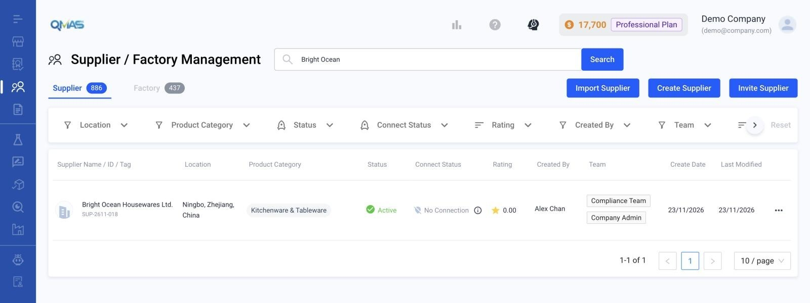
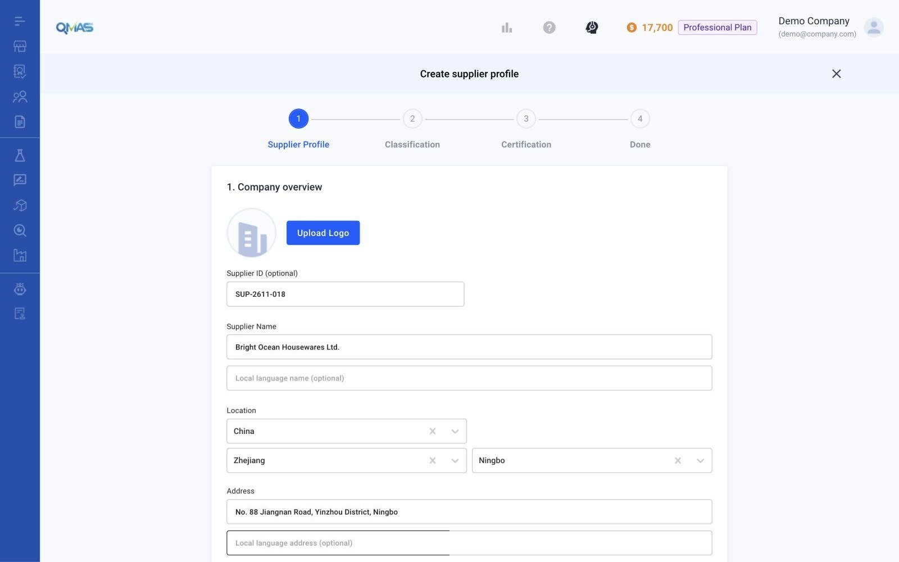
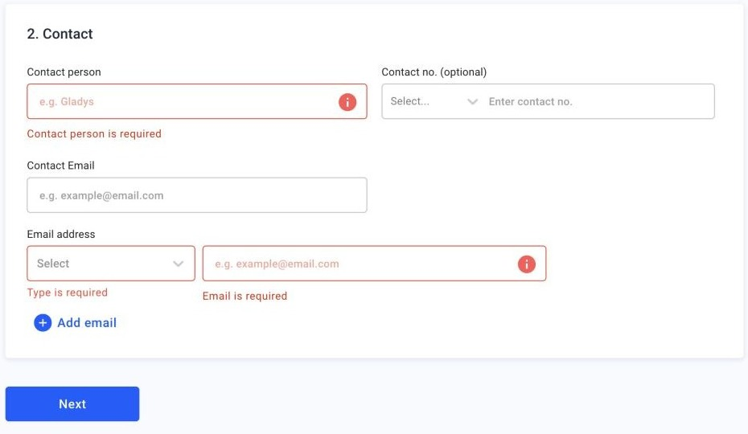
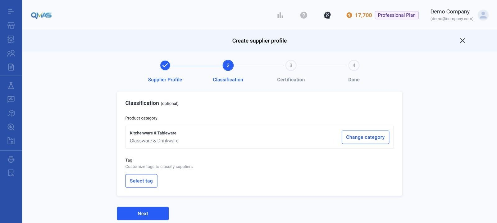
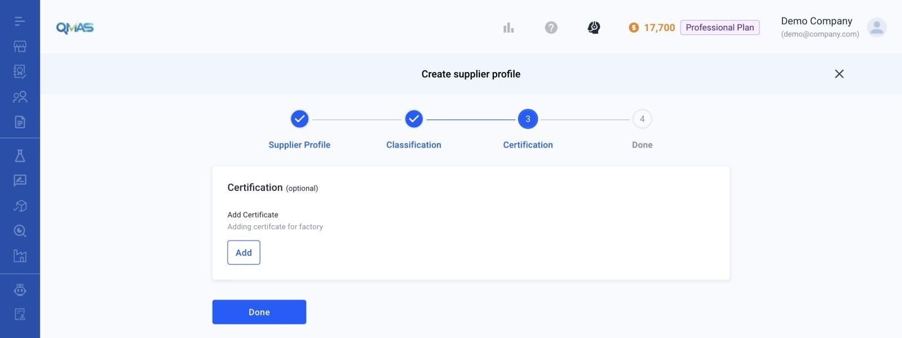
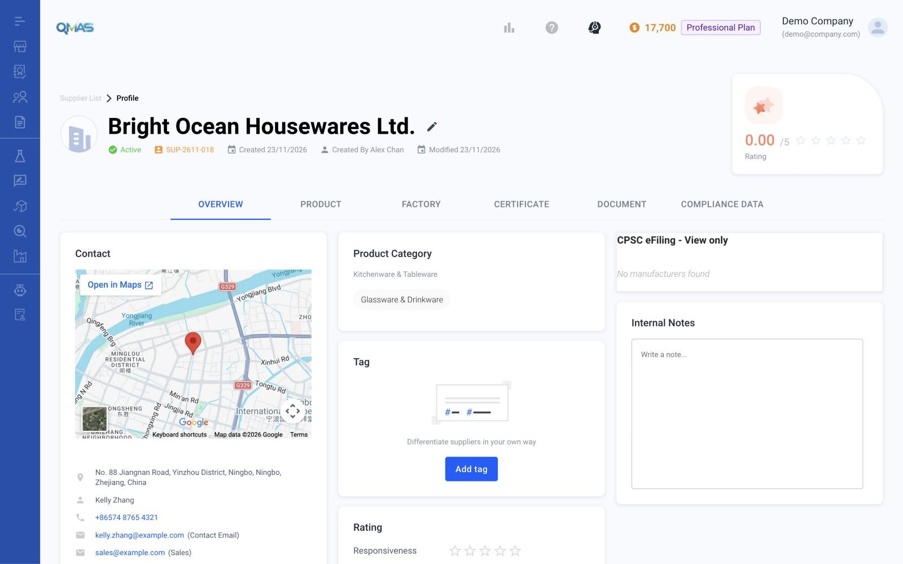

# Supplier Management — Create a Supplier

Add a supplier profile so you can link it to products, factories, documents and service jobs.

- **Module:** Supplier / Factory Management
- **Start here:** https://qmas.icw.io/supplier-manager/suppliers → **Create Supplier**
- **Direct link:** https://qmas.icw.io/supplier-manager/create
- **Steps:** 1 Supplier Profile → 2 Classification → 3 Certification → Done

## Overview

1. Open **Supplier / Factory Management**, stay on the **Supplier** tab and click **Create Supplier**.
2. **Supplier Profile**: company overview and contact.
3. **Classification** (optional): product category and tags.
4. **Certification** (optional): add certificates, then click **Done**.
5. The supplier profile opens.

## Step-by-step

### 1. Open Supplier / Factory Management

In the left menu, open **Supplier / Factory Management**. The **Supplier** tab lists your suppliers with their location, category, status, connect status and rating.

Click **Create Supplier**. You can also use **Import Supplier** to add many suppliers from a file, or **Invite Supplier** to invite a supplier to connect with you on QMAS.

*Supplier tab with Import Supplier, Create Supplier and Invite Supplier.*

### 2. Supplier Profile — company overview

- **Upload Logo** (optional).
- **Supplier ID** (optional): your own reference number.
- **Supplier Name**: English name (required) and local-language name (optional).
- **Location**: country or region, then province and city.
- **Address** and **Website** (optional).

*Create supplier profile — step 1, Company overview.*

### 3. Supplier Profile — contact

Under **2. Contact**, fill in the **Contact person**, **Contact Email** and at least one **Email address**. For each email address, choose a type: Company, QA, Sales or Other. Click **Add email** for more. **Contact no.** is optional.

*Contact section.*

If a required field is empty when you click **Next**, it turns red, for example “Type is required”, “Email is required”, “English name is required”, “Location is required” or “Contact person is required”.

*Required fields turn red when you click Next.*

### 4. Classification (optional)

Click **Select category** to choose the product categories this supplier offers. Click **Select tag** to add your own tags. Click **Next**.

*Step 2 Classification.*

### 5. Certification (optional)

Click **Add** to upload a certificate. Choose the certification type, upload the file, and fill in the rating, issue party and dates. Click **Done** to create the supplier.

*Step 3 Certification — click Add to upload a certificate, or Done.*

### 6. Done — supplier profile

The supplier profile opens. Use the tabs **Overview**, **Product**, **Factory**, **Certificate**, **Document** and **Compliance Data** to manage everything linked to this supplier. Click the pencil icon next to the name, or next to **Contact**, to edit.

*Supplier profile — Overview tab.*

*Supplier profile — Certificate tab. Click + Certificate to add one.*

## Tips

- Search the Supplier list before you create a supplier so you don’t add a duplicate.
- Consistent tags make filtering the list easier later.

## FAQ

**Q: How do I create a new supplier?**

A: Go to Supplier / Factory Management (https://qmas.icw.io/supplier-manager/suppliers), click Create Supplier, fill in Supplier Profile, then Next, Next and Done. Direct link: https://qmas.icw.io/supplier-manager/create

**Q: Can I add many suppliers at once?**

A: Yes. Click Import Supplier on the Supplier tab.

**Q: How do I invite a supplier to QMAS?**

A: Click Invite Supplier on the Supplier tab.

**Q: How do I edit a supplier?**

A: Open the supplier from the list and click the pencil icon next to its name or next to Contact.
