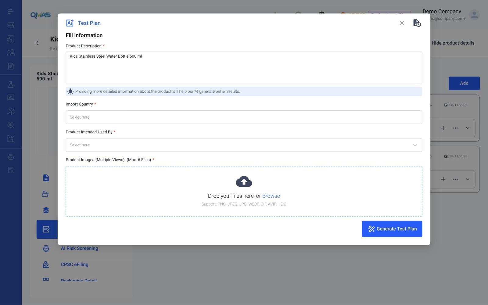

# Test Plan — Get an AI Test Plan for a Product

Test Plan uses AI to suggest the tests a product needs, based on its description, import country, intended users and photos. You open it from a product's Quality Requirement tab.

- **Module:** Product Management → product profile → Quality Requirement
- **Open:** https://qmas.icw.io/product/list → click a product → Quality Requirement → Test Plan
- **See also:** [Product Management — Every Tab of the Product Profile](product-profile.md)

## Overview

1. Open a product and go to **Quality Requirement**.
2. Click **Test Plan**.
3. Fill in the product information and upload photos.
4. Click **Generate Test Plan**.

## Step-by-step

### 1. Open Test Plan

On **Product Management**, click a product to open its profile. In the left menu, click **Quality Requirement**, then click **Test Plan** next to the title.

### 2. Fill in the information

- **Product Description** (required): describe the product. More detail gives better results. QMAS fills in the product name for you.
- **Import Country** (required): where the product will be sold.
- **Product Intended Used By** (required): who the product is for.
- **Product Images (Multiple Views)** (required): upload up to 6 photos (PNG, JPEG, JPG, WEBP, GIF, AVIF or HEIC).

*Test Plan pop-up.*

### 3. Generate the test plan

Click **Generate Test Plan**. To add tests as quality requirements, use **Add Requirement** or a template on the same Quality Requirement tab.

## Tips

- Give a detailed product description, including materials, age grade and functions, for a more accurate plan.
- Upload photos from several angles.

## FAQ

**Q: Where is Test Plan?**

A: Open a product → Quality Requirement → Test Plan.

**Q: What do I need to generate a test plan?**

A: A product description, the import country, who the product is intended for, and product photos.
